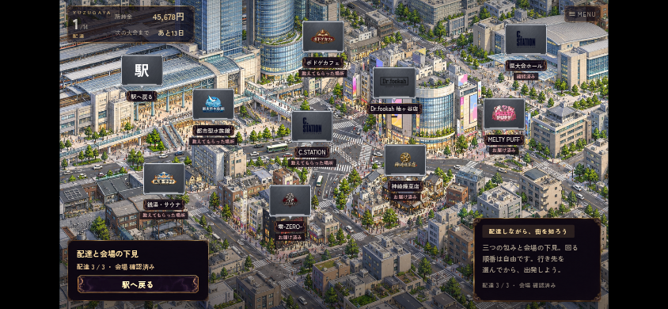
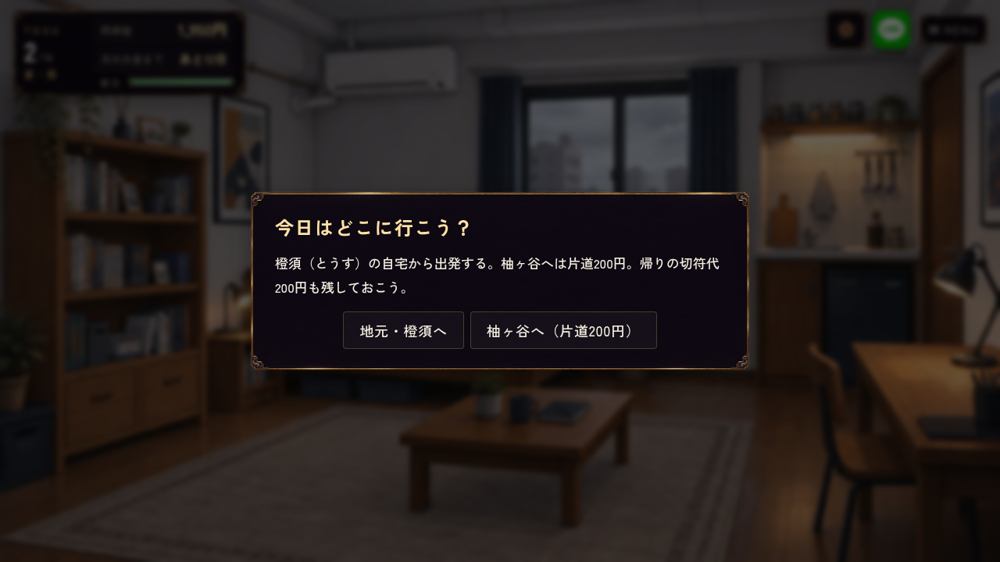

# 柚ヶ谷：背景・登場カットイン・プリクラ

Issue #921。2026-10-24 JST。このチャットで生成した画像をすべて掲載。**画像をクリック／タップして原寸で見られます。**

街名はオーナー決定の「柚ヶ谷（ゆずがや）」。内部の保存IDや過去のファイル名は変更しません。背景選定はオーナーから任せていただいたため、水族館A・TRPGバーB・銭湯A・用品店A・神崎の店Aを本編用の単独画像へ仕上げました。公開ゲームへの反映状況はPRを参照してください。

## 神崎りゅうじとはじめ：筋は通す。ぷりも撮る♡

**最新採用デザイン：53歳、色付き眼鏡と口ひげ、白の大柄チェックスーツ。** #924の正式な素材一式を参照して作り直しました。会話の立ち絵・顔アイコン・「水煙の龍」の登場絵も同じデザインへ更新しています。

筋を通す職人がMELTY PUFFへ挨拶に来た回。面識と実際の在店が揃った時だけ、相席相手として一緒に撮れます。指ハートも本気。撮影後は無料の記念品になります。

旧デザインの比較用画像（本編では使いません）

## あげはとはじめの初プリ：ギャル落書き・盛れた顔

MELTY PUFFの初回サービス。正式立ち絵を参照し、盛れた瞳・キラキラ・ギャル文字と豹柄を追加した最終版。記念品として見返せる実装です。その後の来店では撮らない／一人／あげは／その場にいる面識のある相席相手を選べます。

最初の版・キラキラを増やした途中版も見る

## 店のロゴ

MELTY PUFF・神崎煙草店・零-ZERO-は既存の正式ロゴ。Dr.fookahとC.STATIONの柚ヶ谷店は本店と共通の正式ロゴを使います。ボドゲカフェ／TRPGバー・水族館・銭湯の分を新規生成し、マップと店内の案内へ反映しています。

## シーステーション 柚ヶ谷店

1章の青緑ソファ・木材・黒い天井・暖かい照明を継承。左のボックス席、右奥の曲線カウンター、駅前の高架が見える窓で違う支店にしています。県大会ホールと同じビルの店舗ですが、地図の行き先と訪問は別です。

## ゲーム画面：街の発見と朝の行き先選び

作業ブランチの実画面です。本番への反映とは別に確認できます。

## 本編用に選んだ背景

### 水族館：都会の窓と大水槽

### TRPGバー：地下の物語サロン

### 銭湯：富士山タイル・サウナ・シングル水風呂

### Dr.fookah 柚ヶ谷店：明るい支店とストロベリー売場

### 神崎煙草店：事務所風とホースなしの台

## 登場カットインの実画面

正式立ち絵を維持し、人物・名前・二つ名・台詞をゲームで合成したプレビュー。りゅうじ／零は従来の幾何学背景から第1章と同じイラスト方式へ接続。あげはの既存採用カットインは保持。

## 比較候補の全一覧

各背景シートは**上からA・B・C**です。以下は制作・選定の履歴です。

## 水族館

A：大水槽と都会の窓 ／ B：クラゲの展示 ／ C：水中トンネル

[原寸で開く](candidates/aquarium.png)

## TRPGバー／ボドゲカフェ

A：高架下の隠れ家 ／ B：地下サロン ／ C：夜景の見えるカフェ

[原寸で開く](candidates/trpg.png)

## 銭湯・サウナ

A：富士山のタイル絵 ／ B：黒い石と青い水風呂 ／ C：昔ながらの銭湯

[原寸で開く](candidates/sento.png)

## Dr.fookah 柚ヶ谷店

A：明るい白とミント ／ B：黒と真鍮 ／ C：コンパクトな駅前店

[原寸で開く](candidates/shop.png)

## 神崎煙草店：ホースなしの台を追加

A：正面・左右の低い机 ／ B：斜めの構図 ／ C：暖色の夜

[原寸で開く](candidates/kumicho-room.png)

## りゅうじ登場カットイン：背景案

竜・ドラゴンフルーツ・トング・湯気。人物と名前はゲーム側で重ねる。

[原寸で開く](candidates/cutin-kumicho.png)

## 零登場カットイン：背景案

ギター・薔薇・CD・さりげないTRPGのダイス。人物と名前はゲーム側で重ねる。

[原寸で開く](candidates/cutin-rei.png)

## 将来候補：ゲーセン

今の街歩きは水族館へ変更済み。オーナー「ゲーセンももしかしたら使うかも」により、将来候補として保持。今回マップには追加しない。

[原寸で開く](candidates/arcade-withdrawn.png)

## 制作記録

生成はimage_gen。元PNGを保持し、新規画像はGit LFS。実際の生成指示は[prompts.json](prompts.json)、実寸・SHA256・状態は[metadata.json](metadata.json)。配信用はWebPに変換。人物PNGは描き直さず正規素材を使用。神崎の店の台は準備前なのでボウル・HMD・炭・ホース・ハンドルなし。比較時点の旧地名を含む指示は履歴で、画像には街名を描いていません。

## 別作業の神崎・部下の画像も見る

[神崎の新衣装・年齢案・白チェック衣装一式・部下の立ち絵と登場案](https://github.com/haseatsu114514-dot/shisha-game/blob/codex/ryuji-yakuza-designs/asset_sources/portraits/kumicho-yakuza-concepts/README.md)
