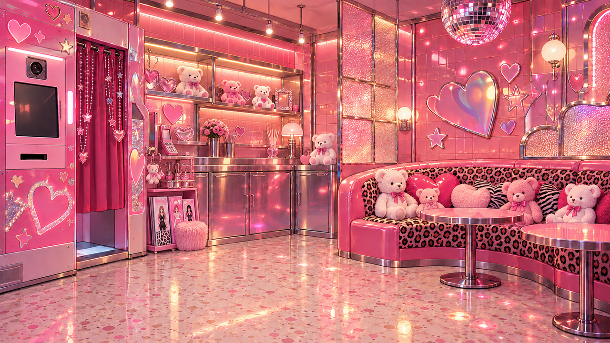

# 閉店後のMELTY PUFF（#563 / #929 A2）

第2章末、あげはの心の声のための閉店後差分。通常営業中の夜とは区別する。昼夜の通常訪問・営業時間・台詞・報酬は維持する。

| 営業中の採用室内 | 閉店後の差分 |
|---|---|
|  |  |

同じ部屋のプリクラ機・閉じた収納・クマ・豹柄ソファ・丸卓を参照し、主照明を消した静かなマゼンタと紫の影へ編集。人物・シーシャ台・露出したフレーバー容器は追加していない。内蔵画像生成1回。無加工原画 [source.png](source.png) は1672×941 RGB。1280×720 WebPへ一様縮小・変換した。参照・SHA256・変換は [generation.json](generation.json)。

家具の配置、床と天井の照明差、追加人物・文字がないことを目視。生成編集のため元画像との画素完全一致は保証しない。閉店後の画像を営業中の全訪問へ広げない。

実会話の確認: [PC](qa/pc.png) / [844×390横タッチ](qa/touch.png)。背景デコード・会話枠との合成を確認。実機スマホは未実施。
