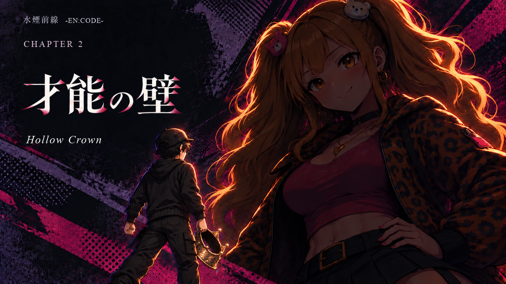
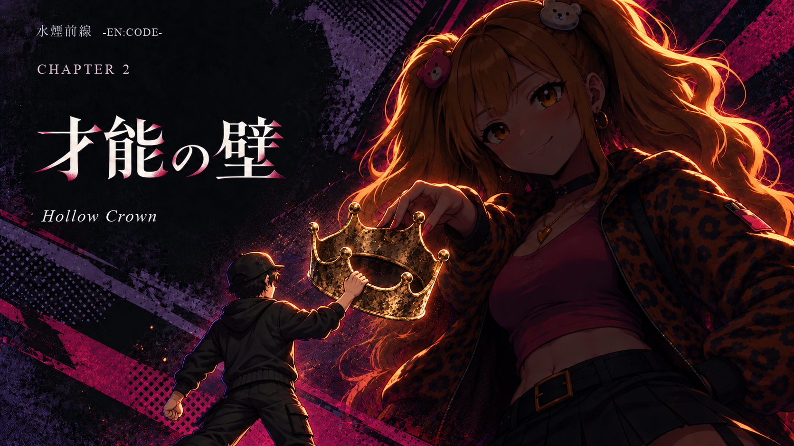
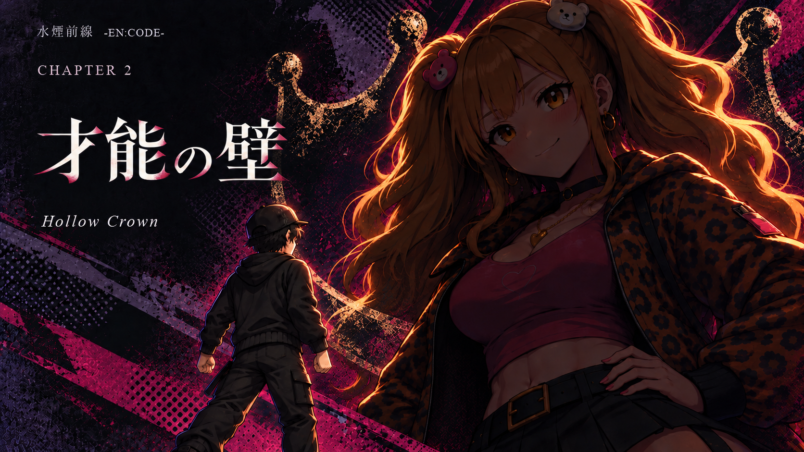

# 第2章「才能の壁 — Hollow Crown」王冠の構図比較

2026-10-13、Issue [#549](https://github.com/haseatsu114514-dot/shisha-game/issues/549)。**案C（背景の王冠輪郭）採用決定。**

オーナーは第2章に「Hollow Crown」を移す方向を選び、先行案の王冠の位置について「いまいち」「王冠をうまいこと盛り込んで何個か案欲しい」と依頼した。既存の大きなアゲハと小さなはじめ、桃色・紫・黒の背景を保ち、王冠の意味と置き方を変えた3案を保存する。

| 案 | 構図 | 読み取れる意味 | 比較時の留意点 |
|---|---|---|---|
| A | はじめが王冠の縁を持ち、脚の横へ下げる | 優勝しても目の前の才能の壁は残る。称号を得た後の重さ | 王冠は小さめ。縮小時にはBより目立たない |
| B | はじめの手と影のアゲハの指が一つの王冠をつかむ | 称号をめぐる競争と才能への焦り | アゲハ自身の悪意ではなく、はじめが感じる大きさを表す。奪う／渡すのどちらにも読める点は選定時に確認する |
| C | 巨大な王冠の輪郭を背景の印刷風テクスチャへ溶かす | 二人と競争そのものを王冠の内側へ置く | 象徴性が強く、具体的な行動はA・Bより弱い |

## A — 手に入れた王冠

## B — 同じ王冠に伸びる手

## C — 背景に刻まれた王冠

## 参照・生成・確認

- 生成: `image_gen.imagegen` による参照画像の編集。画像の画素を外部スクリプトで加工していない。
- ベース: [`default-ch2.png`](../ch2-5-style-studies-385-20261013/type-polish/images/default-ch2.png)。既存採用絵の構図・塗り・人物の比率を優先。
- 本人: [`ageha`](../../../assets/sprites/characters/ageha/chr_ageha_normal.png)、[`hajime`](../../../assets/sprites/characters/hajime/chr_hajime_normal.png) の正式立ち絵を実際に開いて参照。
- 王冠の形状: 旧第3章用 [`default-ch3.png`](../ch2-5-style-studies-385-20261013/type-polish/images/default-ch3.png)。この参照は第3章題の継続採用を意味しない。
- 適用資料: `docs/asset_ai_guidance.md` と `asset_sources/shisha-hardware-reference/heroine-title-cg-rules-20261009.md`。シーシャ機材は描かないため、機材モデル・HMD・ホースの検査は対象外。
- 完全な生成指示: [`A`](prompts/A.txt)、[`B`](prompts/B.txt)、[`C`](prompts/C.txt)。参照のハッシュ・出力寸法・画像ハッシュ・確認結果は [`manifest.json`](manifest.json)。
- 生成後に3案を目視確認。アゲハの顔・髪飾り・衣装、はじめの服装、王冠と手の接触、文字の可読性を確認した。Bの人物の縮尺差、Cの王冠と人物の重なりは意図した構図。最終選定後、実際のタイトルコール寸法で再確認する。

## 先行案と採用状態

[`previous/floating-crown.png`](previous/floating-crown.png) は「王冠の位置を再検討」となった先行案。採用候補A〜Cと区別する。

2026-10-19、オーナー指示により **C（背景の王冠輪郭 / `images/C-crown-background.png`）の採用が決定**。第3章題は『嘘つきたちの夜 / SMOKE AND MIRRORS』が決定した。

本編タイトルコール（1280×720）への接続として、案Cから1280×720の正式PNG（[`images/C-crown-background-1280x720.png`](images/C-crown-background-1280x720.png)）を生成し、配信アセット [`remake/img/ui/chapters/ch2-title.webp`](../../../remake/img/ui/chapters/ch2-title.webp) へロスレスWebP形式（method=6、寸法1280×720一致、全画素検証済み）で反映した。`remake/js/core/chapter-title-art.js` および `remake/js/chapters/ch2.js` の読み表示を `ホロウ・クラウン ── Hollow Crown` へ更新した。

物語・台詞の大幅な改稿および共同制作向け資料（Issue #544）の改稿は今回混ぜず、今後の残作業として整理する（[`docs/archive/plans_story_revision.md`](../../../docs/archive/plans_story_revision.md) 参照）。
