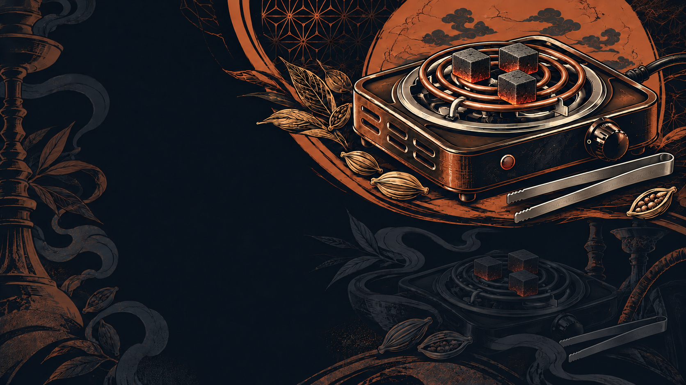
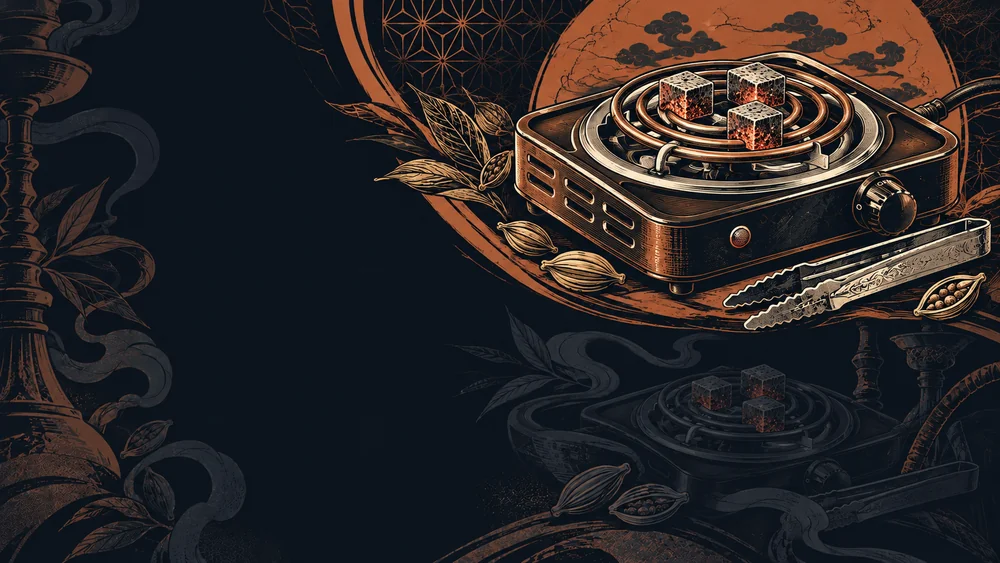

# Sumi cut-in charcoal burner candidate — Issue #750

Unadopted candidate from **one** built-in image generation. The existing background remains in use. This PR stores source material for owner review; it does not change game assets, text, layout or manifest.

| Current background | Candidate v1 |
| --- | --- |
|  |  |

The upper-right bowl and oversized charcoal motif became a low electric charcoal burner with a supported spiral coil and three coals. Copper, ivory and deep navy print colors and the dark portrait/quote fields remain. The faint lower-right equipment repeat was also updated.

**Review limitations:** ornate tongs remain despite the plain-tool request; charcoal retains pronounced pores; the complete power-lead route is not visually verifiable. This is a proposal, not an adoption or full-specification pass. Runtime composition with the portrait/name ribbon/quote, PC/touch playthrough and publication checks are unrun. No further generation is authorized here.

`source-v1.png` preserves generated bytes (1672×941 RGB, 2,423,241 bytes). `preview-v1.webp` is a display conversion only. `prompt.txt` is the exact submitted prompt. `generation.json` records reference roles, hashes, one-call history and visual QA. The external real-product photograph was used only to understand equipment structure and is not redistributed. Source URL is in the record.

Claim: worker `codex-sumi750-task7-20261020-4e5c9d21`, [successful run39399838135](https://github.com/haseatsu114514-dot/shisha-game/actions/runs/39399838135), `CLAIMED_ISSUE=750` and current bot owner/run verified. Base main: `df3d9897b94a9f4d8e5a628ebb85b890ba7255a9`. API-only save; local root/hooks/Git Safety scripts are not applicable. The commit uses `[skip ci]` to avoid new large CI. No CI/test success is claimed.

Next: owner compares current and candidate. Adopt only after explicit selection, then separately verify runtime cropping/readability/fallback/reduced motion before integration. Issue #710's opening art and salaryman work, #564's title/text and all existing originals remain untouched. Do not merge this candidate PR as a runtime release.
