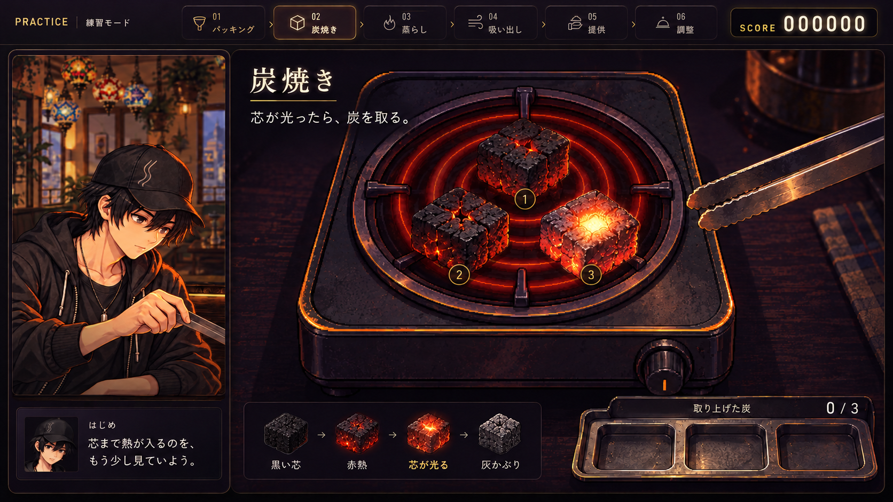
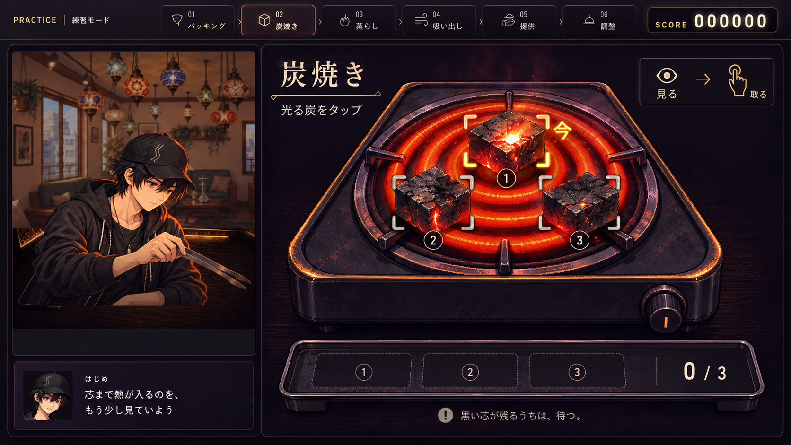
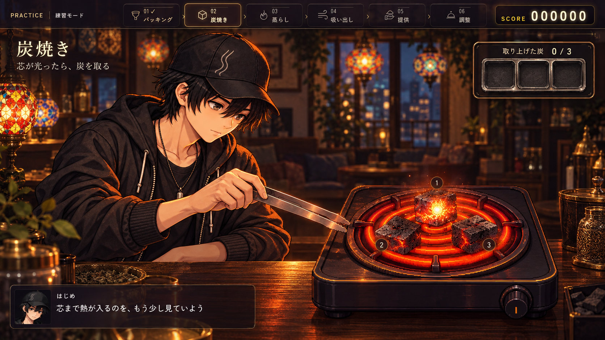

# 炭焼きUI — 改造モックアップ3案

コンロにある炭を、芯が光る頃合いで一つずつ取る。**この遊びを残し、炭の存在感・操作の読みやすさ・取り上げた手応えを改善する提案。**

[3案の比較ページ](index.html) ／ [比較画像](comparison.png) ／ [現行画面](current-heat.png)

このフォルダーは採用前の静止モック。画像の文字・発光・手や機材の位置は構図の提案で、実際の判定・操作・動画ではない。本編への接続はしていない。

## 推奨：Aを土台に、Bの押しやすさを取り込む

| 案 | 見せたい体験 | 主な変更 | 改修規模の目安 | 向く目的 |
|---|---|---|---|---|
| **A：熾火クローズアップ** | 熱い炭をトングで取り上げる手応え | コンロの寄り画、炭の質感、局所的な芯の光、回収皿 | 中 | 見た目と遊びの気持ちよさを両立 |
| **B：スポットガイド** | どの炭をいつ押すか迷わない | 炭を離して配置、広い当たり領域、番号・形・「今」の合図 | 小〜中 | 初見・タッチ操作の分かりやすさ |
| **C：ワンシーン演出** | はじめと同じ作業台で炭を焼く | 左右の別枠を統合、店内・手・コンロの共通構図、控えめなHUD | 大 | シーシャ屋で作業する雰囲気 |

工数は相対比較。実制作の日数や予算は未見積もり。

### A：熾火クローズアップ

- 主役をコイルから炭へ移す。コイルを暗い赤に抑え、灰・赤熱した割れ目・芯の一点の光を分ける。
- はじめの作業風景を残し、操作側は寄り画にする。説明は「芯が光ったら、炭を取る」の一行。
- 押した瞬間に判定し、炭がトングで持ち上がって回収皿へ収まる。残り個数が見た目で減る。
- 成功の光・火の粉は取った炭の周囲に限定する。次の炭を観察し続けられる。

**長所：** 現行の画面構造を活かしながら、しょぼく見える部分を直接改善できる。

**注意：** 大きい発光で炭の色を隠さない。トング演出はほかの炭への入力を止めない。

### B：スポットガイド

- 同じコンロ上の炭を、押す領域が重ならない三角配置へ広げる。
- 炭ごとの番号と控えめな角括弧で、操作できる物が一目で分かるようにする。
- ジャスト中だけ、芯の光に加えて角括弧と「今」を出す。色だけに頼らない。
- 説明・進行・回収結果を短くまとめる。押す対象は炭そのものに揃える。

**長所：** クリック対象とタイミングが読みやすく、スマホ横持ちでも押しやすい。

**注意：** 合図が明確な分、見極める感覚が薄くなる可能性がある。初心者向け表示として切り替える案も検討する。新しい予告秒数・ゲージは足さない。

### C：ワンシーン演出

- はじめ、トング、コンロを一つの店内・作業台に収める。
- 操作UIを小さくし、実物を見て炭を取る構図にする。会話欄は炭を覆わない位置へ置く。
- 手元の光やトングの動き、皿へ置いた音で作業している感触を出す。

**長所：** 作業風景と操作のつながりが最も強く、独立したミニゲーム感を減らせる。

**注意：** 人物・手・トング・コンロの遠近と縮尺を揃える素材作業が必要。採用済みの本人の絵を基準に、レイヤー化と当たり領域の再設計が必要になる。生成モックの構図を、そのまま本編素材に採用しない。

## 現行画面で確認した課題

現行 `remake/js/craft/heat.js` とCSSを読み、実際の炭焼き画面を1280×720で表示して撮影した。

1. コイルの鮮やかな赤・橙が強く、炭の焼け具合と芯の光が埋もれやすい。
2. 炭は平坦な面の立方体に見え、熱・灰・表面の凹凸が伝わりにくい。
3. 焼け方の説明、判定用の帯、各炭の成績カードが下に並ぶ。炭と説明の間で視線が移る。
4. 取り上げた炭は上へ移動して薄くなる。回収した場所や残り個数を物として見せる余地がある。

## 3案で共通に守る仕様

- 「見て待つ → 芯が一瞬光る → その炭を直接取る」を維持する。ゲージ停止・裏返し・火力調整・ドラッグを新しい必須操作にしない。
- 炭ごとの焼ける速度、既存の6段階判定、ジャスト幅、体調・能力・チュートリアル補正を維持する。Bの「今」は実際のジャスト判定と同じ状態から出す。事前の合図は既存の洞察補正を越えて一律追加しない。
- 早くても遅くても取れる。合図が出るまで入力を無効にしない。
- 入力時刻で先に判定し、取り上げる絵や音はその後に再生する。演出中も次の炭を取れる。
- 回収枠には各炭の評価と「0.07秒早い／遅い」のような既存の誤差を残す。操作中は短く、終了後に全体精度・平均誤差を詳しく見られるようにする。判定文字は生きている炭に重ねない。
- 最初の炭焼きと調整時の交換1〜4個に同じ表示を使う。今回のモックは基本の3個。4個時の重なり・1個時の余白は採用案の実装時に検証する。
- SCORE・既存採点・焼け具合の後工程への効果・初回結果と交換結果の分離・セーブを維持する。
- 発光は局所に絞る。動きを減らす設定では持ち上げ・火の粉・揺らぎを静的な切替へ置き換える。

## 採用後の最初の実装単位

1. Aの寄り画・回収皿を土台に、Bの重ならない当たり領域とフォーカス表示を加える。
2. 炭の見た目と芯の光を、既存の判定状態に結び付ける。操作中の情報は炭・短い説明・回収結果へ集める。
3. 実入力で早取り／ジャスト／遅取り、同時に焼ける炭、交換1〜4個、PC／横持ちタッチ、動き軽減、画像準備前の時計、保存状態を確認する。

本編実装は採用案の選定後の別作業。この提案で `heat.js`・本編CSS・台詞・難易度を変更していない。

## 制作・確認記録

- 調査元：`main` 936c95a の炭焼き。保存ブランチは最新 `origin/main` cd74559 から開始。対象の炭焼きコードと制作ルールに差分なし。
- 現行画面：`current-heat.png`。自主練の既存 `runHeat` を直接起動し、炭焼き開始後の時計だけ撮影用に固定。ブラウザーのpageerrorは0。本編進行の通しQAではない。
- ビジュアル：画像生成による静止デザイン。現行画面、採用済み `hajime_craft_heat.webp`、`stove_coil.webp` を参照。ピクセルペインター調、既存人物、コンロ上の三角3炭、機材・台を追加しない条件で制作。
- [生成条件の記録](generation-notes.md)。PNGは原画を保存。比較ページはこれらの画像を表示するだけで、プレイ可能な炭焼きではない。
- Aはコイルの赤が強かった初版を見直し、コイルの発光だけを抑えた修正版。初版3案は `iterations/v1/` に保存。
- [表示確認](qa.json)：ChromiumでPC・横持ちタッチ・縦持ちタッチの比較ページを確認。3案の切替、キーボード、拡大／閉じる、一覧表示、画像の読み込み、横方向のはみ出しを確認し、pageerror・HTTPエラーは0。本編の操作QAはこのモックの確認に含まない。
- WORKER：`codex-coal-mockups-20261013-b0d54e25` ／ Issue [#503](https://github.com/haseatsu114514-dot/shisha-game/issues/503)。
- 予約：claim run `38350757850` SUCCESS、status run `38350959189` SUCCESS。Issue・worker・source run一致をログで確認。
- 採用判断、本編の接続、実機スマホ／Safariでの操作検証は未実施。
