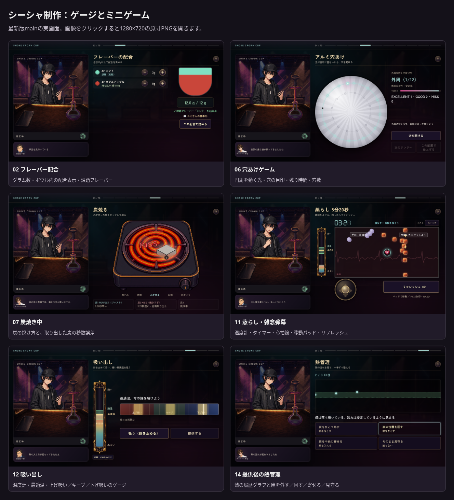
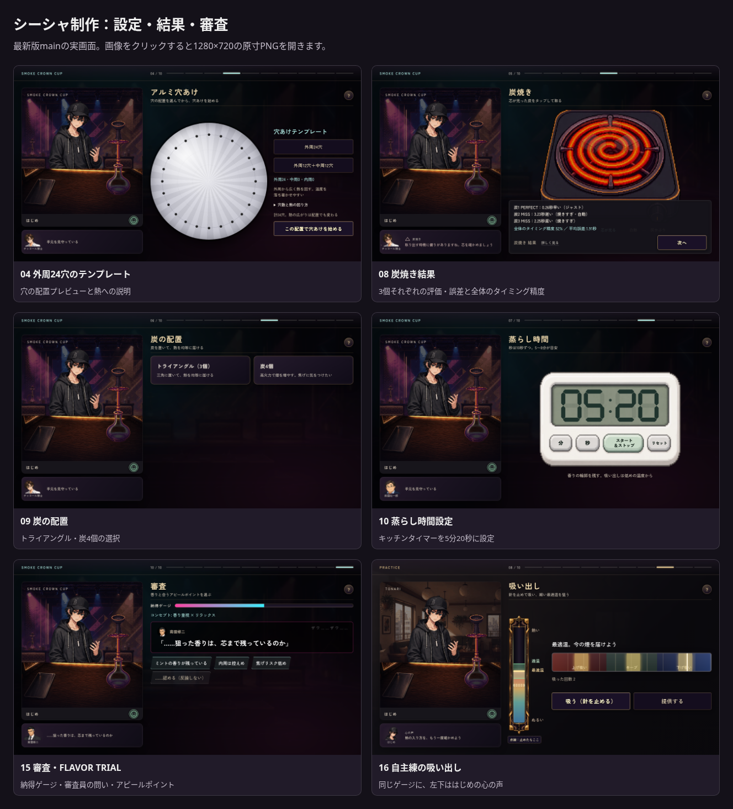

# シーシャ制作画面のスクリーンショット

PR #241がマージされたmain `9b2f20a1df30a2e80ba8a1c50e5c37487888d78f` の実画面。2026-10-09にChromiumで撮影。原寸はすべて **1280×720**。

[16枚のギャラリー](gallery.html) · [全画像・ギャラリーのZIP](shisha-crafting-screenshots.zip) · [撮影時の確認記録](capture-validation.json)

ゲージとミニゲームの比較：



設定・結果・審査の比較：



| 画面 | 見えるもの |
|---|---|
| [01 コンセプト選択](01-concept.png) | 香り重視・リラックスの選択 |
| [02 フレーバー配合](02-mix.png) | グラム数、配合の図、課題フレーバー |
| [03 パッキング](03-pack.png) | ふんわり・ノーマル・かため |
| [04 外周24穴のテンプレート](04-holes-template-outer24.png) | 配置プレビュー、熱への説明 |
| [05 外周12＋中周12穴のテンプレート](05-holes-template-outer12-middle12.png) | 2周の配置、熱への説明 |
| [06 穴あけゲーム](06-holes-game.png) | 動く光、穴の目印、残り時間、穴数 |
| [07 炭焼き中](07-heat-game.png) | 炭の焼け方、取り出した炭の秒数誤差、左下の実況 |
| [08 炭焼き結果](08-heat-result.png) | 3個それぞれの誤差・評価、全体のタイミング精度 |
| [09 炭の配置](09-coal-place.png) | 三角配置・炭4個の選択 |
| [10 蒸らし時間設定](10-steam-timer.png) | 5分20秒に設定したキッチンタイマー |
| [11 蒸らし・雑念弾幕](11-steam-game.png) | 温度計、残り時間、心拍線、弾幕、移動パッド、リフレッシュ |
| [12 吸い出し](12-pull-game.png) | 温度計、最適温、上げ吸い・キープ・下げ吸いのゲージ |
| [13 吸い出し結果](13-pull-result.png) | 工程評価とコメント |
| [14 提供後の熱管理](14-heat-care.png) | 温度履歴のグラフ、炭を外す・回す・寄せる・見守る |
| [15 審査・FLAVOR TRIAL](15-flavor-trial.png) | 納得ゲージ、審査員の問い、アピールポイント |
| [16 自主練の吸い出し](16-practice-pull.png) | 同じゲージと、左下のはじめの心の声 |

## 撮影条件と確認

工程ごとの開始状態を独立したブラウザセッションに用意し、本番モジュールで描画。大会は体力80・天候シード4、コンセプトは香り重視＋リラックス、配合はダブルアップル9g＋ミント3g、ノーマル詰め・三角配置・蒸らし5分20秒を前提とした。吸い出しと熱管理の開始には蒸らし温度0.54・被弾0の工程状態を用意。審査員の呼び名が見えるよう撮影セッションでは会った状態にした。

配合・穴あけ・炭の取り出し・タイマー・吸い出し・炭を回す操作は、実際のボタンと本番の針・時間・採点処理を使用。各画像は独立した工程の例で、16枚が一続きのプレイ結果を表すものではない。原寸PNGへ文字やゲージを合成していない。比較一覧はそのPNGを並べたHTMLをブラウザで撮影した。

フォント・画像の読み込みと場面切り替えの終了を待ち、全16枚で旧実況フッター0・場面切り替えの幕0・ブラウザの実行エラー0を確認。ゲームのコード・台詞・素材の変更はない。

撮影を再現する場合は、リポジトリのルートからプレビューを起動し、別のターミナルで撮影する（Node.js、Playwright、Chromiumが必要）。撮影先はこのフォルダ。

```sh
python3 remake/tools/serve_preview.py --port 8123
```

```sh
node tools/browser/craft_screenshots_capture.cjs
```

別URLには `BASE_URL`、Chromiumのパスには `CHROME_EXECUTABLE_PATH` を指定できる。ZIPを展開すると、ギャラリーから各原寸画像を開ける。
