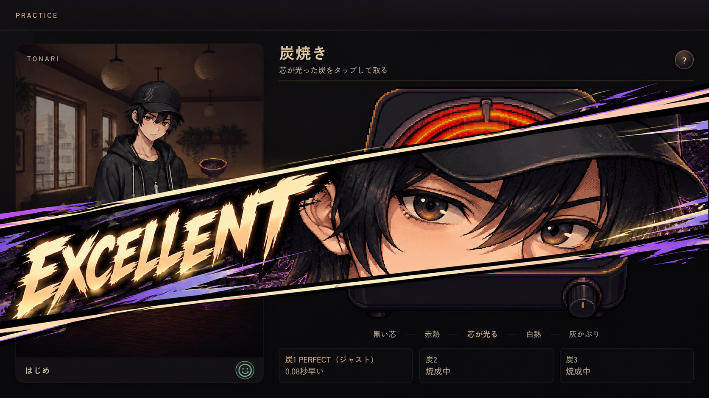
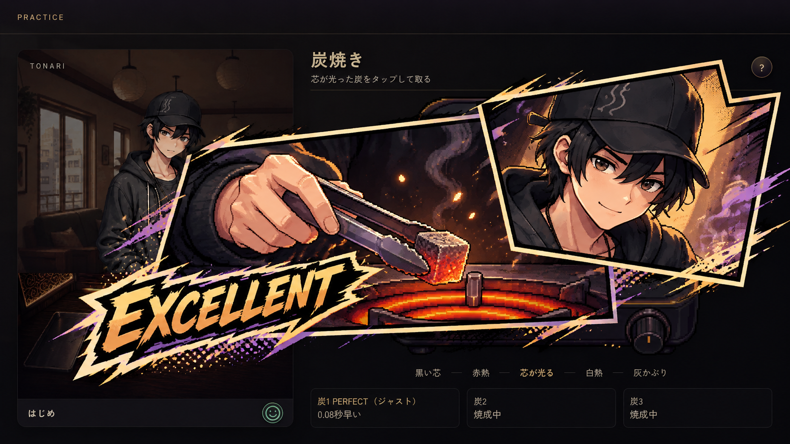

# 制作成功カットイン・2案の比較（2026-10-08）

オーナーの依頼：「シーシャ作りパート全般で上手く行った時のカットイン」「目元メインのやつか漫画のコマみたいなの」「モックアップをみたい それぞれ」。

同じ炭焼きの成功場面・主人公はじめを参照して作った、画面全体の静止モックアップ。本編の成功条件、採点、操作、演出は変更していない。採用案は未決定。

| 案 | 画像 | 表現 | 向いている使い方（提案） |
|---|---|---|---|
| A：目元 | [eyes.png](eyes.png) | 両目を大きく見せる斜めの帯。黒・紫・ラベンダーと小さな炭の暖色 | 工程共通の大成功演出。顔の素材を共用し、0.4〜0.6秒ほどで短く切れる |
| B：漫画コマ | [comic.png](comic.png) | トングで炭を取る手元と、はじめの笑顔の2コマ | 工程完了の見せ場。詰め・穴あけ・吸い出し等では手元の絵を差し替え、0.7〜1.0秒ほど見せる |

上記秒数・使い分けは検討用。アニメーションはまだ作っていない。目元案を基本に、工程完了の大成功だけ漫画コマを使う併用案も可能。頻度の高い穴あけの各穴などへ毎回出すかは別途検討する。

## 原画と参照

- 生成指示：[eyes-prompt.txt](eyes-prompt.txt)、[comic-prompt.txt](comic-prompt.txt)。既存の作りパートのスタイル指針を先頭に保持し、比較用スクリーンショットの文字・UIについてだけ例外を明記。
- 参照ゲーム画面：[references/craft-success-screen.png](references/craft-success-screen.png)。PR #231の実装コミット `4d1a935a02c77924e1a5de597a4b20a6f8a3c5f4` の制作画面を実際にChromiumで撮影。炭1のPERFECT／0.08秒早いを表示した状態。ゲームは新しい2案のカットインをまだ表示しない。
- 参照人物：[references/hajime-serious.png](references/hajime-serious.png)。現在の `assets/sprites/characters/hajime/chr_hajime_serious.png` と同じPNG。採用済みのキャップ・黒髪・目・衣装を基準にした拡大イラストで、通常立ち絵の差し替えではない。
- 生成原画をそのまま `eyes.png`／`comic.png` へコピー。ツールの原画は削除せず、GitHubにも保存。出力は各1672×941px。これは比較原画のサイズで、実装用の1280×720／透過レイヤーの書き出しは未実施。
- Gitの作業ブランチは最新 `origin/main` の `fa3d7fd1f7c2e3e6be2815a9a7f9220390109b05` から開始。画像・文書だけを追加し、PR #231のゲーム実装はこのブランチへ複製しない。

## 確認

目視で2案の違い・はじめの顔と衣装・成功動作・ゲーム画面の上部と下部の表示を確認。PNGの読み込みと出力原画のバイト一致を確認済み。寸法とSHA256は [validation.json](validation.json)、実画面撮影のブラウザエラー0は [references/capture-validation.json](references/capture-validation.json)。

本番 `assets/`・`remake/`・`data/` は未変更のため、画像manifestの再生成やゲームの回帰テストは今回不要。
