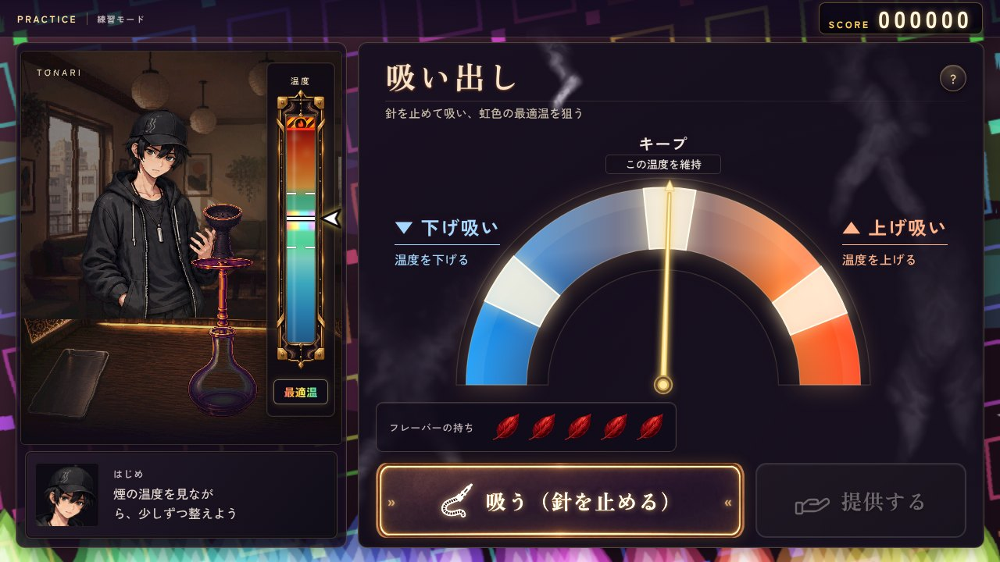
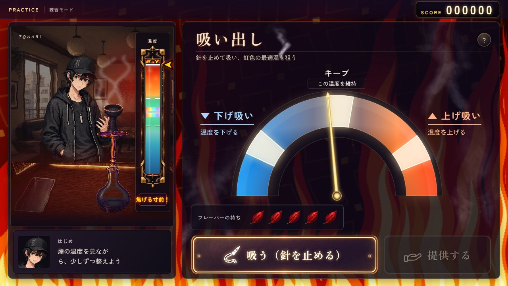
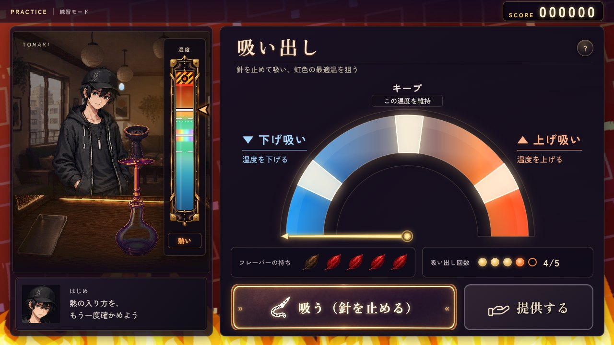
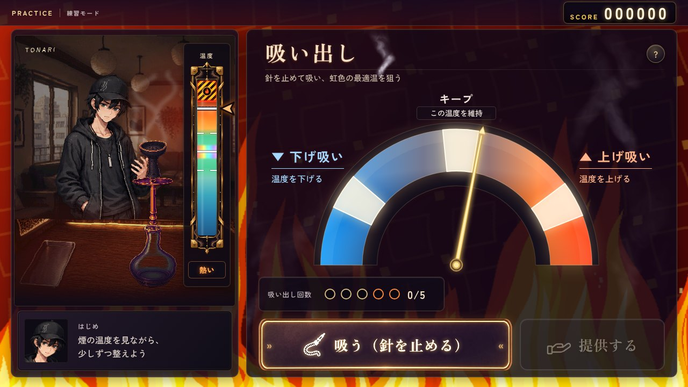

# 制作UIのモックアップ反映（TH47〜82）

[オーナー提示のゲーム部分](reference-game.png)を参照し、採用済みの人物・店舗・機材を使って実ゲームの吸い出し・熱管理画面を更新した。背景画像は追加せず、既存の温度アニメーションを使用する。

左ウインドウはx20・幅424、右はx458・幅802、両方ともy54〜702。下の外側余白を30→18px、ボタン下を24→12pxへ狭めた。左に作業風景・独立した温度計の枠・セリフの内枠を置き、右下に高さ96pxの操作ボタンを並べる。顔の体調バッジは廃止し、疲れは人物の表情・汗で示す。セリフ内枠を左右へ6px離し、内側12px、顔と本文の間18pxを確保。顔は82pxの枠で採用済み顔アイコンと同じ頭部を原画から切り出すため、胴体の中心へ寄らず表情差分も維持する。話者名は本文の上、本文は16pxで短い内心の行長を均等にした。

半円はSVGの縦横比を保った真円。中央を軸にした細いワイパー式の針が同じ円周をなぞる。左は下げ吸い、右は上げ吸い。画面の説明に吸引の長さ・強さは書かない。

虹色の最適温は0.51〜0.57（適温帯の37.5%、旧幅の3.75倍）。見た目と最適温の判定を同じ範囲に広げた。上下の端を周囲のミントへなじませ、中央の白線は1pxで残す。温度計の本体は幅64px・高さ360pxで、背後の枠に左右12px、下16pxの余裕を取る。状態表示は管の12px下、予測線は細い点線にした。

葉は写真の葉色だけを参考にした赤へ更新し、TH78で過剰な発光を外して自然な輪郭・葉脈・短い葉柄が見える素材へ再制作。赤い葉5枚で始まり、無傷の回数を超えた一口ごとに、使用中の1枚だけが赤→茶色→黒→消えると進む。消えるまでは次の赤い葉を傷めず、予備の葉は赤のまま。最後の赤が茶色になって赤い葉が0枚になると失敗する。使用中の葉の段階と赤の残数は吸い出しから熱管理へ引き継ぐ。旧5回上限を撤去し、最低・無傷の回数（吸い出し2／3・熱管理1／2）と吸いすぎの採点減点・体力消費は維持。

「吸いすぎると〜」の注意書きと小ウインドウ、持ち欄の右の回数の点は廃止。持ちの枠は高さ64px・幅約385pxでラベルと5枚が収まる幅へ縮めた（炭・雨・少穴の札があるときだけその幅を追加）。「吸う」はホースと硬い吸い口、「提供する」は掌を上にして差し出す手の線画。操作面を暗い紫に整え、金縁ボタンも細い縁と控えめな発光へ再制作した。既存の背景アニメーションは外側に残し、過熱時は従来どおり操作面から炎が透ける。

| 実画面 | 内容 |
|---|---|
| [01-pull-desktop.png](01-pull-desktop.png) | 1280×720。枠・ボタン・半円と針・温度計・セリフ欄・葉の配置。 |
| [02-up-drawing.png](02-up-drawing.png) | 右の上げ吸いを止めた一口の途中。針は固定、左の水泡が動き、温度が徐々に上がる。 |
| [03-down-drawing.png](03-down-drawing.png) | 左の下げ吸いを止めた一口の途中。温度が徐々に下がり、吸い終わるまで両ボタンを無効化。 |
| [04-pull-mobile.png](04-pull-mobile.png) | 844×390の横向きスマホ。16:9の作業台と操作領域を画面内に収める。 |
| [05-optimal-rainbow.png](05-optimal-rainbow.png) | 最適温0.54。広い虹色と中央の白線、温度が合ったときの発光と表示。 |
| [06-refined-controls.png](06-refined-controls.png) | 2回吸い終えて提供可能。ホースと差し出す手、赤い葉・注意書きなしの持ち欄、セリフと温度計の余白。 |
| [07-charred-leaves.png](07-charred-leaves.png) | 最初の1枚だけが黒く焦げ、次の4枚は赤いまま。人物の疲れも進む。 |
| [08-next-red-leaf.png](08-next-red-leaf.png) | 吸い出しの黒い葉を熱管理へ引き継ぎ、その葉が消えた実画面。残り4枚の赤は変色していない。 |
| [09-brown-leaf.png](09-brown-leaf.png) | 最初の1枚だけが茶色へ変わった段階。次の4枚は赤いまま。 |

## 素材

吸うボタンの金縁と赤い葉は、文字を含まない透過パーツを生成して実操作へ組み込んだ。PNGを `assets/ui/making/`、表示用WebPを `remake/img/ui/making/` に保存。現在のパーツは [金縁の整理](refined-button-prompt.md)・[自然な赤い葉](natural-red-leaf-prompt.md)、過去の制作は [ボタン](button-prompt.md)・[緑の葉](leaf-prompt.md)・[初回の赤い葉](red-leaf-prompt.md)に記録する。

見出し・操作ボタンには同梱したZen Old Minchoの必要字サブセット（内部名Craft Mincho、SIL OFL）を使用。本文・通常UIは従来のZen Kaku Gothic New。文字・操作アイコン・針・温度はゲームが描画し、素材へ焼き込んでいない。

画像の再登録・WebPの再生成（ほかの採用済み画像目録を維持）:

```sh
python3 remake/tools/build_manifest.py --making-only ui_mockup_inhale_button.png ui_mockup_flavor_leaf.png
python3 remake/tools/build_craft_font.py
```

## 吸引と検証

上げ吸いは1.4秒、キープは1.9秒、下げ吸いは3.2秒。吸引中は針を固定し、水泡・ぼこぼこ音と温度の変化を合わせる。吸い終わってから針と提供操作を再開する。両端は強い水泡・音、キープは控えめ。現在の人物の動きは採用済み立ち絵の呼吸動作。今後の吸引動画は `.bench-worker[data-draw]`（`up` / `keep` / `down`）に接続する。

- `pull_draw.mjs` PASS: 実入力で温度補間・針固定・連打・キー長押し・提供制限・泡・音の開始と終了・画面離脱・熱管理・動きを減らす設定・スマホを確認。設定1.4秒／3.2秒の一口を吸い終えてから操作を再開。ページ例外0。ボタンはCSSのURLだけでなく実画像の読み込みまで確認。
- `thermal_background.mjs` PASS: 既存の温度演出・蒸らしの温度引継ぎ・炭交換と再炭焼き・葉の消耗・体力・焦げ／冷え切り・爆発・スマホを確認。ページ例外0。
- `craft_focus.mjs` PASS: 人物と名前の既読制限・コメント・実タイマー・蒸らしから吸い出しへの引継ぎ・成功帯と速度・実際の提供温度の評価・デスクトップ／横向きスマホ／縦向きスマホを確認。
- `flavor_life.mjs` PASS: 赤5枚から、1枚ずつ茶色→黒→消えると進む全13段階の損耗と、最後の赤が茶色になって赤0枚になる条件を確認。予備の赤が同時に劣化しないことも確認。
- TH77〜82の実画面確認: [表示状態の記録](leaf-validation.json)に、赤5枚・最初の茶色と黒・熱管理への途中状態の引継ぎ・黒の消失・次の赤を使い始める段階を保存。各段階で予備の赤はフィルターなし／不透明、消えた葉は透明になることを確認。5枚用の枠・回数の点と注意書きの撤去、自然な赤い葉WebPの読込も確認。ページ例外・HTTP失敗とも0。
- `--making-only`で両パーツを再生成し、日時とこの2素材の余白メタデータだけが変わることを確認。ほかの画像・音声の目録は変更していない。

画面の再取得:

```sh
CHROME_EXECUTABLE_PATH=/usr/bin/chromium SHOTS=asset_sources/craft-ui-20261010 node remake/test/pull_draw.mjs
```

モックアップと吸引の実装は `b7c2563`・`fcbc5b1`・`2d8c622`、操作・余白と顔の整理は `9f3d6a1`、自然な赤い葉5枚と1枚ずつの消耗・枠の最終調整は `ee5c120`。完成状態と各要望は [要望台帳](../../docs/owner_requests.md) のTH47〜82を参照。

## 温度計・煙・吸うアイコンの追加調整（TH83〜90）

適温を0.42〜0.66（約1.5倍）、虹の最適温を0.49〜0.59（約1.7倍）へ広げ、表示と判定をそろえた。現在地は黒縁の大きな矢印（温度帯の色）と太い白線、虹の中央線は3pxへ。焦げる帯は黄黒の警戒ストライプと赤い境目、越えると縞が流れる。状態の一語はぬるい＝青・適温＝ミント・熱い＝橙・焦げる寸前＝警戒色。右ウインドウの煙は線の模様をやめ、ゆがめたノイズで一度だけ描く柔らかい煙（`remake/js/craft/smoke-art.js`、画像素材なし）を昇らせる。吸うアイコンは蛇腹のホースと持ち手・吸い口。




## 吸い出し回数・危険帯・煙の条件・セリフの改行（TH91〜94）

情報欄は左に赤い葉の持ち、右に5つの点の吸い出し回数（最大5回、TH95）。焦げる寸前の帯は0.90以上＝温度計の約10%（TH96）。右ウインドウの煙は過熱以上の時だけ出す。左下のセリフは文節単位で折り、2行に収まる一言は読点で折る。



