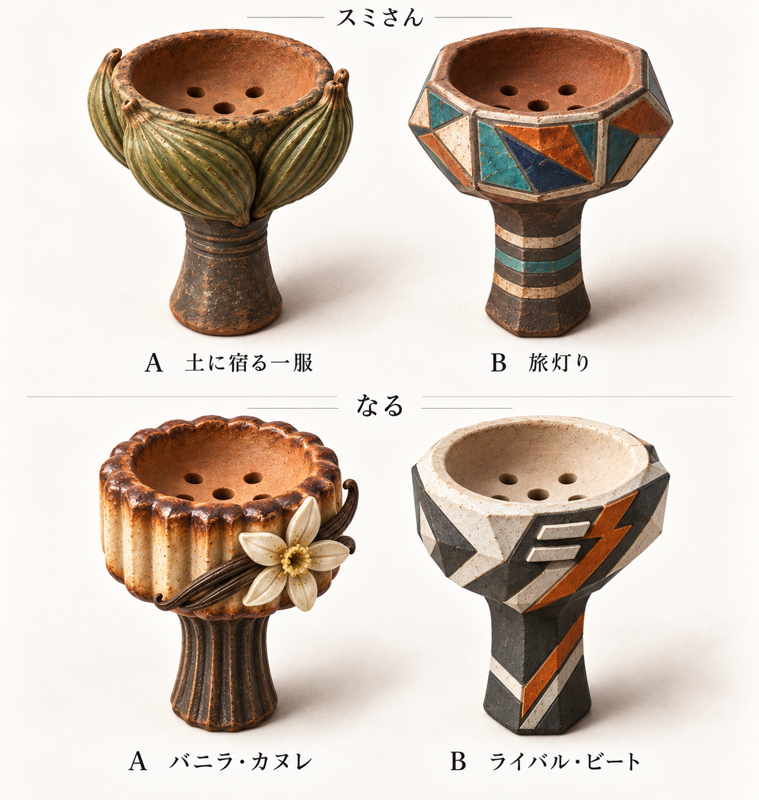
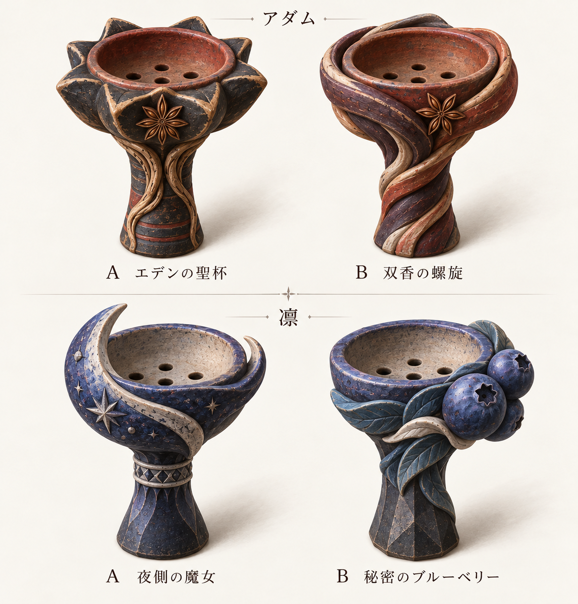
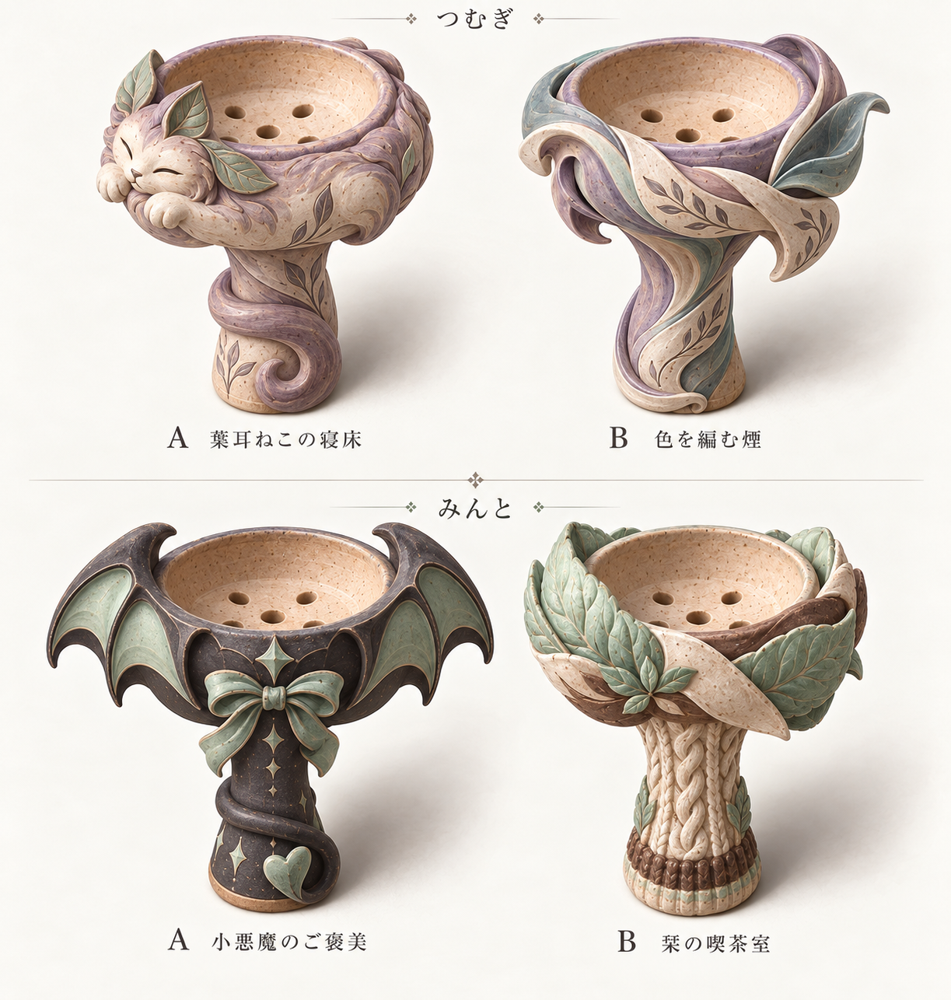
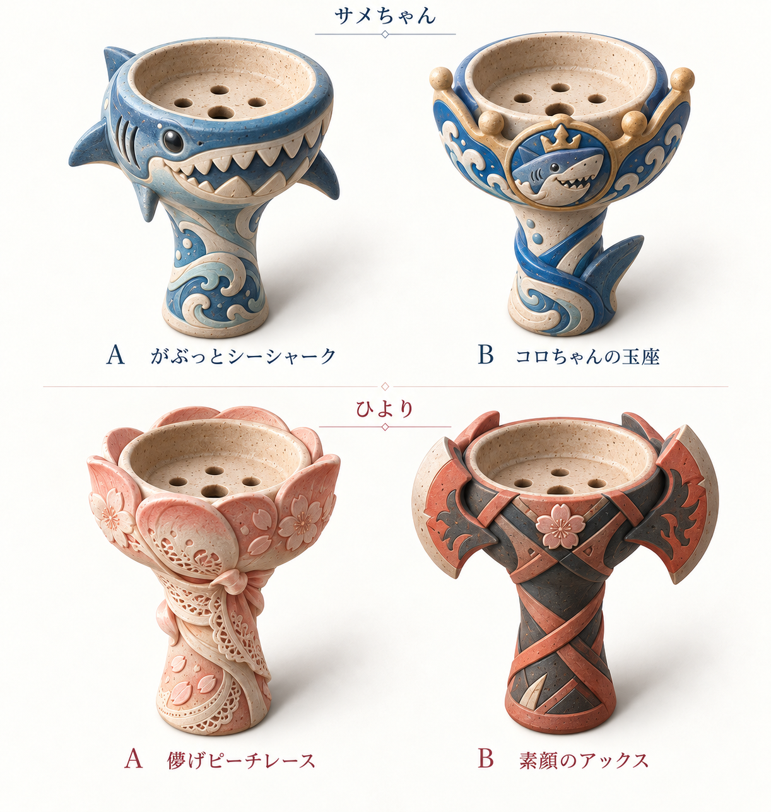

# 好感度MAX専用ハガル — 8人×2案の比較

現在の選定対象は **v2（個性を強めた16案）**。各画像の左がA、右がB。画像をクリックすると原寸で開けます。

画像一覧が表示されない場合は [4ページの比較PDF](preview.pdf) を開いてください。

採用はまだ未決定です。`selection.json` の8人の `selected` はすべて `null`。この資料には候補画像を保存し、本編の機材・報酬・シナリオは変更していません。

## スミさん・なる

| キャラ | A | B |
|---|---|---|
| スミさん | 土に宿る一服：カルダモンの鞘を立体化 | 旅灯り：店のモザイクランプを思わせる面構成 |
| なる | バニラ・カヌレ：菓子作りの知識とバニラ | ライバル・ビート：ストリート感と対等な二本線 |

## アダム・凛

| キャラ | A | B |
|---|---|---|
| アダム | エデンの聖杯：星形と根の彫塑 | 双香の螺旋：二つのスパイスが絡む造形 |
| 凛 | 夜側の魔女：夜色と大きな三日月 | 秘密のブルーベリー：私物の好きな香りを立体化 |

## つむぎ・みんと

| キャラ | A | B |
|---|---|---|
| つむぎ | 葉耳ねこの寝床：本人の作品の猫と煙の尾 | 色を編む煙：記憶・植物・色が混ざる流線 |
| みんと | 小悪魔のご褒美：翼・リボン・尾 | 栞の喫茶室：ミント、ニット、喫茶店の温かさ |

## サメちゃん・ひより

| キャラ | A | B |
|---|---|---|
| サメちゃん | がぶっとシーシャーク：サメ顔と波 | コロちゃんの玉座：王冠とサメの王 |
| ひより | 儚げピーチレース：演じる儚さとレース衣装 | 素顔のアックス：活発な素顔と斧投げ |

サメちゃんの贈り物は未使用の素焼きで、固定フレーバーを追加していません。ひよりは現在の交流対象として意匠案を作ったものです。既存の専用報酬の採用や後半ルート解禁を意味せず、#497の実装と分けて扱います。

## 選び方とマージまで

「スミB、なるA、アダムB、凛A、つむぎA、みんとB、サメA、ひよりB」のように、キャラ名とA/Bを指定してください。修正希望や保留も記録できます。

1. オーナーの選択を `selection.json` に記録する。画像を見ただけで自動採用しない。
2. 選択に修正指定があれば、元画像を残して新しい改稿を保存し、再確認する。
3. [制作・検品メモ](REVIEW.md)にある口縁・装飾・縮尺の残事項を、正式素材化する対象について解決する。
4. 資料保存PRは最新mainとの差分、競合、CI、レビューを再確認してからマージする。選択待ちの間はDraftを維持する。

このPRの完成範囲は**意匠候補と選定資料の保存**です。背景と文字を含む比較シートを、そのままゲーム内の単体アイコンとして登録するものではありません。ゲームへの表示接続を行う場合は、採用案の単体素材化・実際の表示サイズでの検品・既存装備への対応付けが必要です。

## 保存内容

- `v2/`：今回の選定対象4枚・計16案。生成原画を無加工で保存。
- `v1/`：控えめな初稿4枚。経緯の参照用で、現在の選定対象ではない。
- `manifest.json`：各原画のSHA-256・寸法・生成元ファイル名。
- `selection.json`：キャラと装備ID、A/B案、採用状況。
- `REVIEW.md`：設定根拠、描画意図、目視確認と残事項。
- `preview.html`：4枚を並べたブラウザ用比較ページ。フォルダ一式を取得して開く。GitHub上ではこのREADMEが比較プレビューになる。
- `preview.pdf`：v2の4枚を1ファイルで閲覧する比較PDF。
- `validation.json`：原画照合とPC／スマホ幅での表示確認結果。

生成元はこの会話で利用した `image_gen.imagegen`。人物・外部製品写真は原画ファイルに同梱していません。
