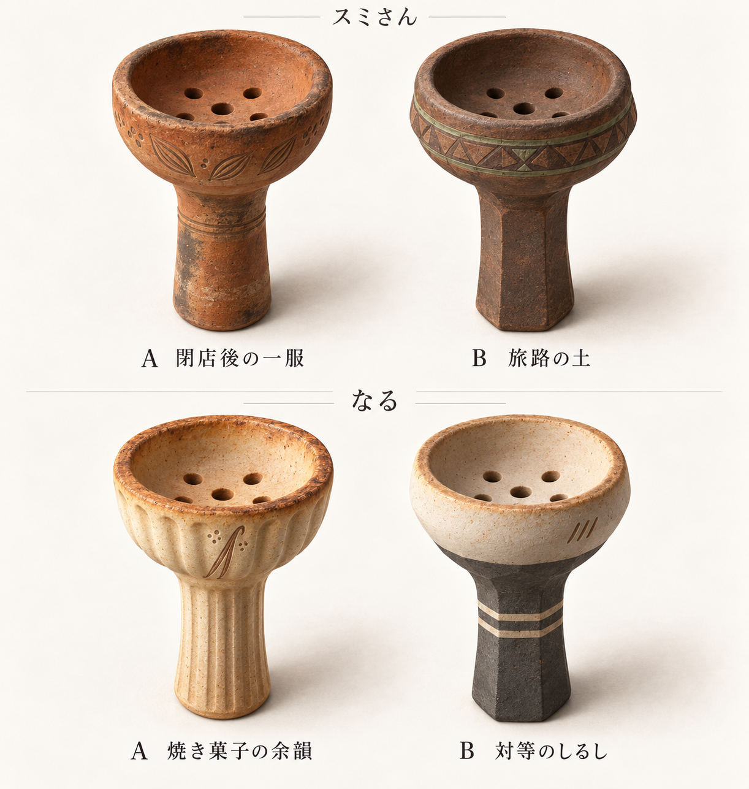
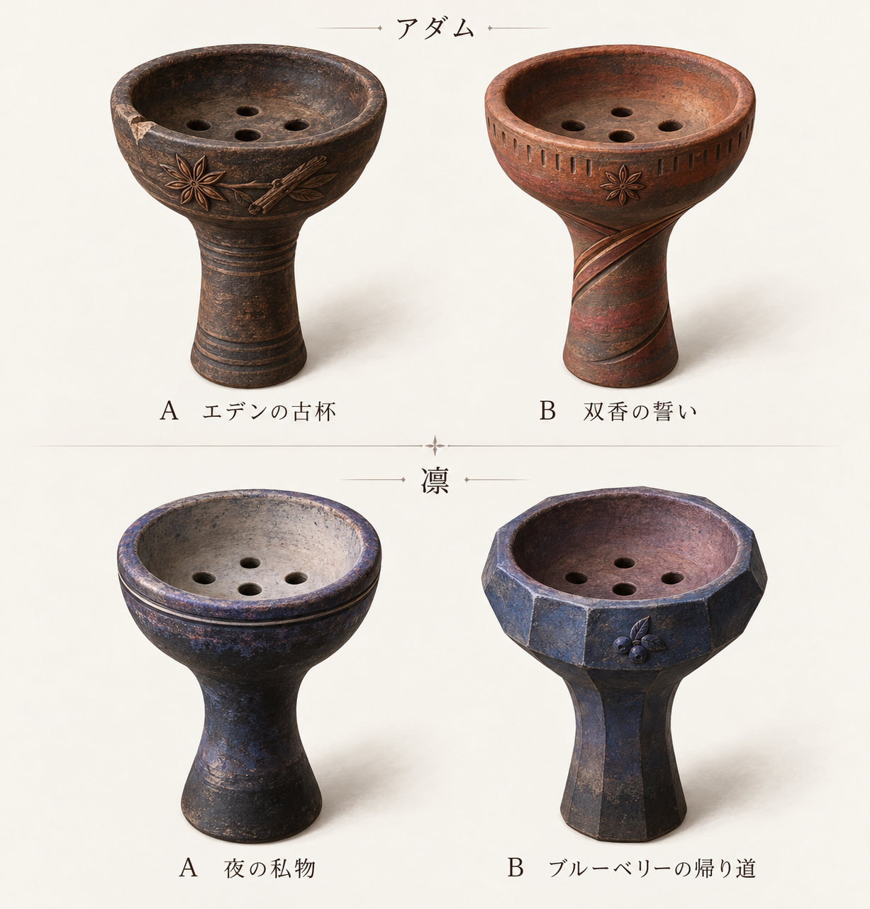
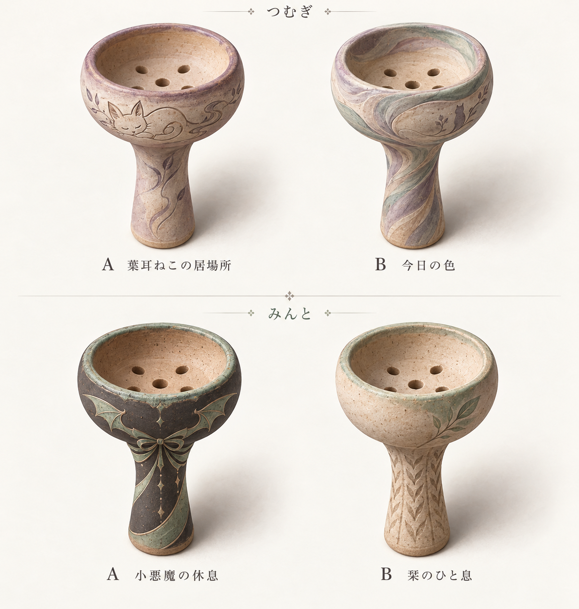
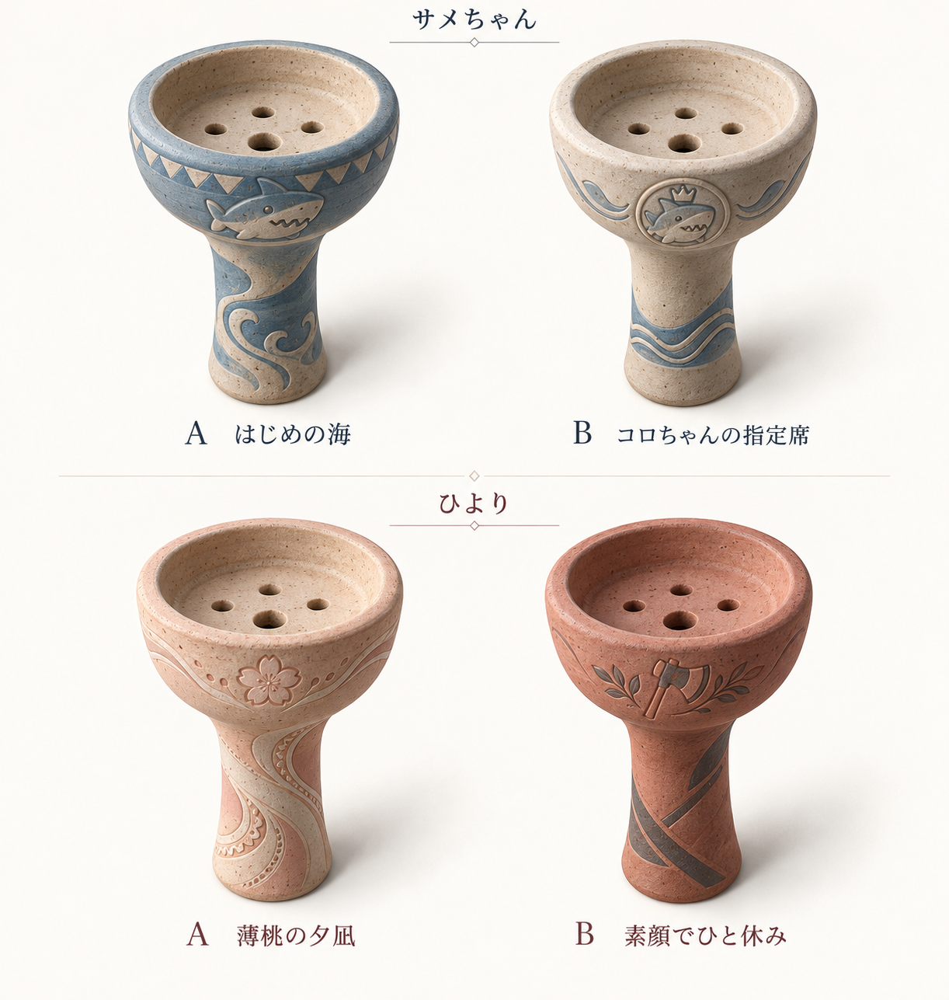

# 好感度MAX専用ハガル — 8人の採用結果と16案比較

**v1（最初のシンプルな16案）から8人分のデザインを選定済み**です。オーナーの「最初にくれたシンプルなやつのが好き」を受け、素焼きの基本形に浅い彫り模様と控えめな色を添える方向を優先します。各画像の左がA、右がB。画像をクリックすると原寸で開けます。

画像一覧が表示されない場合は [4ページの比較PDF](preview.pdf) を開いてください。

## 採用デザイン

オーナーの指定を `selection.json` に反映済みです。各比較画像の下の表でも採用案を太字で示しています。

| キャラ | 採用 | デザイン名 |
|---|---|---|
| スミさん | A | 閉店後の一服 |
| なる | B | 対等のしるし |
| アダム | B | 双香の誓い |
| 凛 | A | 夜の私物 |
| つむぎ | B | 今日の色 |
| みんと | B | 栞のひと息 |
| サメちゃん | B | コロちゃんの指定席 |
| ひより | B | 素顔でひと休み |

## 性能の基本方針

好感度ハガルは、**通常のハガルと同等の基本性能に、得意フレーバー使用時だけ小さなボーナスが付く**方針です。

比較基準となる通常ハガル、各キャラの得意フレーバーの対応、発動条件の詳細、ボーナスの種類・数値は今後決めます。ここで記録するのは設計方針であり、現在のゲーム内性能を説明するものではありません。本編の機材・報酬・シナリオ・計算処理は変更していません。

## スミさん・なる

| キャラ | A | B |
|---|---|---|
| スミさん | **採用：閉店後の一服：使い込んだ土とカルダモンの浅彫り** | 旅路の土：幾何学模様と落ち着いた色帯 |
| なる | 焼き菓子の余韻：淡い焼き色と菓子型の縦溝 | **採用：対等のしるし：白黒の土と二本線** |

## アダム・凛

| キャラ | A | B |
|---|---|---|
| アダム | エデンの古杯：年月を感じる土と香辛料の彫り | **採用：双香の誓い：赤褐色の土と交わる二本の帯** |
| 凛 | **採用：夜の私物：夜色の丸い器と細い周線** | ブルーベリーの帰り道：面取りと小さな果実の意匠 |

## つむぎ・みんと

| キャラ | A | B |
|---|---|---|
| つむぎ | 葉耳ねこの居場所：猫と煙の尾の線描 | **採用：今日の色：淡い色土が混ざる流れ** |
| みんと | 小悪魔の休息：黒とミント色の翼・リボン模様 | **採用：栞のひと息：生成りの土と葉・編み目の彫り** |

## サメちゃん・ひより

| キャラ | A | B |
|---|---|---|
| サメちゃん | はじめの海：青い波とサメの絵柄 | **採用：コロちゃんの指定席：小さな王冠付きサメの紋章** |
| ひより | 薄桃の夕凪：桃色の土と花・レース模様 | **採用：素顔でひと休み：赤土と小さな斧の彫り** |

サメちゃんの贈り物は未使用の素焼きで、固定フレーバーを追加していません。ひよりは現在の交流対象として意匠案を作ったものです。既存の専用報酬の採用や後半ルート解禁を意味せず、#497の実装と分けて扱います。

## 選定後の作業とマージまで

8人のA/B選定は完了しました。資料保存PRは採用結果と性能の基本方針をレビューできる状態です。性能の詳細は、今後の指定を受けて更新します。

1. 正式素材化では、[制作・検品メモ](REVIEW.md)の底面孔・内壁・縮尺などを確認し、文字なしの単体素材を用意する。
2. 修正指定があれば、元画像を残して新しい改稿を保存する。
3. 資料保存PRのマージはオーナーの「マージまでして」の指示に基づく。最新mainとの差分、競合、CI、レビューを確認し、結果は [PR #507](https://github.com/haseatsu114514-dot/shisha-game/pull/507) を参照する。
4. 性能実装は、ボーナスの種類・数値・発動条件などの詳細を決めてから行う。

このPRの完成範囲は**意匠候補・選定資料・性能方針の保存**です。背景と文字を含む比較シートを、そのままゲーム内の単体アイコンとして登録するものではありません。ゲームへの表示接続には、採用案の単体素材化・実際の表示サイズでの検品・既存装備への対応付けが必要です。性能の実装は詳細を決めてから行います。

## 保存内容

- `v1/`：今回優先するシンプルな初稿4枚・計16案。生成原画を無加工で保存。
- `v2/`：個性を強めた別方向の4枚。比較用の履歴として保持。
- `manifest.json`：各原画のSHA-256・寸法・生成元ファイル名。
- `selection.json`：キャラと装備ID、A/B案、採用状況、デザイン・性能の方針と未決定項目。
- `REVIEW.md`：設定根拠、描画意図、目視確認と残事項。
- `preview.html`：v1の4枚を並べたブラウザ用比較ページ。フォルダ一式を取得して開く。GitHub上ではこのREADMEが比較プレビューになる。
- `preview.pdf`：v1の4枚を1ファイルで閲覧する比較PDF。
- `validation.json`：原画照合とPC／スマホ幅での表示確認結果。

生成元はこの会話で利用した `image_gen.imagegen`。人物・外部製品写真は原画ファイルに同梱していません。
