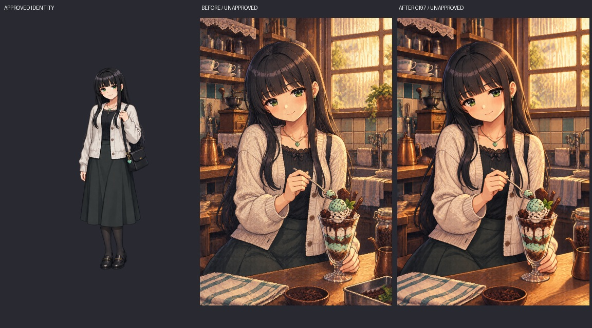

# Issue #375：CI83〜99の候補検品と比較

作業者E `codex-e-visual-20261011-01`。予約成功 run [38178464309](https://github.com/haseatsu114514-dot/shisha-game/actions/runs/38178464309)。照合基準は `inventory.json.base_sha`。**作業者の検品であり、オーナーの採用承認ではない。** 原画・過去プロンプト・NG履歴は上書きせず保持した。

## 分類とゲーム使用パス

| 系統 | 分類 | 点数／使用 |
| --- | --- | --- |
| 正式タイトル | 採用済み | `assets/ui/title_arts/` の6人18枚 → `remake/img/ui/title_arts/` のWebP → `manifest.titleArts`。凛02を除く。予備のkeyvisualは別枠。変更しない |
| 本フォルダの既存別候補 | 候補保存のみ | 8点。ゲーム使用パスなし、オーナー未選定 |
| 本フォルダの既存別候補 | 要修正 | 4点：みんと01・02・03、アゲハ02の室内植物。みんと01の短い脚はモデル再照合も必要 |
| 別候補15枠の欠番 | 要修正 | 凛01、つむぎ01：NG原画のみ。短いハガル／ホースのオーナーNGを維持 |
| 別候補15枠の欠番 | 素材待ち | アゲハ01：この系統の原画なし。正式タイトル01とは別物 |
| 今回の背景修正原画 | 候補保存のみ | みんと私服パフェ1点、1024×1536。承認待ち。本編未登録 |

原画・サイズ・SHA256・人物基準・生成指示・過去metadata・ゲーム使用パス・個別所見は [inventory.json](inventory.json) に全件記録。既存候補の `metadata.qa.reviewed=true` は以前の作業者の記録であり、採用履歴として扱わない。外部実写を指す `/workspace/scratch/…` は本checkoutに無く、製品寸法の再検証には再取得が必要。

## 比較画像

正式立ち絵／別候補／採用タイトルをラベル付きで並べた縮小一覧。機材7候補は原画でも確認した。縮小一覧で手・ホースの合格を断定しない。

- [つむぎ](comparisons/tsumugi.jpg)
- [ましろ](comparisons/mashiro.jpg)
- [みんと（営業・私服を別々に照合）](comparisons/minto.jpg)
- [アゲハ](comparisons/ageha.jpg)
- [凛](comparisons/rin.jpg)

現時点で明白な汎用別人化や3D化は認めなかった。顔の濃い頬・暖色逆光・細かな均一粒子・窓際の反復は選定時の比較点で、画像全体を「AI感」だけで不採用にしない。各人の髪・目・顔・服・アクセサリーを正式絵と照合。凛の深夜黒縁眼鏡は `data/characters.json` の正規設定でありNGではない。PRT34の完成・承認とは別問題。

## 今回の1点修正

- [修正原画](minto-private-parfait-ci97.png)／[実際の生成指示](minto-private-parfait-ci97.prompt.txt)。元絵は `../minto/minto_03_private_parfait.png` にそのまま残る。
- 参照：既存パフェ候補（編集対象）、`chr_minto_ura_normal.png`（人物）、`title_art_keyvisual_01.png`（質感だけ）。背景の室内鉢植え3領域を窓・タイル・机へ変更。食べ物のミント飾りは残す。
- 原寸目視：緑目、黒い長髪、白系カーディガン、黒トップ、緑ペンダント、手・スプーン・パフェを維持し、大きな破綻なし。粒子感を維持。顔などの画素は生成編集により微変化しており、完全な局所差分ではない。比較してオーナーが最終判断する。
- シーシャを含まない場面なので、HMD・炭・ホースの新規描写なし。機材修正を資料不足のまま同時生成しない。

## CI83〜99との対応

| ID | 現在の証拠／残作業 |
| --- | --- |
| CI83 | 別候補12点、15枠の欠番3を確認。正式18点とは分離 |
| CI84 | 正式keyvisualとの粒子・材質比較。全候補は細かなピクセル調、好みの判定は保留 |
| CI85 | 5人の正式立ち絵（みんと私服を含む）と比較。深夜凛の眼鏡は設定通り |
| CI86 | 屋外雨・猫・舞台裏・準備・深夜を区別。暖色窓際の反復は残る |
| CI87 | 喫煙2点はHMDあり。準備／洗浄は炭なし。旧NG原画は別保存 |
| CI88 | 手持ち器と掌を原画目視。厳密な寸法・装着比率は実写再取得後に再確認 |
| CI89 | metadataのProvost II／ONMO／Lotus I+を照合。現在の製品実写未取得なのでモデルQAを新たに合格確定しない |
| CI90 | 伝統型・準備道具・非シーシャ日常あり。欠番の完成原画はない |
| CI91 | 植物不要の原則。室内鉢・蔦を4候補の修正点へ記録 |
| CI92 | `docs/asset_ai_guidance.md` と恒久のヒロインCGルールが既に存在。再生成後の目視記録を今回追加 |
| CI93 | 過去実写出典は `installed-and-handheld-scale-20261009.md`。ローカル参照の再取得が必要 |
| CI94 | 手持ち原画を比較。巨大初版5点は `rejected-scale-v1`、承認素材で置換しない |
| CI95 | みんとY字初版は `ng-examples/minto-hose-fork-20261009.png`、v2の一本経路と区別 |
| CI96 | 本一覧へパスで集約。既存PR #387の19案／15案／正式18点ギャラリーを重複改変しない |
| CI97 | 今回のパフェ修正案で室内鉢を除去。営業01・02、アゲハ02は背景修正が残る。屋外植栽を室内植物として数えない |
| CI98 | 凛01・つむぎ01の短いボウルNG維持。これらの承認できる新原画なし |
| CI99 | つむぎ01の過大な前景ループNG維持。正しい側面ポートへ自然な単一経路を再設計する必要あり |

## 承認後の次手

まず今回のパフェ案を選定。承認されても原画保存と正式登録は別工程。背景修正が残る3点は顔・機材を固定して小さく修正し、機材の再制作は製品実写（装着／掌）を再取得してから行う。欠番を別人画像で埋めない。ひより #373、背景 #360、凛の立ち絵 #376 は本PRの制作対象外。表示名はサメちゃん／正式名は波多野なぎさ、内部ID `kafuka` は維持。

テスト結果は [validation.md](validation.md)。本Issueは採用・残原画が未完のためopen維持、PRはDraftとしマージしない。
