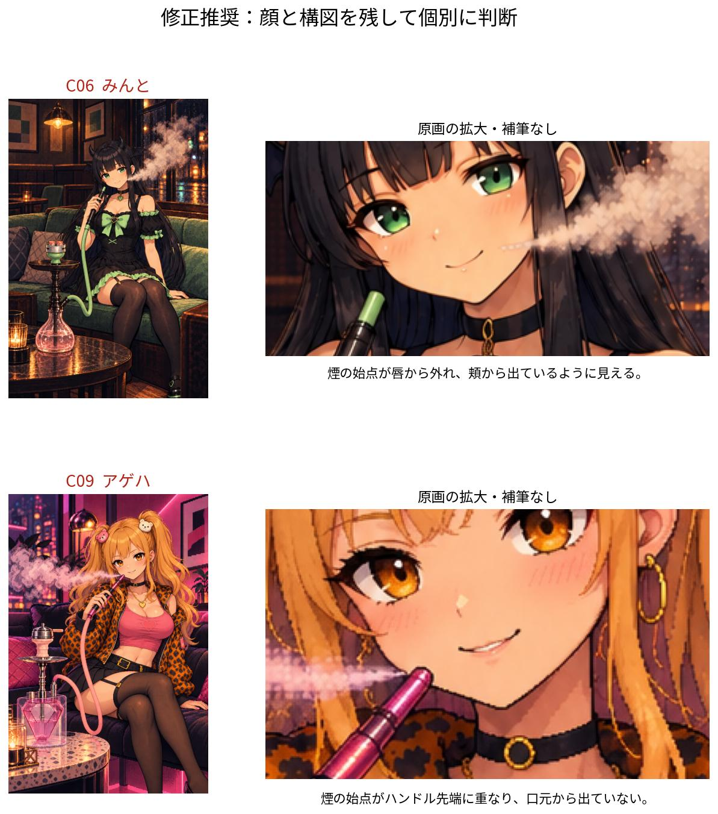
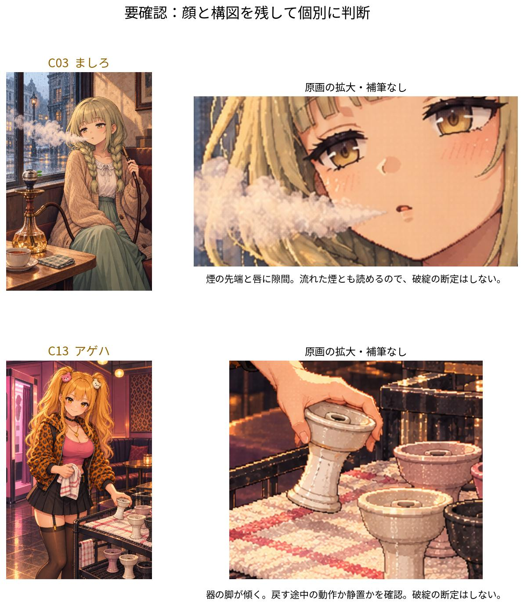
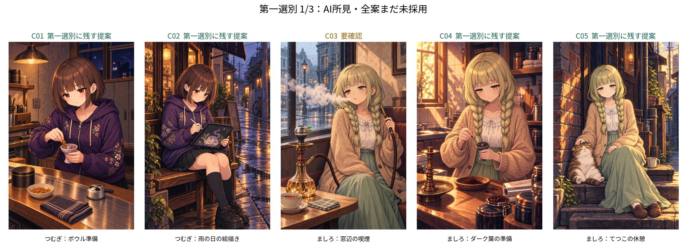
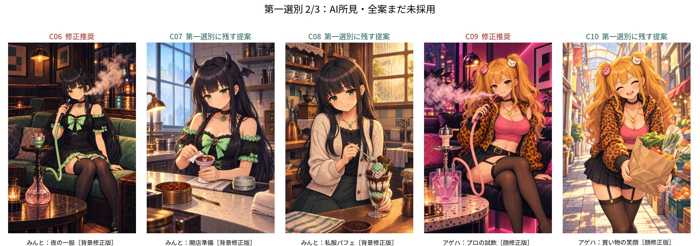
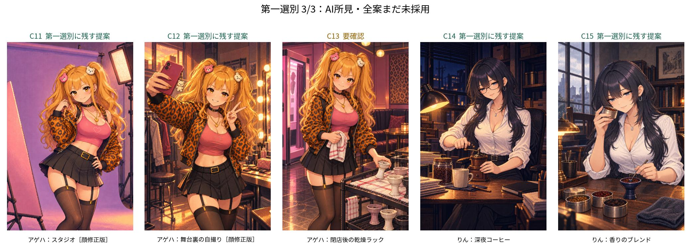

# 第一選別：最新版CG候補15点

2026-10-13 JST、Issue #375。オーナーの「AI目線で破綻があればピックアップして見せて、第一選別したい」を受けた目視資料。基準main `75dd7bc79ee0c6460acea820fec4d0c4a1283aff`（候補保存PR #436と採用記録PR #438のマージ後）。worker/claim/status・原画パス・SHA256・原寸切出し範囲・個別所見は [review.json](review.json)。

**修正推奨2点、要確認2点、第一選別に残す提案11点。全15案はまだ未採用。アゲハ5案のオーナー選定保留を維持する。** 「残す提案」は大きな破綻を見つけなかったというAI所見で、本人性・機材モデル/実寸の合格や正式採用を確定しない。

## 優先して直したい2点

- **C06 みんと・夜の一服（背景修正版）**：煙の細い始点が笑っている唇から外れ、画面右の頬側から出ているように見える。煙の始点を口へ寄せる局所修正を推奨。顔・衣装・ポーズ・構図を捨てる判断ではない。短いボウル脚は、具体モデル/実寸との照合も未完。
- **C09 アゲハ・プロの試飲（顔修正版）**：煙の始点が口より下にあり、離したハンドル/チップ先端に重なる。器具から煙が出ているように見えるため、口から吐いた煙として修正することを推奨。

これらはルール [首掛け/ホースの必須検品](../../../shisha-hardware-reference/visual-qa-necklace-hose-20261009.md) の「煙は人物の口元とタイミングが合っているか」に照らした実画像の指摘。今回画像を直したことにはせず、原画は保持する。マージ済みの候補保存・表示CI PASSは画像の造形を保証しない。

## 破綻と断定しない2点

- **C03 ましろ・窓辺の喫煙**：煙の先端と唇に隙間がある。吐いた煙が流れた瞬間とも読めるので、破綻とは断定しない。C06/C09とは分けて確認する。
- **C13 アゲハ・乾燥ラック**：手に持った器の脚が斜め。棚へ戻す途中の動作とも読めるので、浮遊・転倒を断定しない。静置を狙った絵なら脚の向き/安定、動作なら手の支えと接触を確認する。棚上下の器を含むモデル/寸法のQAは未完。

## C01〜C15から第一選別

「残す C01,C02…」「直して残す C06,C09」「外す Cxx」のように番号で指定する。こちらの提案は採用決定ではなく、今回は削除/再生成/正式登録をしない。アゲハの顔を正式基準と比較した既存資料は [5案の比較](../ageha-identity/README.md) を参照。

| 番号 | 最新原画 | AIの第一選別提案 | 個別所見 |
| --- | --- | --- | --- |
| C01 | [つむぎ：ボウル準備](../../tsumugi/title_art_tsumugi_02_bowl_prep.png) | 残す提案 | 顔・手・準備中の器に、大きな破綻は見当たらない。 |
| C02 | [つむぎ：雨の日の絵描き](../../tsumugi/title_art_tsumugi_03_rain_drawing.png) | 残す提案 | ペンとタブレット、座り姿の大きな破綻は見当たらない。 |
| C03 | [ましろ：窓辺の喫煙](../../mashiro/title_art_mashiro_01_window_smoke.png) | 要確認 | 煙の細い先端と唇の間に隙間が見える。吐いた煙が流れた瞬間とも読めるため、破綻とは断定しない。口元へ始点を寄せるか選定時に確認。 |
| C04 | [ましろ：ダーク葉の準備](../../mashiro/title_art_mashiro_02_dark_leaf_prep.png) | 残す提案 | 手持ちボウル・ピックの大きな破綻は見当たらない。 |
| C05 | [ましろ：てつこの休憩](../../mashiro/title_art_mashiro_03_tetsuko.png) | 残す提案 | 撫でる手・猫・座り姿の大きな破綻は見当たらない。 |
| C06 | [みんと：夜の一服［背景修正版］](../background-plants/minto-night-ci97.png) | 修正推奨 | 煙の細い始点が笑っている唇から外れ、画面右の頬側にある。口から吐いた煙に見える始点へ局所修正を推奨。短いボウル脚のモデル/寸法照合も未完。 |
| C07 | [みんと：開店準備［背景修正版］](../background-plants/minto-prep-ci97.png) | 残す提案 | 手・布・器に大きな破綻は見当たらない。丸缶からタッパーへの方針確認は別の修正課題。 |
| C08 | [みんと：私服パフェ［背景修正版］](../minto-private-parfait-ci97.png) | 残す提案 | スプーン・グラスを持つ手に大きな破綻は見当たらない。 |
| C09 | [アゲハ：プロの試飲［顔修正版］](../ageha-identity/ageha-01-professional-face.png) | 修正推奨 | 煙の細い始点が口元より下にあり、持ったハンドル/チップ先端に重なる。器具から煙が出ているように見えるため、口から吐く始点へ局所修正を推奨。 |
| C10 | [アゲハ：買い物の笑顔［顔修正版］](../ageha-identity/ageha-02-grocery-face.png) | 残す提案 | 袋を支える両手・笑い顔に大きな破綻は見当たらない。 |
| C11 | [アゲハ：スタジオ［顔修正版］](../ageha-identity/ageha-03-studio-face.png) | 残す提案 | 髪/腰に触れる手・身体の大きな破綻は見当たらない。 |
| C12 | [アゲハ：舞台裏の自撮り［顔修正版］](../ageha-identity/ageha-04-selfie-face.png) | 残す提案 | スマホを持つ手・Vサインに、余分な指は確認できない。手前の手の大きさは遠近として説明できる。 |
| C13 | [アゲハ：閉店後の乾燥ラック](../ageha-identity/ageha-05-closing-rack.png) | 要確認 | 手に持った器の脚が斜めで、棚へ戻す途中か静置かを確認したい。動作として成立し得るため、浮遊/転倒の破綻と断定しない。棚上/下の各器の脚・寸法/モデル再現は未合格。 |
| C14 | [りん：深夜コーヒー](../../rin/rin_c_midnight_coffee.png) | 残す提案 | ミルのつまみと本体を持つ両手に大きな破綻は見当たらない。黒縁眼鏡は正規設定。 |
| C15 | [りん：香りのブレンド](../../rin/title_art_rin_02_aroma_blend.png) | 残す提案 | 缶・ピック・ボウルと両手の大きな破綻は見当たらない。 |

## 対象と検証の境界

旧12候補から、みんと3点とアゲハ2点を保存済みの最新版へ置き換えて一覧化し、正式タイトルに対するアゲハ顔修正3点を加えた15点。旧版の削除/置換は行っていない。C09は正式タイトルの顔修正案で、旧「別候補ageha01」欠番の完成を意味しない。凛01/つむぎ01の過去NG、Y字ホース初版は履歴として保持し、今回の最新版へ混ぜない。

手・指・身体・器具の接触、ホース/煙、衣装と正式人物基準、場面の大きな破綻を原寸目視した。隠れた指や遠近を根拠なく「余分な指」「巨大化」と扱わない。りんの黒縁眼鏡は正規設定。丸缶/タッパー、背景照明や粒子感、実物モデル・機材寸法、本人性の最終承認は別に確認する。単に好みが違う画像を破綻と呼ばない。

正式タイトル21枚・立ち絵・背景・採用済み装備4原画・manifest/保存/ゲームコード・#341 QA・#342後日素材には変更なし。差分はこの比較フォルダのみ。

検証：15原画のSHA256/原寸1024×1536/デコード、番号重複なし、全原画/比較リンク、5比較JPEGのデコード、原画無変更、入口文書/Git Safety/diff checkを確認。画像の造形はAI目視であり、自動テストによる「全15点造形合格」ではない。

再現：`python -m pip install matplotlib==3.10.8 Pillow==12.3.0`、日本語フォントNoto Sans CJK JPを用意して、`python3 asset_sources/heroine-title-candidates-20261009/review-issue375/first-selection/make_review_figures.py`。原画は変更せず、縮小一覧と切出し比較を作る。描き足しや画像生成は行わない。
