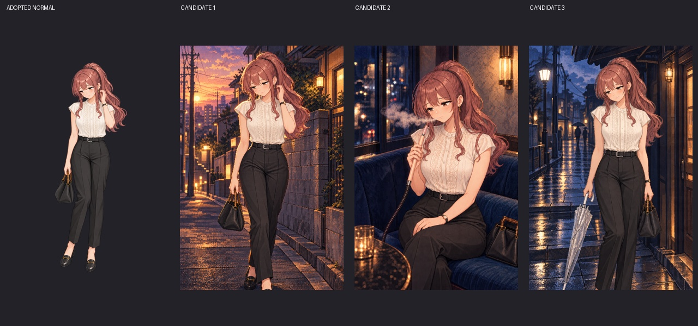

# ひよりのランダムタイトル原画3場面（候補）

作業者E `codex-e-visual-20261011-01`。Issue #373予約成功 [38199919533](https://github.com/haseatsu114514-dot/shisha-game/actions/runs/38199919533)。基準main `134b1a5a327cf25ddab94b6ab4ed18d604735bbf`。

**2026-10-12、オーナーが3案すべての採用・本編登録・マージを承認。** 本編へPNG／配布WebP／manifestを接続し、7人21枚のローカル検証に合格。 正式立ち絵、顔アイコン、既存タイトル18枚は維持。3場面は夕暮れの帰路・静かな窓際で一服・雨上がりの街角。原画と実際の生成指示をこのフォルダへ保存した。窓際はv2で短い衛生チップを別パーツとして修正。初版と指示も上書きせず残す。

本人の正本は `assets/sprites/characters/hiyori/chr_hiyori_normal.png` と `assets/ui/face_icons/face_hiyori.png`、25歳・現在のポニーテール／白〜アイボリーの立ち襟フレンチスリーブのレースブラウス・黒パンツ。生成ツールへ実物の正式画像を添付した。既存keyvisualは質感だけ参照。表の静かな姿を描き、素顔と演技のネタバレ・回想の学生衣装を追加しない。

既存素材の調査：現在の6表情と顔アイコンは採用済み。`asset_sources/character-intros/hiyori-senkou-v1/source.png` は人物なしの1672×941導入背景で、本編の一度限りのカットインで使用中。ランダムタイトルの縦原画へ流用しない。Issueにある別チャットの草案3場面は、正式な独立3PNG・承認・本編登録が未完了と記録され、checkoutに当該原画もない。別人素材や横長背景で穴埋めしない。

採用後の接続：承認されたPNGだけ `assets/ui/title_arts/` に配置し、`python3 remake/tools/build_manifest.py --title-only` で表示WebPとmanifestを生成。既存のキャラ均等・同キャラ連続回避・1枚先読み・フォールバック・セーブ不変を維持する。全3枚採用なら7人21枚となり既存テストの期待値をその時点で更新する。今回の承認された3枚のみ接続済み。

## 原画と比較

| 案 | 原画 | PC仮表示 | タッチ端末仮表示 |
| --- | --- | --- | --- |
| 01 夕暮れの帰路 | [PNG](title_art_hiyori_01_twilight_walk.png) | [PC](qa/pc-title_art_hiyori_01_twilight_walk.png) | [スマホ](qa/mobile-title_art_hiyori_01_twilight_walk.png) |
| 02 静かな窓際で一服（v2） | [PNG](title_art_hiyori_02_window_pause.png) | [PC](qa/pc-title_art_hiyori_02_window_pause.png) | [スマホ](qa/mobile-title_art_hiyori_02_window_pause.png) |
| 03 雨上がりの街角 | [PNG](title_art_hiyori_03_after_rain.png) | [PC](qa/pc-title_art_hiyori_03_after_rain.png) | [スマホ](qa/mobile-title_art_hiyori_03_after_rain.png) |

[顔の拡大比較](comparison-face-details.jpg)／[窓際チップの修正前後](comparison-window-tip-v1-v2.jpg)／[原画・指示・参照・実写出典とSHA256](candidates.json)。生成画像は1024×1536のRGB。人物原画の単純貼り付けではなく、同じ採用人物を参照して場面を生成したため、顔・手・装飾を比較した上でオーナーが3案を選定。

目視検品：3案の顔、茶目、ピンクブラウンの高いポニーテール、立ち襟・短い袖・レース、黒パンツとベルト、時計・耳飾り・手提げを正式絵と比較。01は夕暮れの路地、02は夜の青いベンチと窓、03は雨上がりの庇と閉じた傘で場面を区別。植物を共通の室内飾りにしない。ラベル・名札・台詞・ネタバレは追加していない。

窓際の機材：実写の硬いハンドルと、別体の小さな衛生チップを参照。v2は上端に短い淡色チップ、下端に金属の接続部＋柔軟なホースを確認。見えるホースは一本で枝分かれせず、手前テーブル下／左下の画角外へ自然に続く。煙は唇から左へ。首掛けチップは指定せず、鎖だけの首飾り・二重チップを足さない。台本体・HMD・炭はこの寄りの画角外なので、隠れた接続や具体モデルの構造まで合格断定しない。構成メモはJSONに保存。外部実写は参照URL・ハッシュのみ保存し、写真自体は再配布しない。

## 確認結果と残作業

- [仮表示の結果JSON](qa/results.json)：PC1280×720／タッチ端末844×390で各3案の読込・表示、タイトルメニューの画面内配置、エラーなし、localStorage／sessionStorage不変をPASS。
- 仮表示は既存 `prepareTitleArt`／`showTitle` に候補のURLを一時的に渡すだけ。manifestの変更がないことも実行中に検証。`assets/`・`data/`・`remake/`には差分なし。画像選択確率や本編登録の合格試験とは扱わない。
- 再現用 [preview.mjs](qa/preview.mjs)：プレビューサーバー8123起動後、`ARTIFACT_DIR=/tmp/hiyori-review node asset_sources/hiyori-title-candidates-issue373/qa/preview.mjs`。使い捨てブラウザコンテキストで実行し、プレイヤーの保存領域に触れない。
- PNGデコード・原画／正式参照のSHA256照合、agent docs、diff check PASS。
- 採用承認とPNG／WebP／manifest接続、7人21枚の抽選・全画像表示・旧セーブ検証は完了。CIとマージ後の公開版確認が完了するまで予約を維持する。

## 採用後の本編確認

2026-10-12のオーナー回答「3案すべて採用して本編登録・マージ」に従い、窓際v2を含む3PNGを同一バイトで正式保存し、タイトル限定ビルドでWebPとmanifestを接続。既存18枚のPNG／WebPは全ハッシュ維持。立ち絵・顔・ほかのmanifest項目と本編抽選コードは変更していない。

- [抽選・PC／スマホ全21画像の結果](qa/adopted-title-results.json)：3ケースPASS。実際のpickerでひよりを選択、同キャラ連続回避、起動1枚先読み、全21枚の表示とセーブ不変。
- [旧セーブ・保存／読込](qa/adopted-save-load-results.json)：6ケースPASS（全スロット・旧形式移行・壊れたJSON・PC UI・タッチUI・縦持ち回転）。
- 正式WebPの画面：01 [PC](qa/adopted-pc-title_art_hiyori_01_twilight_walk.png)／[スマホ](qa/adopted-mobile-title_art_hiyori_01_twilight_walk.png)、02 [PC](qa/adopted-pc-title_art_hiyori_02_window_pause.png)／[スマホ](qa/adopted-mobile-title_art_hiyori_02_window_pause.png)、03 [PC](qa/adopted-pc-title_art_hiyori_03_after_rain.png)／[スマホ](qa/adopted-mobile-title_art_hiyori_03_after_rain.png)。
- 詳細は [validation.md](validation.md)。CI／公開反映の結果はIssueへ追記する。アゲハの正式3枚はオーナーが選定保留したため維持。
