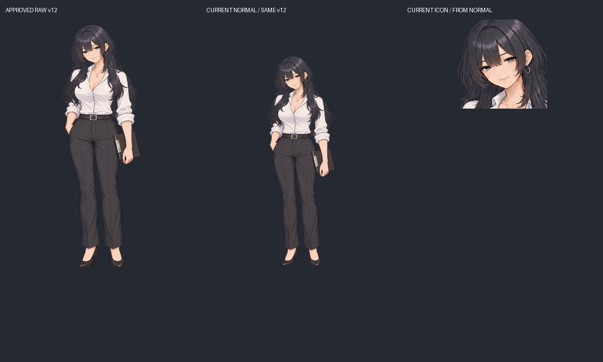
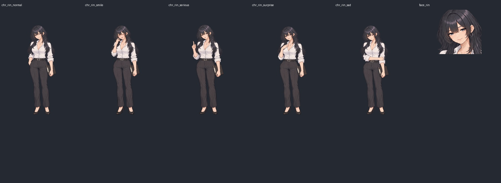

# Issue #376：凛v12の立ち絵・顔アイコン同期検品

作業者E `codex-e-visual-20261011-01`、予約成功 [run 38180374973](https://github.com/haseatsu114514-dot/shisha-game/actions/runs/38180374973)。基準main `73cd85e0c2f40f18361a6174b9cb9c1064eaab56`。

**修正版原画は存在し、採用・main反映済み。立ち絵5表情と顔アイコンは現在も同期している。** PRT34の「修正版完成・反映待ち」は後続のPRT43〜50と実装に追いついていなかった。新たな人物像を生成せず、既存の承認済みv12を維持する。

## 採用履歴・画素の証拠

- [PR #195](https://github.com/haseatsu114514-dot/shisha-game/pull/195)：凛v12の5表情・自然な腰の姿勢・頭部中央アンカー。merge `9d60247f285dd9da150703dcb2be4db4b9e315b2`。
- [PR #194](https://github.com/haseatsu114514-dot/shisha-game/pull/194)：上記を取り込み、PRT50で凛v12から顔アイコンを再制作。merge `67a31860198e41161913d08a514606f753dfab05`。
- 採用指示はPRT45、制作・当時の停止・保存指示はPRT46／47。後続のマージ事実とPRT50を優先して現行を照合した。生成記録の古い `main_merge_on_hold` は当時の記録であり、現在のmain未採用を意味しない。
- 元原画：`.claude/skills/character-portrait-remaster/references/rin-v12-{normal,smile,serious,surprise,sad}.png`。5点の原画SHA256と現行PNGのSHA256は `rin-v12-integration.json` の各記録に一致。
- 現行5PNGと5lossless WebPの全RGBA画素が一致。顔アイコンは現行 `chr_rin_normal.png` と `tools/make_face_icons.py.make_icon('rin', …)` をメモリ内で計算したRGBA画素に一致。書き戻しや一括生成はしていない。
- 全原画・使用パス・ハッシュ・manifestは [audit.json](audit.json)。PNGは896×1200 RGBA、顔アイコンは160×160 RGBA。

## 比較

変更前後は既存の[v11→v12姿勢比較](../../../.claude/skills/character-portrait-remaster/references/rin-v12-stance-comparison.png)を参照。本PRで素材を再変更していないので架空の「修正後」を作らない。半目、長い暗色ウルフ、フープピアス、白シャツ、無色爪、黒スラックスの同一性を目視。各表情の意味（通常／閉じ目の笑顔／指で説明／胸へ手の驚き／静かな悲しみ）を維持する。

## 使用箇所

| 画面 | 正本と経路 |
| --- | --- |
| 会話・表情切替 | `assets/sprites/characters/rin/chr_rin_<face>.png` → `remake/img/sprites/characters/rin/chr_rin_<face>.webp` → manifest.portraits.rin → `core/data.js` のportraitInfo → `vn/engine.js` |
| LIME・関係UI | `assets/ui/face_icons/face_rin.png` → manifest.faceIcons → `core/data.js.faceIconUrl` → `daily/phone.js.avatar`／status。LIMEの160px原寸読込をブラウザで確認 |
| キャラ紹介 | introArt.rinは背景のみ `ui/character_intros/rin.png`、人物はportraitInfoの採用smileを `vn/intro-art.js` が重ねる。独立した古い人物CGへ切替えていない |
| 設定資料 | `asset_sources/reference-sheets/rin/rin-reference-sheet.png`。立ち絵を並べる参照資料で、ゲーム実行時の人物の正本ではない |
| manifest・設定 | 5faces、anchor=head、共通ax=0.4657、spriteScale=0.97／spriteAnchor=head。原画・表示倍率・保存キーを変更しない |

## 検証

- `NODE_PATH=…/remake/test/browser/node_modules SHOTS=/tmp/e376-portraits node remake/test/rin_portraits.mjs`：全5表情×PC1280×720／スマホ591×1280の10ケースPASS。頭部見切れなし、同じ表示枠、中央ずれ1.5%未満、ブラウザエラーなし。最大ずれPC12.60px／スマホ5.82px（sad）。
- 別の使い捨てブラウザでPC1280×720／スマホ844×390のLIME・紹介を確認。LIMEはface_rin.png160px、紹介はchr_rin_smile.webp896×1200をデコード。ブラウザエラーなし。結果は [ui-results.json](ui-results.json)、画面証跡は [comparisons](comparisons/)。
- 採用原画と現在の5PNGハッシュ、PNG/WebP画素、アイコン再計算画素、manifestの5表情・頭部アンカーはPASS。台詞のfaceキーは変えない。
- Git Safety／diff check／資料リンク検査。`assets/`・`data/`・`remake/`差分なし。セーブ仕様も変えず、旧セーブ・全枠は同じmainのIssue #374検証6ケースで確認済み（本PRで通しプレイを重複実施していない）。

本編の同期実装について新たな承認待ちはない。本PRは台帳・引き継ぎの古い待ち表示と検品証拠の更新。凛02タイトルの葉の色修正、別候補CGの選定は本Issueの完了とは分けて保留する。
