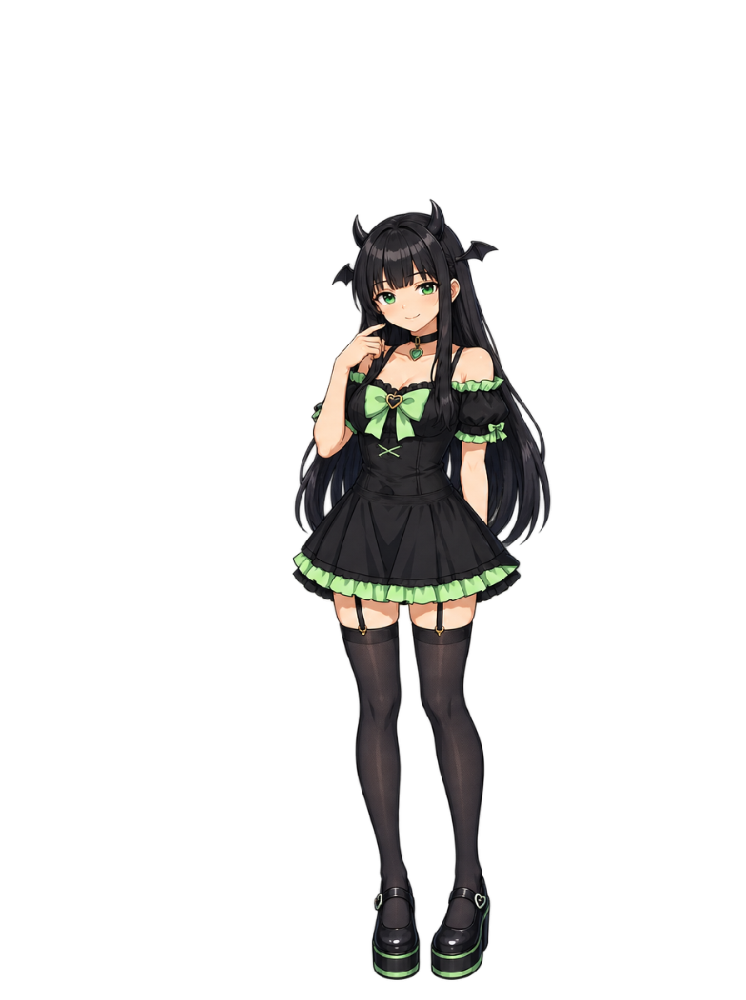
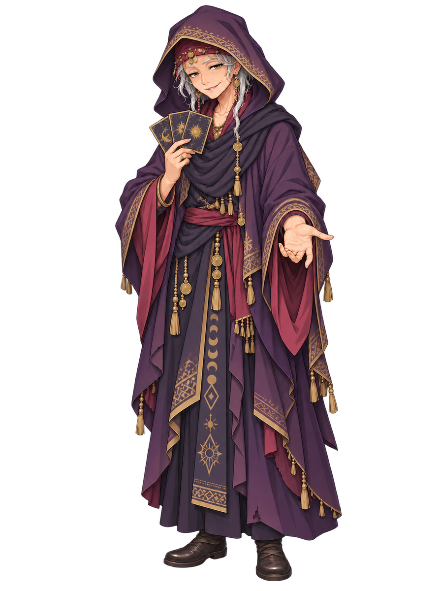
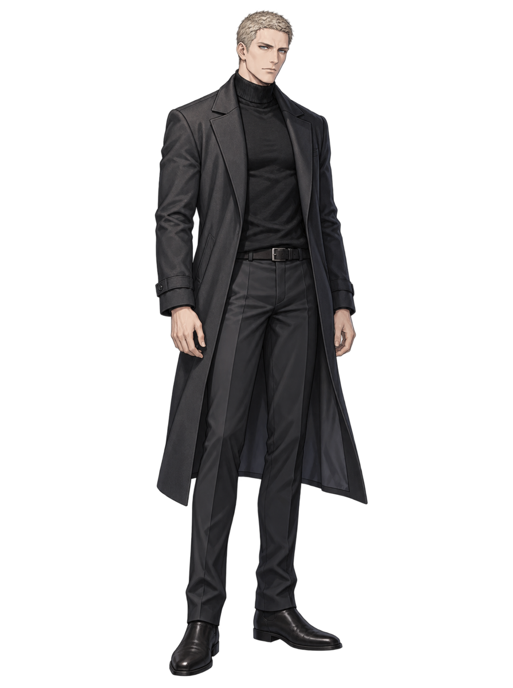
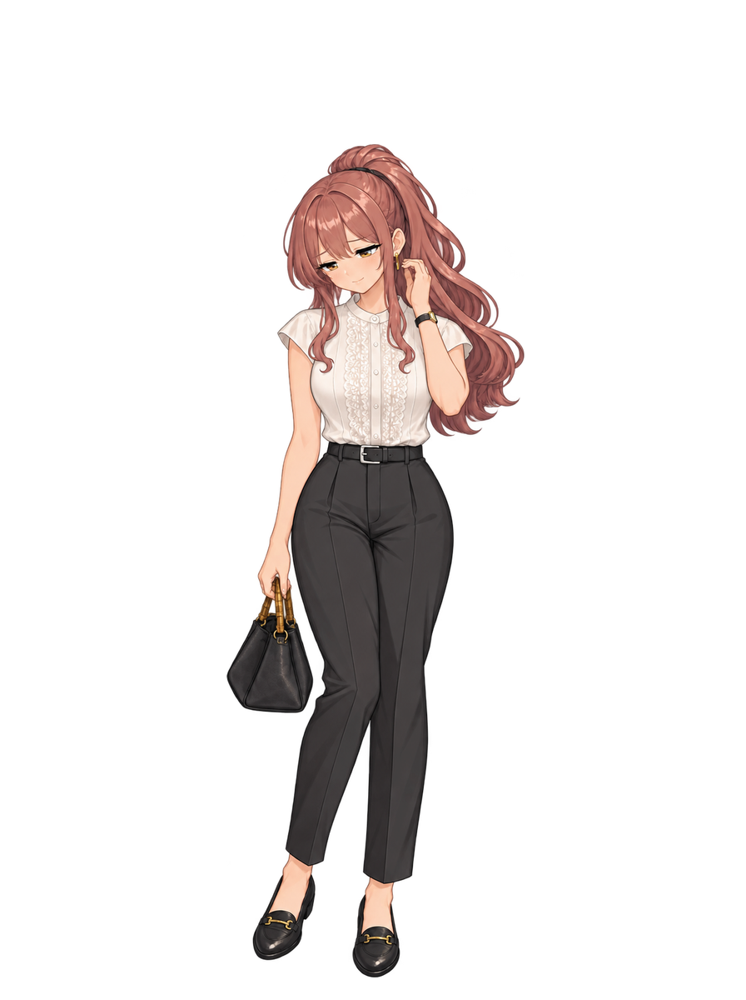
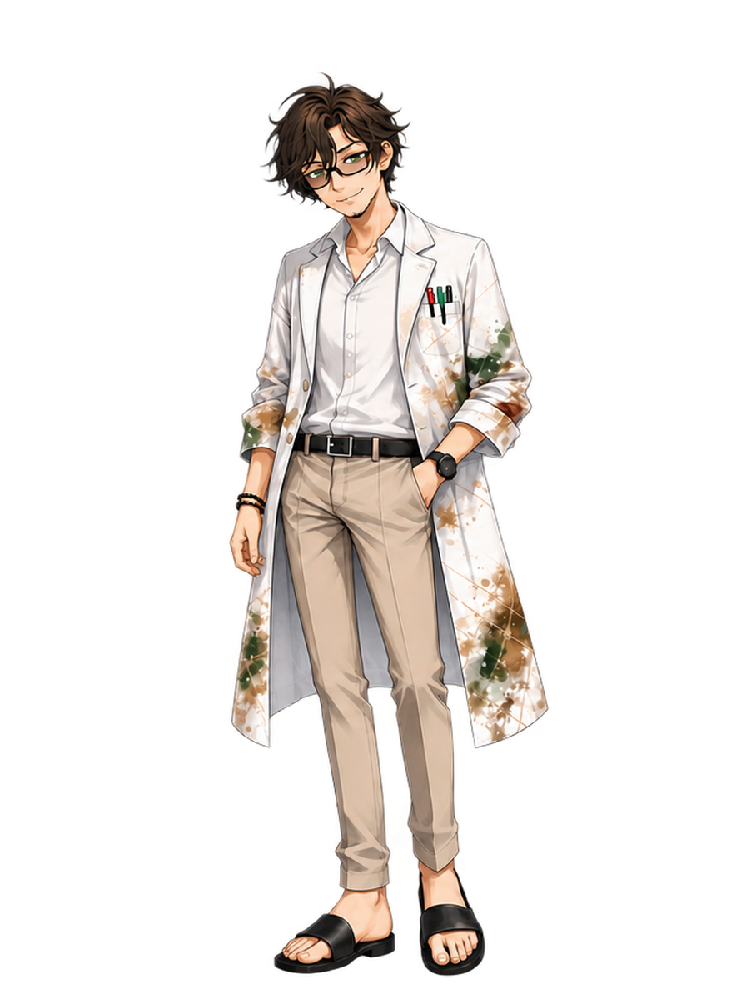

# 立ち絵・画風統一の試作（6人）

> **REIの新しい服装デザインは [新A・B・C比較](../../rei-look-929/README.md) へ。** このページのREIは旧衣装の画風試作で、新デザインの採用候補ではありません。

みんと・アゲハの正式立ち絵を画風の基準に、各キャラの通常立ち絵を1枚ずつ生成した比較用候補です。凛は対象外です。ゲーム内の画像は変更していません。採用前の試作で、位置合わせ・透過端・本人性の最終調整は未実施です。

左が現行、右が試作です。右のJPEGは見やすい背景色を付けた閲覧用で、透過PNG原画は無加工で保存しています。

## 画風の基準

| みんと | アゲハ |
|---|---|
|  |  |

### 零（REI）

線と刺繍を整理。背景のにじみが残るため、採用前に透過を要修正。

| 現行 | 試作 |
|---|---|
|  |  |

[試作の透過PNG原画](rei/normal-source.png) · [生成指示](rei/normal-prompt.txt)

### 組長

スーツの質感と陰影を整理。顔の変化は控えめ。

| 現行 | 試作 |
|---|---|
|  |  |

[試作の透過PNG原画](kumicho/normal-source.png) · [生成指示](kumicho/normal-prompt.txt)

### 路上占い師

布の粒状感を抑え、装飾を読みやすい形に整理。

| 現行 | 試作 |
|---|---|
|  |  |

[試作の透過PNG原画](uranaishi/normal-source.png) · [生成指示](uranaishi/normal-prompt.txt)

### ヴォルク

コートと顔をセル塗り寄りに整理。

| 現行 | 試作 |
|---|---|
|  |  |

[試作の透過PNG原画](volk/normal-source.png) · [生成指示](volk/normal-prompt.txt)

### ひより

髪・衣装の線と陰影を整理。元の絵に近い控えめな変化。

| 現行 | 試作 |
|---|---|
|  |  |

[試作の透過PNG原画](hiyori/normal-source.png) · [生成指示](hiyori/normal-prompt.txt)

### チャコール博士

白衣の汚れと布の陰影を整理。

| 現行 | 試作 |
|---|---|
|  |  |

[試作の透過PNG原画](dr_kemuri/normal-source.png) · [生成指示](dr_kemuri/normal-prompt.txt)
