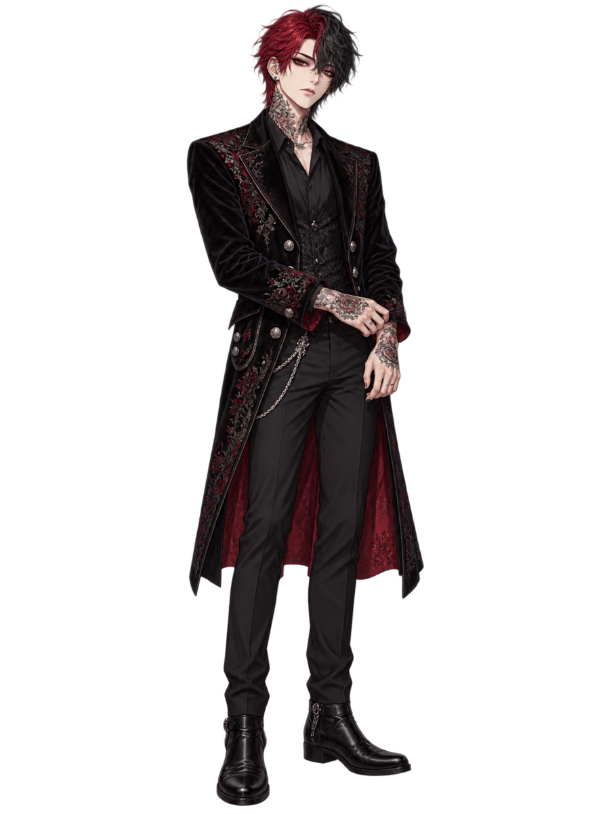
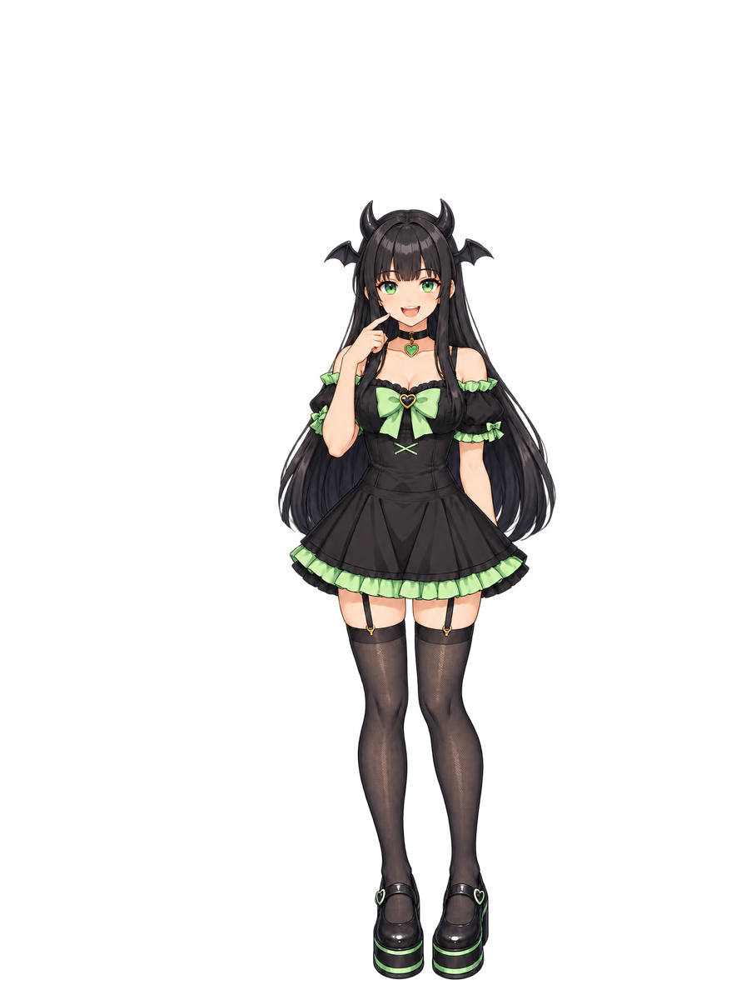
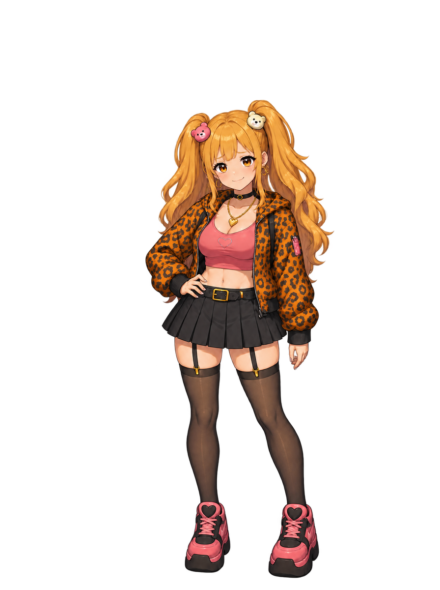

# REI 新デザイン A・B・C 比較

> **2026-10-26 最新採用：初期衣装をリメイクした版。** オーナーが本チャットで採用済みと再確認し、[PR #1011](https://github.com/haseatsu114514-dot/shisha-game/pull/1011) と [正式素材の記録](../portraits/style-unify-20261026/README.md) を照合した。現在の正式画像は `assets/sprites/characters/rei/chr_rei_normal.png`（黒い刺繍コート、黒髪に不規則な深赤メッシュ）。顔アイコンも#1011で反映済み。下のA/B/Cと追加比較は未採用の履歴であり、選び直し待ちではない。今後の表情・登場絵はこの正式normalを参照し、別衣装へ差し替えない。

[Issue #929 の外見指定・3案](https://github.com/haseatsu114514-dot/shisha-game/issues/929#issuecomment-6376954529)をもとに新しく制作した候補です。**今回の新3案は未採用で、本編の立ち絵・アイコン・登場絵は差し替えていません。**

V系が好きな25歳の一般の美形青年・店長。旧絵の舞台衣装・密な刺青・チェーンを減らし、顔と髪の本人性を保った普段着へ変更しました。画風は今回の指示に従って、みんと・アゲハの採用画像に寄せています。

## まず3案を並べて見る

| A：黒シャツ＋カーディガン | B：黒ジャケット＋赤インナー | C：バンド好きの私服 |
|---|---|---|
|  |  |  |
| [Aを大きく見る](A/normal-preview.jpg) | [Bを大きく見る](B/normal-preview.jpg) | [Cを大きく見る](C/normal-preview.jpg) |

Aは落ち着いた店長らしさ、Bは黒とワインレッドの配色、Cは音楽好きの普段着感を比べる案です。顔・髪・立ち姿はAを基準にそろえています。

## 画風の参照と現行REI

| 現行REI（旧デザイン） | みんと・現在の笑顔 | アゲハ・現在の通常 |
|---|---|---|
|  |  |  |

みんとの笑顔は、正面化案が不採用になったあと元の頭を傾けた笑顔へ復元された現行画像を参照しています。復元記録のSHA-256と一致を確認しました。前回の画風試作の基準欄はnormal画像で、今回ここではsmileを明記しています。

## サイズの扱い

- 全候補を896×1200へ一様縮小・配置。現行REIの可視全高・靴底の位置・横方向の重心へ合わせています。頭だけを拡縮する加工はしていません。
- `spriteScale`・manifest・正式画像は変更していません。このページは画像比較で、ゲーム画面の実表示検証ではありません。
- 原画は無加工で保存。候補の髪先が原画上端に接しているため、採用案を仕上げる際に頭上の余白を増やして再出力します。指輪の数や小さなタトゥー形状も最終調整対象です。

[寸法・位置・参照hashの記録](generation.json) · [透過の3案シート](candidates.png)

既存REIの細密な画風を基準にした[追加の3案比較](additional-20261026/README.md)も保存しています。こちらも未採用です。正式絵を選ぶまでは本編の画像を変更しません。

## 原画と生成指示

| 案 | 無加工原画 | 896×1200候補 | 生成指示 |
|---|---|---|---|
| A | [PNG](A/normal-source.png) | [PNG](A/normal-fitted.png) | [prompt](A/normal-prompt.txt) |
| B | [PNG](B/normal-source.png) | [PNG](B/normal-fitted.png) | [prompt](B/normal-prompt.txt) |
| C | [PNG](C/normal-source.png) | [PNG](C/normal-fitted.png) | [prompt](C/normal-prompt.txt) |
