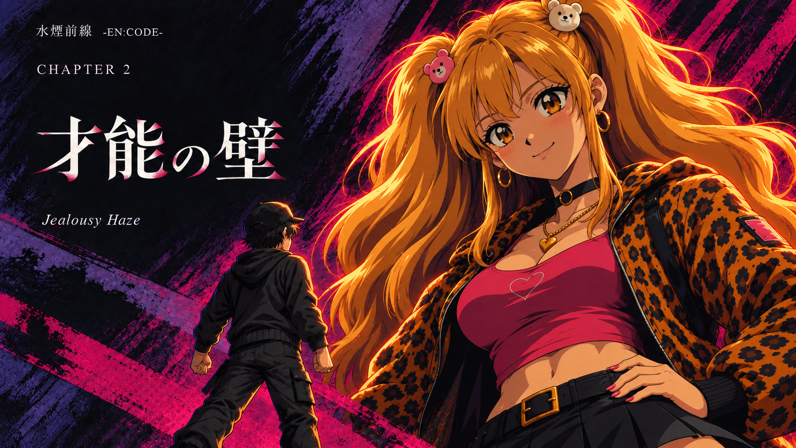

# 紬・第2章タイトルの90年代OVA風スタディ

Issue [#519](https://github.com/haseatsu114514-dot/shisha-game/issues/519) / 2026-10-13（JST）

オーナーの「紬を1枚だけ『BASTARD!!』のヨーコ／OVA風に」「女の子はヨーコみたいな可愛いのがいい」を受けた別バージョン実験。第2章の「巨大なアゲハの影にハジメが挑む」タイトルも同じ方向で描いた。正式採用・本編への接続は未実施。

## 今回の2枚

| 画像 | 狙い |
| --- | --- |
| [紬：水を差し出す](images/tsumugi-ova.png) | 大きく澄んだ茶色の瞳、柔らかい頬、小さな鼻と口。優しい心配の表情と、花刺繍の紫パーカー・茶色の短いボブを保つ。 |
| [第2章：才能の壁](images/ch2-ova-title.png) | アゲハの顔は可愛く親しみやすく。圧倒する天才の存在感は巨大な尺度、ハジメとの対比、橙色の髪の縁光と紫黒の背景で表す。 |

90年代OVAを参考にした有機的な線、大きな瞳、髪の帯状ハイライト、2〜3段階のセル影、絵具の背景。人物の本人性は正規立ち絵を参照した。作品名はオーナー指定の画風の参考で、外部作品の画像・ロゴ・衣装は同梱していない。

## 制作記録と初稿

プロンプト、添付した参照、SHA-256、生成時のネイティブ寸法、Issue予約を [generation.json](generation.json) に記録。原本PNGの再圧縮・切り抜き・拡大は行わず、そのまま保存している。横長の約16:9で、紬1672×941、第2章1671×941。

`archive/` は顔の可愛さを調整する前の初稿。特に第2章は唇・鼻筋・顎が大人びていたため、正規アゲハと最新の要望を添付して顔を描き直した。採用候補は上の `images/` の2枚で、初稿は生成経緯の保存用。

## 目視QA

- 正規の紬・アゲハ立ち絵、元の紬CG、第2章タイトルを開いて比較済み。紬21歳、アゲハ22歳の設定を維持する別画風の候補。紬のボブ・茶色の瞳・黒いピアス・花刺繍の紫パーカー、アゲハの金色ツインテール・熊のクリップ・金のピアス・チョーカー・ハートのネックレス・豹柄とピンクの衣装を確認。
- 最終2枚を開き、瞳・頬・顎・小さな口を確認。アゲハの初稿にあった強い鼻筋と立体的な唇を修正し、明るい小さな笑みにした。
- 紬の手とグラスの接触、水面、卓上のタブレットと猫のスケッチ、ペン、ハジメの前景を確認。第2章はアゲハの腰に置いた手、ハジメの後ろ向きの姿勢と拳、二人の大小関係を確認。
- 第2章の文字「水煙前線 -EN:CODE-」「CHAPTER 2」「才能の壁」「Jealousy Haze」を目視確認。既存タイトルをもとに生成画像へ含めた試作で、文字なしの分離レイヤーは今回作っていない。
- 機材・ホース・HMD・炭・喫煙描写なし。ガラスは水のグラス。機材の構造検品は対象外。
- 最終画像と初稿のPNG復号、RGB・不透明、寸法、SHA-256を確認済み。元の参照画像は変更していない。

## 検証・適用範囲

`git diff --check`、`python3 tools/check_agent_docs.py`、PNG復号／寸法／ハッシュ照合を実施。変更はこのフォルダだけ。ゲームのコード・データ・正式素材を変更していないため、ゲーム動作テストは実施していない。

採用済みCの第1章エンディングと予告、既存の第2章タイトル、正規立ち絵は維持する。採用する場合は、オーナーが選んだ画像を別の実装作業で接続する。

## 引き継ぎ

- WORKER: `codex-ova-study-20261013-5f470b9d`
- ISSUE: #519
- BRANCH: `codex/519-retro-ova-study`
- CLAIM: [38359462795](https://github.com/haseatsu114514-dot/shisha-game/actions/runs/38359462795)（成功）
- STATUS: [38359709631](https://github.com/haseatsu114514-dot/shisha-game/actions/runs/38359709631)（成功・同owner/run検証）
- DONE: 可愛さを優先した最終2枚、初稿、プロンプトと生成記録を保存。
- TODO: オーナーの選定後、採用画像の本編接続を別作業として検討。
- NEXT: この2枚を比較し、使う場合の範囲を確定。正式採用まで画像を自動置換しない。
