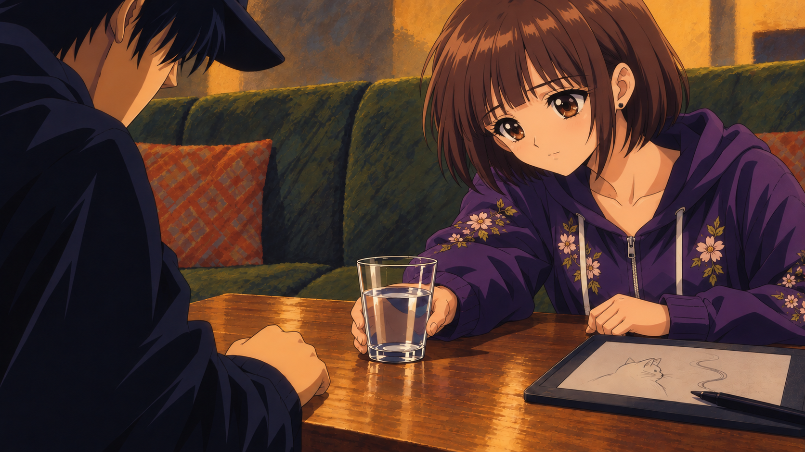
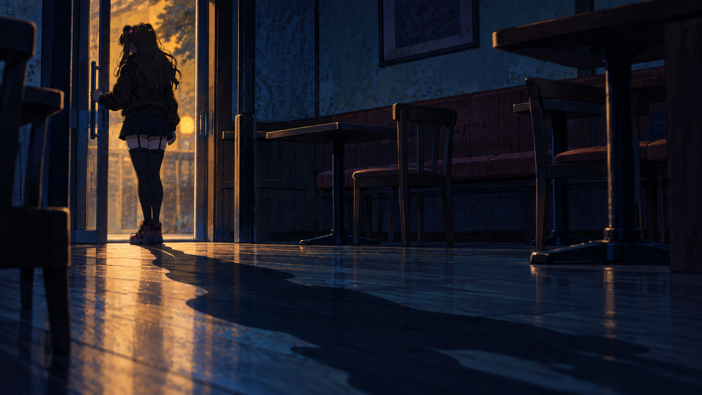

# 紬・予告の90年代OVA風スタディ

Issue [#519](https://github.com/haseatsu114514-dot/shisha-game/issues/519) / 2026-10-13（JST）

オーナーの「紬を1枚だけ『BASTARD!!』のヨーコ／OVA風に」「女の子はヨーコみたいな可愛いのがいい」を受けて描いた2枚。続く指示に合わせ、予告には顔・文字を隠した別構図のワンシーンを描いた。2章のタイトルコールで「あ、この子か」とつながる見え方を狙う。「ゲームに予告を組み込めたらマージして」の指示に従い、本編の採用済みCの次回予告へ接続した。

## 今回の2枚

| 画像 | 狙い |
| --- | --- |
| [紬：水を差し出す](images/tsumugi-ova.png) | 大きく澄んだ茶色の瞳、柔らかい頬、小さな鼻と口。優しい心配の表情と、花刺繍の紫パーカー・茶色の短いボブを保つ。 |
| [予告：入口の影](images/ch2-teaser-shadow.png) | 夜の店の入口を低い斜めの視点から見る。普通の大きさの人物の後ろ姿と、床に伸びる長い影。顔と目・口を見せず、髪飾りの小さなピンクだけを後から分かる手がかりにする。 |

90年代OVAを参考にした有機的な線、大きな瞳、髪の帯状ハイライト、2〜3段階のセル影、絵具の背景。人物の本人性は正規立ち絵を参照した。作品名はオーナー指定の画風の参考で、外部作品の画像・ロゴ・衣装は同梱していない。

## 予告から章頭への見え方

[約10秒の確認動画](teaser-to-title-preview.mp4)を保存。0〜6秒は文字なしの暗い予告カット、末尾0.4秒で暗転、6〜6.6秒は黒、6.6秒から顔の分かる章頭の参考画像へ切り替わる。無音で絵のつながりを見るための映像。

章頭側は[前回のOVAタイトル試作](images/ch2-ova-title.png)を比較用に使用した。予告の入口・後ろ姿・冷たい青から、章頭の正面の可愛い顔・巨大な尺度・暖色へ変わる。新しい予告画像自体に文字やロゴは含まれない。元のタイトル画像を暗くした流用ではなく、新しく描いた一場面。

## ゲームへの採用と録画

[音付きのゲーム録画・約53秒](gameplay/chapter-preview.mp4)は本編と同じ予告APIを確認ページで自然完走した実ブラウザ録画。予告本体は47.5秒、導入と終了画面を含めて52.9秒。Cの静かな曲、章名のあとに戻るみんとの言葉、最後の問いを維持する。

- [紬のゲーム画面](gameplay/tsumugi-desktop.png)
- [入口の影・PC](gameplay/shadow-desktop.png) / [スマホ横画面](gameplay/shadow-touch.png)
- [録画QA](gameplay/capture.json) / [本編接続9ケース](gameplay/ch1-preview-results.json) / [比較案4ケース](gameplay/chapter-preview-samples-results.json) / [匿名のスマホ表示](gameplay/shadow-touch.json)

第1章クリアの初回・クリア画面の再視聴・確認ページで同じ2枚を使う。予告の入口では話者名を表示せず、元の「……ごめん。理由は、聞かないで」だけを置く。章頭の人物画は予告に入れない。正式なWebPとPNG原画の照合は[採用記録](../ch2-preview/adoption.json)、進行と保存の仕様は[章末と次回予告](../../docs/spec/chapter_previews.md)。

## 制作記録と初稿

プロンプト、添付した参照、SHA-256、生成時のネイティブ寸法、Issue予約を [generation.json](generation.json) と [teaser-generation.json](teaser-generation.json) に記録。原本PNGの再圧縮・切り抜き・拡大は行わず、そのまま保存している。横長の約16:9で、紬と予告1672×941、前回のタイトル1671×941。確認動画のみ1280×720へ縮小して配置。

`archive/` は顔の可愛さを調整する前の初稿。特に前回のタイトルは唇・鼻筋・顎が大人びていたため、正規アゲハと要望を添付して顔を描き直した。今回の候補は上の紬・予告の2枚。タイトル試作と初稿は比較・生成経緯の保存用。

## 目視QA

- 正規の紬・アゲハ立ち絵、元の紬CG、第2章タイトルを開いて比較済み。紬21歳、アゲハ22歳の設定を維持する別画風の候補。紬のボブ・茶色の瞳・黒いピアス・花刺繍の紫パーカー、アゲハの金色ツインテール・熊のクリップ・金のピアス・チョーカー・ハートのネックレス・豹柄とピンクの衣装を確認。
- 紬と前回のタイトルを開き、瞳・頬・顎・小さな口を確認。アゲハの初稿にあった強い鼻筋と立体的な唇を修正し、明るい小さな笑みにした。
- 紬の手とグラスの接触、水面、卓上のタブレットと猫のスケッチ、ペン、ハジメの前景を確認。第2章はアゲハの腰に置いた手、ハジメの後ろ向きの姿勢と拳、二人の大小関係を確認。
- 第2章の文字「水煙前線 -EN:CODE-」「CHAPTER 2」「才能の壁」「Jealousy Haze」を目視確認。既存タイトルをもとに生成画像へ含めた試作で、文字なしの分離レイヤーは今回作っていない。
- 新しい予告を開き、文字なし・人物1人・普通の大きさ・目と口の描写なしを確認。髪の重なりと入口で輪郭を隠し、髪飾りの小さな色を残した。手とドア取っ手、足と床、後ろからの光と床の長い影を確認。正面の巨大な人物とハジメの構図を反復していない。
- 機材・ホース・HMD・炭・喫煙描写なし。ガラスは水のグラス。機材の構造検品は対象外。
- 5枚のPNG復号、RGB・不透明、寸法、SHA-256を確認済み。元の参照画像は変更していない。
- 確認動画を全編復号。1秒の予告、6.3秒の暗転、7.4秒の章頭をフレーム抽出して目視確認。H.264・1280×720・300フレーム・無音・実時間9.966667秒。

## 検証・適用範囲

`git diff --check`、`python3 tools/check_agent_docs.py`、PNG/WebP復号・寸法・ハッシュ照合、動画の全編復号を実施。`node remake/test/browser/ch1_preview.mjs` は9ケース、`node remake/test/browser/chapter_preview_samples.mjs` は4ケース成功。さらに844×390のタッチ画面で入口の影を表示し、名前なし・構図全体と字幕の収まり・保存不変を確認。録画でも全12カット、画像6枚の復号、字幕と操作の収まり、エラーなし、保存不変を確認。H.264/AAC・1280×720・52.9秒、音声の最大値−22.8dB。

本編への変更は予告の2枚、入口の話者名の省略、採用記録と資料。PNG原画と過去の比較案を保持する。第2章の章頭への接続は第2章開発側の範囲。

## 引き継ぎ

- WORKER: `codex-ova-study-20261013-5f470b9d`
- ISSUE: #519
- BRANCH: `codex/519-retro-ova-study`
- CLAIM: [38359462795](https://github.com/haseatsu114514-dot/shisha-game/actions/runs/38359462795)（成功）
- STATUS: [38374804361](https://github.com/haseatsu114514-dot/shisha-game/actions/runs/38374804361)（ゲーム組み込み開始時に成功・同owner/run検証）
- DONE: 紬と匿名の入口の影を本編Cへ接続。原画・初稿・比較用タイトル・生成記録・確認動画、ゲーム録画と動作確認の結果を保存。
- TODO: 第2章の章頭の実装は第2章開発側の範囲。
- NEXT: 次の素材変更では本資料と正式WebPの採用記録を照合する。
