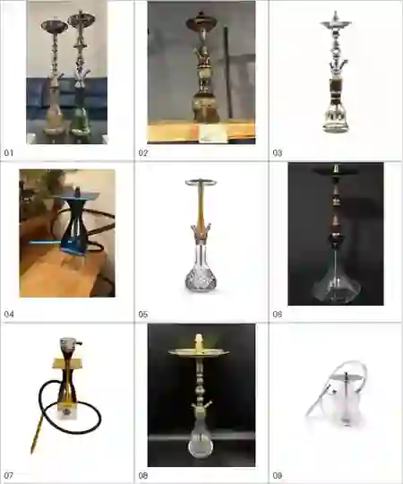

# シーシャ台の実物参考 — 形とバリエーションのガイド

**オーナー追加指定（Issue #360、2026-10-12）：容器と裸の先端を大きくしない。** フレーバー用タッパーは、今回提供の写真のような小さく浅い角丸矩形の密閉容器とする。深い大型在庫箱のように描かず、カウンター・棚・手・機材との縮尺と遠近を確認する。ハガル未装着時は、広く薄い皿の中央に短く細い金属接続部と小さな先細りの黒いゴムを描く。上部を大きなボウル・キャップ・きのこ・HMDにしない。ゴムの小さな開口と金属との接点を保ち、皿やステムを削って縮小を代用しない。ボウル装着・喫煙時は別の完成状態ルールに従う。写真由来のラベル文字・ブランドは複製しない。

今回の実生成・修正前後・不採用理由は [セットBの縮尺修正記録](../ch1-visual-quality-issue360/set-b-facilities/owner-scale-corrections.json)。2枚の追加写真は会話から生成機能へ直接添付して参照した。元の添付ファイルは作業環境にダウンロード経路がなく、生成絵を元写真として保存していない。今後の生成前メモに「小さく浅い容器／短い金属接続部＋小さいゴム」を入れ、生成後は全景と先端の拡大を両方検品する。

追加採用の制作参考：[フレーバーの透明タッパー保管4写真・炭は通常2〜3個、稀に4個](flavor-storage-tubs-issue396/README.md)。炭数は画像の選択モデルへ適合させる。ゲームの装備・初期炭・採点仕様は変更しない。

> **生成するときのルールは [`docs/shisha_reference.md` §4「画像生成の必須手順」](../../docs/shisha_reference.md#4-画像生成の必須手順機材の形と構造) が正本**（2026-11-02）。このフォルダの `*.webp` は提供写真を1枚150px前後に縮めた一覧で、形の幅をつかむ用途にしか使えない。生成ツールに渡す実写は [`photos/`](photos/README.md) に集める（2026-11-02時点では未収集）。早見表と構造図（[drawing-sheet/](drawing-sheet/README.md)）は理解・検品用で、生成ツールには渡さない。

> 2026-10-09 オーナー提供の写真9点を縮小した一覧。これは**機材の形・色・素材・装飾の幅をつかむための参考資料**であり、どれか1台を完全に再現するための指示ではない。ゲーム用の素材として写真をそのまま使用しない。オーナー提供写真の出典・権利関係は個別に確認できていないため、メーカー名・ロゴ・特徴的な柄の忠実な模写を避ける。

## 写真インデックス（左上から右下へ）

| 番号 | 元の添付 | 参考にする点 |
|---|---|---|
| 01 | `IMG_1197.jpeg` | 背の高い伝統的な金属ステム、皿、装飾入りの大きなガラスベース。金・銀・緑・透明ベージュなどの組み合わせ |
| 02 | `IMG_1196.jpeg` | 背が低めで細かな金属装飾の伝統型。金色金属と濃色の装飾ガラス |
| 03 | `IMG_1195.webp` | 銀色の曲線的な金属ステムと透明な広口ガラス、金の帯装飾 |
| 04 | `IMG_1194.jpeg` | 角型クリアベースと角型トレー、青・黒の現代的なフレーム、太いホース |
| 05 | `IMG_1192.jpeg` | 細長い木製ステム、薄い丸トレー、カットガラス調ベースの自然素材×高級感 |
| 06 | `IMG_1191.jpeg` | マットな黒・ダークブラウン・金の組み合わせ、段のある木製ステム、幅広いガラスベース |
| 07 | `IMG_1199.jpeg` | 金・黒の角型ボディと透明な角型ベース、ホース、上部ヒートマネジメント器具の組み合わせ |
| 08 | `IMG_1198.webp` | 緻密な金色彫金、長い金属ステム、装飾的なトレー、カットガラス |
| 09 | `IMG_1200.jpeg` | 低重心の透明・白系モダン台、ガラス本体、金属軸、ホースの柔らかなループ |

## 画像生成・背景・CGで守る考え方

- **実物の構造に説得力を持たせる。** 基本は上からフレーバーボウル（または準備中なら小さな凸型の金属ポスト）／炭受けの皿・トレー／縦のステム／水を入れたベース・ボトル。ホースは本体の接続口につながる。用途・機種で高さ、接続方法、部品の見え方は変わる。
- **構造を1型に固定しない。** 01〜03・08の彫金や伝統型、05〜06の木製、04・07の角型・金属フレーム、09の低い透明型はいずれも成立する例。縦長に限らず卓上型もよい。
- **色・素材・細部は創作可。** 金・銀・黒・木目・真鍮・青・緑・透明・琥珀色、彫刻・ガラス模様・直線的な形などを世界観や店ごとに組み合わせ、他の色にも自由に変えてよい。
- **写真の複製ではない。** 9点を形状辞書として使う。特定写真の輪郭、装飾、ロゴ、独自意匠を一対一でトレースしない。写真内の値札、背景、文字、ブランドロゴを生成しない。
- **シーシャらしさを優先。** ただの花瓶・燭台・照明・香水瓶・パイプの混合物にしない。皿だけが浮く、ホースが本体につながらない、水槽や筒が不自然、接続口や部品数が破綻する絵を避ける。
- **場面に応じる。** シーシャ台を描く依頼ではこの資料を参照。台を映さない演出や台を取り去る指定がある画像に、無理に台を追加しない。作りパートでボウル未装着の先端を描く場合、従来の「小さい凸型金属ポスト」を守り、上端を大きなボウル一体型にしない。
- **絵柄はゲーム優先。** この資料は写真だが、採用絵は本作のピクセルペインター調・既存背景と整合する描写。写実的な写真化を強制しない。

## 生成プロンプトに入れる短いルール

> `asset_sources/shisha-hardware-reference/README.md` の実物参考9種を参照し、シーシャ台としての構造・接続・材質感を理解して描く。いずれかの写真を完コピせず、形状・色・装飾・比率は場面に合わせ自由にデザインしてよい。伝統型、木製、角型モダン、透明低重心型などの差を活かす。ロゴ・文字を複製せず、本作の画風に合わせる。シーシャ台が不要な場面には足さない。

## 人物の吸い方とヒートマネジメントの追加参考

2026-10-09 追加写真10点の[喫煙シーン7点とヒートマネジメント3点](smoking-and-heat-management-20261009.md)を参照。シーシャ台を**使っている場面**では人物との大きさ、ホースの接続・握り方・口元への届き方、煙の出方も確認。**上部の熱管理器具**を描く場合は、フレーバーボウルとHMD（蓋付き・穴あき筒・網状など）とキューブ炭の上下関係を確認する。使用シーンとボウル未装着の製作中を区別し、写真の人物や商品を模写せず自由に創作する。

## アルミ・HMD・炭の近接写真（9点）

2026-10-09 提供の[近接写真9点と構造別の生成ルール](heat-management-closeups-20261009.md)を参照。穴あけアルミに炭を直置きする方式とHMDを使う方式を区別し、灰をまとった角炭・赤い発光・アルミのしわ・陶器と金属の接点を自然に描く。**写真にある機材を無断でゲームの標準機材へ追加しない**。
## 追加構図とAI誤描写防止（2026-10-09）

- [アルミ・煙突型・台の設置場所・人物との構図の写真9点](usage-and-installation-20261009.md)
- [これまでの37写真を横断した、ハガル／アルミ／HMD／接続・構図の誤描写防止ガイド](ai-generation-structural-pitfalls.md)

## 追加の構造図・外部リサーチ（2026-10-09）

- [オーナー提供の実物構造図3点：部品名／接続／パージ／空気の通路](anatomy-diagrams-20261009.md)（縮小一覧と写真番号）
- [ハガル内部の穴、アルミ穴あけ、炭の配置、HMDの種類：外部出典の調査](bowl-interiors-foil-coal-placement-20261009.md)
- [内部吸気穴の位置を説明する自作SVG模式図](bowl-interiors-types-20261009.svg)（伝統型／ファンネル／ボルテックス）

## ホース・マウスピース・喫煙姿勢の追加資料（2026-10-09）

- [使い捨て／首掛けマイマウスピース、ホース先端、人物の持ち方の追加写真6枚と詳しい誤描写防止ルール](hose-and-mouthpieces-20261009.md)
- [ホースの部品と接続を示す自作模式図](hose-mouthpiece-connections-20261009.svg)
- ボウル内部の外部調査は引き続き[ハガル内部・アルミ・炭配置の調査](bowl-interiors-foil-coal-placement-20261009.md)を参照。

## ホースハンドル4点・マウスピース3点（追加）

[追加画像7点／素材／接続／スキン発想](mouthpiece-handle-skins-20261009.md)を参照。トングは次の実物画像を待って別カテゴリに整理する。

## 生成後チェック（2026-10-09）

- [ヒロインのシーシャ画像で実際に生じた「チェーンだけのマイチップ」「接続されていないホース」を防ぐ具体的なQAと再生成条件](visual-qa-necklace-hose-20261009.md)
- [日常・タイトルCG：正規の顔、具体的HMDモデル、装着時・手持ちの縮尺、背景の変化](heroine-title-cg-rules-20261009.md)
- [不採用NG原画：みんとのホースがY字に分岐する例](ng-examples/README.md)
- [装着状態・手持ちのハガル／HMDの縮尺を調べた実写の出典](installed-and-handheld-scale-20261009.md)
