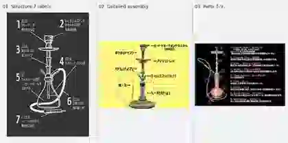

# 提供されたシーシャの構造図3点と構造理解（2026-10-09）

ユーザー提供の構造図3点（`IMG_1236.jpeg`／`IMG_1234.jpeg`／`IMG_1233.webp`）の**縮小一覧**。構造を理解する補助であり、その図の機種だけが正解ではない。元図の商標・レイアウト・説明文を画像生成でコピーしない。

| 図 | 見るべきこと | 注意 |
|---|---|---|
| 01：黒背景・7項目 | 上からトップ、熱管理、縦のパイプ、ベース内の水、ホース、吸い口。内部へ伸びるパイプの位置 | 上部の「熱管理」や下部の「フィルター」は**すべての機種に必須ではない**。透視図は吸い込み経路の略図 |
| 02：黄色背景・実機部品名 | **HMS/HMD → ボウル（トップ） → アッシュトレー → ステム → 接続口（ホース/パージ） → ベース**という縦の位置関係 | フレーバーを詰める「ボウル」と、「水を入れるベース」は別物。HMS/HMDの呼び名やホース接続位置は機種差あり |
| 03：番号つき部品一覧 | Ceramic Bowl、Charcoal Tray、Stem、Outlet、Hose Adapter、Hose、Bottle、Bottle Rubber、Mouthpiece | 吸い口はホースの先端。ゴムパッキンは接続部に置き、ボウル上に貼るホイルやHMDと混同しない |

## 実機の機能分解

1. **ボウル／トップ／ハガル**：フレーバーを収める器。内部には伝統型・ファンネル型等の吸気口が存在する。
2. **熱源と熱管理部**：角炭、穴あきアルミ、HMD／HMS、チムニー、網等。方式によって組み合わせる。全部必須ではない。
3. **アッシュトレー（受け皿）**：上部ステムに付く皿。落ちる炭や灰を受ける。**ボウルやHMDではない**。
4. **上部ステム・ボディ**：縦に伸びた軸。途中の飾り（木・真鍮・銀色金属）は煙の通路全体の材質と必ずしも一致しない。
5. **ハート／ポート／パージ**：ホース接続口と、余分な煙を吐き出すパージ弁は**別の機能**。見た目に似た斜めの口を、2本ともホース接続口にしない。多口や隠しパージの例外あり。
6. **ダウンステム（ベース内管）**：ベースの水面下へ延びる管。先端にディフューザー（泡を細かくする部品）が付く場合もあるが**常時必須ではない**。
7. **ベース／ボトル**：水面が見えるガラス等の容器。水面下のダウンステムから気泡が立ち上がり、ベース上部の空間へ抜ける。
8. **ホース → マウスピース**：ベース上部につながるホースポートと吸い口。ホースがボウル上部や受け皿から生えてはいけない。

### 空気と煙の流れ：吸うときとパージするとき

**吸引時（典型的な1ホース）**

`外気 → 炭の周辺 → （ホイルの穴／HMDの通気口） → フレーバー入りボウル → ボウル内部の吸気口 → 上部ステム内の通路 → ダウンステム → 水面下から気泡 → ボトルの水面上の空間 → ホースポート → ホース → 口`

**パージ時（排気可能な構造）**

`口からホースへ息を吹く → ベース上部の空間が加圧 → パージ弁が外向きに開く → 煙が外に抜ける`

- パージ弁は球状の逆止弁を使う機種がある。吸うときには外気が逆流しないよう閉まる。ホースポートをパージ弁と同じものとして描かない。
- マルチホースや特殊な一体型本体は例外。下流のホース位置は写真・その機種の設計を優先。

## 構造の追加一次・専門資料（元画像を転載しない）

| 分類 | 参考資料・リンク | 参照ポイント |
|---|---|---|
| 主要な部品・内部経路 | [米国心臓協会の学術レビュー（Design and Operation、図1）](https://pmc.ncbi.nlm.nih.gov/articles/PMC6600812/) | 上部ヘッド・ダウンステム・水入りベース・ホースの原理。写真では分からない管内の流れ |
| 実物部品の全体図 | [Hooky Shishaのメーカー取扱説明書（PDF）](https://www.hooky-shisha.com/document/userguide-steel.pdf) | 上部アダプター、受け皿、バルブ、ホース接続口、ダウンステムの分解・接続。**特定製品の設計例** |
| ホースとパージの区別 | [Hookah.com のパージ弁解説](https://hookah.com/blog/romancing-the-smoke-purge-valve-and-hose-ports) | 球状逆止弁の役割と、ホース吸引時／排気時の違い |
| 基本の部品辞書 | [Hookah.orgの各部名称](https://www.hookah.org/hookah-beginners/) | ディフューザー、ハート、ベースの気密、パージの定義 |

※上述は外部の参考先を示すもので、図・文章・写真のコピーをリポジトリに取り込んでいない。

続き：[ハガルの内部と穴あけ・炭配置の調査](bowl-interiors-foil-coal-placement-20261009.md) ／ [AIの誤描写防止一覧](ai-generation-structural-pitfalls.md)
