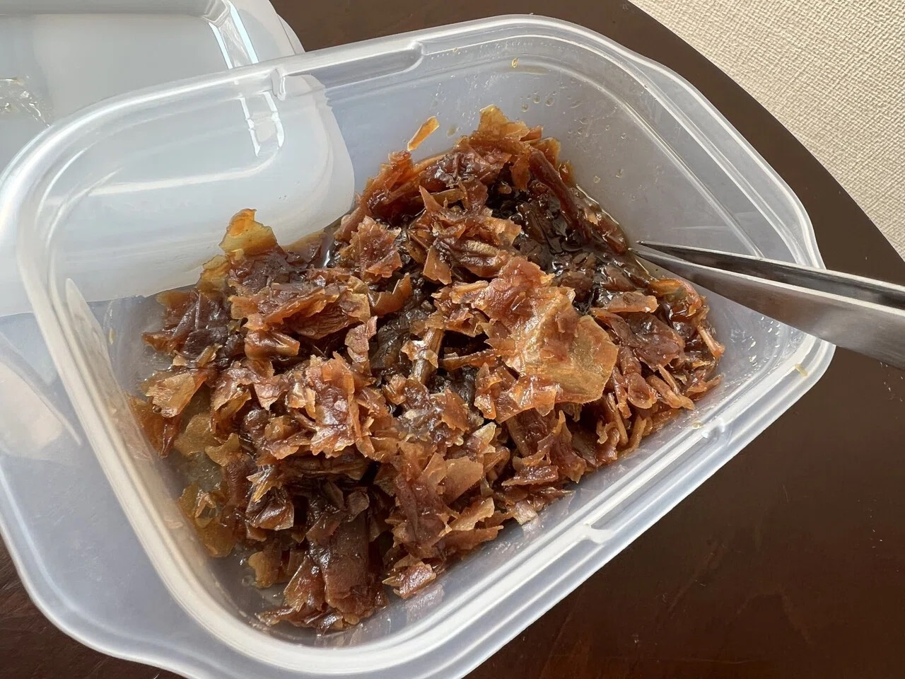

# フレーバーのタッパー保管・炭数の描写参考

Issue #396。オーナーの2026-10-11 UTCの追加指示で**制作参考として採用済み**。缶を全員に反復するより、写真のような透明／半透明の密閉タッパーを優先する。写真は実物構造の参考で、CGの完成・採用承認とは分ける。

## 提供写真4枚（原本を無加工保存）

| 原本 | 観察点 |
| --- | --- |
| [01 青系の密閉縁](photos/01-sealed-blue-rim.jpg) | 低い角丸矩形の透明容器、半透明蓋、濃青の密閉縁、側面に小さなラベル。葉は内部にあり外へ露出しない |
| [02 白い蓋](photos/02-sealed-white-lid.jpg) | 角丸矩形、白い樹脂蓋、透明側面、少量の葉。正面ラベルは実商品文字を参考CGへ写さない |
| [03 開いた容器と湿った葉](photos/03-open-wet-leaves.jpg) | 開口は矩形、側壁・角・上縁に厚み。茶系の不揃いな葉片、蜜状のしっとりした光沢。粉・炭・液体だけの容器にしない。蓋は外した状態で葉を扱う |
| [04 店内の積み重ね](photos/04-stacked-shop-storage.jpg) | 蓋を閉じた小容器を安定して積む。内容物・ラベル位置が容器と整合。原本233×350と小さいため細かな文字や寸法の根拠には使わない |

出典状態・原本サイズ・SHA256は [photo-sources.json](photo-sources.json)。オーナー提供で参考保存を依頼されたもの。撮影者や外部出典・商用再配布権は未確認なので、実物写真を配信ゲームへ直接入れず、ブランド・ロゴ・文字・ラベル意匠を模写しない。寸法・容積・特定製品の仕様は写真だけで断定しない。

## 今回から使う制作条件

- 店の常用フレーバー保管は**透明／半透明の角丸矩形タッパー**を優先。卸の商品パッケージや試香用の小皿・缶は文脈で残せるが、全員の手元・棚を一様な丸缶へしない。
- 保管時は蓋を閉め、準備・取り出し時は開けて蓋を別置き。容器の厚み、底、葉の量、開閉状態、棚の積み重ねを成立させる。
- **追加のオーナー指示：タッパーは規則的に並べて保管する。** キャラや店ごとにランダムな向き・間隔・段違いの塔へしない。同じ棚では前面・ラベルの向き、底面、蓋の高さ、間隔を揃えた列にする。積む場合も同じ底面同士を揃え、棚や容器へ実際に接地させる。
- **縮尺は手・人物・棚の奥行きで照合する。** 背景へ置いた同系統容器を、手前と同じ画像上の大きさにしたり、人の頭ほどの巨大な箱へしない。今回のみんとv2は手前の大きさを維持し、背景だけを縮小する。画像ごとに近景・遠景の容器を並べて確認し、実寸未確認の写真から万能のcm規格を作らない。
- **シールの位置：容器本体の平らな前面に貼り、蓋や密閉縁を跨がない。** 底より上・蓋の縁より下で、重ねても各段のシールが見える位置を揃える。葉の中や棚板に浮かせない。今回の手前容器は長い面をカメラへ向け、その広い前面へシールを配置し、横向きの短い端面にだけシールが見える不自然さを直す。
- **最新オーナー指示：フレーバー名のペン書きは、読めない程度に小さく柔らかい筆跡でよい。** 「何か書いてある」と分かる実用的な保管表示を白系シールへ置き、名前を大きく読ませる演出をしない。実在ブランド・宣伝・誤った擬似文字は写さない。画像全体をぼかさず、インクの細い筆跡だけを遠近・光学的な読みにくさへ合わせる。文字のために容器を拡大しない。この指定は従来の文字なしルールのうち保管シールだけを上書きする。
- 2段に重ねる保管も標準的な例として描く。同じ底面・蓋の形が合う容器を真上に積み、列と各段の前面シールを整える。全棚へ機械的に同じ段数を強制せず、量と収納空間に合わせる。
- 葉は湿った不揃いな茶／暗褐色の葉片。色はフレーバーや材質の違いがあり得るが、瓶の中に色付きの液体しかない表現や、燃えた炭と混同する表現を避ける。
- **炭は通常2〜3個、4個は稀な構成。** 各画像で個数と大きさを先に決め、HMD・ボウルの実寸と蓋の状態に適合させる。通常例だからと小さいHMDに3個を無理に詰めない。準備前・洗浄中にはまだ炭を足さない。
- ONMOやLotus I+等の個別仕様を優先し、炭は受け面に収める。ヒロインの完成／喫煙CGでは既存どおりHMDを使い、直炭へ変えない。
- 既存正式タイトル18枚は維持。未採用候補の問題箇所から小さく修正する。ゲームの初期3炭、解放条件、温度、スコア、価格・能力へこの画像ルールを転用しない。

## 今回の修正候補

既存の未採用みんと準備CG（`../../heroine-title-candidates-20261009/minto/title_art_minto_02_opening_prep.png`）を人物・服・手元の器具を保ちながら、手元の丸缶と棚をタッパーへ、室内蔦を窓・壁へ直す。正式営業立ち絵・タイトルの粒子感・今回の実物原本を生成に添付する。原画・指示・比較・検品は [candidate](candidate/) へ。**原画の最終採用と本編登録は未承認。**

他の缶が見える別候補はましろ02・つむぎ02・凛02など。コーヒー豆の瓶・私生活小物をフレーバーと誤認して変えない。凛の卸商品缶や試香缶は正規設定の文脈も確認してから選定する。まとめて置換しない。
