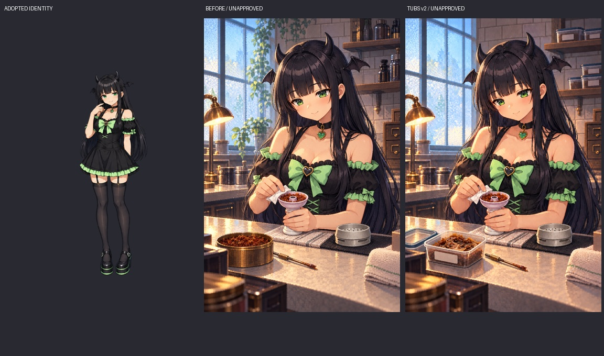

# みんと準備CG：丸缶から透明タッパーへの修正案

- 最終比較用原画：[v2 PNG](minto-opening-tubs-v2.png)、[生成指示](minto-opening-tubs-v2.prompt.txt)。**オーナー未選定、本編未登録**。
- 途中履歴：[v1 PNG](minto-opening-tubs-v1.png)、[初回指示](minto-opening-tubs.prompt.txt)。内容が角張った均一片に寄ったので、実写03を再添付して不揃いな薄い湿った葉へ修正。v1を最終候補として扱わない。
- 元候補は上書きせず保持。人物・機材・衣装の基準は正式営業立ち絵、粒子感は正式keyvisual、容器はオーナー実写を使用。ハッシュ・実参照順・QAは [metadata.json](metadata.json)。
- v2は原寸で、緑目・黒長髪・角・蝙蝠・黒緑衣装、手元の脚付きボウル、別置きの冷たいHMDを比較。手元の容器は開き、蓋が左に別置き。棚は閉じた容器、無地ラベルでブランド文字なし。植物・炭・ホース・煙は0。
- 生成編集なので顔・手・HMD通気スリット等の画素は微変化している。完全な局所差分や実機の精密再現としては扱わず、採用前に比較して判断する。

**タッパー優先と炭2〜3個（稀に4個）の参考方針はオーナー指示で採用済み。生成CGの正式採用は別の承認待ち。** 本編PNG・WebP・manifest・タイトル18枚・ゲーム装備・炭数解放・価格・能力を変更しない。
