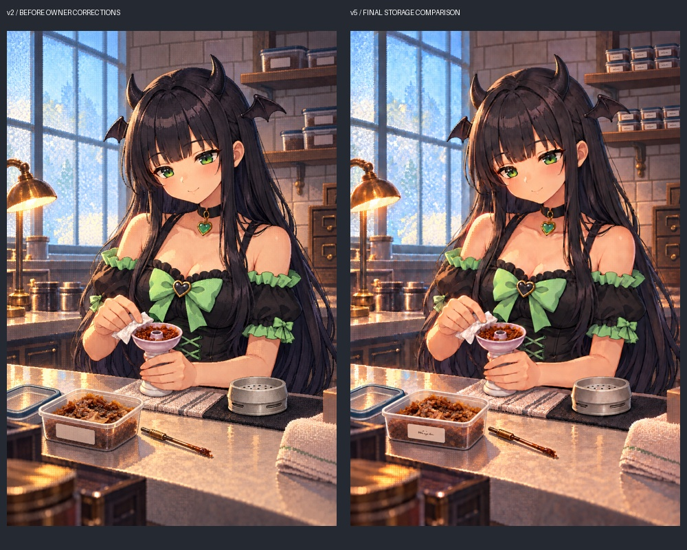

# みんと準備CG：丸缶から透明タッパーへの修正案

- 最終比較用原画：[v5 PNG](minto-opening-tubs-v5.png)、[生成指示](minto-opening-tubs-v5.prompt.txt)。**本編未登録**。ユーザーの「マージして」は本PRの候補保存と参考ルールへの指示として記録し、ゲームへの画像登録は別途選定する。
- [手前の向き・シール・文字のv4→v5比較](v4-v5-front-label.jpg)。手前サイズを保ち長い面をカメラへ向け、その広い前面へシールを配置。短い端面には置かず、文字は読めない程度の小さく柔らかい筆跡へ。背景は各棚3列×2段、小型・整列・接地を維持。
- [背景を小型化した棚の旧比較](shelf-detail-v2-v4.jpg)は履歴として保持。v4の読みやすい名称は最新指示で採用せず、v5へ修正。各背景容器は手前の約1/4の見かけ幅として照合した。
- [v2](minto-opening-tubs-v2.png)は背景容器が大きすぎるというオーナー指摘を記録し、旧比較として保持。[v3](minto-opening-tubs-v3.png)は縮尺・列の中間修正。[旧・丸缶からv2の比較](before-after.jpg)と全原画・全指示を保持。
- 途中履歴：[v1 PNG](minto-opening-tubs-v1.png)、[初回指示](minto-opening-tubs.prompt.txt)。内容が角張った均一片に寄ったので、実写03を再添付して不揃いな薄い湿った葉へ修正。v1を最終候補として扱わない。
- 元候補は上書きせず保持。人物・機材・衣装の基準は正式営業立ち絵、粒子感は正式keyvisual、容器はオーナー実写を使用。ハッシュ・実参照順・QAは [metadata.json](metadata.json)。
- v2は原寸で、緑目・黒長髪・角・蝙蝠・黒緑衣装、手元の脚付きボウル、別置きの冷たいHMDを比較。手元の容器は開き、蓋が左に別置き。棚は閉じた容器、無地ラベルでブランド文字なし。植物・炭・ホース・煙は0。
- 生成編集なので顔・手・HMD通気スリット等の画素は微変化している。完全な局所差分や実機の精密再現としては扱わず、採用前に比較して判断する。

**タッパー優先と炭2〜3個（稀に4個）の参考方針はオーナー指示で採用済み。生成CGの正式採用は別の承認待ち。** 本編PNG・WebP・manifest・タイトル18枚・ゲーム装備・炭数解放・価格・能力を変更しない。
