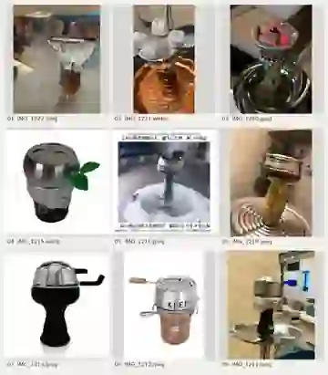

# アルミ直置き・HMD・ボウルと炭の見た目：追加参考9点

> 2026-10-09 にオーナーから追加された写真9点。製品の宣材画像、店の実写、個人の撮影写真が混在する。**ゲームに写真そのものを使うのではなく、形状・構造・素材感・炭の状態を理解するための参照資料。** 色・柄・ボウル・HMDの組み合わせは自由に創作してよい。ブランド名、文字、装飾柄、実製品の独自形状は模写しない。

## 写真別の観察ポイント

| No. | 元画像 | 描写に活かせる点 |
|---|---|---|
| 01 | `IMG_1222.jpeg` | ボウルに張った銀色のアルミホイル。縁から垂れるシワと折り込み、上に載る角炭2個。下には受け皿 |
| 02 | `IMG_1221.webp` | アルミ上の小穴・灰をまとった角炭4個。灰色の表面と炭の角の残り方、外周寄りの配置 |
| 03 | `IMG_1220.jpeg` | 鮮やかな陶器ボウル、ホイルの反射、小さな角炭3個を三角に置いた例。灰色と赤い発光が共存 |
| 04 | `IMG_1215.webp` | 丸い金属製HMDの蓋と調整用のつまみ。ボウル・ホイル・HMDが重なる見せ方の一例 |
| 05 | `IMG_1216.jpeg` | 金属容器状のHMDに炭を載せた例。上から見える炭と通気スリット、厚手陶器ボウルとの関係。掲載広告の文字は参照しない |
| 06 | `IMG_1219.jpeg` | 陶器の黄色系マーブル柄と、背の低い金属HMDの組み合わせ。上部の浅い円筒、側面スリット |
| 07 | `IMG_1214.jpeg` | 黒い陶器ボウルとドーム型の銀色HMD。複数のハンドル、金属蓋の高さ・金属の厚み |
| 08 | `IMG_1212.jpeg` | 木製ハンドルが伸びる開口模様つきの金属熱管理器具と陶器ボウル。固定部品や重なりの幅も参考 |
| 09 | `IMG_1211.jpeg` | ホイルで巻いた陶器ボウルに短い筒状のHMDを載せた例。穴・側面スリット・青い調整つまみ、受け皿との位置関係 |

## 生成時に区別すること

**A：穴あけアルミに直接炭を載せる方式**

- ボウルの口をアルミが覆い、縁にしわ・巻き込みが出る。アルミ上の小穴と、その上に置かれた角炭が視覚的な手掛かり。
- 炭は2〜4個など実例で異なり、本編の基本の「三角配置」は通常3個を想定する。写真の4個配置をゲーム全体の新しい標準にしない。
- 灰をまとった炭の外側は白〜灰色、端や内側に赤〜橙の発光が見えることがある。全体を炎の塊にしない。
- アルミの穴は工程で実際にあける小穴で、巨大な切り抜き・規則的な丸窓・蜂の巣模様とは違う。

**B：ヒートマネジメント器具（HMD）を載せる方式**

- HMDは、陶器／素焼きボウルと炭とは別の**金属製の熱管理部品**。浅い金属の皿・蓋付きの容器・スリット付き筒・ドーム・透かし模様など多様な構造を取り得る。
- フタ、つまみ、ハンドル、スリット、穴の形は器具ごとに違う。すべての器具に同じ機能や蓋を足さない。炭は器具の上・内部などその形式に合う位置へ描く。
- ボウルとHMDの間にアルミを挟む構成も写真にある一方、**アルミが必要ない構成もある**。すべてのHMDの下にアルミを強制しない。
- ボウルの形状（深さ・幅・素材・色・装飾）とHMDが実際に安定して重なって見えるよう描く。

**C：共通の見た目**

- 構造：炭→アルミまたはHMD→ボウル（中に葉）→ステム→水入りガラスベース。ボウル付近には皿があり、組み立て途中は完成時と外観が異なる。
- 本編の穴あけミニゲームにHMDを勝手に追加しない。**採用済みの工程・機材を保持したうえで**、その工程に合う形だけを参照する。
- 人物・シーシャ台の構造資料は[基本ガイド](README.md)および[使用シーンと熱管理10点](smoking-and-heat-management-20261009.md)も参照する。
- 実写写真の人物・背景・商標・商品の固有形状は転載・模写せず、ゲームのピクセルペインター調に合わせる。ゲーム内の新しい機種・ブランド・ルールを写真だけから確定しない。

## イラスト生成前のチェック

- 「穴あけホイル」か「HMD」かが明確か。必要なら両方の組み合わせを選んでいるか
- 炭は物理的に乗る位置に置かれているか。灰と赤熱部が自然か
- 金属の反射・アルミの折り込み・陶器の光沢・スリットの陰影が材質らしく見えるか
- ゲームで既に決めた「外周24」や「外周12／中周12」の穴テンプレートを勝手に変更していないか
- 生成物に写真の価格表・ロゴ・広告コピーが入っていないか
