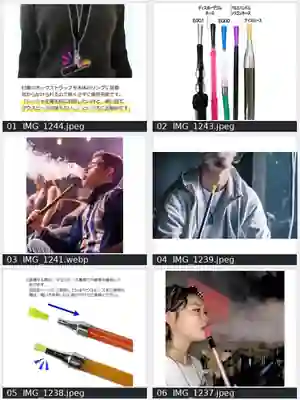
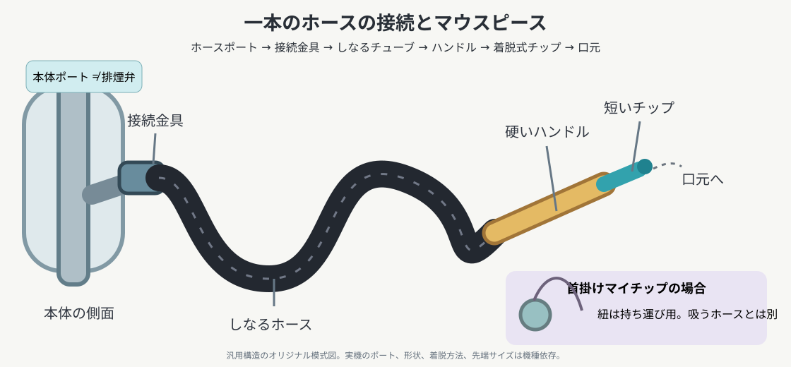

# ホース・マウスピース・喫煙姿勢の参考6点とAI誤描写防止（2026-10-09）

ゲーム『水煙前線 -EN:CODE-』用の**造形・接続・人物の持ち方**を理解する資料。ユーザー提供6点を縮小した一覧画像。実際の商品ロゴ・人物・広告文字・顔立ち・衣装は**複製せず**、機材の構造と多様性だけ参考にする。画像内の宣伝上の効果や衛生性能を医学的な保証として扱わない。

| 番号 | 提供ファイル | 外観・使い方の参考 |
|---|---|---|
| 01 | `IMG_1244.jpeg` | **首から下げる携帯用マイマウスピース**。短いチップ本体、リング、紐・ストラップ、首元での実際のサイズ。**ホース全体を首から下げる道具ではない** |
| 02 | `IMG_1243.jpeg` | 異なる長さ・材質・色の**ホースのハンドルと先端**。カラフルな使い捨てチップ、細い先端、金属／樹脂ハンドル、ホースとの太さの違い |
| 03 | `IMG_1241.webp` | 椅子に座る人物の**長い硬質マウスピース／ハンドル**の握り方。煙の吐き出す向きと手元の位置。顔の大きさに対する持ち手の長さ |
| 04 | `IMG_1239.jpeg` | 短い黄色の衛生チップが長い金属ハンドルに付き、首元にアクセサリーを下げた人物。ホースの全長を映さなくても成立する構図 |
| 05 | `IMG_1238.jpeg` | **使い捨ての小さなプラスチックチップの装着説明**。取り外した状態と装着後。金属製の持ち手はチップとは別部品 |
| 06 | `IMG_1237.jpeg` | **リング付きの個人用マウスピース**を長い金属ハンドルの先に装着して吸い、煙を吐く様子。チップ側のリングと金属持ち手を分ける |

## 一本のシーシャホースを構成する部品

典型例：
`シーシャ台のホースポート（横の接続口） → [ホース側コネクタ/ヒールチップと気密接続] → [しなる長いチューブ] → [手に持つ硬めのハンドル] → [必要なら短い衛生マウスチップ] → 口元`

- **本体ポートとホース末端**：ホースの根元を本体の側面に差し込む。パージ弁（排煙用の別口）を「ホース2本目」にしない。伝統的な差し込み＋グロメットのほか、機種固有のマグネット／ねじ／クイックコネクター等もある。個別写真で断定できない機構を勝手に追加しない。
- **チューブ**：シリコン、伝統的な蛇腹状／布巻き、樹脂等。なめらかな曲線やたわみ、テーブルや床へ落ちる重さがある。いつも蛇腹とは限らず、色も自由。必要以上の枝分かれ・不自然な鋭角は避ける。
- **ホースハンドル**：持ち手はチューブから先に伸びる硬いパーツ。非常に長い棒状、短い樹脂／木製／金属製、アイスホースなど様々。**長いハンドルは「使い捨てチップ」とは別物**。
- **使い捨てマウスチップ**：口が触れる小さなプラスチック等の部品。**ハンドルの先端に内差し／外被せ**で装着し、取り外せる。小さく透明・黄色・青・ピンク等いろいろ。ホースが先端から生えるように描かない。
- **首掛け式マイマウスピース**：個人で持ち歩く短い再利用型。チップにリングやネックストラップが付く場合がある。**首から下げているときはホースから独立**し、使用するときは取り外し・接続して先端に付く。ストラップとホースは別物。
- **煙の方向**：吸い込む姿勢と吐き出す姿勢を区別。口から吐き出す雲状の煙を、マウスピースの先端やHMDから常時発生させない。吐き出すときは手元にハンドルを残しても、口元を少し離してもよい。
- **人物とのサイズ感**：直径数mm〜数cmほどのチップと、数十cmありうるハンドルを等身大に描き分ける。チップを口より大きい筒・瓶・マイクにしない。手はチューブの根元だけでなくハンドルを自然につかむ。
- **シーンごとに必要数を選ぶ**：複数人の間で共用ホースを受け渡す絵では、各人の専用チップという区別も可能。一人で一台の場合、必ず両方式を重ねない。個人用チップがあれば別の使い捨てチップを必須にしない。

## AIによくある誤り → 正しい解釈

| 誤り | 修正 |
|---|---|
| ホースが2本以上生えて人物の手元で融合 | **1本の連続した経路**を先端まで追跡。多口型は明示的な指定がある場合のみ |
| ホースがトレー／炭／ハガル／ガラス底から出る | 本体**側面のホースポート**へ接続。機種による場所の違いは許容 |
| 先端の硬いハンドルと先端チップが溶け合う | 境目／差し込み構造を描き、素材差を出す |
| 透明プラスチックチップを巨大な棒として描く | **使い捨てチップは短い**。長い棒は持ち手や着脱式の延長ハンドル |
| 首の紐がそのままホースになっている | マイマウスピースのネックストラップは**持ち運び用の細い紐**、吸うホースは別 |
| 一つの先端に使い捨てチップとマイチップを二重装着 | シーンの設定で**どちらか適合する1種類を選ぶ** |
| 口が2つ・口元でホースが枝分かれ・煙が逆流 | 人物の口元へ到達するハンドルは原則一つ。煙の起点は口元 |
| 横の排気弁にホースを常に挿す | パージ用の弁は吸い込み口とは役割が異なる |
| ホースが極端に短く、人まで届かない | 本体の位置・人物・テーブルの距離に合うたわみと長さ |
| 元写真のメーカー名・顔・CMコピーを写す | **構造を学び、作品の素材・画風でオリジナルに描く** |

## 外部リサーチ（画像は転載しない）

下記は構造や実例を確認できる説明・製品写真の**参照元URL**。リンク先画像は権利者のものなので本リポジトリに複製しない。

| 目的 | 参照先 | 確認したこと |
|---|---|---|
| ホースのパーツ名称 | [Hookah.com：Hookah Glossary](https://business.hookah.com/blog/hookah-glossary) | Hose port、hose handle、hose tubing、heel tip、hose springの機能 |
| ホースの素材・全長と歴史 | [Hookah.com：Hookah Hoses 101](https://business.hookah.com/blog/hookah-hoses-101) | シリコン製の交換可能なホース、伝統型の金属コイル等 |
| 本体側の接続の実写手順 | [Hookah.com：Shishabucks Cloud Micro Guide](https://hookah.com/blog/shishabucks-cloud-micro-hookah-guide) | シリコンチューブ・金属ハンドル・角型ヒールチップ・本体への差し込みを分ける |
| パージ弁とホースポート | [Hookah.com：What's Inside a Hookah?](https://business.hookah.com/blog/what-is-in-a-hookah) | 一つはホース接続、もう一つは排煙。共通パーツではない |
| 小さな使い捨てチップの接続 | [Hookah-Shisha：How do I use a hookah mouth tip?](https://help.hookah-shisha.com/portal/en/kb/articles/how-do-i-use-a-hookah-mouth-tip) | チップを**差す／被せる**の2系統。共用時に自分のチップを着脱する |
| 「オス／メス」先端 | [Shisha Shop Support：Male and female mouth tips](https://support.theshishashop.com/knowledgebase.php?article=2) | maleは細い部分をハンドル内へ差し込み、femaleは外から被せる。ホース機材の性別を意味しない |
| 首掛け式再利用チップ | [Hookah Ministry：Lavart Personal Mouthpiece](https://hookahministry.com/products/personal-mouthpiece-lavart-minor-nerikomi-oranight-blue-orange) | 陶器＋シリコン連結部とランヤード。首から携帯してホース先端に付け替える商品例。**商品1件の参考** |

## 生成の短いプロンプト

> シーシャ本体の側面のホースポートから、適切な接続金具を経てしなるホースが伸び、その先に**硬いハンドル→短い着脱式マウスチップ→人物の口元**が自然につながる。使い捨てタイプと首掛けマイマウスピースは用途別の代替例で、不要な二重装着をしない。首のストラップはホースではない。煙は人物の口から広がる。実物参考の写真6点から形と比率を学び、キャラ・部品の色とデザインは自由。製品名・本人の顔は模写しない。

[ハガルの内部と穴あけ・炭配置の調査](bowl-interiors-foil-coal-placement-20261009.md)／[AI誤描写防止ガイド](ai-generation-structural-pitfalls.md)もあわせて参照。
