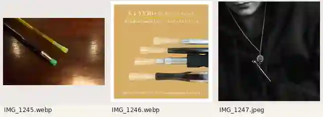
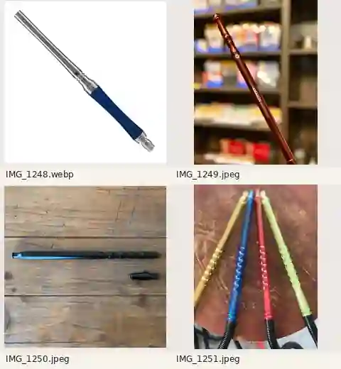

# 追加参考7点：使い捨て・マイマウスピース3点、ホースハンドル4点

ユーザー提供の実物資料（2026-10-09）。写真は**構造・大きさ・材質・個性の参考**であり、商品ロゴ・実在人物・宣伝文・特有のデザインを完コピしない。従来の[ホース・マウスピース6写真と接続ルール](hose-and-mouthpieces-20261009.md)と併読。

## マウスピース3点

| 元画像 | 重要な観察点 |
|---|---|
| `IMG_1245.webp` | 長いハンドル先端につけた**小さな黄緑・緑色チップ**。カラー透明/半透明の樹脂と金属・樹脂ハンドルの質感を分ける |
| `IMG_1246.webp` | 複数種類のハンドルの先端に淡色の**使い捨て衛生チップ**を装着。チップには差し込み/被せる形があり、商品画像の「差し込み口8mm」はその商品の適合目安で普遍的な唯一規格ではない |
| `IMG_1247.jpeg` | 細長い金属製の**首掛けマイマウスピース**。胸元にチェーンやリングで下がる携帯時のサイズ感。ホース本体でもハンドル全体でもない |

## ホースハンドル4点

| 元画像 | 重要な観察点 |
|---|---|
| `IMG_1251.jpeg` | 黄色・青・赤・緑の長い**半透明カラー樹脂ハンドル**。節や握り部分があり、根元で黒い蛇腹の柔軟なホースに接続 |
| `IMG_1250.jpeg` | マットブラックの細く長いハンドルと別の短い接続部品。小パーツを第二のホースやマウスピースと混同しない |
| `IMG_1249.jpeg` | 茶色系の細長い光沢ハンドル。木目風・彫りやくびれ等のクラシックな造形例。写真だけでは素材の厳密な断定は避ける |
| `IMG_1248.webp` | **長い金属チューブと青いグリップ**の異素材コンビ。装飾リング、根元の接続金具、先端の開口 |

## 機材が破綻しないためのルール

**典型的な一本の通路**：
`本体の横のホースポート → 柔軟なホース → ホース先端の硬いハンドル（持ち手） → 必要に応じて小さな着脱式マウスピース → 口元`。

- ホース本体は長く柔らかくたわむ。ハンドルは硬い棒状で形を維持し、根元でホースと接続する。ハンドルとホースの境界線・接続金具を描く。
- 使い捨てマウスピースは短い樹脂チップ。透明・半透明・蛍光色・緑/黄/ピンク/青など色の幅がある。**ホースの根元ではなくハンドルの吸い口側先端**に差す/被せる。
- マイマウスピースは金属・樹脂・陶器風等の素材を楽しめる個人用着脱式の小物。首掛け紐・チェーンは**携帯専用**であり、ホースでも煙の経路でもない。使うときは持ち手先端に適切に装着する。
- 通常、使い捨てチップとマイチップは**代替**。同じハンドル先端に両方を重ねて継ぎ足さない。
- 長い硬質ハンドルを「全部使い捨ての巨大チップ」と誤認しない。ハンドルの長さ・形は機種差が大きく「必ず20～35cm」と固定しない。
- 一人のキャラが吸うとき、自然な握り・口への距離・ホースのたわみを確認。空中にハンドルが浮いたり口元へ届かない描写は避ける。
- 実際の製品写真は**例**。木目／透明色／黒マット／木＋金属／レトロ／海やサメなど、ゲーム独自のモチーフに自由に変えてよい。ロゴは流用しない。

## スキン変更の考え方

将来のカスタマイズを想定し、**ホースハンドルのスキン**と**マイマウスピースのスキン**を別の見た目カテゴリとして整理する（現時点ではゲームコードもUIも追加しない）。

- ハンドル：クリアカラー／墨黒ミニマル／木目クラシック／金属×木の豪華版／イラスト世界観に沿うオリジナル。
- 先端チップ：透明使い捨てのカラーバリエーション。マイチップはチェーン・紐・小さな装飾で個性を演出できる。
- 装飾が変わっても**接続の物理的な位置関係**を維持。サイズが大きすぎて口に入らない、素材がホースへ溶け込む、先端が枝分かれするスキンは禁止。
- **シーシャ用トング**もスキン対象候補だが、BBQトングとは長さ・先端・握り感が異なることがあるため、次のユーザー実物写真が届いてから別資料に分類する。写真を受け取るまでは種類を確定しない。

### 画像生成チェック

1. ホースとハンドル、ハンドルとチップの**2か所の接続**が自然か。
2. 首掛けのチェーンとホースを誤接続していないか。
3. 金属、木目、半透明樹脂、それぞれの光沢・透け方が適切か。
4. 写真の固有ロゴや人物を複製していないか。
5. キャラの持ち物が一貫し、ゲーム画風に合っているか。

## 実使用シーンの後検品

[首掛けマイマウスピースをただの棒飾りにしない・ホース接続を途切れさせないQC](visual-qa-necklace-hose-20261009.md)を必須参照。ハンドルとチップのデザインは自由だが連結部は成立させる。
