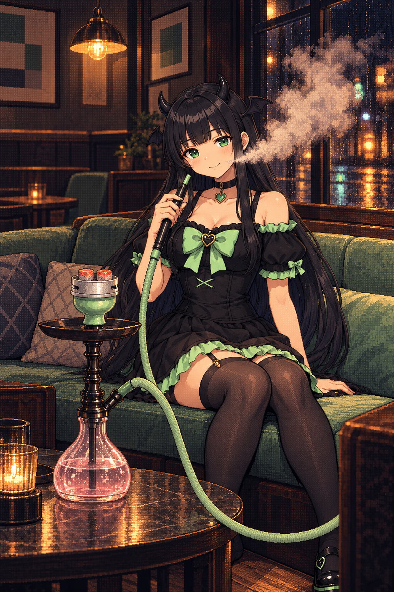

# 画像生成のNG実例

採用素材や実物の構造資料ではなく、オーナーが指摘した**再現してはいけない描写**の保存先。生成時に画像を添付する場合も「模写対象」ではなく「この欠陥を避ける例」と明示する。

## NG-HOSE-01：みんとの喫煙カットでホースがY字に分岐する

- **指摘日**：2026-10-09。オーナー「これとかホースの構図がおかしい」「参考資料やメモに入れといて NGみたいな」。
- **出典**：このチャットで生成した `minto_01_afterhours_smoke` の初版。オーナーが送った画像と同じローカル原画を無加工で保存。実物写真ではない。
- **NG箇所**：画面中央より下、台の右上側。手元から下がる緑のホースと、台の接続口から来る短いホースがY字に合流し、その先に第三の長い経路が足の前を通って右端まで続く。単一ポート・単一ハンドルなのに、ホースの端と経路が三つある。
- **単なる交差との区別**：二本の線が画面上で重なるだけなら、手前の管の輪郭が連続し、奥側が隠れる等の前後関係が必要。この画像は管の輪郭が結合しており、交差としても読み取れない。
- **修正条件**：本体の正しいホース接続口→一本の柔軟なホース→手で持つ硬いハンドルの根元。余分な分岐・第三の端・足元への不要な延長を除く。家具や手による遮蔽は許容するが、隠れる前後で色・太さ・向き・接続先が一致すること。
- **検品**：ポートから手元へ追跡し、次に手元からポートへ逆向きにも追跡する。交差点・折り返し・画面端を一つずつ確認する。接続点だけが正しくても、途中の経路がNGなら不採用。
- **状態**：初版は不採用。候補一覧から外し、修正版を別途生成する。ルールを追記しただけで初版を合格にしない。

参照：[ホース・マイチップ検品ガイド](../visual-qa-necklace-hose-20261009.md)、[ヒロインCGの追加ルール](../heroine-title-cg-rules-20261009.md)。
