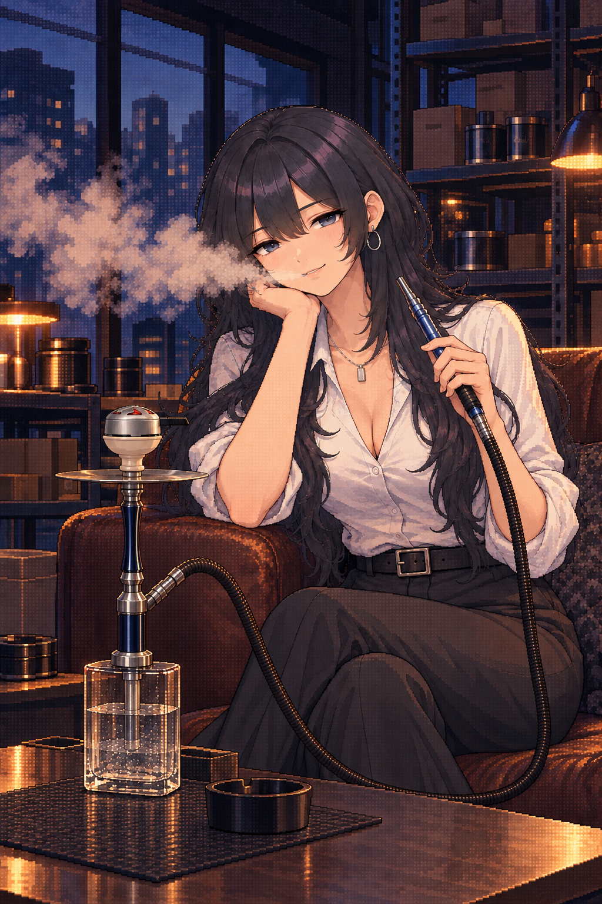
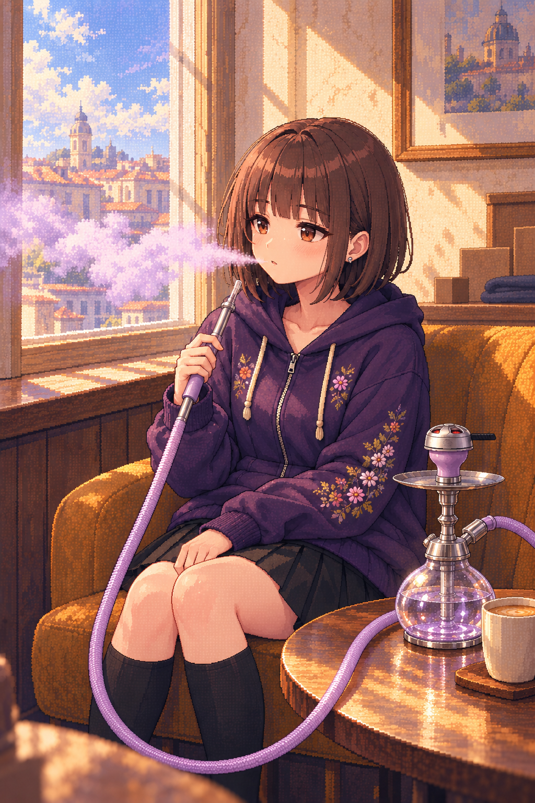

# 画像生成のNG実例

採用素材や実物の構造資料ではなく、オーナーが指摘した**再現してはいけない描写**の保存先。生成時に画像を添付する場合も「模写対象」ではなく「この欠陥を避ける例」と明示する。

## NG-HOSE-01：みんとの喫煙カットでホースがY字に分岐する

- **指摘日**：2026-10-09。オーナー「これとかホースの構図がおかしい」「参考資料やメモに入れといて NGみたいな」。
- **出典**：このチャットで生成した `minto_01_afterhours_smoke` の初版。オーナーが送った画像と同じローカル原画を無加工で保存。実物写真ではない。
- **NG箇所**：画面中央より下、台の右上側。手元から下がる緑のホースと、台の接続口から来る短いホースがY字に合流し、その先に第三の長い経路が足の前を通って右端まで続く。単一ポート・単一ハンドルなのに、ホースの端と経路が三つある。
- **単なる交差との区別**：二本の線が画面上で重なるだけなら、手前の管の輪郭が連続し、奥側が隠れる等の前後関係が必要。この画像は管の輪郭が結合しており、交差としても読み取れない。
- **修正条件**：本体の正しいホース接続口→一本の柔軟なホース→手で持つ硬いハンドルの根元。余分な分岐・第三の端・足元への不要な延長を除く。家具や手による遮蔽は許容するが、隠れる前後で色・太さ・向き・接続先が一致すること。
- **検品**：ポートから手元へ追跡し、次に手元からポートへ逆向きにも追跡する。交差点・折り返し・画面端を一つずつ確認する。接続点だけが正しくても、途中の経路がNGなら不採用。
- **状態**：初版は不採用。候補一覧から外し、修正版を別途生成する。ルールを追記しただけで初版を合格にしない。

参照：[ホース・マイチップ検品ガイド](../visual-qa-necklace-hose-20261009.md)、[ヒロインCGの追加ルール](../heroine-title-cg-rules-20261009.md)。

## NG-BOWL-01：凛の修正版でハガルが短すぎる

- **オーナー指摘**：「これは流石にハガルが短すぎるかも こういうのもNGにしたい」。
- **出典**：本チャットの生成原画 `exec-5beaff5a-4ded-4d16-8840-ed769088587f.png`。無加工で保存。
- **欠陥**：クリーム色のハガルの器から脚への距離が詰まり、HMDと受け皿の間に短い台座のように挟まる。口径を縮めるだけで、器全高と独立した細い脚の比率を再確認していなかった。
- **修正条件**：適合する具体的な脚付きボウルを先に選び、上の器の深さ・細い脚の長さ・口径をそれぞれ実写と照合する。HMDは小さなまま、ボウルの脚と全高を実物に沿って確保する。短い特殊モデルを無指定で作り出さない。
- **状態**：不採用。以前の「縮尺確認済み」の判定を撤回し、修正版を別途作る。

## NG-BOWL-02 / NG-HOSE-02：つむぎの短いハガルと不自然な大回りのホース

- **オーナー指摘**：「これも短い」「あとホースの構図が変」。
- **出典**：生成原画 `exec-7bf1c2de-f921-4d66-b902-0f5735c09c3e.png`。無加工で保存。
- **ハガルの欠陥**：紫の器から受け皿までの脚と全高が詰まっている。上記NG-BOWL-01と同じ検品漏れ。
- **ホースの欠陥**：台側のホースは右へ画面外に続く一方、もう一方の区間はベースの下側・裏側から戻ったように見える。画面下の大きなU字が人物の足と前景を囲み、不必要に主張する。分岐がないという条件だけでは自然な使用構図として合格できない。
- **修正条件**：正しい側面ポートと手元が一つの自然な経路で対応する構図へ設計し直す。重力に沿ったたるみ・家具との接触・遮蔽の前後を確認する。ホース全長を無理に画面へ収めるために人物を囲む輪を作らない。見切れを理由に説明できない接続の矛盾を許可しない。
- **状態**：不採用。以前の「一本のU字で合格」という判定を撤回する。
