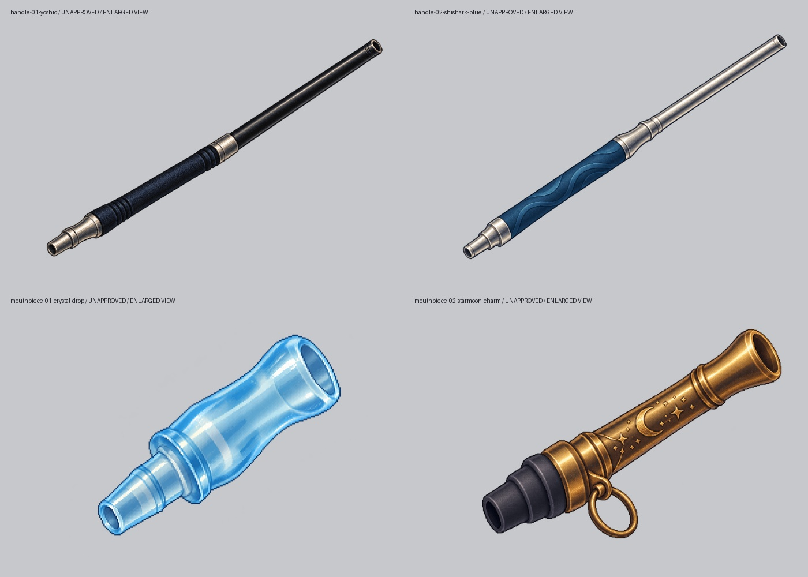
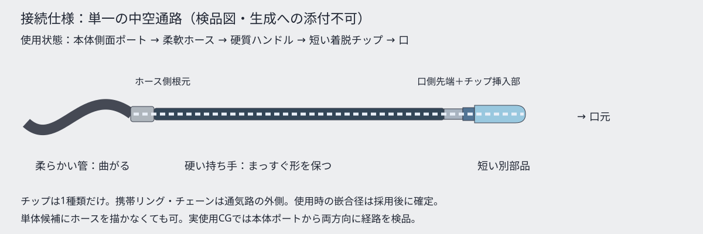

# Issue #374：ハンドル2案・短いマウスピース2案

作業者E `codex-e-visual-20261011-01`。予約成功 [run 38179073060](https://github.com/haseatsu114514-dot/shisha-game/actions/runs/38179073060)。基準main `73cd85e0c2f40f18361a6174b9cb9c1064eaab56`。制作時点では未採用候補として保存。**2026-10-12、オーナーが4点すべてのデザインを採用。ゲームへの外観導入は別Issue [#437](https://github.com/haseatsu114514-dot/shisha-game/issues/437) で進める。本編・ショップ・所持品・manifestにはまだ登録していない。**

## 制作物と比較



| 候補 | 原画 | 造形 |
| --- | --- | --- |
| 夜潮 | [PNG](handle-01-yoshio.png)・[指示](handle-01-yoshio.prompt.txt) | 墨黒の長い硬質管、わずかな紺の握り、銀の根元接続金具 |
| SHISHARKブルー | [PNG](handle-02-shishark-blue.png)・[指示](handle-02-shishark-blue.prompt.txt) | 銀の長い管、海青グリップと波の溝。文字・突き出たサメ装飾なし。サメちゃん専用とは未確定 |
| 水晶のしずく | [PNG](mouthpiece-01-crystal-drop.png)・[指示](mouthpiece-01-crystal-drop.prompt.txt) | 小さな半透明淡青の樹脂風チップ。中空の先端・短い差し込み部・止め段 |
| 星月のチャーム | [PNG](mouthpiece-02-starmoon-charm.png)・[指示](mouthpiece-02-starmoon-charm.prompt.txt) | 真鍮色の短い中空チップ、黒い弾性接続部、外側の携帯リング。星月の表面意匠、鎖は描かない |

全原画1536×1024のRGBA。原画と実際の生成指示、参照・ハッシュ・alpha・目視所見は [candidates.json](candidates.json) に保存。既存素材の置換はなく、比較前は「独立した装備外観アセットなし」。写真との構造比較は [既存実物4ハンドル＋3チップ](../mouthpiece-handle-skins-20261009.md) と [使用・着脱写真](../hose-and-mouthpieces-20261009.md) を使う。元写真の広告・人物・ロゴは生成しない。

[同じ想定縮尺での比較](comparisons/concept-relative-scale.jpg)では長いハンドルと短いチップを区別。ハンドル30cm／チップ4cmは**本候補の設計目安**であり、写真から測った実寸でも全製品の共通規格でもない。上の拡大一覧で両者が同じ大きさに見えても実使用で同じ縮尺にしない。

## 接続・検品



- 単体なのでホースなし。ハンドル根元は柔らかいホースへ、先端の開口は1個の短いチップへ接続する構想。導入工程で差し込み方式・内外径・挿入量を組ごとに確定する。
- 原寸目視で単一軸・両端開口・分岐なしを確認。金属／墨黒／半透明樹脂の材質差あり。星月の携帯リングは側面の独立金具で、煙の経路にしない。
- 灰背景合成で大きな背景矩形や白縁なし。alphaは0〜254で完全不透明画素なし。配信用の仕上げでは濃淡背景での輪郭・alpha正規化を検討する。原画を勝手に加工して合格済みにしない。
- 実使用のホース装着・手の握り・口との寸法・首掛け携帯・チップ嵌合は未制作／未検証。単体原画を完成した装備切替と扱わない。
- トングは資料待ちで対象外。新規キャラ・衣装・能力・価格・解放・採点は変更しない。

## 現行実装と再利用範囲

| 箇所 | 実装状況／影響 |
| --- | --- |
| `data/equipment.json` | bowl／hms／charcoalが正本。価格・性能・gift等を持つ。handle／mouthpieceカテゴリなし |
| `remake/js/core/state.js:15,42` | 初期所持3点、equipはbowl／hms／charcoal、SCHEMA11。見た目保存欄なし |
| `remake/js/craft/steps.js:54` | 所持品から上記3装備を選びstate.equipへ戻す。能力装備の選択コードは存在するが外観切替ではない |
| `remake/js/daily/status.js:159` | 持ち物はownedとequipを一覧表示。外観を選ぶ操作はない |
| `remake/js/daily/shop.js:18` | 販売対象3カテゴリ。売買に新カテゴリを勝手に追加しない |
| `remake/js/craft/art.js:87` | 本体・ステム・皿・ボウル・炭を組み上げる描画。独立ハンドル／チップ描画層なし |
| `remake/js/craft/skin.js:4` | SKINSは制作UIのボタン・パネル。装備外観とは別 |
| `assets/ui/making/` と人物CG | 持ち方・ホースは工程絵やCGへ描き込み。独立4スキンの差替え画像は従来存在しない |

再利用できるのは既存の所持品表示や選択ダイアログのUI部品まで。**機能としての着せ替えはまだない**。採用済み4デザインの外観保存と描画層は、別実装Issue [#437](https://github.com/haseatsu114514-dot/shisha-game/issues/437) へ分離した。能力装備のequipへ直接追加すると旧セーブ・所持・売買・制作選択まで影響する。初期装備は維持し、旧セーブの既定外観／保存・復元／PC・スマホを確認してから接続する。

## 検証と残作業

Git Safety・diff check・4PNGデコード／透明角／ハッシュPASS。`assets/`・`data/`・`remake/`の差分なし。既存save_load.mjsは6ケースPASS（全枠・旧セーブ・不正JSON・PC・スマホ・縦回転）。結果は [save-load-results.json](save-load-results.json)。現行持ち物・ショップのPC／スマホ検品は [ui-results.json](ui-results.json) と [比較フォルダ](comparisons/) を参照。

上記のsave/load・現行UI証跡はPR #395の制作時点の検証で、外観切替を実装したテストではない。採用記録時点の基準mainは `eca6a3d12ec4bb8918ef8eb773f08bf816da16b5`。既存4PNGのハッシュ・寸法・RGBA・alphaを再検証し、原画・生成指示・比較画像に差分がないことを確認した。ゲーム実装には変更がない。

## 採用判断と導入への引き継ぎ

オーナー回答（2026-10-12、この作業セッション）：

> 4案とも採用し、ゲームへの外観導入は別Issueで進める

[判断の記録](https://github.com/haseatsu114514-dot/shisha-game/issues/374#issuecomment-6126516611)。夜潮・SHISHARKブルー・水晶のしずく・星月のチャームを既存原画のまま採用し、`candidates.json` の `approved` を全4点 `true` に更新した。承認範囲は**デザイン採用**。配信用素材の仕上げ完了・実機適合・ゲーム登録を表さない。制作時のworker・生成指示・元ハッシュは保持し、今回の採用worker／claim／statusは `adoption` に記録する。

[外観導入Issue #437](https://github.com/haseatsu114514-dot/shisha-game/issues/437) へ、次の3工程を引き継ぐ。

1. ハンドル／短いチップを別カテゴリで継続追加できる外観カタログ・描画契約と、配信用サイズ／アンカー／alpha仕上げ。実物参照で接続・嵌合・手持ち／口サイズも確認する。
2. 既定外観と4採用IDの選択・描画反映・保存／復元。能力装備と分け、旧セーブや未知IDは安全な既定値に戻す。初期3装備・価格・性能は維持する。
3. PC／スマホ／縦回転、明暗背景、ホース接続・装着時の縮尺、保存／読込／旧セーブの画面QAと証跡。

本採用記録では原画の加工・再生成・ゲーム導入を行っていない。トングは引き続き対象外。親 #374 は採用記録PRのレビュー・反映までopenとし、導入の未完は #437 で追跡する。

## 独立した外観カタログの確認（#437 第1段階）

リポジトリルートから実行する。Python 3.10以降の標準ライブラリのみを使用する。

```sh
python3 tools/shisha_appearance_catalog.py
python3 tools/shisha_appearance_catalog.py --json
python3 -m unittest discover -s tools -p test_shisha_appearance_catalog.py
```

`candidates.json` が引き続きID・名称・カテゴリ・原画パス・SHA256・寸法・採用範囲の唯一の正本。ツールは実行のたびに正本を読み、独立カタログを標準出力へ導出する。別のカタログJSONは保存せず、ゲームのmanifestや装備へ登録しない。出力の `adoption` と `approved` / `approval_scope` / `runtime_integrated` を分け、デザイン採用をゲーム導入完了と扱わない。`source_sha256` は読んだ正本の照合用。

正常時は終了コード0と `PASS: 4 originals validated ...` を出力する。4点とも1536×1024・RGBA・`approval=design_only`・`runtime_integrated=False`。異常時は終了コード1と、該当項目の位置・ID・理由（例：`duplicate id`、`SHA256 mismatch`、`invalid category`）を標準エラーへ出す。重複ID・JSON同名キー・欠落原画・ハッシュ不一致・不正カテゴリ・寸法/モード不整合・不正な採用情報をfixtureで検査する。原画・正本が取得できない場合も成功扱いにしない。`--source` で検査するJSONも原画パスも、このリポジトリ内に限定する（外部へ向かうsymlinkも拒否）。過去の `generated_original` は生成履歴なので検査対象外。

PNG検査は元バイトのSHA256とIHDRの寸法・RGBA宣言・CRCまで。画像全体のデコード、実ピクセルのalpha再測定、実機嵌合や画面QAではない。`alpha_extrema` と長さ目安は正本メタデータの継承で、配信用仕上げ済み／実寸検証済みの主張ではない。切り抜き・bbox・アンカー・相対縮尺・実物適合ID（`compatible_ids`）・配信用パス・透過処理は、派生カタログの `render_contract` では引き続き `null`（未確定）。接続候補と接続位置/径の扱いは以下の契約に従う。後続の素材仕上げ・選択・描画・保存導入は本段階の対象外。


## 接続候補の機械検証（#437 接続契約v1）

### 配信用画像と参照先（2026-10-30、#437）

採用4原画から [`remake/img/appearance/`](../../../remake/img/appearance/) に同じIDのPNGを別保存した。新規生成・原画の上書き・デザイン変更は行っていない。4点ともRGB全画素・1536×1024のキャンバス・接続アンカーは原画と同一。透過縁の薄い光彩を抑えるため、alphaだけを `a <= 16 → 0`、それ以外を `(a - 16) * 255 / 238`（8bitへ丸め、上限255）に変換した。最大254を255に正規化し、中間alphaは残す。色の塗り直し・拡縮・回転・切り抜きはしていない。

再作成はリポジトリルートで ImageMagick 6 の次のコマンドを4つの採用IDに実行する。原画・生成指示・`candidates.json` のハッシュと採用範囲は引き続き正本のまま。新規PNGはGit LFSで保存する。

```sh
for id in handle-01-yoshio handle-02-shishark-blue mouthpiece-01-crystal-drop mouthpiece-02-starmoon-charm; do
  convert "asset_sources/shisha-hardware-reference/skin-candidates-issue374/$id.png" \
    -channel A -fx 'u<=16/255?0:(u*255-16)/238' +channel -define png:color-type=6 \
    "remake/img/appearance/$id.png"
done
```

本編作業台（#1636で接続済み）と独立比較ページは共通の `render-preview.js` を通して配信用PNGを読む。今後の採用画像も `<安定ID>.png` を同フォルダに配置する。カタログとアンカーJSONはこのフォルダの既存正本をそのまま読み、Pages配信時にもこの2JSONだけを同じパスへ配置する。原画や実物写真は公開サイトへコピーしない。`candidates.json` の `design_only`・`runtime_integrated:false`・`distribution_assets_ready:false` と `physical_fit:null` は変更していない。今回の画像仕上げを実物適合・人物の手持ち・口元との比率の承認とは扱わない。

検証: 原画4点のSHA256と全RGB画素不変、全PNG復号、RGBA・寸法一致、alpha 0〜255。ChromiumでPC／844×390横タッチ／390×844縦の既定込み9組×明暗（54表示）、配信用画像の実復号、確定／取消・横から縦への回転・本編ストレージ不変を確認。外観選択/SAVEの6テストとカタログ26テストも成功。実機・人物の手持ち・物理嵌合は引き続き未確認。

| 仕上げ画像の暗背景 | 仕上げ画像の明背景 |
|---|---|
|  |  |
|  |  |

[横タッチ](preview-qa/distribution-touch-dark-1.png)・[縦画面](preview-qa/distribution-portrait-light-1.png)・[本編作業台](preview-qa/distribution-bench-pc.png)。原画PNGを置かず（HTTP 404）、正本2JSONだけを配置した公開相当のディレクトリでも同じ54表示と本編作業台の配信用画像2点の復号を確認した。本編の任意選択→取消／確定→SAVE／再読込、PC練習・横タッチ大会の既存 `setup_continuation.mjs` も3件成功。下の2026-10-26記録は原画を表示していた時点の履歴。

### 原画を組み合わせる実表示プレビュー（2026-10-26）

[`remake/appearance-preview.html`](../../../remake/appearance-preview.html) は採用原画を別々の層で「ホース→ハンドル→任意の短いチップ」に配置する比較ページ。正本の4デザインを再生成・描き換えず、表示上の一様拡縮と回転で接続する。明暗背景・未選択・2ハンドル×2チップを比較でき、確定と取消も操作できる。本編・GAME OVER・本編セーブには接続しない。

画像上の接続中心は [`render-preview.json`](render-preview.json) に記録した原画px。画面上の長さ340/46は図示上の比率で、実測寸法や実物の嵌合を証明しない。正式カタログの `distribution_assets_ready:false`、`runtime_integrated:false`、`physical_fit:null` と未確定径は保持する。原画の光彩・半透明の縁を残した確認段階で、配信用仕上げ・手持ちの確認・本編の選択導線が残る。

実ChromiumでPCと844×390横タッチ、既定を含む9組、全画像の復号、確定・取消・本編ストレージ無変更を確認。既存の外観選択/SAVEテスト6件とカタログ26件も成功。外観テストは後から追加されたギャラリー保存処理の実モジュールも読ませ、旧fixtureの依存欠落を修正した。実機・縦回転・人物の手持ち・物理適合は未確認。

| 暗背景 | 明背景 |
|---|---|
|  |  |
|  |  |

同じ `candidates.json` に各項目の `connection` と、トップレベルの `connection_contract` を追加する。別カタログ・runtimeデータは作らない。契約v1はデザイン採用段階専用で、`approval_scope: design_only`、`runtime_integrated: false` と `adoption.distribution_assets_ready: false` を維持する。

- `connection_contract.version` は整数 `1`。`candidate_pairs` は検討対象の組を `{handle_id, mouthpiece_id, physical_fit}` で列挙する。現在は採用2ハンドル×2マウスピースの4組。存在する採用IDをハンドル→マウスピースの順で参照し、同じ組の重複・逆順・同カテゴリ・未知ID・未採用IDを拒否する。配列にない組を自動補完しない。候補がない場合は空配列を許容する。
- `physical_fit` はv1では必ず `null`（未検証）。候補列挙はカテゴリ上の整合だけで、どの組も実物嵌合・装着承認・描画可能を表さない。`true` も `false` も拒否し、未検証を「適合しない」とも判定しない。
- 各素材の `connection` は `position_px` と `diameter_mm` の2キーを必須とし、未知値は省略や0でなく `null`。現在の4点は両方とも `null` のまま。`concept_length_cm` や原画寸法から接続位置・径・相対縮尺を推定しない。
- `position_px` は原画左上を原点、右を+x、下を+yとする接続中心 `[x, y]`。ハンドルはチップ側、マウスピースはハンドル側の接続部を対象とする。数値を与える場合は有限数かつ `0 <= x < width`、`0 <= y < height`。`diameter_mm` はその接続部の径の数値欄で、有限の正数のみ。bool・文字列・NaN・無限大・範囲外座標・0以下の径を拒否する。これは値の形式検査であり、内外径・差し込み方式・挿入量・公差・実測根拠を確定する物理嵌合仕様ではない。数値を記入しても適合や実測済みとは判定しない。

派生出力では `connection_contract` を継承し、各素材の `position_px` / `diameter_mm` を `render_contract.connection_position` / `connection_diameter` へそれぞれ転記する（単位は原画px / mm）。`compatible_ids` は候補リストから生成せず `null` を維持する。数値のあるsynthetic fixtureでも `physical_fit` と `relative_scale` は `null` のまま検査する。

上記の既存コマンドで、原画SHA256・PNG IHDR検査に加えて接続契約を検査する。終了コード0の `Connection metadata PASS` はID・カテゴリ・値域の検証のみ。画像全体のデコード・実物/画像QA・装着承認・配信用仕上げ・ゲーム導入・選択/保存の完了ではない。原画・採用履歴・本編state/manifest/レンダラーは変更しない。
