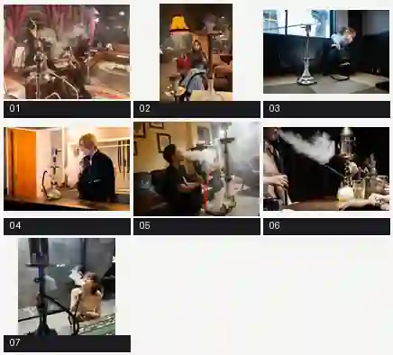
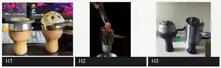

# シーシャの喫煙シーンとヒートマネジメント：実物参考10点（2026-10-09）

> オーナーから追加提供された写真。**人物の顔・服装・店舗・ロゴ・実製品を再現するためのものではない。** 目的は、シーシャ台の実際の使われ方、人体との大きさの関係、ホースの接続・持ち方、煙、炭と熱管理器具の構造を把握し、ゲーム用の架空デザインに活かすこと。掲載画像は見やすさと容量を考慮した縮小一覧であり、元画像9点とは別の追加10点。

## 喫煙・シーシャ台・人物の関係（7枚）

| 番号 | 元写真 | 観察ポイント |
|---|---|---|
| 01 | `IMG_1208.jpeg` | ソファで座って使う複数人の様子。手元のホース・長い吸い口・煙が顔の周辺に重なる様子、手前の細身の伝統型本体と奥行き |
| 02 | `IMG_1209.jpeg` | ソファ・テーブルと背の高いシーシャ台の比率、パイプ上の器具、ホースを片手に持つ距離 |
| 03 | `IMG_1205.webp` | 床座りでの使用、低い目線と長身で細い台、蛇行する黒いホース、吐いた煙の横方向の広がり |
| 04 | `IMG_1206.webp` | カウンター席での使用、テーブル上の透明なベースと金属ステム、煙が顔の前で広がる様子 |
| 05 | `IMG_1207.webp` | ソファに座った姿、手元から台に伸びる目立つ橙色のホース、伝統型の皿と縦長の金属ステム |
| 06 | `IMG_1202.jpeg` | 卓上の小さめのガラスベースと金色のステム、ヒートマネジメント器具、長い青色のマウスピースと煙 |
| 07 | `IMG_1201.webp` | 大型の青いモダン台を手前に据えた構図。太いホースの接続と曲がり、人物との前後関係と煙の塊 |

## ヒートマネジメント・炭の扱い（3枚）

| 番号 | 元写真 | 観察ポイント |
|---|---|---|
| H1 | `IMG_1189.webp` | ボウル上の網状・平皿状の熱管理器具と、穴のあるドーム型蓋の器具。共にボウルとは別パーツ |
| H2 | `IMG_1188.jpeg` | 穴のある金属製の煙突型（チムニー系）の器具と、トングで赤熱したキューブ炭を上から入れる／置く際の位置関係 |
| H3 | `IMG_1187.jpeg` | 低い蓋付き金属HMDと背の高い穴あき筒状チムニーを並べた比較。高さ・通気孔・ハンドル形状・ボウルへの載り方の差 |

## ゲーム画像を生成する際の実用ルール

1. **人物との比率・配置**：シーシャ台の高さは小型から長身まで幅がある。床・カウンター・テーブルのどこに置いているかによって、ソファに座る人物や持つ口元との高さの関係を自然に描く。全体を画面に収める必要はない。
2. **ホース・吸い口**：ホースはボウル上や皿から直接生えるのではなく、台側面のホース接続口から伸びる。カーブ・たわみ・長さ・重さがある。持つ部分（マウスピース）は手や口元へ届き、使用姿勢と矛盾しない。写真にはホースと口元の距離の違う場面もあるので1パターンに固定しない。
3. **煙の方向と濃さ**：煙は口元から出ると、まず向きを持って広がり、乱流や室内の空気に従い薄まる。画面中に常に均一な白霧を置かない。控えめな一筋・一塊・広がる大きな雲まで演出で変える。炎・蒸気・魔法のエフェクトにしない。
4. **ボウルとHMDを区別**：素焼き・陶器等のフレーバーボウル（ハガル）は葉を入れる器。HMDはその上に載せて炭の熱や空気を調整する別の器具。丸い蓋付き・穴のある金属筒・金網状など構造が異なる。すべてのシーシャに同じHMDを載せない。
5. **炭とトング**：キューブ炭は小さく、焼けた面が赤く光り表面には灰色の灰がつく。トングで挟んでHMDや網の上に配置する。炎が派手に燃える巨大な石塊、煙を吹く炭、宙に浮く炭はNG。
6. **取り付けの順序**：組み立て前はボウル未装着の金属ポストがありうる。提供時・使用時は一般にボウルやHMD・炭が載ることがある。既存の「制作中の先端は小さな凸型金属ポスト」ルールは、**ボウルをまだ載せていない状態にだけ適用**する。完成後の台までボウル・熱管理器具を消さない。
7. **写真模写は不要**：人物の顔、衣装、性別の組み合わせ、室内インテリア、機材のブランド、図柄は流用しない。見た目の方向性・寸法感・機能を参考にして、本作のキャラ・世界観・ドット調に合わせて新しく描く。
8. **別工程との区別**：炭を台上に配置するシーンと、炭を焼く装置から取り出すミニゲームは別。HMD・ボウル・トレー・ステムを混同しない。既存シーシャ制作工程・採点の仕様は変更しない。

## 生成時のチェック

- 台のベースは床や卓上に安定して置かれているか
- 縦のステムがベースへつながり、トレー・ボウルの上下関係が成立しているか
- ホースが台側の接続口と人物のマウスピースまで自然につながっているか
- HMDはボウルの上に配置され、炭が実際に置ける構造か
- 煙の発生位置・広がりと人物の動作が自然か
- 画風は作品に合わせており、写真の顔や製品を再現していないか

先に読む：[シーシャ台の基本形・バリエーション9点](README.md)。制作時の台の接続、ボウル未装着時の先端、ホース、トレー等は基本ガイドと合わせて判断する。
