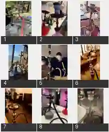

# 追加実物写真9点：アルミの貼り方、煙突型、構図、完成時のシーシャ台

2026-10-09 オーナー提供。これは写真の構図と機材のつながりを学ぶための**参考資料**であり、写真に写る人物・店・製品・ロゴの完コピは求めない。色や形状、ボウル／ハガル、煙突型・HMDの意匠は創作してよい。写真から実際の熱量・温度・使用時間・型番は断定しない。

## 9枚の観察ポイント

| 番号 | 観察できる点 | AI画像生成で特に注意 |
|---|---|---|
| 01 | 屋外の台に載る銀色の伝統型、透明で幅のあるガラスベース、鮮やかな赤い蛇腹ホース、横に別台のボウルと受け皿 | **複数のシーシャが前後に重なる**構図。ボウルを別の台へ誤接続しない。上部はアルミに縦長の金属チムニーが載る例 |
| 02 | ピンク系のガラスベース・赤紫のステム、アルミをボウルの胴まで折り込んだ大きな包み、上に載る黒い熱管理部品 | ガラスベース・ステム・トレー・陶器ボウル・ホイル・HMDの**上下関係**。脇の黒いパーツはトレー周りの別物であり、台の飾りが生えたわけではない |
| 03 | 金色の伝統型ステム、透明なガラス、上部のメッシュ状チムニー、ボウル付近の垂れたアルミ、円い銀色トレー | 網目のある高い筒はボウルの**上に載る熱管理器具**。本体ステムの延長として描かない |
| 04 | 海を背に並ぶ複数の完成台。高さ、ボトル、トレー、ホースの色・曲線・設置位置が異なる | 奥行き・縮尺・透過ガラスと日光の反射、台ごとの部品を混同しない。単一の規格に固定しない |
| 05 | 使用者が長い金色のマウスピースを持ち、金属装飾のある大型台から長いホースが伸びる | 吸い口と蛇腹ホース、ホースポートの接続。顔から出る煙とマウスピース、人物と大きな台の比率 |
| 06 | 彫金のような銀色ステム、細い受け皿、透ける褐色のガラスベース、側面から伸びる黒い蛇腹ホース | **台本体とホースは接続点でつながる**。ボウル上部に銀色の煙突型器具、アルミの裾が見える |
| 07 | 金色ステム、深い金色トレー、穴あきの金属チムニーが黒いハガルの上に載る | 深いトレーは炭受けの皿で**ハガルでもHMDでもない**。チムニーはボウルの上、ホースは下方の側面 |
| 08 | 黒い金属ステム、グレーガラスベース、黒い蛇腹ホースと銀色のアルミ、HMDの蓋のような別パーツがトレー脇に置かれている | **取り外したパーツを「ボウルの二重蓋」にしない**。黒い容器状ボウル上にアルミがあり、部品が隣に仮置きされた状態 |
| 09 | シンプルな銀色の細いステム、淡色陶器ボウルとアルミ、浅い金属製HMDに**赤熱した角炭2個**が見える | 炭はHMDに実際に接して載る。灰色の灰とピンク～赤色の発光が共存し、炎が噴き出してはいない |

## 写真を跨いで守る区別

### 正しい機材の積層

- **ベース（水を入れるガラス等）**にステム／ダウンステムが接続する。金属の飾りが縦に長くても、全体が水槽や花瓶にならない。
- ステムの上部付近に**受け皿／アッシュトレー**、さらに上に**ハガル／フレーバーボウル**。皿は炭受けでありボウルの代用品ではない。
- ハガルにアルミを張る場合、口の上に平らに張ったアルミがあり、縁や側面に余りが折り込まれる。しわや垂れ方は写真のように変わる。小穴は主に**張ったアルミ面**に開けるので、ハガルの側面やトレーを穴だらけにしない。
- **アルミに炭を直接置く方式**、**アルミ＋チムニーや金属HMD等の器具を併用する方式**、**対応ボウルにHMDを直接載せる方式**は別。写真の方式を混在させて全装備を必須にしない。
- 煙突型は円筒のメッシュ／穴あき金属で、ボウル上に置く熱管理部品。装飾の「塔」や、ホースポートや水容器と融合させない。
- HMDの種類は極めて多い。高さ、蓋、スリット、メッシュ、調整ハンドル、炭を入れる位置を写真に合わせた**成立する1方式**として描き、架空型を発想するときも機械的な説得力を保つ。
- 炭は写真によって2個、3個、4個など異なるが、**既存ゲームの通常三角3炭配置は変更しない**。写真の別配置は描写の参考であって、ゲームの新ルールではない。

### 構図と被写体の描写

- カメラ距離の違い：近接でボウル・炭・アルミを見せる／台1本を全身で見せる／人物の手とホースを見せる／窓際に複数台を遠近で置く。**すべてをいつも正面の製品写真にしない**。
- シーシャ台は撮影角度により一部がフレーム外でもよい。全要素を1枚に無理に収めない。
- 近景／遠景に複数台があるとき、金属皿・パイプ・ホース・ガラスベースを**それぞれ同じ台へ正しく接続**。空中に独立したボウルや、2台に1本のホースを描かない。
- 強い昼光では透明なガラスやステンレスに環境の反射が入る。室内の照明では赤・紫・金など色の反射が乗る。材質ごとの違いを保ち、全パーツを同じプラスチック質感にしない。
- 既存の人物やゲーム背景・固有キャラクターのデザインを優先。写真の実在人物の容姿は取り込まない。

**他の資料も読む**： [実物の台9種](README.md) ／ [喫煙と熱管理10種](smoking-and-heat-management-20261009.md) ／ [アルミ・HMD・炭9種](heat-management-closeups-20261009.md) ／ [AIのよくある誤描写とチェックリスト](ai-generation-structural-pitfalls.md)。

**現在の制作パートの特殊ルール**：ハガル未装着の先端は小さい凸型金属ポスト。完成・提供・喫煙中のシーンまで、ハガルやHMDを外した状態にしてはいけない。
