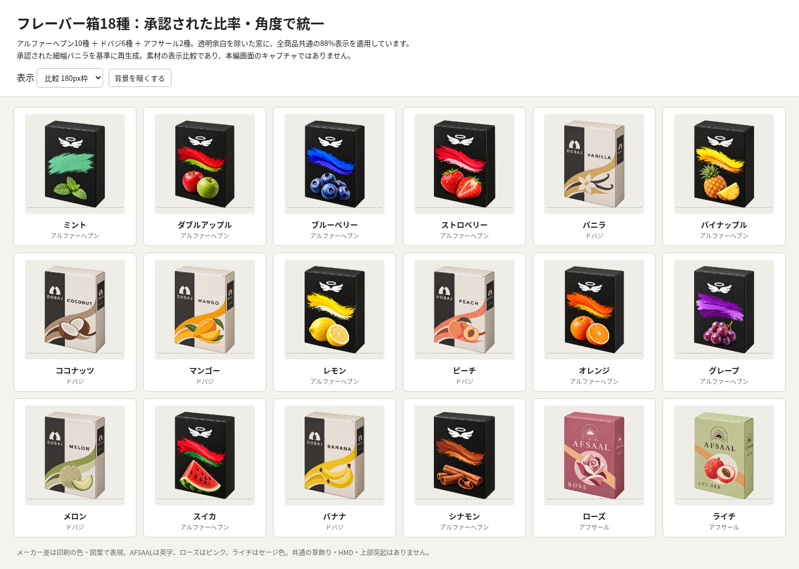

# #586 フレーバー箱18種：細幅・共通角度

[一覧画像を直接開く](comparison-18.png?raw=true) / [112px比較](comparison-112.png?raw=true) / [66px暗背景](comparison-66-dark.png?raw=true) / [表示サイズ切替HTML](comparison-18.html)

オーナーが確認した細幅のDOBAJバニラを基準に、Heaven10・DOBAJ6・AFSAAL2の全18種をそろえました。バニラは承認PNGをbyte単位で再利用し、他17種は同じ基準で再生成。AFSAALは英字、ROSEはピンク、LYCHEEはセージ色です。

箱は紙の折り目・上面・右側面の陰影で立体感を出しています。共通の草飾り、HMD、上部の突起は追加していません。図案は既存の独自案を継承。果物やミント固有の葉は一部のフレーバー表示に含まれます。

基準の幅は当初「約3%減」を指示しましたが、生成結果は約8%減でした。この実画像を示し、オーナーの「これでOK 引き続き頼む」で採用しています。厳密な3%版とは扱いません。

## 検品

全18種の1254角RGBA・透明域・SHAを確認。透明余白を除いて同じ高さへ表示したとき、幅比は基準に対して約−2.6〜＋2.3%。112px枠では窓の高さ98.55px、幅65.94〜69.19px。上面・右側面の向き、閉じた紙箱、メーカー差、表記を一覧で目視確認しました。生成由来の微差はあり、カメラ行列の完全一致ではありません。

Chromiumで180/112/66px枠、暗背景切替、390px画面のはみ出し無しを確認。ここは素材比較であり、本編キャプチャ・ゲーム回帰テストではありません。原画をコードで変形・修整していません。

## 保存物と採用範囲

- outputs/：今回選定18原画。バニラは承認基準と同じSHA。
- trials/：旧幅の3試作、最初の細幅候補、幅が残ったAFSAAL2枚。未採用。
- dobaj-vanilla-baseline-preview.png：ユーザーが直接確認した基準画像。
- manifest.json / size-metrics.json / comparison-validation.json：指示・出典・SHA・測定・検証。
- 比較HTML・PNG：ソース表示の確認用。

ゲームコード・商品データ・配信WebP・active mappingは変更していません。既存原画、予約、別担当の成果物を保持しています。既存worker停止・未push無し・正式移管を確認したとは扱いません。旧worker IDの流用・予約の解除・Issueの完了扱いは行いません。

通信量の記録はmanifest参照。生成PNG約29.4MB＋GitHubへのbase64画像payload約39.2MB。キャッシュ済み参照の実転送量はツールから取得できず、毎回再転送した最も保守的な加算では比較画像前で約114MBとなります。実測通信量とは区別し、追加の大容量取得・生成は止めています。
