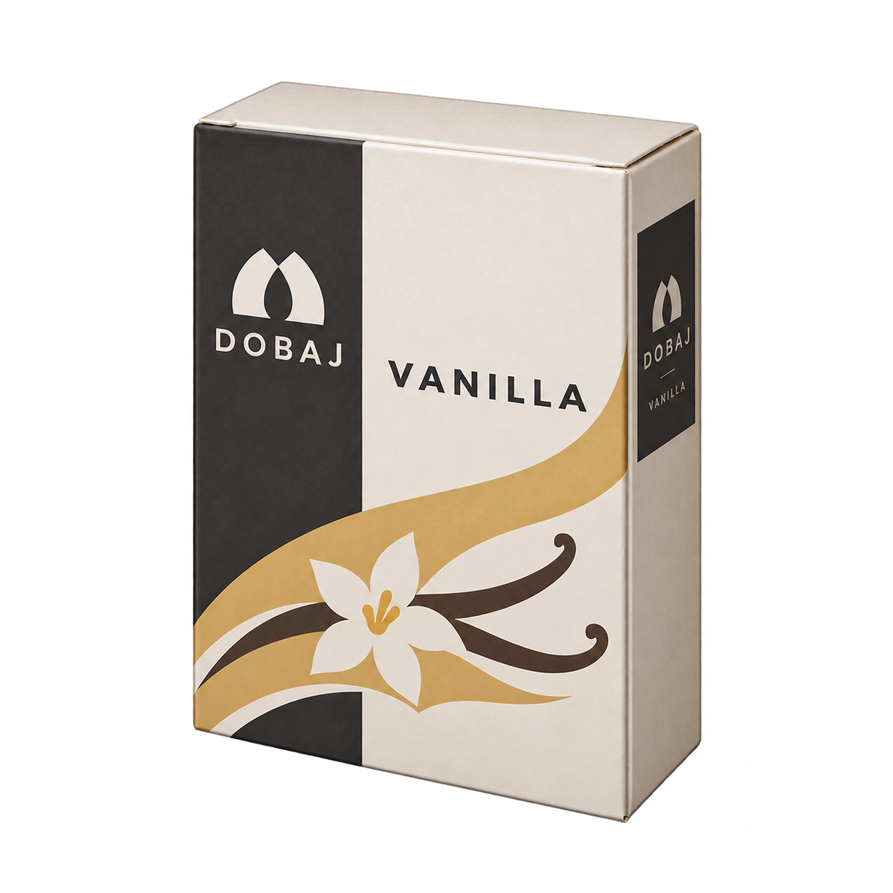

# #586 共通角度・細幅の基準プレビュー（未承認）

全18種の展開・マージ前に、ユーザーの「一旦基準みせて」「プレビューで欲しい」に応じた比較候補を保存。

- バニラの高さ・角度をほぼ維持して横幅を抑えた候補。
- 生成指示は約3%減だが実測は約8%減。厳密な3%の基準として採用していない。
- trials の3種は直前の旧幅で開始済みだった角度統一試作。AFSAALは英字、ローズはピンク、ライチはセージ色。
- 既存予約の解除・正式移管・元担当停止を実施または確認したとは扱わない。
- 生成ネイティブPNGと指示を保存。ゲーム実装・配信画像・商品データは変更しない。
- 残りの再生成とマージは基準確認待ち。
