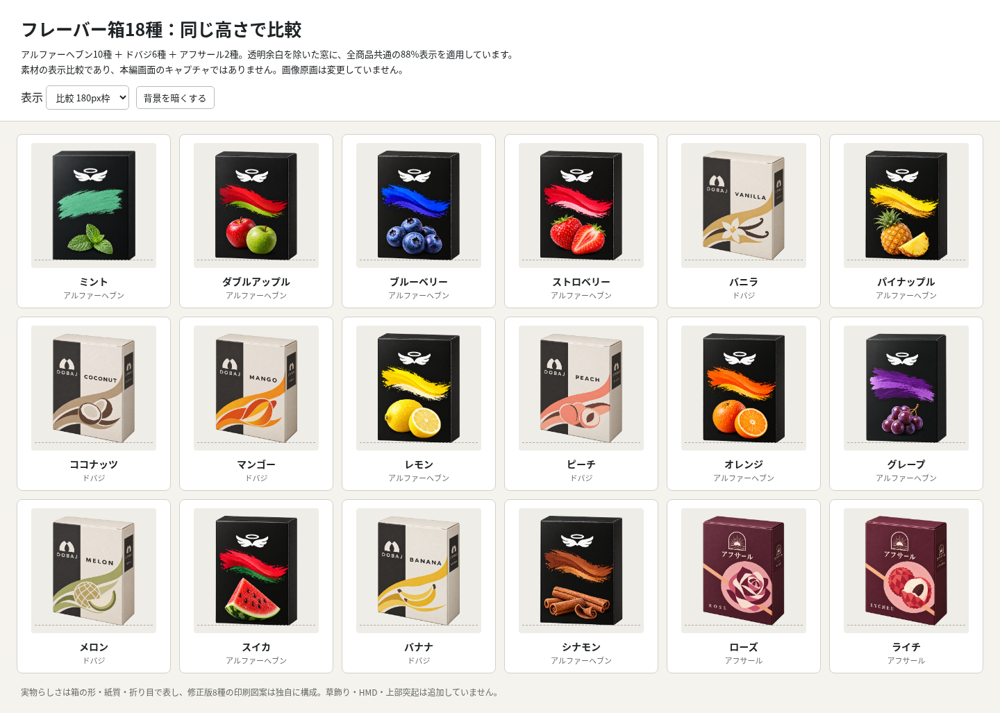
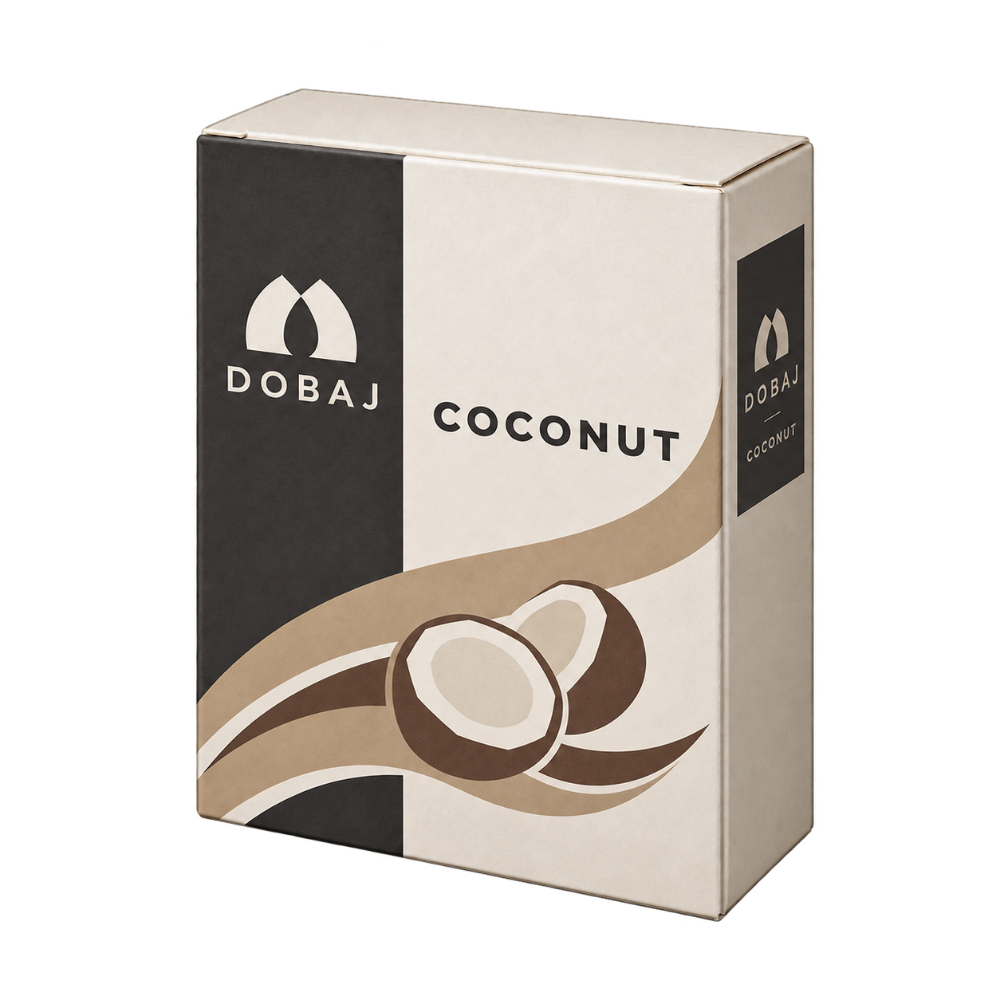
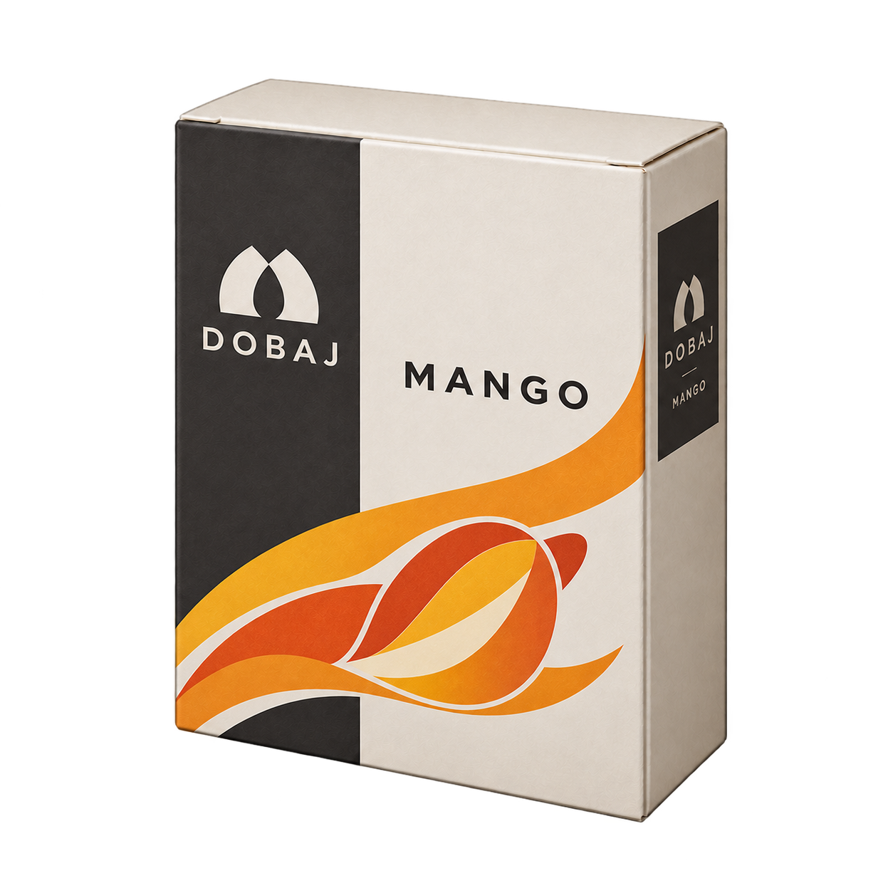
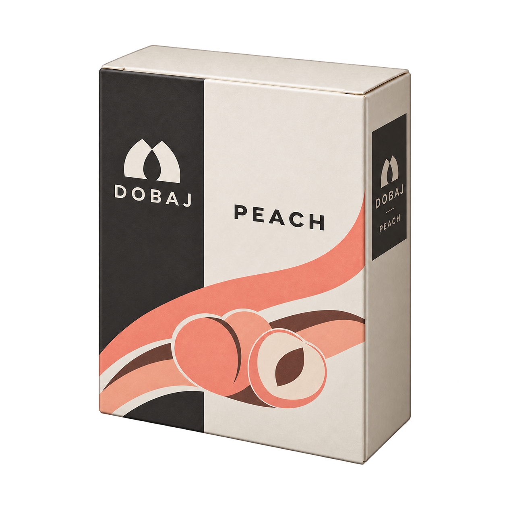
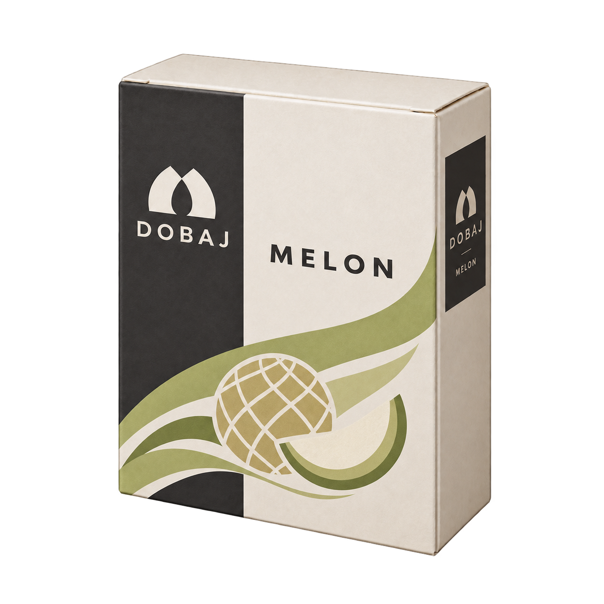
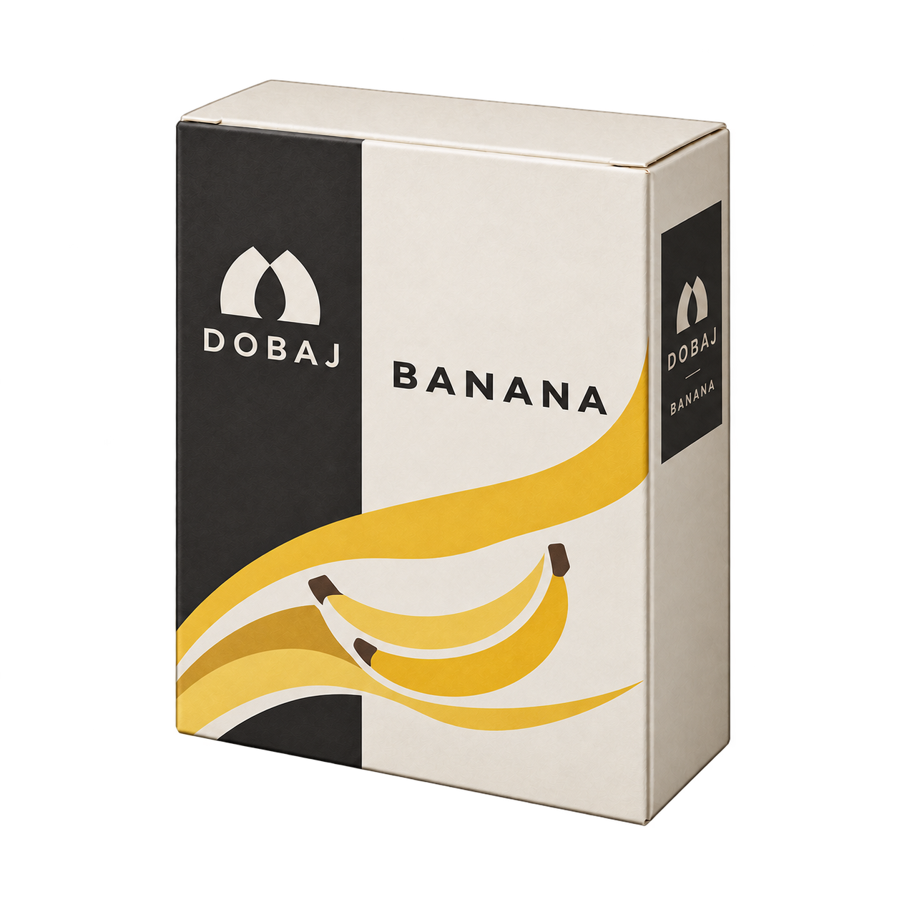
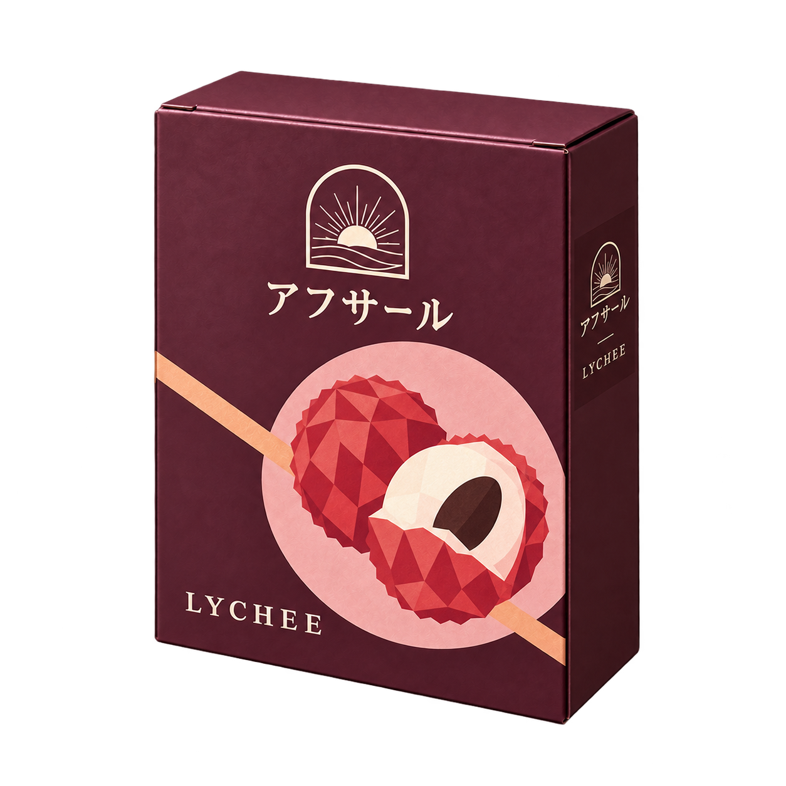

# 共通サイズ・独自図案のフレーバー箱8種

多数派だったドバジ型の実物らしい紙箱を基準に、ドバジ6種・アフサール2種をそろえました。写真風の下部食材画と下帯の構成を改め、独自の平面的な図案・配色・文字組みでフレーバーを表しています。

## アルファーヘブンも含む18種の比較

上は素材を並べた表示比較です。本編画面のキャプチャではありません。透明余白を除いた窓で、全商品に同じ88%縮尺と枠を適用しています。原画を同じ1254角の枠にそのまま縮小する比較とは異なります。

- 112px枠：全18種の表示窓高は98.55px。アルファーヘブンの幅約71.94〜74.77px、修正版8種は約73.09〜73.40px。
- 66px枠：全18種の表示窓高は58.08px。箱の見た目の大きさがほぼ同じになることを、実ブラウザで目視・実測しました。
- [comparison-18.html](comparison-18.html)は同梱PNGを参照する比較用HTMLです。リポジトリを取得して開くと66/112/180px枠と明暗背景を切り替えられます。外部通信は使いません。
- 計測: [size-metrics.json](size-metrics.json)。実ブラウザの18画像読込・3サイズ・明暗切替・ページエラーなし: [comparison-validation.json](comparison-validation.json)。

比較窓は現行 `tools/build_shop_art.py` のalpha>16＋2px余白と `shop.js` の88%縮尺に合わせています。ただし、実際の512WebP変換後や本編でのQAは今回行っていません。

## 修正版原画8種

| ドバジ・バニラ | ドバジ・ココナッツ | ドバジ・マンゴー | ドバジ・ピーチ |
|---|---|---|---|
|  |  |  |  |

| ドバジ・メロン | ドバジ・バナナ | アフサール・ローズ | アフサール・ライチ |
|---|---|---|---|
|  |  |  |  |

原画は全8枚1254×1254・透過RGBA、合計10,233,538 bytes。元の出力PNGにコードで切り抜き・描き足し・色変更をしていません。比較HTMLでの縮尺・窓表示は表示処理だけです。低alphaの薄い縁は元出力のまま保持。ロゴや外形の画素単位の完全一致は主張しません。

## 方向性と履歴

ユーザーは「実在商品のパッケージや食材写真に似すぎないようにしたい」と明示。実物を参考にするのは紙箱の立体構造で、写実食材の大きな下部配置を避け、独自の平面図案に改めました。色・マーク・文字組みでメーカー差を出し、草飾り・HMD・構造的な上部突起は追加していません。実在全商品の類似性を網羅して調査したという意味ではありません。

多数派ドバジ型を指定する前の小さい黒箱基準の2試作は [trials/](trials/) に保全。以前の[写真風8案](../maker-preview-20261017/README.md)も保留履歴として保持。全プロンプト・参照・元出力SHA256・実行権限・原画検品は [manifest.json](manifest.json)。

## 実行許可と通信量

このチャットでの制作許可、修正版2枚を基準に残り6枚を修正する許可、追加30MBまでの通信許可、完了後のマージ指示を受領済み。旧workerの実停止や正式transfer/release成功を確認した記録ではありません。旧bot予約・旧ブランチ・既存採用原画は変更していません。

新規6枚7,501,530 bytes＋比較PNG596,686 bytes。参照原画入力・生成出力・base64保存等の既知payload概算は約26.4MBで、追加30MBの範囲内。厳密な総通信量は未計測です。既存キャッシュとシステムChromiumを再利用し、full clone、追加ブラウザ取得、外部ログイン・課金・アカウント切替はしていません。

## このPRの範囲

原画・生成記録・比較資料の保存だけです。本編への画像登録、512配信画像生成、「アブサル」→「アフサール」の正式データ変更、ゲームテスト・公開版QAは未実施。アルファーヘブン10種は変更していません。マージ前に最新CI・レビュー・競合を確認します。

Refs #586 / PR #619。
