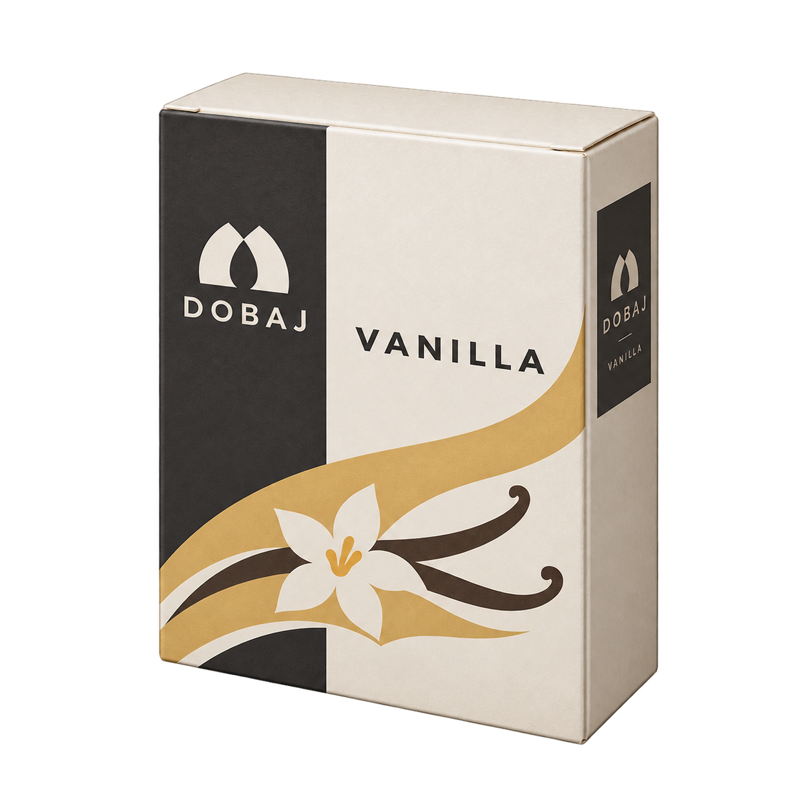
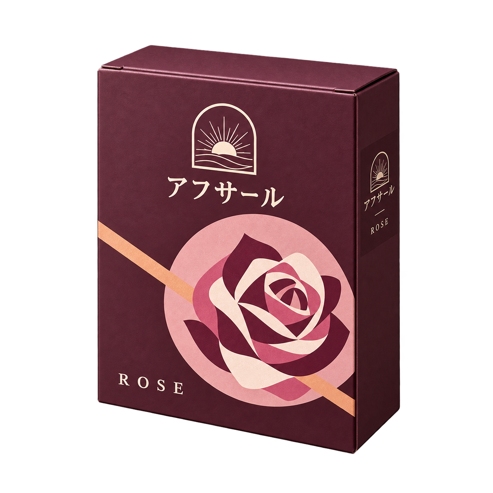

# 共通サイズと独自図案：修正版2枚

箱の基準は、前案8枚のうち6枚に用いた**ドバジ型の紙箱**です。実在の小売箱らしい縦横比・厚み・折り目を残し、両メーカーを同じ大きさと視点にそろえました。実在パッケージや食材写真の丸写しを避けるため、写実的な下部食材画＋下帯の構成を改め、独自の平面的な印刷図案にしています。

| ドバジ・バニラ | アフサール・ローズ |
|---|---|
|  |  |

- ドバジ：アイボリーと墨色の縦面、黄土色の曲線、記号化したバニラ。
- アフサール：プラム色、円と斜線、平面的な薔薇の図案。
- 色・図案・文字組みでメーカー差を出し、共通の草飾り・HMD・上部突起は追加していません。実物らしさは紙箱の構造・材質で表します。

## サイズ確認

1254角の原画で、alpha128以上の対象外形を測定しました。

| 対象 | 外形幅 | 外形高さ | 外形窓（x0,y0,x1,y1） |
|---|---:|---:|---|
| 基準の旧ドバジ・バニラ | 769px | 1035px | 248,115,1017,1150 |
| 修正版バニラ | 773px | 1040px | 246,113,1019,1153 |
| 修正版ローズ | 769px | 1039px | 248,115,1017,1154 |

修正版2枚間の差は幅4px、高さ1px。画素単位での同一外形ではありません。低alphaの薄い端ノイズは元出力のまま保持しています。主対象の見た目・面構成を実出力で確認しました。

## 原画と履歴

選定2枚は無加工PNG、1254×1254 RGBA、合計2,732,008 bytes。実プロンプト・参照元・出力SHA256・検品は [manifest.json](manifest.json)。

ユーザーが多数派ドバジ型を指定する前に作った小さめ黒箱基準の2試作は [trials/](trials/) に保全し、選定しません。前回の[8枚](../maker-preview-20261017/README.md)はサイズ・類似への指摘により保留、原画は削除・変更していません。今回は新代表2枚まで。残り6枚の同方向修正、本編反映、名称データ変更、採用・公開・マージは未実施です。

## 通信量

今回の2試作＋共通サイズ版2枚は計5,016,766 bytes。既存参照キャッシュを再利用しました。生成サービス、繰り返し参照入力、保存用base64等を含む正確な総通信量は計測できませんが、今回までの概算は承認枠約40〜55MBの上限付近です。残り6枚を修正すると追加約25〜30MBを見込むため、実行前の追加許可を確認中です。外部ログイン・課金・アカウント切替なし。

Refs #586 / Draft PR #619。
