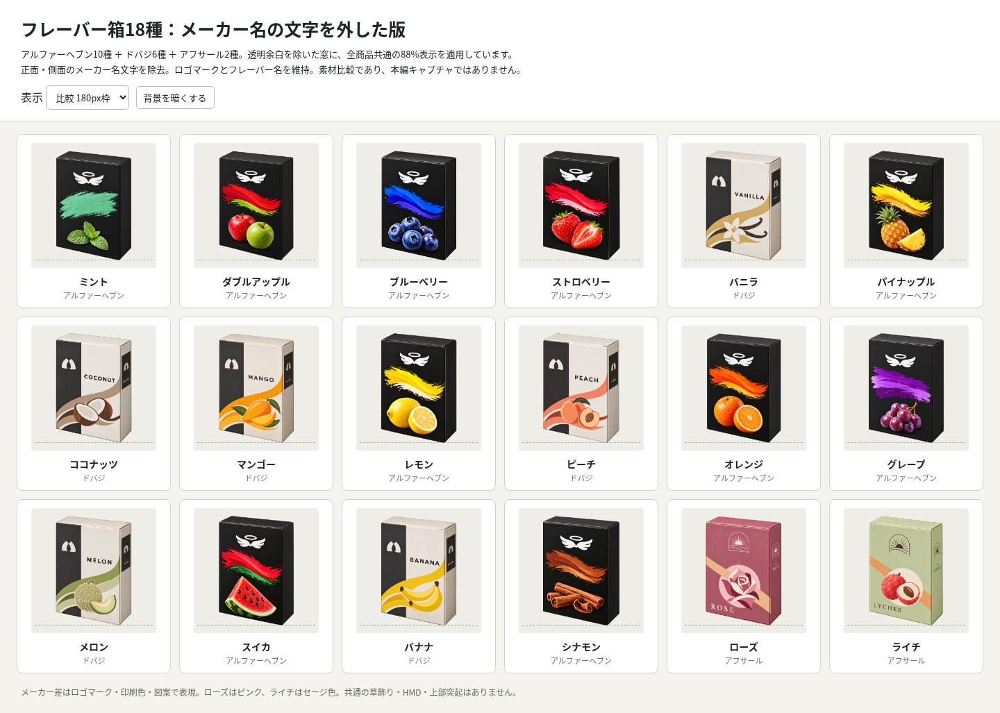

# #586 フレーバー箱：メーカー名の文字なし

[全18種の画像を直接開く](comparison-18.png?raw=true) / [修正前後8種](before-after-8.png?raw=true) / [サイズ切替HTML](comparison-18.html)

箱の正面・右側面に印刷されたDOBAJ／AFSAALのメーカー名文字を消しました。対象はドバジ6種とアフサール2種です。既にメーカー名の無いHeaven10は直前の原画をbyte単位で再利用しています。

ロゴマーク・フレーバー名・食材図案・箱色・紙箱の向きと比率を維持。比較画像の箱の外にあるメーカー名は識別用ラベルです。箱へのメーカー名印刷を外す依頼に対し、商品データや画面のメーカー表示は変更していません。

## 検品

全18点1254角RGBA、透明域0..255、SHA確認。再利用10点は前版のGit blob SHAと一致。編集8点はネイティブ出力と修正前後で正面・側面のメーカー名消去、ロゴ／フレーバー名残存を目視確認。TesseractによるDOBAJ／AFSAAL文字の検出も0ですが、OCRは補助であり目視の代わりにはしていません。

編集前後の不透明シルエットIoUは最小99.13%、縦横比差は最大約0.56%。生成編集のため文字以外も微小な紙目・エッジ差があり、完全なpixel不変とは扱いません。原画のコードによる画像修整・変形は行っていません。

Chromiumで180/112/66px枠の18画像decodeと共通高さ、暗背景切替、390px幅の横はみ出し無し、修正前後16画像の表示を確認しました。ここは素材比較であり、本編ゲームのキャプチャ／ゲーム回帰QAではありません。

## 保存と範囲

outputs/ に今回の18原画、manifest.json に生成指示・出典・SHA・目視記録・通信量算定を保存。旧文字あり原画は angle-unified-v3/ にそのまま残しています。

追加40MB許可に対し、参照PNG＋生成PNG＋GitHubへの画像base64＋比較画像uploadの既知payload合計は約31.9MB。実測総通信量はツールから取得できないため、転送エンコード等の差は含みません。全て既存キャッシュ参照を使用し、新しい外部素材・ブラウザをダウンロードしていません。

ソース素材のみの更新です。本編コード・商品データ・配信WebP・active mapping・既存予約は変更しません。正式移管・旧担当停止を確認したとは扱わず、Issue #586の完了／予約解除も行いません。
