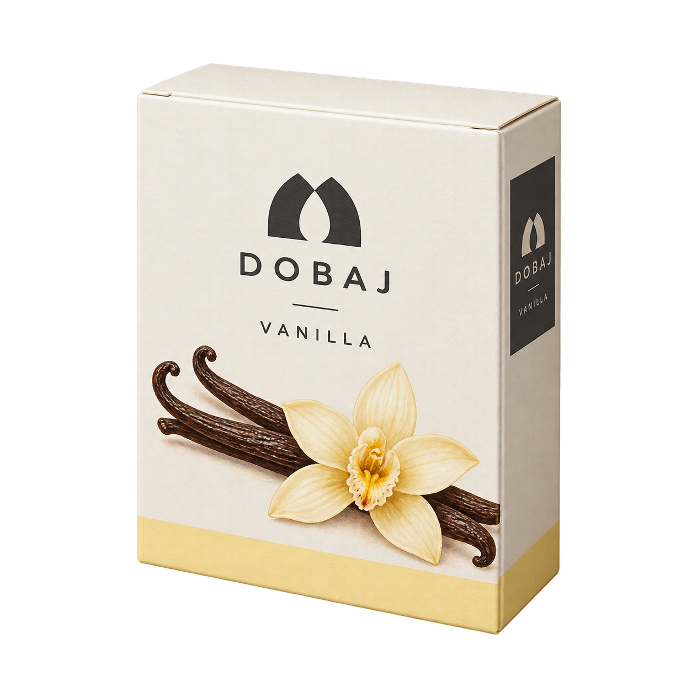
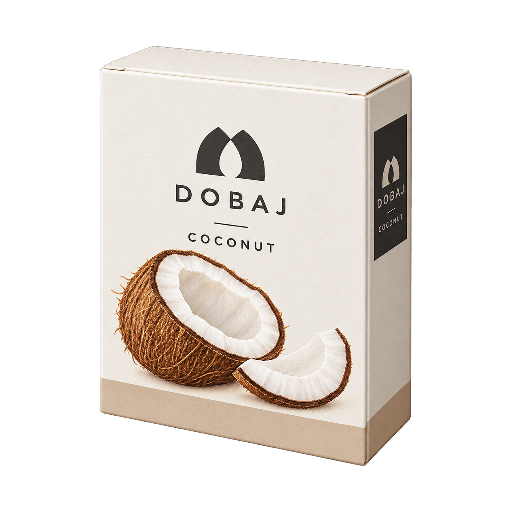
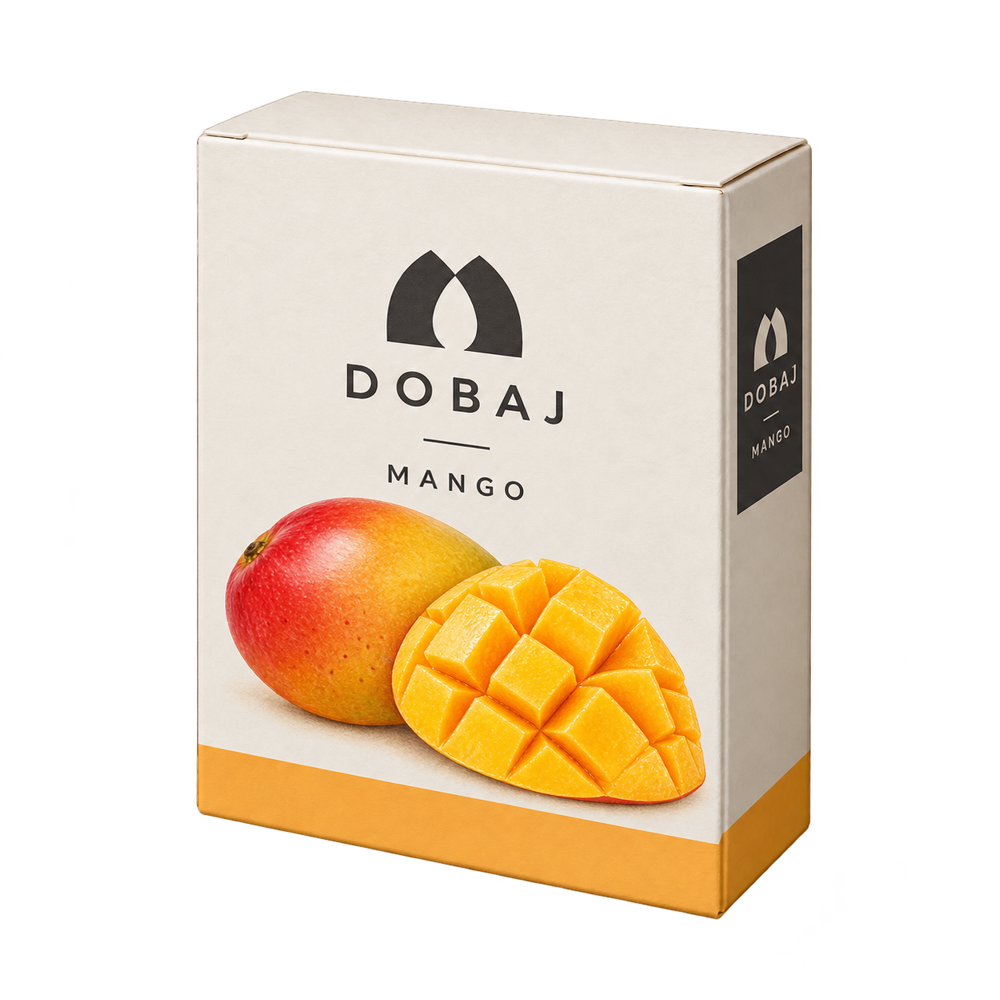
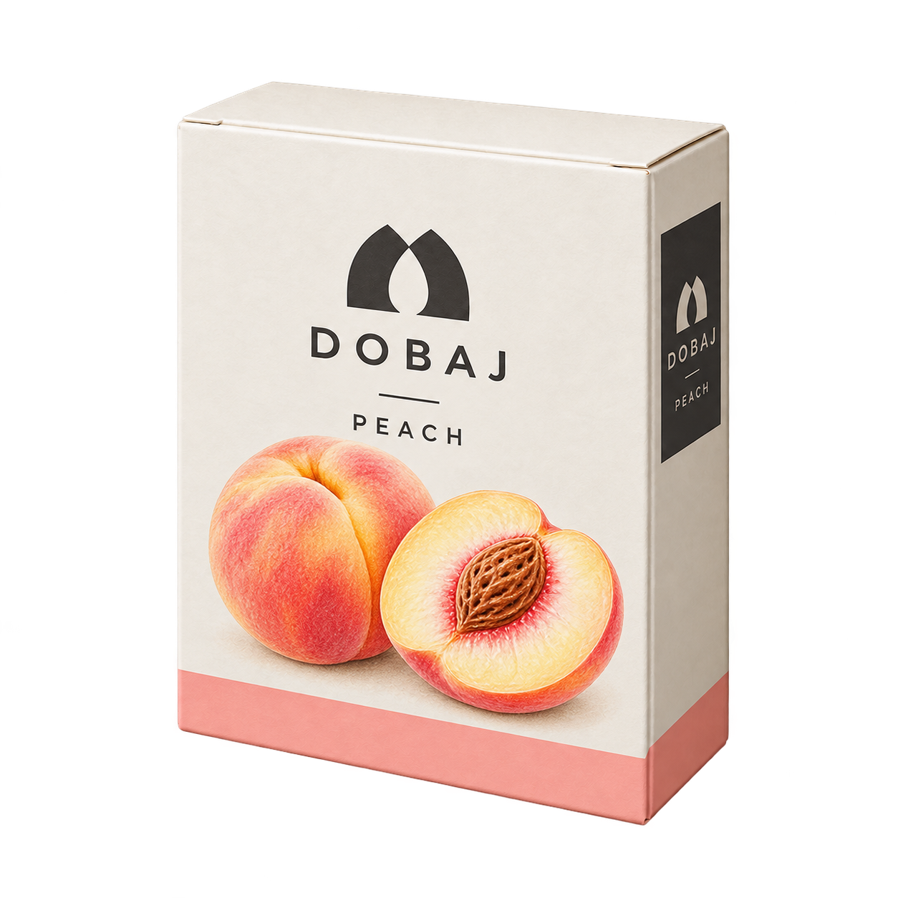
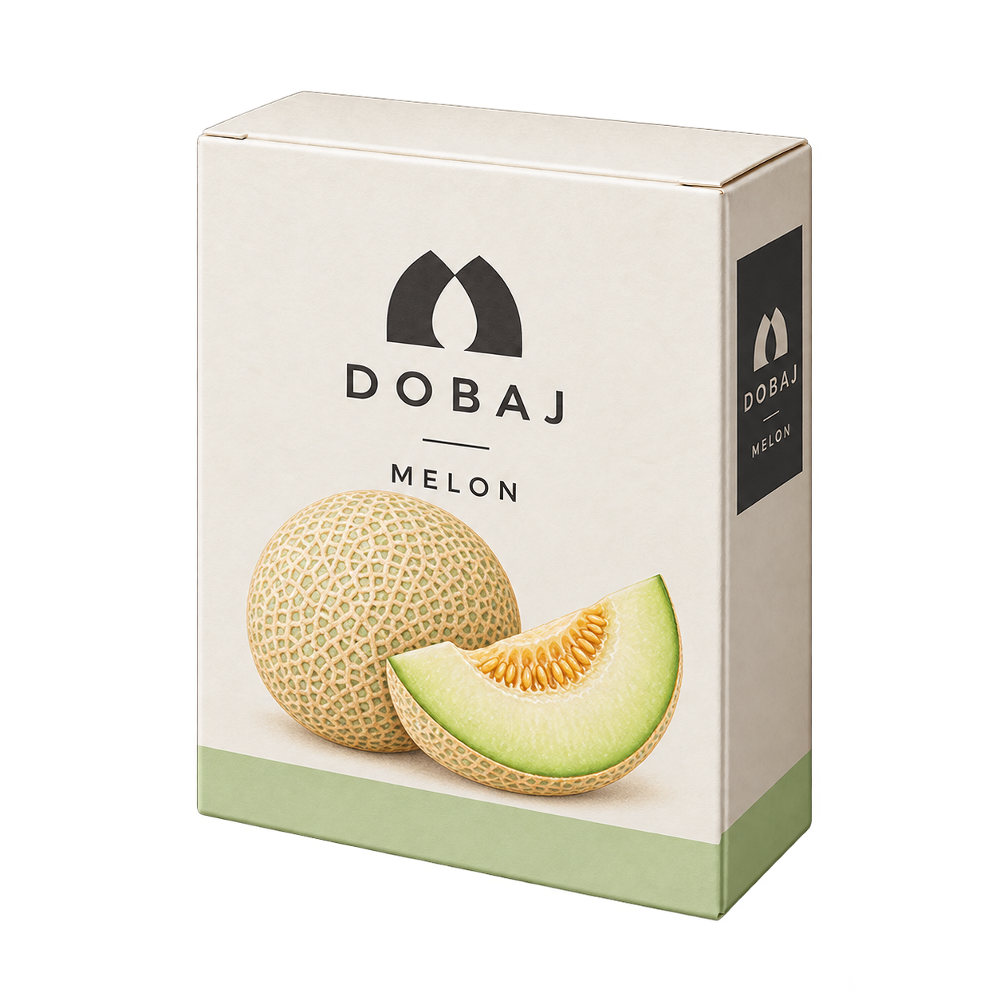
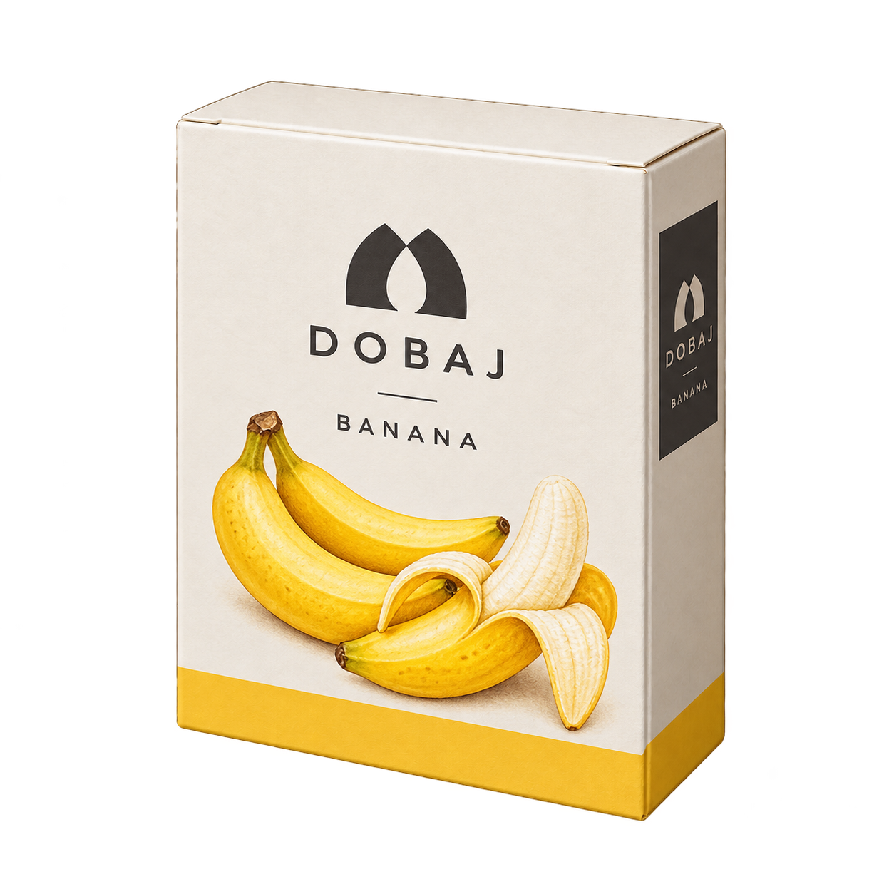
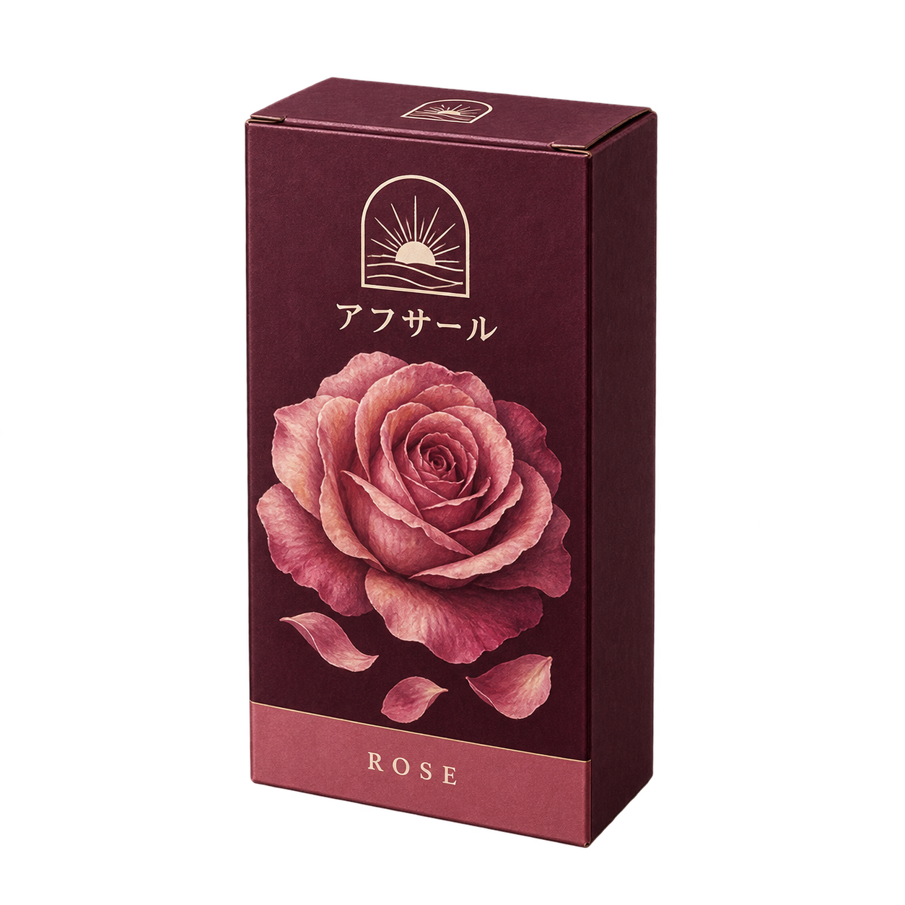
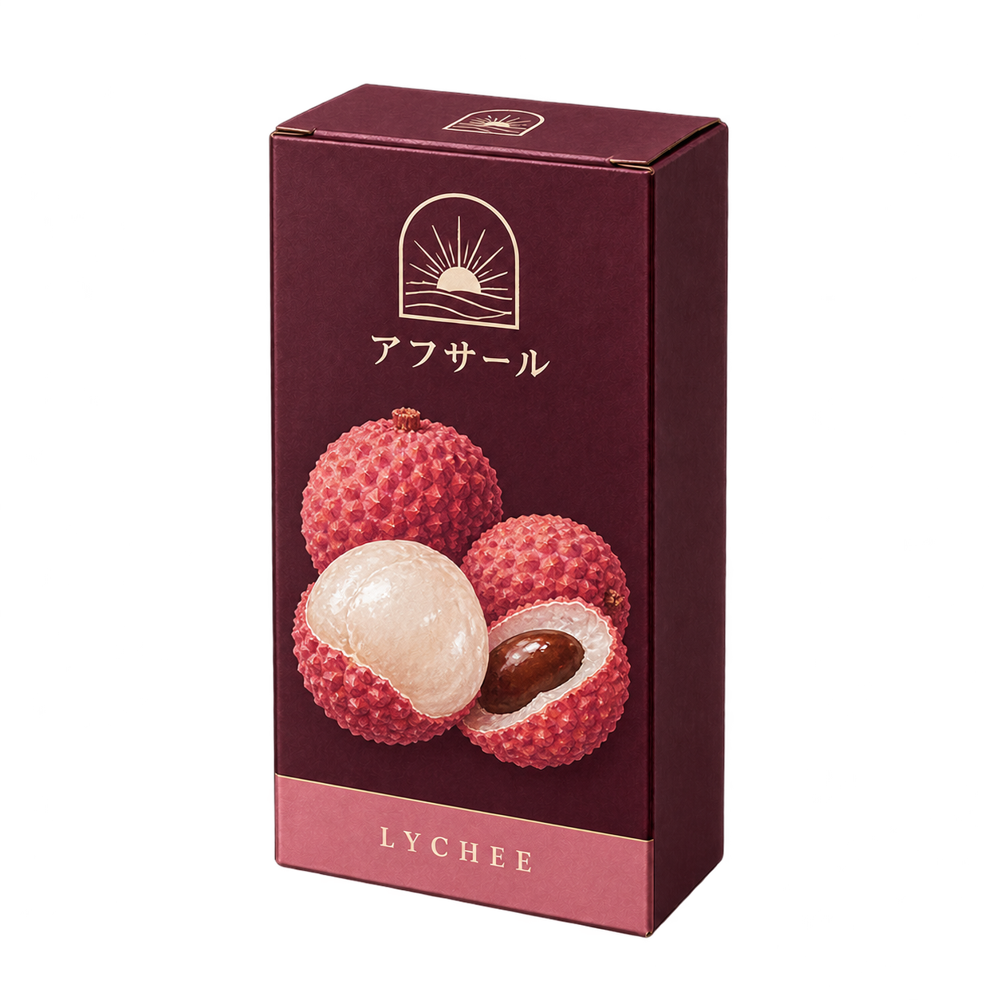

# ドバジ6種・アフサール2種の比較候補

承認済みの代表2枚を基準に、残り6枚を生成しました。ドバジは白いマットな薄箱、アフサールはプラム色の縦箱。箱の厚み・折り目・印刷面の陰影を維持し、食材画とフレーバー帯を変えています。

画像をクリックすると無加工の原画が開きます。8枚合計10,587,489 bytes（約10.59MB）。

| ドバジ・バニラ（承認済み代表） | ドバジ・ココナッツ | ドバジ・マンゴー | ドバジ・ピーチ |
|---|---|---|---|
|  |  |  |  |

| ドバジ・メロン | ドバジ・バナナ | アフサール・ローズ（承認済み代表） | アフサール・ライチ |
|---|---|---|---|
|  |  |  |  |

## 採用状況

ユーザーの「いい感じだから続けて」で代表2枚の方向性と残り6枚の制作を承認済み。バニラ・ローズの原画は元SHA256のまま保持し、再生成・加工していません。今回の6枚はその原画をimagegenへ参照添付して生成した候補です。全8枚の最終確認・本編への接続はまだ行っていません。

画像内の呼称は「アフサール」。既存ゲームデータの「アブサル」は今後の名称変更対象として記録しており、今回の素材保存ではデータを変更しません。

## 検品

- 原画8/8を全decode。すべて1254×1254・RGBA・alpha0〜255。各SHA256と実プロンプト・参照・出力元は [manifest.json](manifest.json)。
- 8枚の実出力を目視。メーカー別の紙箱形状、マーク・文字、フレーバー画と帯を確認。マンゴーに柑橘、ライチに薔薇などの持越しなし。
- 共通の草/葉/蔓飾り、HMD、炭、ボウル、構造的な上部突起なし。果実画は箱の印刷表現。
- 自動生成のためロゴ位置や紙面は画素単位の同一ではありません。承認済み2枚も含め透明輪郭に薄い縁があり、低alphaノイズは画像端まで分布する場合があります。alpha16以上の主対象は内側に収まります。全原画無加工で、余白は一律10%以上とは主張しません。
- 小サイズ・ゲーム背景でのQA、runtime/data変更、ゲームテスト、採用・公開・マージは未実施。今回の範囲は比較候補の保存です。

## 制作許可と保存

このチャットでの制作はユーザーの明示許可「そのチャット見当たらないからここで作るってこと　許可する」、続く代表2枚への「いい感じだから続けて」に基づきます。元担当の実停止・未pushなし・正式transfer/release成功を確認した記録ではありません。旧bot予約・旧ブランチ・既存採用素材は変更していません。

保存先はDraft PR #619 / branch `codex/586-maker-preview-20261017` のこの新規フォルダだけです。元出力は `/workspace/generated_images/` に保持。原画へのコード加工・切り抜き・合成はありません。

## 通信量

既存repo/代表原画のキャッシュを再利用し、今回の新規6枚は合計7,880,194 bytes（約7.88MB）、GitHub保存用base64 payloadは約10.51MB。承認済み2枚の再uploadはしていません。参照画像・生成サービス・API・メタデータを含む正確な総通信量は未計測です。承認枠約40〜55MBを大きく超える追加取得は予定していません。外部ログイン・API課金・アカウント切替なし。

Refs #586。
