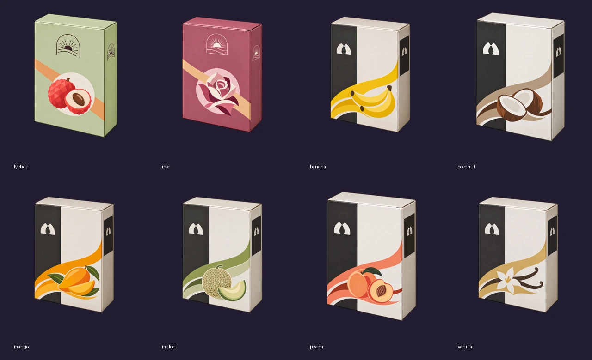

# 第1章・残り8種の箱表示を再構築（#647）

オーナーが旧担当チャットをロストしたため「作り直して」と指定したことに基づき、現在予約中の #647 の範囲で表示を再構築した。旧 #586 のworker ID・claim・branchを使わず、旧原画も書き換えない。未採用HMD候補は取り込まない。

原画自体はPR #628、commit `bb2492e1763d68edc45fa2e1edf772ad8848e612` に保存されていた。全リポジトリの取得や再生成をせず、必要8PNGだけをGitHub APIで回収。`sources.json` のGit blob SHA／SHA256／byte数を照合して不変コピーを保存した。新たな画像生成を行ったとは扱わない。回収PNGの総量8,511,841 bytes、base64転送は約11.4MB（実測wire総量ではない）。

8原画を全デコードし、正面・側面に英字のないこと、ドバジの黒白・フレーバー色の帯と図案、アフサールの太陽ロゴ・ローズ/ライチ図案、閉じた紙箱・上面と右面・透明余白を一覧と代表原画（バニラ／ローズ）で確認した。実ロゴ・HMD・箱外の果実は追加していない。図案は元画像のまま。

`tools/build_shop_remaining_art.py` は選択8点のSHAとIDを検証し、原画を加工せず512角の配信用WebPへ縮小・圧縮する。全alpha・境界窓を検査し、`--check` で8配信bytes・mapping・validationを再現する。配信総量182,616 bytes。既存の `tools/build_shop_art.py` / Heaven10の選定契約と原画・配信・mappingは不変。

ゲームの `shop.js` で追加mappingを読み、全18商品を箱として表示。読込失敗時は既存植物画→文字のfallbackを維持。商品ID・価格・maker・性能・在庫・購入処理は変更しない。PC／横持ちタッチ／800×600の一覧・詳細・旧セーブ・購入とくじの検証はPRのQA記録を参照。
