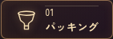
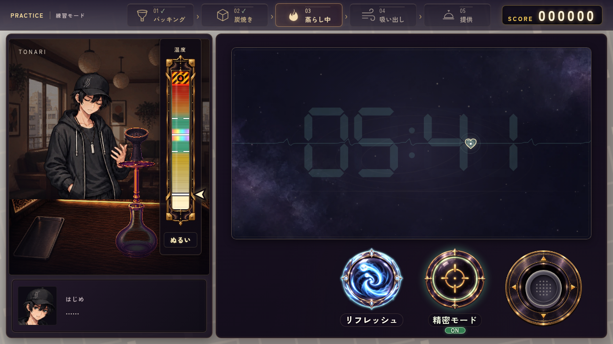
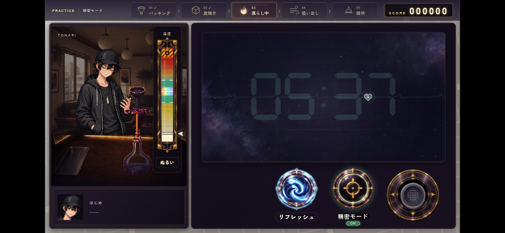
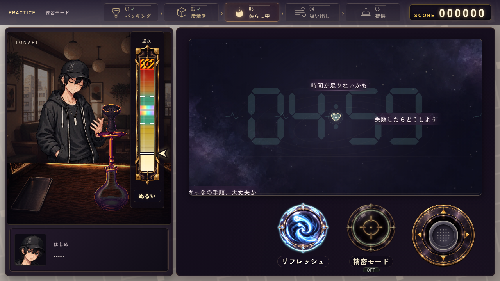
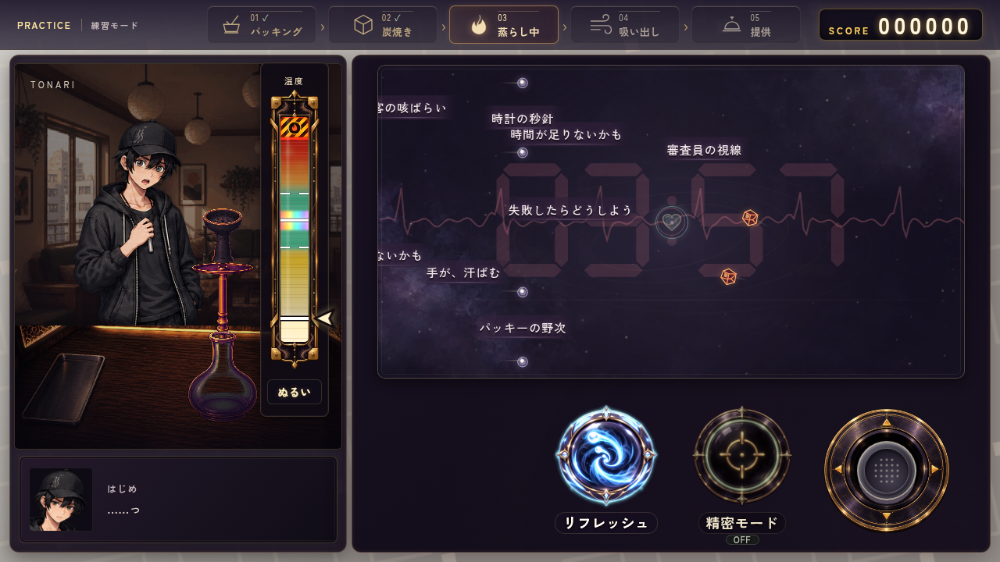
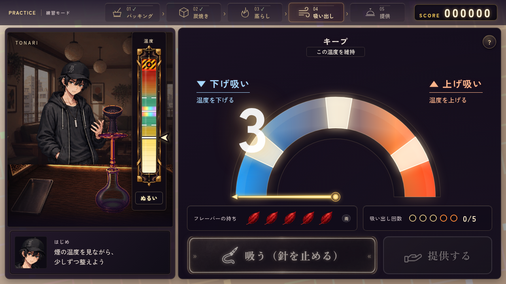

# 蒸らしの円形操作UIと工程ヘッダー（2026-10-11）

> 操作素材・寸法・ハートの最新実装は [SF49〜56のシンプル操作UI](../steam-controls-simple-20261011/README.md)。このページの操作素材と寸法は前段階の記録として保持する。工程ヘッダーと内心の仕様は引き継ぐ。

SF37〜44・46〜48。参考画像は下段の操作UIだけに用いた。操作素材は新規生成し、背景・弾・温度計・人物・会話・スコアの意匠を移していない。後からの指示で、心拍と時計の色連動・工程ヘッダー・ゲーム領域の拡大を追加した。

## 個別の透過素材

| 素材 | 採用原画 | 構成 |
|---|---|---|
| リフレッシュ | [PNG](../../assets/ui/making/steam_refresh_button.png) | 青白い渦へ玉が吸い込まれる円形ボタン。青い周回エネルギーはCSSで回転し、使用後は一回のボタンとして無効になる |
| 精密モード | [PNG](../../assets/ui/making/steam_precision_button.png) | 金の照準・控えた緑の輪。ONは外光を強めて緑のON表示、OFFは光を抑えてOFF表示 |
| スティック台座 | [PNG](../../assets/ui/making/steam_stick_base.png) | 黒紫の金属、金の細い装飾、四方向矢印。独立した76pxのノブをコードで動かす |

`image_gen.imagegen`で各素材を独立生成。いずれも1254×1254のRGBA、角と外周に完全透過を持ち、文字・背景を焼き込んでいない。[完全な生成指示](prompts.json)・[原画SHAと透過検査](generation.json)を保存。`build_manifest.py --making-only`で3素材だけをWebP化・目録へ追加した。

## 実装

「リフレッシュ → 精密モード → スティック」を右下へまとめ、20pxずつ離した。ボタンは140pxの絵と154×180pxの操作領域、右のスティックは176px。リフレッシュの一回・消去範囲、通常290px/s・精密120px/s、キー・スティックの入力を維持。2本目のタッチでも精密が動くようpointerdownで切り替え、キーボード・支援技術のclickはdetail=0だけで処理して二重切り替えを防ぐ。

工程名は番号・アイコン・現在の工程を示す上段へ移動。準備・配合・アルミ等はパッキング群、炭の配置は炭焼き群、熱管理は吸い出し群にまとめ、現在の実工程名は表示する。実際の11工程は変更していない。右の見出しを外し、蒸らしは752×402pxへ縦に拡大した。薄い時計は同じ448×158pxで中央に置き、心拍と同じメンタル色に連動する。

SF46ではパッキングのマークを、口の広い器と細い脚のシンプルなハガルへ変更。他の工程と同じ線幅・金色のSVGとして実装した。PC・スマホの以下のON画面を更新し、パッキングが現在の工程のときの表示も保存した。

SF47ではフィールドを16px下へずらし、右パネル上側に約30pxの余裕を確保。フィールドは752×402pxで、操作欄との間にも隙間が残る。SF48では19種類の雑念をはじめ自身の内心に揃え、いないパッキー・審査員・客・隣の台を前提にする言葉を差し替えた。「穴、足りてたかな」「煙、ちゃんと出るかな」など、蒸らし中に手順や仕上がりを気にする言葉を使う。

OFFの画面は実際に2回被弾した状態。時計と心拍が同じピンク赤へ変わり、既存の心拍の乱れとはじめの表情も動く。

[縦画面の収まり](controls-portrait.png)・[吸い出しのスマホ](pull-mobile.png)。

## 検証

`steam_forecast.mjs`はPC1280×720・スマホ844×390でPASS。実マウス／タッチの通常→精密→通常、Space／Enter、ON/OFF表示、時計のカウントダウン、温度計の4工程の位置、天候予測、一回のリフレッシュを確認。二本の実タッチを使い、片方の指で移動を続けながら精密をONにし、リフレッシュを使えることを確認した。大きい操作欄・弾幕・ヘッダーは重ならず画面内へ収まる。

`pull_draw.mjs`もPASS。ヘッダー移動後の吸い出し・熱管理、温度計・葉・ボタン・半円ゲージ、吸引中の入力ロック・水泡・温度応答、スマホ・動きを減らす設定・画面離脱を確認。JS構文・差分空白は正常。原画3点を目視し、独立した円形操作・文字と背景の混入なし・透過を確認した。

追加の実ブラウザ確認は練習と大会それぞれ11工程のヘッダー・現在表示・右見出しの非表示がPASS。実際の被弾2回で心拍と時計が青緑 `rgb(134,214,197)` からピンク赤 `rgb(239,135,149)` へ同時に変わることを確認。390×844へサイズ変更しても操作欄は画面内に収まった。ページエラーなし。

SF46の変更後は1280×720・844×390の実ブラウザ画面を目視。ハガルの口・器・脚、アクティブ時の発光、完了時のマークと並びを確認し、ページエラーなし。変更はパッキングのSVGのみのため、機能テスト一式は再実行していない。JS構文と差分空白は正常。

SF47〜48は変更後に`steam_forecast.mjs`をPC・スマホで再実行しPASS。配置と操作欄との非重複、実マウス／タッチ・二本指の同時操作、精密ON/OFF、リフレッシュ、時計、温度計の位置と天候予測を確認した。更新した3画像を目視し、実際に出現した内心の言葉と上の余白を確認。旧5表現を`data/`と`remake/js/`で横断検索し、残りなし。JS構文・差分空白は正常、tidyは整形0行、台詞リンタはERROR 0（既存JSONのWARN 345、今回のJSON変更なし）。
