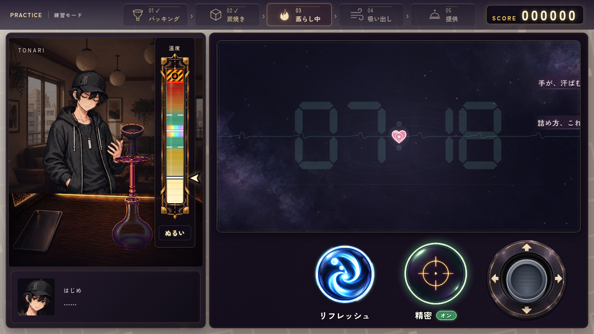

# 蒸らしのシンプルな操作UI（2026-10-11・SF49〜57）

参考画像の操作3要素だけを基準に、円形ボタンとスティック台座を個別の透過素材として新規生成した。細い光の輪・中央アイコン・余白に絞り、照準と可動スティックを一目で区別できる構成にする。

| 原画 | 用途 | 実装側が表示するもの |
|---|---|---|
| [steam_refresh_simple.png](../../assets/ui/making/steam_refresh_simple.png) | 細い青白い輪、渦へ吸い込まれて消える玉 | 名前、回転する光、使用済みの暗さ |
| [steam_precision_simple.png](../../assets/ui/making/steam_precision_simple.png) | 細い金の照準、落ち着いた緑の輪 | 「精密」「オン／オフ」、緑の発光の強弱 |
| [steam_stick_simple_base.png](../../assets/ui/making/steam_stick_simple_base.png) | 黒紫の台座、細い金の縁、太い四方向矢印 | 灰色の立体ノブ、ドラッグ移動、押している状態 |

3点とも1254×1254 RGBA。四隅のalphaは0。原画は生成出力をそのまま保存し、ゲーム用のWebPは `build_manifest.py --making-only` で制作した。以前の素材と目録の項目も保持し、最新mainとの併合では双方の目録の既存項目がすべて残ることを確認した。

生成ツールは `image_gen.imagegen`、`transparent_background: true`。新規生成で参照画像の直接切り抜きはしていない。[完全な生成指示](prompts.json)と[原画のSHA256・寸法・透過の検品記録](generation.json)を保存する。文字や状態を素材に焼き込まず、採用済みの人物・精神世界の背景・弾・温度計の素材は保持した。

下段は「リフレッシュ → 精密 → スティック」の順。空き幅を使って円形ボタンを152px、押せる範囲を176×180pxへ広げた。間隔20pxと右側176pxのスティックは保ち、ボタン操作中にも親指を動かせる。灰色のノブは88pxで、照準の金色と異なる中心形状・色にする。「精密」と「オン／オフ」は横並びに表示する。

精密の移動速度は通常290px/s・オン120px/s、入力処理と切り替えを維持する。両ボタンはpointerdownで受け、キーボード・支援技術のclickはdetail=0だけ処理する。リフレッシュは一台につき1回。

追加指示で弾幕の高さは402→414pxへ上方向に12px拡大。SF57では幅752→784pxへ左右に16pxずつ広げ、上・左・右の余白を17pxに揃えた。下の操作欄との隙間は残す。ハートは36pxの明るいピンクと白い縁、芯は6px。基本の実判定半径は8→9px（+12.5%）、根性・体調の係数は維持し、中心の白い円の直径を実判定の2Rに揃える。

## 完成画面

最新の [スマホ横画面](field-width-784/mobile.png)・[拡大前後の寸法記録](field-width-784/geometry.json)。下のオン／オフ比較はSF49〜56時点の幅752pxの記録を保持する。

| サイズ | オフ | オン |
|---|---|---|
| PC・1280×720 | [画面](controls-desktop-off.png) | [画面](controls-desktop-on.png) |
| スマホ横・844×390 | [画面](controls-mobile-off.png) | [画面](controls-mobile-on.png) |

スマホ縦・390×844では、[既存の横向き案内](portrait-rotation-hint.png)が操作より前に表示される。この既存の進行は変更していない。

## 確認結果

`steam_forecast.mjs` PASS。PCの実マウス入力は288→120→290px/s、スマホサイズの実タッチ入力は289→120→287px/s。Space／Enterの切り替え、二本の指でスティックを動かしながら精密とリフレッシュを押す操作、消費の独立性、リフレッシュ一回、全4工程の温度計位置、天候・洞察による予測、薄い時計、操作欄の収まりを確認した。

`steam_refresh.mjs` PASS。近い実弾だけの消去・遠い実弾の保持、空振り・連打による二重消費の防止、全★で一回だけの使用、根性による範囲の成長とメンタル一段階回復、被弾数による採点を確認した。

SF49〜56の実ブラウザ画面で、上下の余白と操作3要素の非重複・収まり、白い判定円の幅とborder-box、実際の繰り返し被弾による時計と心拍の同色変化、ページエラー0を確認した。スマホはChromiumの画面サイズ・タッチ入力のエミュレーション。原画3点は生成出力と完全一致し、RGBA・寸法・SHAも一致する。

SF57はPC1280×720・スマホ横844×390で実画面を確認。幅784px・高さ414px、上・左・右の余白はいずれも基準画面換算17px。操作部との非重複・時計の中央配置は正常で、PCのボタン3点と温度計の座標は拡大前と完全一致した。マウスと実タッチで新しい左右端まで移動でき、精密切り替えも動作。ページエラー0。[寸法と入力の記録](field-width-784/geometry.json)へ拡大前後の座標と画面サイズを保存した。

[検証ログ](test-results.json)・[画面寸法と状態の記録](verification.json)。再現用の [画面保存スクリプト](capture.mjs)はサーバー8123で実行する。時計・弾・被弾値を偽造せず、実際のゲームを撮影する。
