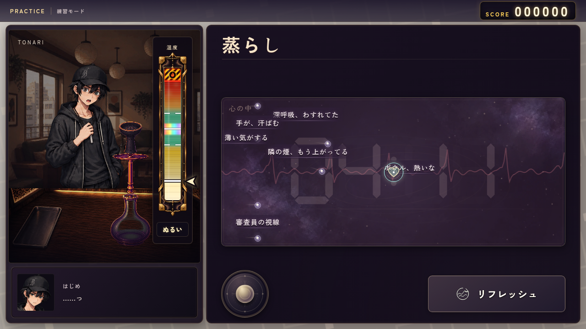
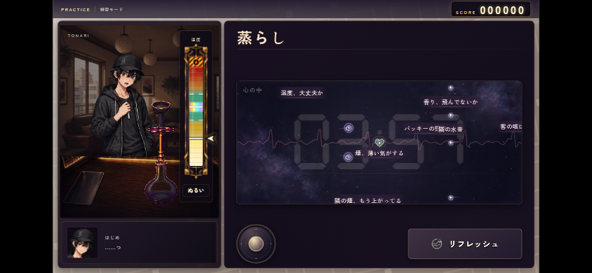
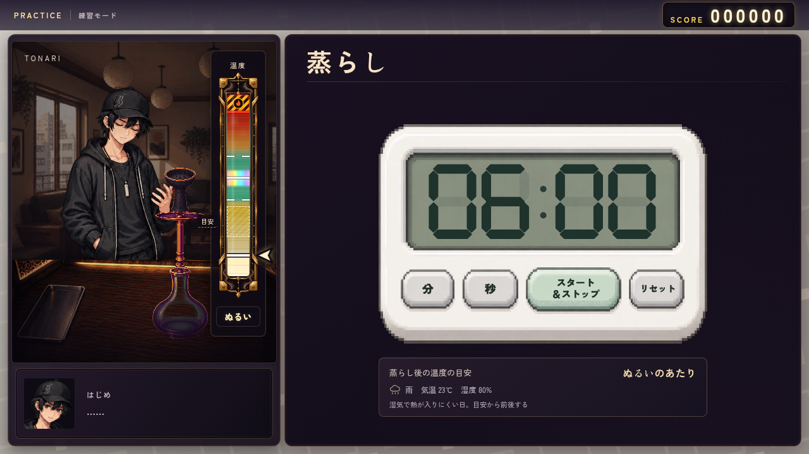
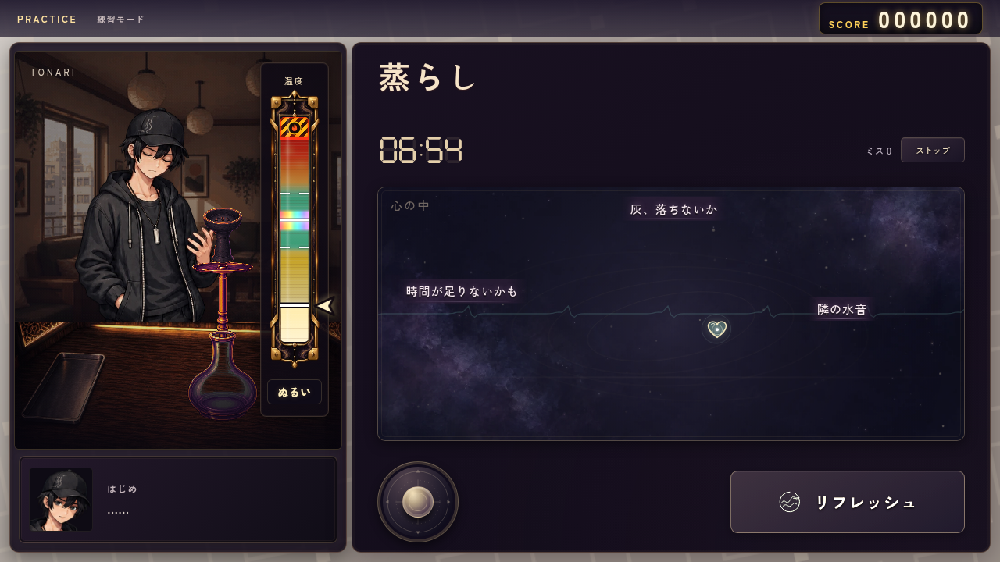
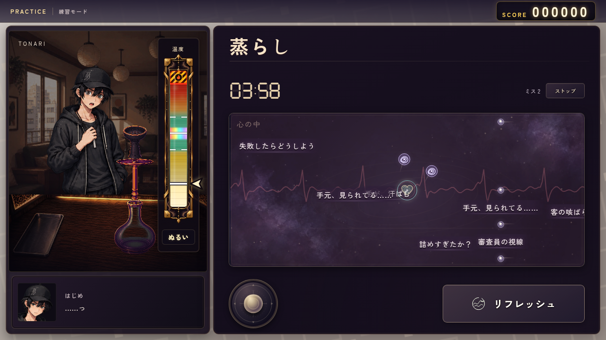
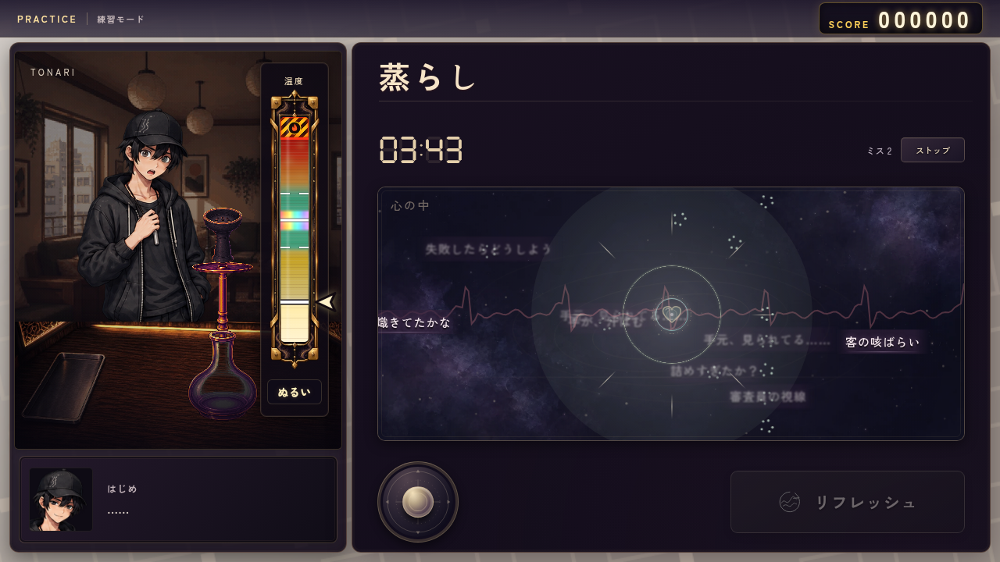
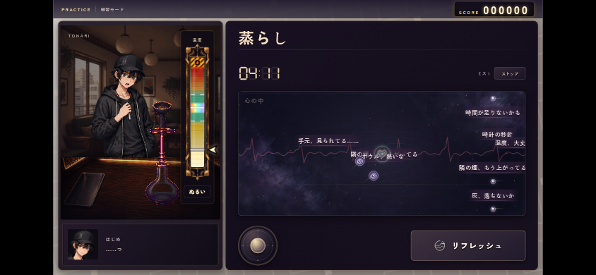
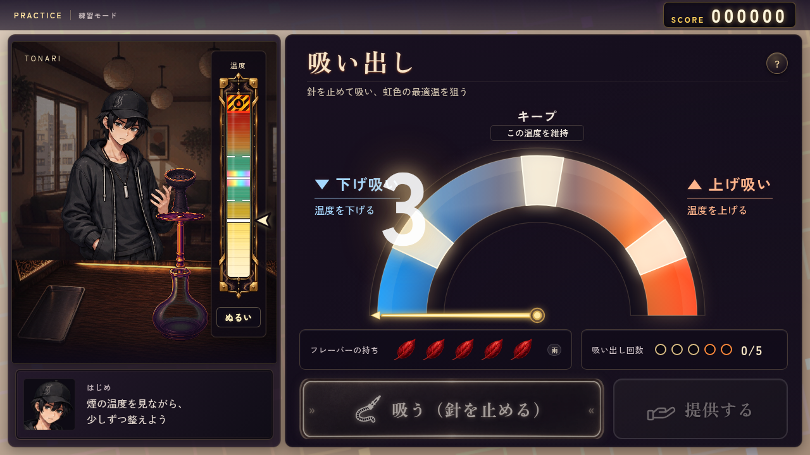
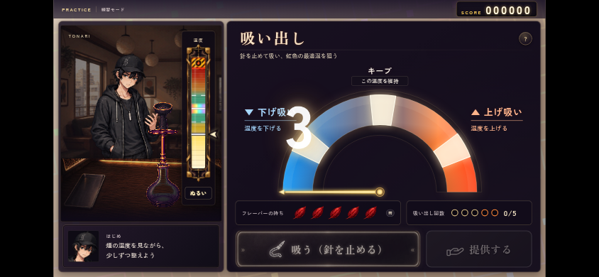

# 蒸らしの精神世界・温度の目安（2026-10-10）

SF01〜30の実装画面と、画像生成の原画・指示・検品記録。

## 弾幕の背後の残り時間（SF28〜30）

弾幕右上のストップ・ミス表示を撤去。手動停止を外し、残り時間の7セグをフィールド中央へ移した。数字は幅448px・高さ158px、表示の濃さ16%で、言葉・玉・心拍・心の芯より奥に出す。時計の上でも移動でき、残り時間は実際にカウントダウンする。被弾数は内部で保持し、結果・次の吸い出しの集中へ反映する。

`steam_forecast.mjs` がPC・スマホでPASS。中央に収まる薄い時計、停止・ミス欄の撤去、実カウントダウン、時計が操作を遮らないこと、リフレッシュ後の背景描画と効果の片づけを確認した。温度計の位置・設定時だけの予測も維持。`steam_refresh.mjs` もPASSし、内部の被弾数による採点・全成長段階で1回・範囲消去・段階回復を確認した。変更JS・テストの構文と差分空白も正常。下の素材・画面はSF01〜27の初期実装記録。

## 採用素材

| 素材 | 原画 | 指示・出自 | 実装 |
|---|---|---|---|
| 目を閉じて蒸らしを待つはじめ | [hajime_steam_wait.png](../../assets/ui/making/hajime_steam_wait.png) | [生成指示](hajime-wait-prompt.txt)・[参照とSHA](generation.json) | `worker.js`。平静なときだけ採用し、動揺したら既存の表情差分へ戻す |
| シンプルな抽象的宇宙 | [steam_mind_world.png](../../assets/ui/making/steam_mind_world.png) | [生成指示](world-prompt.txt)・[SHA](world-generation.json) | `steam-art.js`。暗い紫の星雲・少数の星粒を背景へ敷く |

どちらも `image_gen.imagegen` で生成。人物は採用済みの serious 立ち絵を実画像参照とし、帽子・黒いパーカー・鎖と実体のある携帯中のマイチップを維持した。背景には人物・機材・文字・ゲージを描いていない。はじめは真の透過RGBA、背景は不透明。人物画像へシーシャ本体・ホースを追加せず、左の一台は従来の採用素材をそのまま使う。

店内の建築が残る[前の背景案](rejected-lounge.png)は、抽象的な宇宙へという追記を受けて不採用。[生成指示](rejected-lounge-prompt.txt)と[出自](rejected-lounge-generation.json)だけ履歴として保存し、manifest・ゲームには接続しない。

`build_manifest.py --making-only` で2素材だけをWebP化・目録追加。他の採用済みアセットの目録を維持した。原画・参照のSHAと指示ファイルの存在も確認済み。

## 画面

タイマー設定。温度計はここから現れ、蒸らし・吸い出し・熱管理で位置を変えない。点線の帯が終了温度の大まかな目安。気温・湿度・雨を表示する。

洞察★5の例。同じ天候・設定時間でも目安の幅が狭くなる。一台ごとの揺らぎを部分的に読むため、中心の予想も改善する。最大でも正確な到達温度は明かさない。

雑念は言葉が中心。光る玉・炭・煙はアクセントとし、横なぎは通れる隙間を予告する。言葉の当たり判定は表示された書体と寸法で測る。心拍はフィールド中央、被弾で波と表情が乱れる。操作札・呼吸状態の説明・重複する見出しの分数・終了温度の予測はここには出さない。

被弾したときの表情と心拍。

リフレッシュはシンプルな一回だけのボタン。実際に消した言葉の残像がほどけ、粒と波になる。文字による発動説明は出さない。終了時には残像と効果を片づける。

スマホ横向き。

共通の左右ウインドウ間を6px、下の余白を12pxへ詰めた。熱ゲージは下からクリーム・淡い黄・黄・橙・赤・深紅。緑の適温帯と虹の最適温は既存の幅を維持し、薄い横目盛りを加えた。

## 温度と集中

- タイマーの調整・リセットでは天候や一台の揺らぎを引き直さない。
- 雨・高湿度・低い気温では温まりにくい。目安の外へずれることも許容し、実温度を予測範囲へ制限しない。
- 洞察の各段階で目安が狭くなる。低温・蒸らし上限の近くでも、段階が上がって帯が逆に広がらない。
- 蒸らしは最大0.465。最も強い炭・4個置き・10分でも虹の入口0.49へは届かない。最後の温度を吸い出しへそのまま引き継ぐ。
- 被弾で熱や葉を傷めない。集中が乱れると、次の吸い出しの針が速く、成功帯が狭くなる。
- リフレッシュは根性の全段階で一台につき1回。範囲拡大・★3からのメンタル1段階回復・★5の全画面消去という成長は維持する。

## 検証

変更工程を対象に実行。通しテストは実行していない。

| 確認 | 結果 |
|---|---|
| `steam_temperature.mjs` | PASS。11,340件の温まり方・虹未到達、天候、予測のずれ、集中と熱の独立、端の温度を含む洞察5段階 |
| `steam_forecast.mjs` | PASS。PCとスマホで実タイマー・リセット・天候表示・生成画像読込・洞察の成長・4工程の温度計の同一位置・余白・予測の非表示・簡素なボタン・中央の心拍・停止と効果の片づけ |
| `steam_refresh.mjs` | PASS。近い実弾だけを消去、遠い弾を維持、全成長段階で一回、連打・空の防止、範囲とメンタル成長、基礎段階に回復・無敵・出現停止なし |
| `craft_focus.mjs` | PASS。PC・スマホ横向き・縦長でタイマー・温度上昇と引継ぎ・被弾時の心拍と表情・集中による吸い出しの成功幅と針速度 |
| `pull_draw.mjs` | PASS。共通レイアウト・ゲージ、温度変化・吸引の入力ロック・水泡と音・熱管理・動きを減らす設定・スマホと画面離脱 |
| `foil_holes.mjs` | PASS。穴数・完成条件・温度応答の接続 |
| 台詞lint／整形dry-run | ERROR 0、既存WARN 345。整形0行 |
| JS構文・差分空白・素材SHA | 正常 |

既存テストの針速度測定は実RAFの経過時間で割り、フレームのばらつきによる誤判定を抑えた。穴あけVMテストには、現行工程が使う `scoreStep` のスタブを補った。
