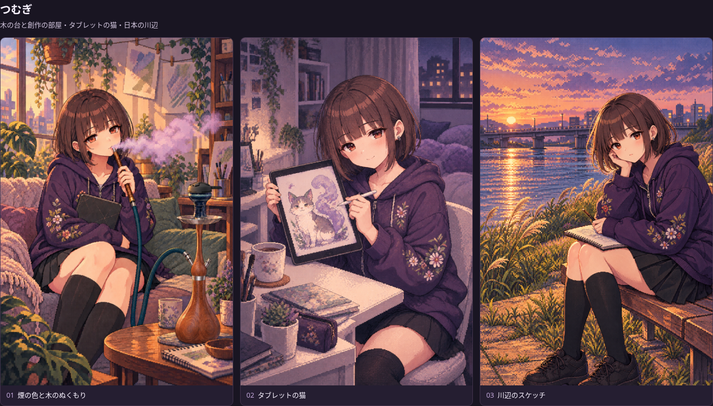
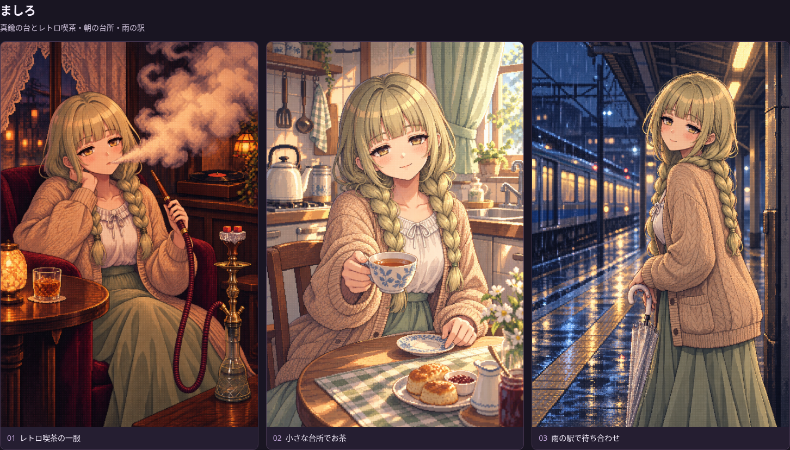
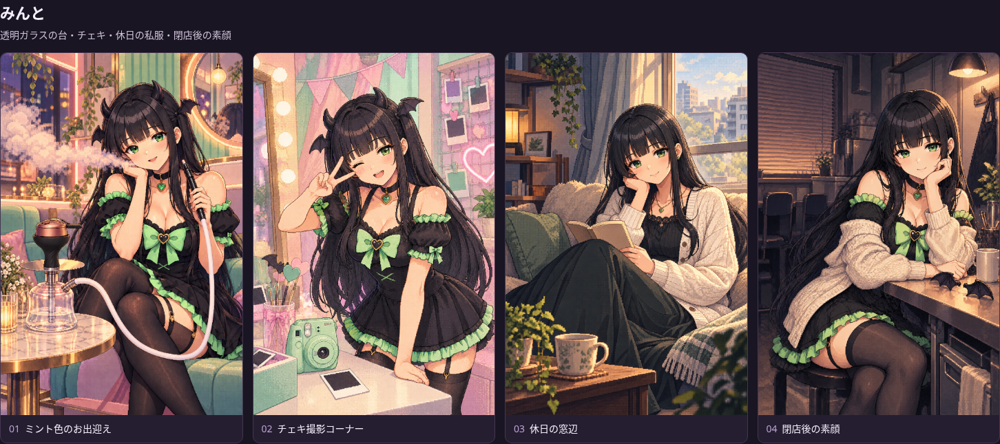
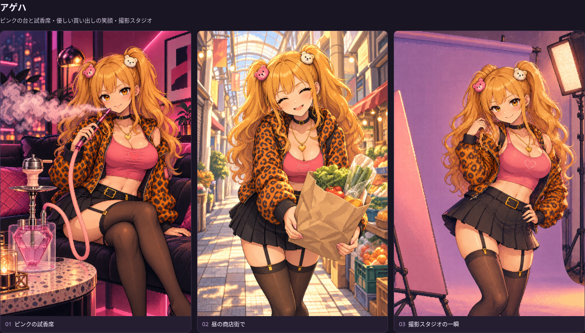
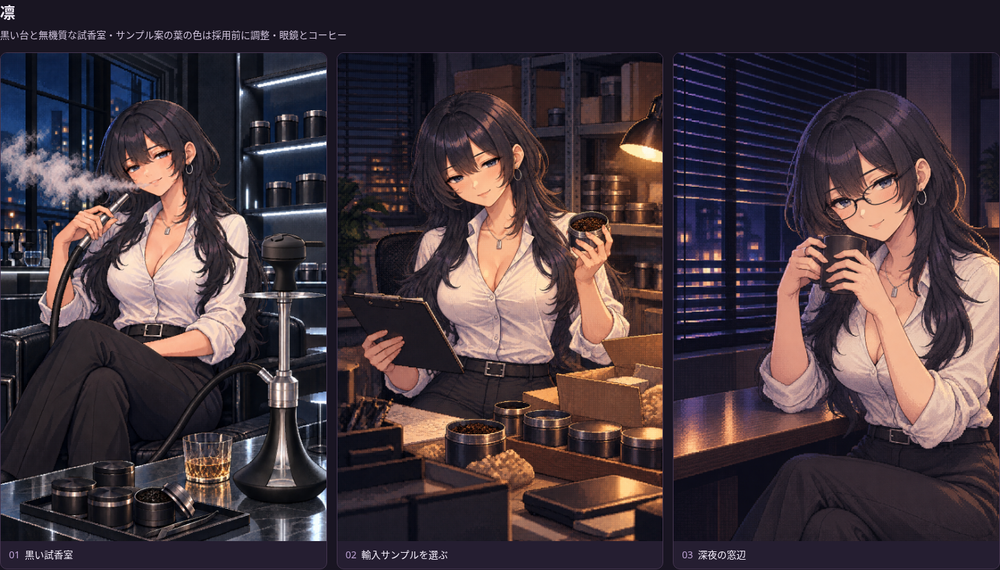
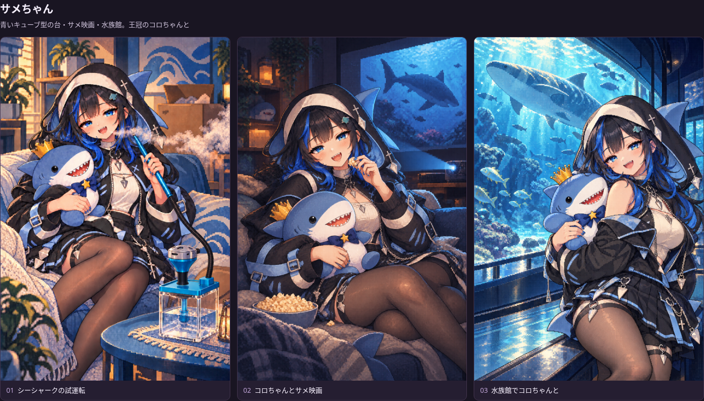

# ヒロインアートの採用候補一覧

生成した絵を見比べて、オーナーが後で採用を選ぶための入口です。原画を保存した状態で、ゲームへの採用は選択後に行います。

| 候補集 | 内容 | 一覧 |
|---|---|---|
| 個別背景・ドット感の19案 | 6人×3場面＋みんとの仕事と私生活の中間の1場面。キャラごとに違う台・背景・色 | [19案の画像一覧](../title-art/heroine-concepts-v2-personality-pixel-20261008/README.md) |
| 最初の15案 | 5人×3場面。新しい案と比較するため保持 | [旧案の画像一覧](../title-art/heroine-concepts-v1-20261008/README.md) |
| 別チャットの日常・タイトル候補 | 日常5案を保存済み。シーシャ案は縮尺・ホース接続を修正中 | [別チャットの候補一覧（制作中）](https://github.com/haseatsu114514-dot/shisha-game/blob/codex/heroine-title-candidates-20261009/asset_sources/heroine-title-candidates-20261009/README.md) |
| 別チャットの初期制作記録 | このフォルダを使用していた制作履歴。原画と検品記録を保持 | [初期の作業ブランチ](https://github.com/haseatsu114514-dot/shisha-game/tree/codex/heroine-title-daily-art-20261009/asset_sources/title-daily-heroines-20261009) |

別チャットの制作中の原画は作業ブランチへのリンクで見られます。この入口から両方の候補集を開けるようにし、原画と履歴はそれぞれの保存先を維持します。

## 19案をキャラ別に見る

番号は各行の左から01・02・03。みんとだけ04が追加カットです。気になるキャラ・番号で採用候補を指定できます。

### つむぎ

[原画と場面一覧](../title-art/heroine-concepts-v2-personality-pixel-20261008/README.md)

### ましろ

### みんと

### アゲハ

### 凛

凛02の葉は茶色寄りに見えるため、採用前に黒いダークリーフへ調整する候補です。絵の保存と採用承認は別に記録しています。

### サメちゃん

## 原画・比較・履歴

- [19枚の原画へのリンク](../title-art/heroine-concepts-v2-personality-pixel-20261008/README.md)
- [タイトル右側に配置した比較一覧](../title-art/heroine-concepts-v2-personality-pixel-20261008/review/title-overview.png)
- [新旧を並べられる比較HTML](../title-art/heroine-concepts-v2-personality-pixel-20261008/comparison.html)（リポジトリのローカルHTTPプレビュー用）
- [旧15案](../title-art/heroine-concepts-v1-20261008/README.md)

一覧の画像はブラウザで原画を表示した比較用スクリーンショットです。原画PNG、実際の生成指示、参照画像の出典とSHA256、修正前の絵は候補集のフォルダにそのまま残します。後続の候補も保存先を変えず、この一覧へ追加できます。
