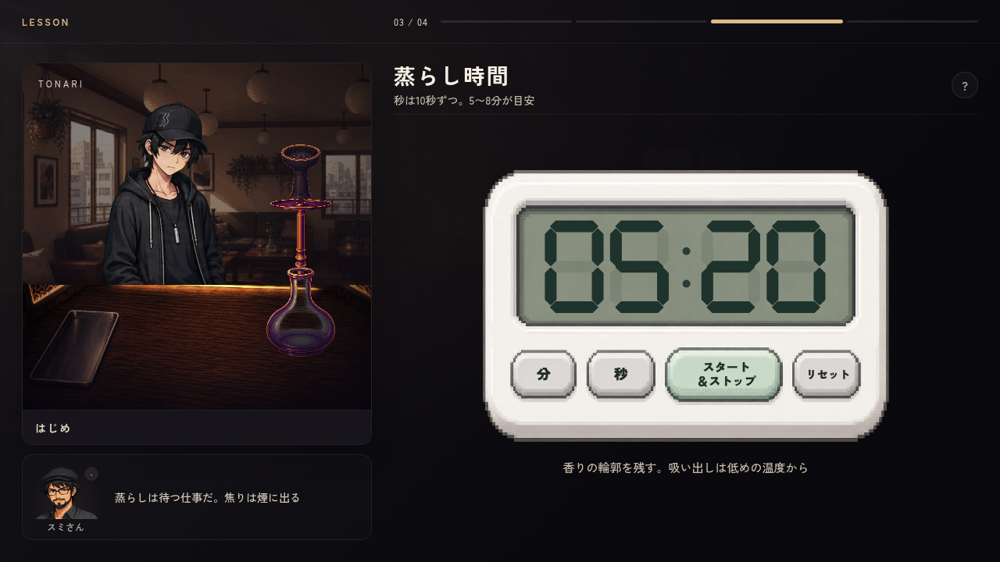
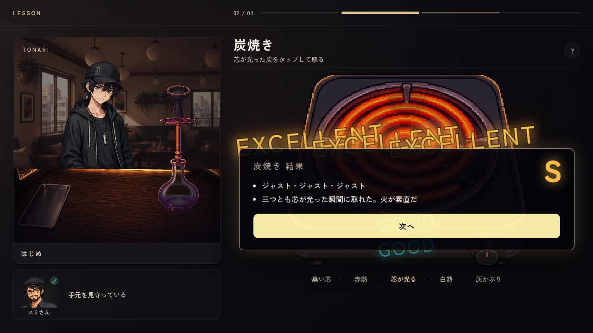
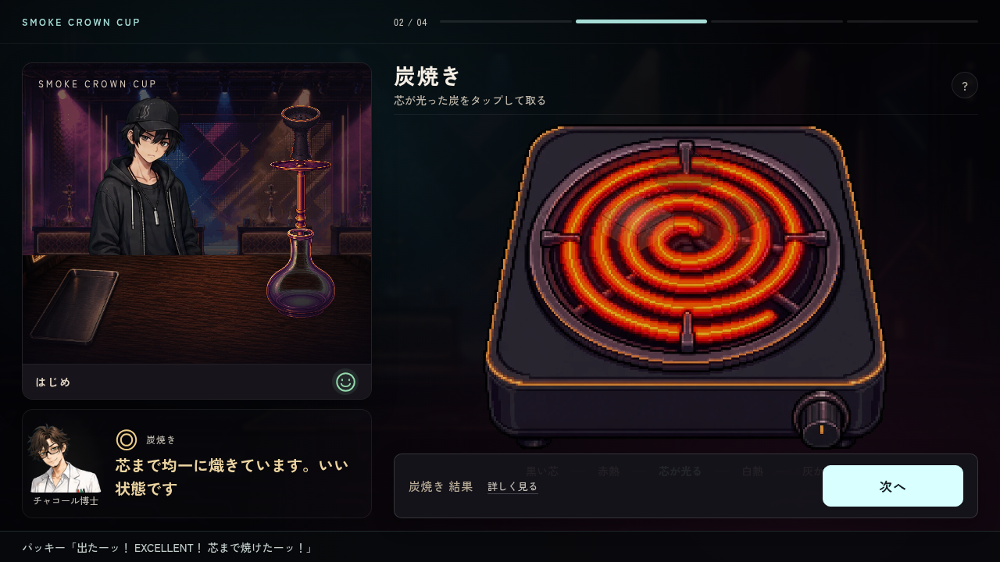
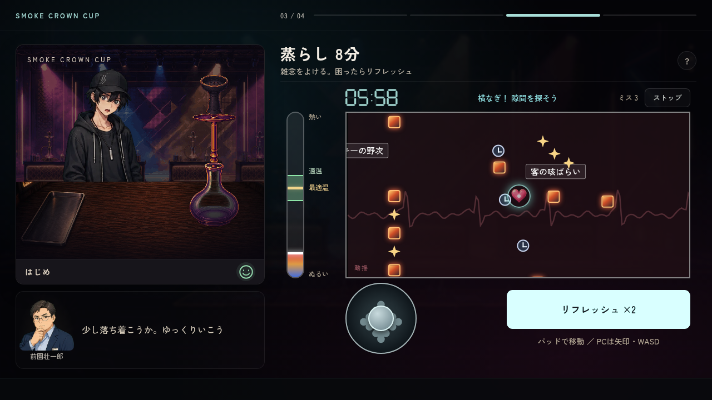
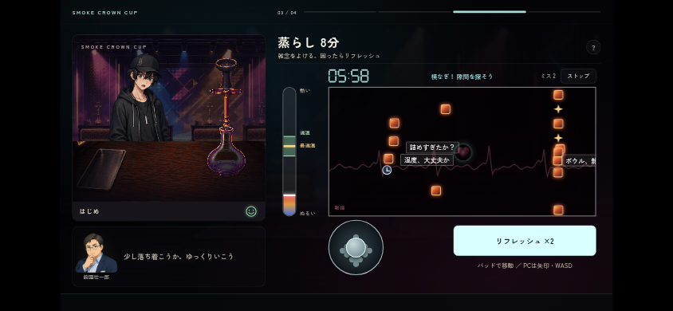
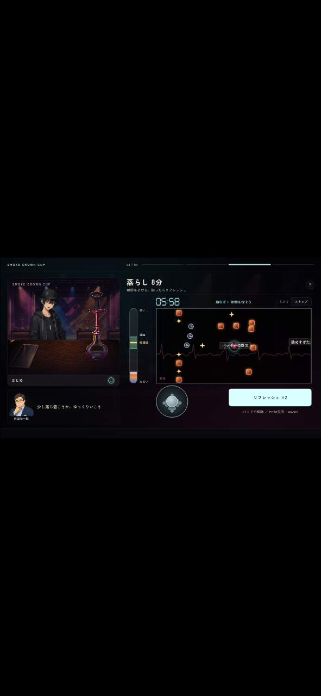
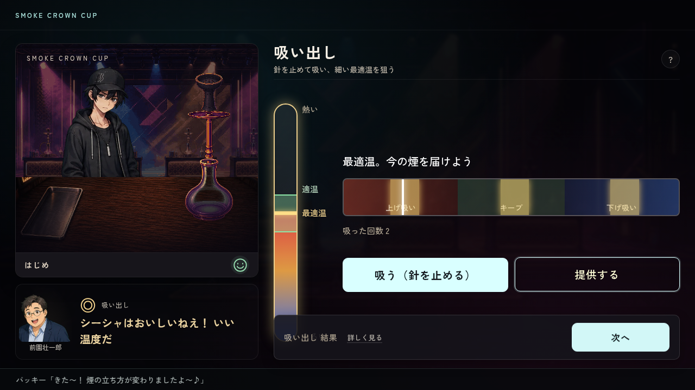
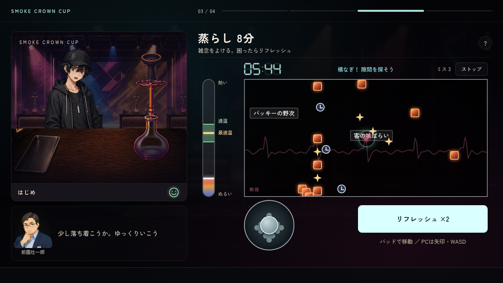
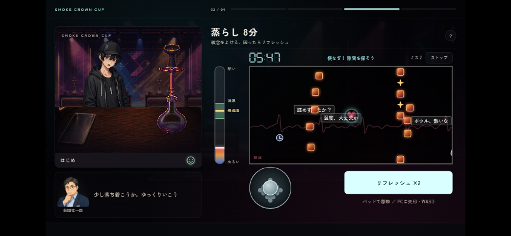
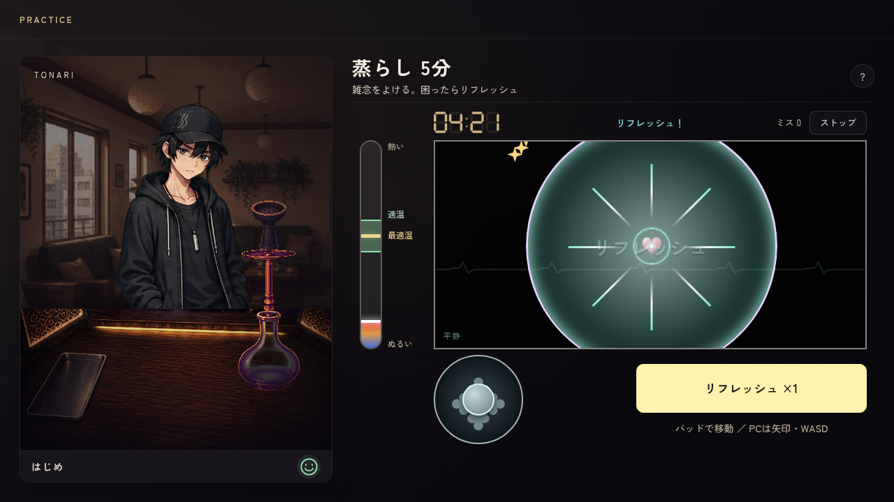

# 制作画面・シンプルなキッチンタイマー（2026-10-08）

オーナーのGP18〜40。制作に集中できる画面、見守る人物、顔で伝える体調、10秒単位のタイマー、弾幕中の温度と心の揺れ、段階的なリフレッシュ、最適温を狙う吸い出し。

## 採用タイマー

- 採用原画: [assets/ui/making/kitchen_timer.png](../../../assets/ui/making/kitchen_timer.png)。1536×1024の透過PNG。最終生成画像をそのまま保存
- 実行時: [remake/img/ui/making/kitchen_timer.webp](../../../remake/img/ui/making/kitchen_timer.webp)。`python3 remake/tools/build_manifest.py`で可逆WebPと透過領域の境界を生成
- 生成指示: [kitchen-timer-final-prompt.txt](kitchen-timer-final-prompt.txt)。100均にあるような白い本体と灰緑の液晶、下段4ボタン。スタート＆ストップだけ幅広の薄緑。数字・文字は原画へ焼き込まない
- 配線: `remake/js/craft/timer.js`・`digital-clock.js`。520×348の本体枠の液晶へ7セグ数字を重ね、ボタンの中心は横15%／34%／60%／85%、縦75%。文字とクリック範囲も同じ位置に置く
- 分は1分ずつ、秒は10秒ずつ増える。分は99→00、秒は50→00へ戻る。リセットで00:00にし、0秒では開始できない。弾幕に移った後もストップ／スタートで時間・温度・弾幕を中断・再開できる
- 追加指定で数字を約2割大きくし、セグメントを太くして上下の余白を揃えた。ボタン文字は濃いインク色・太字・本体色との乗算で印刷感を出す。原画は空のまま、実際の時刻と文字を重ねる

最初の飾り付き案と4つの等幅ボタン案は、依頼の追加指定で不採用。[装飾付き原画](kitchen-timer-decorated-superseded.png)・[等幅4ボタン原画](kitchen-timer-four-equal-buttons-superseded.png)と各プロンプトは生成履歴としてのみ保存し、実行時に読み込まない。

## 制作と見守る人物

左側ははじめと台を収める広い作業風景。下段は今話す人物1人だけを出し、練習はスミさん、大会は工程や発言の相手に合わせて南雲・上園・チャコール博士を切り替える。顔は既存の立ち絵差分。

終了後の実際の成績に応じて◎・○・△とその人らしい短いセリフを表示。プレイ中は作業の様子を実況し、評価記号を出さない。チュートリアルのスミさんだけ操作・ゲームシステムも説明する。良い出来は明るく大きい文字、もう一歩なら落ち着いた文字で伝える。南雲は静かに考える表情にとどめ、人物名の開放・票・好感度を変えない。S・A等の表示は工程結果・アピールポイント・最終内訳から外した。詳しい結果は右側の小さな「詳しく見る」で開く。体調ははじめの名前の横の顔アイコンを押すと説明が開く。

動画は読み込まない。`.bench-worker-stage`と`data-step`を残し、今後ここへ作業演出を接続する。

## 温度・操作の表示確認

弾幕と吸い出しは同じ温度計・適温帯と、中央の細い金色の最適温。温度は蒸らしの経過時間で上がり、被弾では下がらない。最後の温度を次工程へ引き継ぐ。弾幕で集中できたほど、吸い出しの成功帯が広く、針の移動がゆっくりになる。

吸い出しは提供時の最適温への近さで評価する。最適温帯の幅は適温帯の1/10。キープ中央は維持、左寄りは微増、右寄りは微減なので、狙って仕上げられる。針のジャスト数による加点を外し、3回を超える吸いすぎによる葉の減点は残す。

薄い心拍線は被弾ごとに振幅・速さが増し、緑から黄・赤へ変わる。はじめの顔も驚き／不安へ変わり、時間が経つと落ち着く。初期リフレッシュは中くらいの範囲の弾を消すだけ。根性で範囲が広がり、★3からメンタル1段階回復、★5で画面全体を消す。無敵や発生停止は付けず、ミス数・成績・温度も巻き戻さない。動きを減らす設定では揺れと心拍線の横移動を止める。

`remake/test/craft_focus.mjs`で実ボタン・7セグ・停止と再開・温度上昇・引継ぎ・成功帯と針速度・評価とセリフ・話者1人・体調アイコン・実際の被弾による心拍の乱れと表情・リフレッシュを確認。1280×720、844×390、591×1280で左枠・人物・温度計・弾幕・パッド・実況欄が重ならないことを確認した。スマホは横向き、縦長画面はデスクトップの縮小表示で確認。

[検証結果とログ](verification.md)。最新mainの通知・マップ・SLOT BONUSを保持し、統合後の通知・HUD・スロットも検証した。
