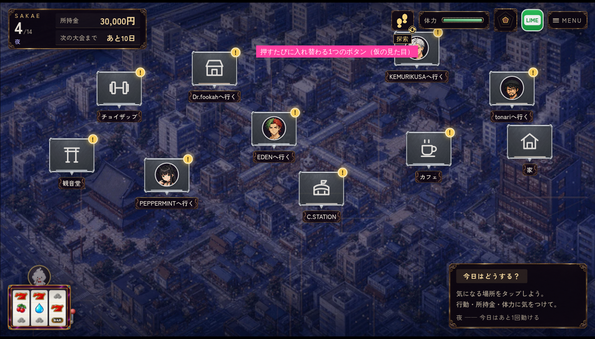

# 地図のモード切り替えボタン（AA24〜AA26）

> 旧「街歩き」試作の配置資料。現行リメイクへの実装・採用はしていない。

地図画面で「ファストトラベル」と「探索」を切り替えるボタン。押すたびにモードが入れ替わる1つの正方形ボタンにする。設計は [`docs/archive/street_city_design.md`](../../../docs/archive/street_city_design.md) の§9「切り替えボタン」、Codexへの発注は [`docs/archive/codex_handoff_city_images.md`](../../../docs/archive/codex_handoff_city_images.md) の発注E。

| ファストトラベルのとき | 探索のとき |
|---|---|
|  |  |

上の2枚は置き場所と大きさの配置モック（既存のパネル素材と仮のアイコンで作った）。本番の絵ではない。生成スクリプトは今回の資料移管に含めていない。

## 配線の約束（素材が届いたら）

| 原画（Codex） | 置き場所 | 実行時 | 画面での大きさ（1280×720基準） | 使い方 |
|---|---|---|---|---|
| — | 既存 | `remake/img/ui/lounge/panel.webp` | 48×48 | ボタンの枠。HUDの五角形・MENUと同じ9スライス |
| `ui_mode_icon_fast.png` | `assets/ui/lounge/mode-icon-fast.png` | `remake/img/ui/lounge/mode-icon-fast.webp` | 26×26・中央 | ファストトラベルのとき |
| `ui_mode_icon_explore.png` | `assets/ui/lounge/mode-icon-explore.png` | `remake/img/ui/lounge/mode-icon-explore.webp` | 26×26・中央 | 探索のとき |
| `ui_mode_swap_badge.png` | `assets/ui/lounge/mode-swap.png` | `remake/img/ui/lounge/mode-swap.webp` | 16×16・右下に半分はみ出す | 押すと入れ替わる印 |

- 置き場所: HUDの右上の列で、体力の札の左。ほかのHUDボタンと同じ高さ・同じ間隔にする。
- 押したとき: ボタンが一度くるっと裏返り（0.2秒）、アイコンが入れ替わる。ボタンの下に「ファストトラベル」「探索」の札を1.2秒出す。指やマウスを乗せている間も出す。
- 文字・状態はDOMで出す。画像にはモード名を入れない。
- 読み上げ用の名前は「移動のしかた：ファストトラベル」「移動のしかた：探索」。Enter・Spaceで切り替える。
- 今のモードはセーブの `state.travelMode`（`"fast"`／`"explore"`）。最初は `"fast"`。
- 切り抜き・縮小・WebP化は `python3 remake/tools/build_ui_skin.py`（届いたら、この3枚を変換の対象に足す）。
