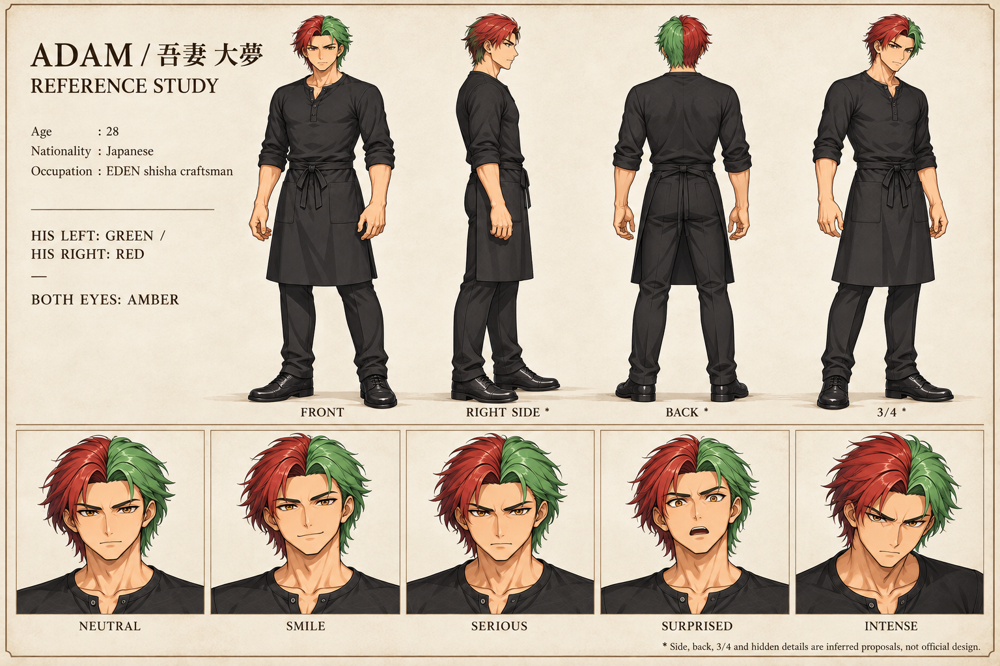

# adam — 動画生成用制作資料

1536×1024。全身正面・側面・背面・3/4と5表情。正規画像生成による新規制作案であり、canonicalゲーム画像や正式背面設定ではありません。不可視部分は画像脚注にも補完と明記。

参照main: `f0af2d890ee814485ef861ea62923de48b950316`、`assets/sprites/characters/adam/` と `data/characters.json`。採用原画キャッシュをGit blobと照合、候補絵と別キャラを入力に混ぜていません。

本人左髪=緑、右髪=赤。正面画面左赤/右緑、背面画面左緑/右赤、右側面は赤が手前。両目琥珀。黒ヘンリーシャツ/腰エプロン維持。main旧配色を入力にせずPR742修正normalを参照。側背面色分けの立体、エプロン背面の紐/結びは補完案。

アダム修正参照: PR #742 HEAD `2224b428b341ee58680caf46dba550c6cb4794b7`、normal blob `9ee76e3d2713b15022dfb78b4528a416ec64a6da`。PR/原画は変更していません。

原画の画素複製や厳密な3D整合を保証しません。動画作成時は採用原画と併用してください。新しいゲーム実装や採用変更は含みません。
