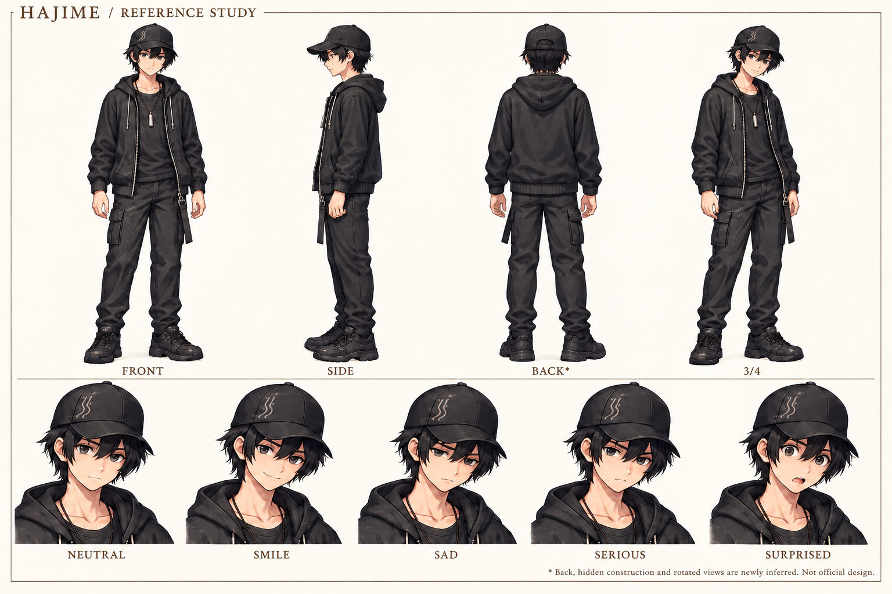

# hajime — 動画生成用制作資料

1536×1024。全身正面・側面・背面・3/4と5表情。正規画像生成による新規制作案であり、canonicalゲーム画像や正式背面設定ではありません。不可視部分は画像脚注にも補完と明記。

参照main: `f0af2d890ee814485ef861ea62923de48b950316`、`assets/sprites/characters/hajime/` と `data/characters.json`。採用原画キャッシュをGit blobと照合、候補絵と別キャラを入力に混ぜていません。

採用5表情のblob一致。黒キャップ/黒パーカー/黒カーゴパンツ/黒靴/銀マウスピースを優先。背面キャップ、フード、靴、衣服構造は補完。側面カーゴポケットの重複を修正済み。

原画の画素複製や厳密な3D整合を保証しません。動画作成時は採用原画と併用してください。新しいゲーム実装や採用変更は含みません。
