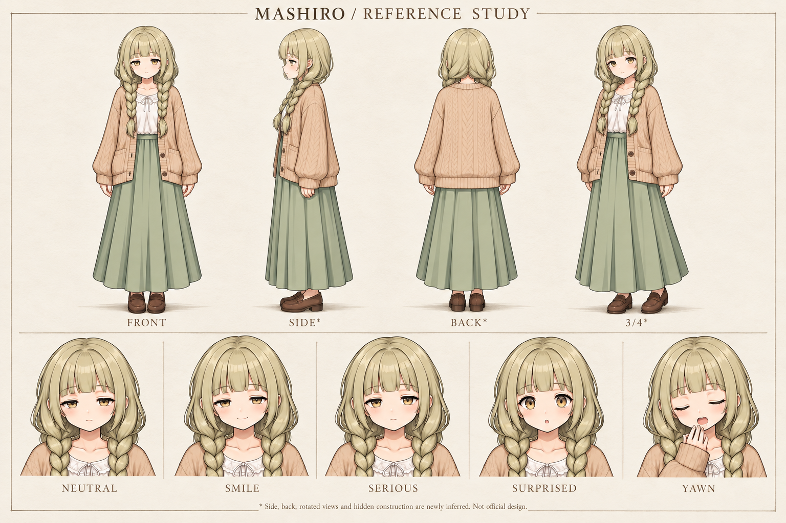

# mashiro — 動画生成用制作資料

1536×1024。全身正面・側面・背面・3/4と5表情。正規画像生成による新規制作案であり、canonicalゲーム画像や正式背面設定ではありません。不可視部分は画像脚注にも補完と明記。

参照main: `f0af2d890ee814485ef861ea62923de48b950316`、`assets/sprites/characters/mashiro/` と `data/characters.json`。採用原画キャッシュをGit blobと照合、候補絵と別キャラを入力に混ぜていません。

採用6表情blob一致、生成には5枚参照。sad画像の実際のあくびをYAWNと表記。二本編み、カーディガン、スカート、靴の側背面構造は補完。

原画の画素複製や厳密な3D整合を保証しません。動画作成時は採用原画と併用してください。新しいゲーム実装や採用変更は含みません。
