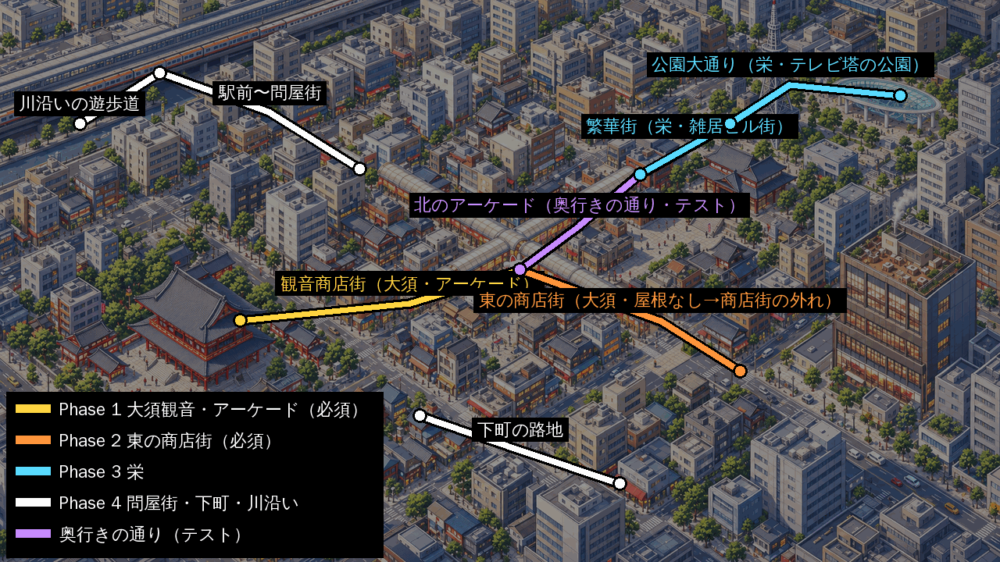
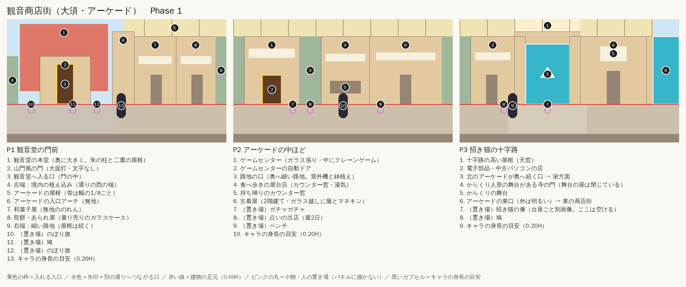
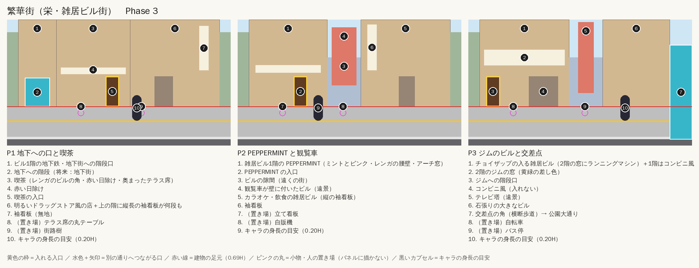
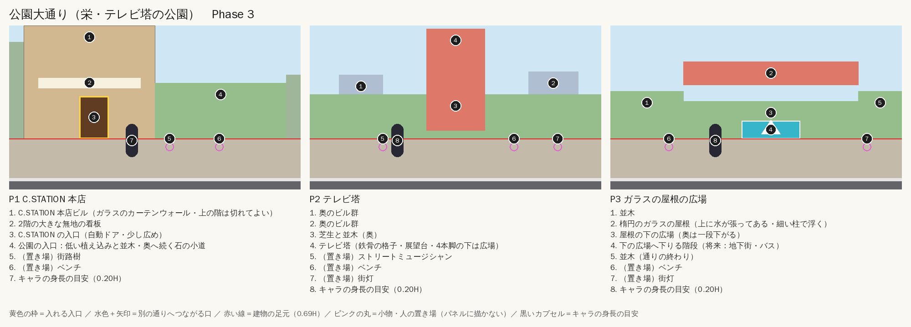
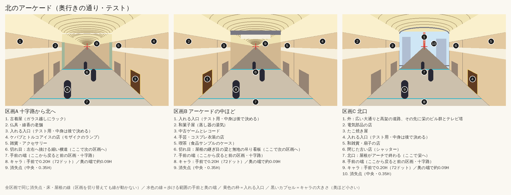
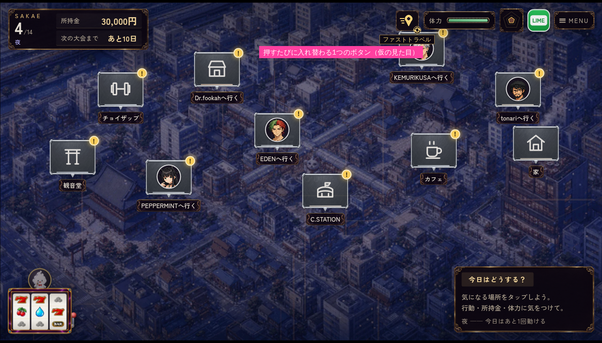

# 街歩きの舞台設計: 栄・大須風の架空の街

> **保存資料（2026-10-26）**：旧「街歩き」試作の設計を、画像資料とともにmainへ移した記録。現行リメイクの地図・実装仕様ではない。本文中の発注や実装手順は当時の計画であり、今回の採用指示ではない。

作成: 2026-10-09（Claude）／ 台帳: `docs/owner_requests.md` の AA14〜AA27
画像の発注書: [`docs/codex_handoff_city_images.md`](codex_handoff_city_images.md)
構図ガイドの保存先: `asset_sources/images/proto_city/layout/`（生成スクリプトは移していない）

休止していた街歩きの試作（AA13）を、オーナーの指示で再開する。今回の範囲は**設計と画像の発注書まで**。
試作のコード（`experiments/proto/street/`）とリメイク版の本編はまだ変更していない。

---

## 0. 前提

- 移動システムは試作をそのまま使う。8方向の歩行、ダッシュ、タップ移動、足元のyで前後関係を決める描画、入店、しらべる、ファストトラベル、昼夜を引き継ぐ。
- **今後は「ハリボテ背景版」（AA11・`?stage=set`）だけを使う**（オーナー決定・AA18）。画面1枚分のパネルを3枚つないで背景にする。キャラは72ドットで、小物は別画像にして前後へ回り込めるようにする。標準版（320×180）と高解像度2.5D版は新しい通りに使わず、§8の実装時に撤去する。
- **必須のスポットは大須観音と商店街**（オーナー指定・AA19）。発注と実装は大須側から始める。
- 画像の生成はCodexが担当する。変換・つなぎ合わせ・配置・実装はClaudeが行う。
- 歩くのは**はじめ**（AA12）。立ち絵は2026-10-08に採用済みなので、今回の発注に歩行シートを入れる（§7）。
- 今の繁華街の通り（古着屋〜KEMURIKUSA）の絵は試作用。本番の絵は今回の設計で描き直す。

## 1. 街の方針

- **名古屋の栄と大須をモデルにした架空の街**として描く。実在の地図の距離や向きは再現しない。既存の街マップ `bg_osu_map_day/night`（大須・栄の清書版）と同じ並びを使う。
- **街そのものの名前（市の名前）は今回付けない**。エリアの呼び名は、台詞と `remake/js/daily/spots.js` で使っている「繁華街」「商店街の外れ」「問屋街」「下町」「古町」「観音商店街」「川沿い」「駅前」をそのまま使う。新しい通り名は仮称とする。
- **ランドマークは形を寄せ、名前とロゴは出さない**（§5）。見れば「あれっぽい」と分かるくらいに寄せ、色・細部・持ち物を変えて特定の施設の写しにしない。
- 雰囲気の分担:
  - **大須側**は、屋根のあるアーケード、寺、古着屋、食べ歩き、電気街が混ざる「ごちゃっとした楽しさ」。昼が主役。
  - **栄側**は、背の高い雑居ビル、縦に並ぶ袖看板、大通りの公園、テレビ塔の「都会の大きさ」。夜が主役。
  - 二つの間は、北のアーケードを抜けた先でつながる。高速道路の高架をくぐる短い場面は将来の追加候補。

## 2. 通りの構成とつながり

| 通り（仮ID） | モデル | 入れる所（spot ID） | 主なつながり | 発注 |
|---|---|---|---|---|
| 観音商店街 `kannon_arcade` | 大須観音〜アーケード〜招き猫の十字路 | 観音堂（`kannon`）・ゲームセンター（しらべるのみ）。路上占い（`fortune`）は週2日だけ路地の口に出る | 東口→東の商店街、十字路の北口→繁華街 | **Phase 1（必須）** |
| 東の商店街 `higashi_shotengai` | 大須の東側の屋根のない商店街 | tonari（`tonari`）・KEMURIKUSA（`naru`） | 西端→観音商店街の東口、外れの路地→下町 | **Phase 2（必須）** |
| 繁華街 `sakae_hankagai` | 栄の雑居ビル街（夜は錦の飲み屋街の雰囲気） | 喫茶（`cafe`）・PEPPERMINT（`minto`）・チョイザップ（`choizap`） | 南端→観音商店街の北口、交差点→公園大通り、地下への口→将来の地下街 | Phase 3 |
| 公園大通り `koen_odori` | 久屋大通公園・テレビ塔・ガラスの屋根の広場 | C.STATION（`c_station`） | 左端→繁華街、広場の階段→将来の地下街・バス | Phase 3 |
| 駅前〜問屋街 `ekimae_tonya` | 鉄道の高架下〜長者町の繊維問屋街 | Dr.fookah（`shop`） | 駅の改札（エリアマップ扱い）、川へ下りる階段→川沿い | Phase 4 |
| 下町の路地 `shitamachi` | 大須の南の古い住宅地 | EDEN（`adam`）・家（`rest`） | 東の商店街の外れ、川沿い | Phase 4 |
| 川沿いの遊歩道 `kawazoi` | 堀川・納屋橋 | なし（会話・イベントの場所） | 問屋街、下町 | Phase 4 |

- 第1章のスポットは、これで全部どこかの通りに入る。第2章のSHISHARKの置き場所は第2章の接続時に決める。
- 場所の割り振りは、台詞にある位置の情報に合わせた。問屋街は「駅の向こう」、KEMURIKUSAは「商店街の外れ」、観音堂は「古町」、喫茶とPEPPERMINTは「繁華街」にある。
- C.STATIONの店内（`bg_c_station_day`）は高い階から街を見下ろす広いラウンジなので、栄の大通りに面したビルに置いた。tonariの外観（`bg_tonari_outside_day`）は古いコンクリートのビルの2階で、外階段と電柱がある。そのため、栄ではなく大須の東側の生活感のある通りに置いた。
- **つながり方の種類**（§8で実装）:
  - 端: 通りの左右の端まで歩くと隣の通りへ移る（今の「◀エリアマップへ」と同じ形）。
  - 奥: 十字路や地下への階段のように、建物の並びが途切れて奥へ続く口がある。そこへ上向きに歩き込むと移る。
  - 手前: 路地の口や横断歩道で、歩道の手前側へ下りると移る。

## 3. パネルの決まり

### 共通（ハリボテ背景版と同じ）

1枚は16:9（2048×1152を推奨）。位置は画像の高さHに対する割合で決める。

| 部分 | 位置・大きさ |
|---|---|
| キャラの身長 | 約0.20H（ゲーム内72ドット） |
| 入口のドア | 約0.24H。**どの店も同じ高さ**。大きな店は幅だけ広げる |
| 建物の足元 | 0.69Hの水平線。全パネル・全通りで同じ |
| 歩ける帯 | 0.69〜0.93H。**物を置かない**（小物はゲーム側で置く） |
| 帯より下 | 0.93H〜は通りの型で変える（下の表） |
| 左右の端 | 建物と建物の隙間。ここで隣のパネルとつなぐ |

光は左上から。消失点は作らない（平行に近い3/4見下ろし）。人物・車・動物・文字は描かない。

### 通りの型（今回追加）

| 型 | 使う通り | 上の方（0〜0.69H） | 帯より下（0.93H〜） | 前景（画面の手前を横切る） |
|---|---|---|---|---|
| 屋外の商店街 | 東の商店街・問屋街 | 2階建て程度。屋根の上に空と遠くの街 | 縁石と車道 | 電柱（既存） |
| **アーケード** | 観音商店街 | 上端〜0.14Hが屋根の裏側。骨は幅の1/8ごとに等間隔で、パネルの端は骨の位置にする。その下に2階建ての店。空は天窓越しに少し見える程度 | 手前側の店の足元（シャッターのレール・暗い帯）。車道はない | アーケードの柱・吊り旗（新規） |
| **十字路** | 観音商店街P3 | 交わる通りが奥へ続く口を開ける。口の中だけは自然な遠近でよい | 型に従う | 型に従う |
| **高い街** | 繁華街 | 5〜8階の雑居ビル。上端で切れてよい。縦長の袖看板が何段も並ぶ | 縁石と車道 | 街路樹（新規） |
| **公園の大通り** | 公園大通り | 奥は並木・芝生・ランドマーク。建物は片側の一部だけ | 縁石と車道 | 街路樹 |
| **高架下** | 駅前 | 上端〜0.22Hを鉄道の高架の桁が横切る。柱が立つ | 縁石と車道 | 高架の柱 |
| **路地** | 下町 | 低い家並み。軒先の鉢植え | 手前の家の塀と植木鉢 | 電柱（既存） |
| **川沿い** | 川沿い | 0.18〜0.45Hに対岸、0.45〜0.66Hに川、0.66〜0.69Hに護岸の柵 | 柳の根元・石垣 | 柳の枝（新規） |
| **奥行き**（提案） | 北のアーケード | 一点透視の1枚絵。消失点は中央・約0.35H。両側に店 | 床の台形の手前 | なし（§8「奥行きの通り」） |

## 4. 通りごとの構図

番号つきの図は `asset_sources/images/proto_city/layout/<通り>_overview.png`、Codexに渡す文字なしの図は `<通り>_p1〜p3.png`。
**ブロックの位置は `tools/proto_city_layout_guides.py` が正本**。ここには狙いと、昼夜の違いだけを書く。

### 観音商店街（Phase 1・必須）

- **P1 観音堂の門前**: 左半分は空の開けた境内。奥に朱の本堂を大きく描き、手前に山門風の門と大提灯を置く。門の中が観音堂への入口になる。右半分からアーケードが始まる。入口のアーチの先に、和菓子屋と煎餅屋が並ぶ。
  - 本堂は入った先の背景 `bg_kannon_day` と同じ建物にする。朱の柱、二重の屋根、正面の石段、白いのぼりをそろえる。
  - 鳩とのぼり旗はゲーム側で置く。鳩は走ると飛び立つようにする。
- **P2 アーケードの中ほど**: ゲームセンター、路地の口、食べ歩きの屋台店、古着屋が並ぶ。屋根の下でいちばん賑やかなパネル。
  - ゲームセンターは台詞の「観音商店街のゲームセンター」として使う。
  - 路地の口の前には、週2日だけ占いの出店が出る。正体が分かるまでは「？？？」のまま。
- **P3 招き猫の十字路**: 中央でアーケードが交わり、屋根が一段高くなって天窓から光が落ちる。北のアーケードが奥へ続く口は、栄方面へのつながりになる。
  - 十字路の広場に、大きな招き猫の像（別画像）が立つ。
  - 右側に、門の上にからくり人形の舞台がある寺を置く。舞台の扉は閉じた状態で描き、開閉は将来コードで動かす。
  - 右端はアーケードの東口で、外の明るい通り（東の商店街）へ出る。
- **夜**:
  - 屋根の吊り灯が暖色の光だまりを作る。半分ほどの店はシャッターを下ろす。
  - ゲームセンターと屋台店は明るいまま。観音堂は提灯と石灯籠に灯りが入る。
  - 入れる所（観音堂の門・ゲームセンター）は夜も開いた姿にする。

### 東の商店街（Phase 2・必須）

- **P1 アーケードの東口の外**:
  - 左端は観音商店街P3の東口を外から見た姿で、アーケードの屋根がアーチで終わる。
  - 屋根のない2階建ての商店が続く。たい焼き屋、古道具・骨董の店、コインランドリーを置く。
  - 建物の隙間の遠くに、栄のビル群とテレビ塔の先が見える。
- **P2 tonariのビル**:
  - tonariは `bg_tonari_outside_day` と同じ姿にする。4階建ての古いコンクリートのビルで、2階に大きな窓（カーテンと暖かいランプ）があり、1階はシャッター。右脇の外階段の上り口が入口になる。
  - 隣に町の酒屋と古い民家を置く。奥には銭湯の煙突が見える。
- **P3 商店街の外れ**:
  - シャッターの下りた店、ブロック塀の空き地、KEMURIKUSA（黒い木と漆喰、丸窓、軒先のランタン、入口脇の植木）を並べる。KEMURIKUSAは店内 `kemurikusa` の緑と木の色に合わせる。
  - 右端はブロック塀で通りの終わり。手前の路地が下町へつながる。
- **夜**:
  - 商店はほとんど閉まり、街灯とtonariの2階の窓、KEMURIKUSAのランタンが灯る。
  - 「生活の通りの夜」の静かさにする。観音商店街の賑やかな夜との差を出す。
- 窓は小さく描くので、窓越しのシーシャ台は描かない（tonari・KEMURIKUSAとも）。

### 繁華街（Phase 3）

- **P1 地下への口と喫茶**:
  - ビルの1階に、地下鉄・地下街へ下りる階段口がある（将来のつながり）。
  - 喫茶は店内 `bg_cafe_day` に合わせ、レンガのビルの角に赤い日除けと黒い窓枠を付ける。ツタを這わせ、奥まったテラス席を置く。テラスの丸テーブルはゲーム側で置く。
  - 右は明るいドラッグストア風の店で、上の階に無地の袖看板が何段も並ぶ。
- **P2 PEPPERMINTと観覧車**:
  - PEPPERMINTは雑居ビルの1階にある。試作の外観（ミントとピンク、レンガの腰壁、アーチ窓）を引き継ぎ、店内 `peppermint` の白とミントに合わせる。
  - ビルの隙間の遠くに、壁に観覧車が付いたビルが見える。
- **P3 ジムのビルと交差点**:
  - チョイザップは2階の窓にランニングマシンが見える。白と黄緑の差し色は店内 `bg_choizap` に合わせる。1階の階段口が入口になる。
  - 隙間の遠くにテレビ塔が見える。右端は交差点の角で、公園大通りへつながる。
- **夜**: 街でいちばん明るい。袖看板とネオンは無地の光る板と色の帯で表し、文字や記号に見える形にしない。歩道にネオンの色がにじむ。

### 公園大通り（Phase 3）

- **P1 C.STATION本店**:
  - 左半分はガラスのカーテンウォールの大きなビルで、上の階は切れてよい。2階に大きな無地の看板、1階に少し広い自動ドアを付ける。
  - 店内（高い階のラウンジ）とは、ロビーを経て上がる設定にする。外観はロビーの入口だけ。
  - 右半分から公園になり、低い植え込み、並木、奥へ続く石の小道が始まる。
- **P2 テレビ塔**:
  - 芝生と並木の奥に、鉄骨の格子の塔を全高で描く。展望台が上端近くに来て、4本脚の下は広場になる。
  - ストリートミュージシャンとベンチはゲーム側で置く。
- **P3 ガラスの屋根の広場**:
  - 楕円のガラスの屋根が細い柱で宙に浮き、上に水が張ってある。屋根の下は一段低い広場で、下りる階段が将来の地下街・バスへのつながりになる。
  - 右端は並木で、通りの終わりにする。
- **夜**: 塔は白と淡い色でライトアップし、ガラスの屋根は青く光る。並木に小さな灯りを付ける。暗くしすぎない。

### Phase 4（構図だけ。発注書はPhase 3の納品後に作る）

| 通り | P1 | P2 | P3 |
|---|---|---|---|
| 駅前〜問屋街 | 鉄道の高架が上を横切る駅前。奥に改札、高架下の飲み屋 | 昭和の問屋ビル（巻き上げシャッター半開き、段ボール）・壁画のある問屋ビル | **Dr.fookah**（古い問屋ビルを改装。1階はレンガと黒い鉄枠の大きなガラス＝`bg_shop`、2階はショールームの窓＝`bg_fookah_showroom`）・川へ下りる階段 |
| 下町の路地 | 鉢植えがぎっしりの長屋・**EDEN**（古い2階家を改装。窓にモロッコ風ランプ、深紅の扉＝`bg_eden_shop`）・小さな祠 | 銭湯・**自宅**のアパート（2階建て・外階段・郵便受け） | （2枚で足りる） |
| 川沿いの遊歩道 | 対岸の古い倉庫と低いビル・川・護岸の柵 | 欄干に飾りのある古い橋 | （2枚で足りる） |

- 通りのパネルでは、窓越しのシーシャ台を描かない指定にする（小さすぎて構造を正しく描けないため）。店先や窓のシーシャ台を見せたくなったら、CLAUDE.md「シーシャ台の画像生成リファレンス」の資料を読んでから発注書を作る。

## 5. ランドマークの扱い

| 作中の呼び方（仮） | モデル | 寄せる点 | 変える点・禁止 | 置き場所 |
|---|---|---|---|---|
| 観音堂 | 大須観音 | 朱の柱、二重の屋根、大提灯、白いのぼり、鳩 | 提灯・のぼりに文字を入れない。寺なので**鳥居を描かない**。境内でシーシャを吸う場面は作らない | 観音商店街P1 |
| 招き猫の像 | 大須の招き猫 | 商店街の十字路の広場に立つ大きな招き猫 | 白地に朱の首輪と金の鈴、無地の小判、石の台座にする。顔立ちや色を変え、文字を入れない | 観音商店街P3（別画像） |
| からくりの舞台 | 万松寺のからくり人形 | 寺の門の上にある人形の舞台 | 特定の人物の人形にしない。扉を閉じた姿で描く | 観音商店街P3 |
| テレビ塔 | 中部電力 MIRAI TOWER（旧名古屋テレビ塔） | 公園の中の鉄骨の格子塔、4本脚、展望台 | 塗装の帯の色と展望台の形を変える。名前・ロゴ・数字を入れない | 公園大通りP2、繁華街P3の遠景 |
| ガラスの屋根 | オアシス21 | 楕円のガラスの屋根に水、下の一段低い広場 | 柱の形を変える。名前を入れない | 公園大通りP3 |
| 観覧車のビル | サンシャイン栄 | ビルの壁面に付いた観覧車 | ビルの形と色を変える。劇場やテナントの看板を出さない | 繁華街P2の遠景 |
| 問屋ビル | 長者町の繊維問屋街 | 昭和の問屋ビル、巻き上げシャッター、壁画 | 店名を入れない | 駅前〜問屋街 |
| 飾りのある古い橋 | 堀川の納屋橋 | 欄干に飾りのある古い橋、街灯 | 紋章を別の模様にする | 川沿い |

- 実在の店名、チェーンのロゴ、マスコット（豚の看板など）、劇場名は出さない。台詞でも実名を出さない。
- 名古屋らしさは小物と店の種類で出す: 喫茶のモーニング、食品サンプル、鬼まんじゅう風の和菓子、手羽先風の屋台、ういろう風の棹菓子。店名と文字は出さない。
- 既存の街マップでは、観音堂の近くに鳥居が描かれている。今回の範囲外なので、地図を清書し直すときに直す。

## 6. 素材の一覧

ゲーム内では、パネル3枚をつないだ1本の背景（幅およそ1840×高さ360）にして、2倍で表示する。

| 素材 | Phase 1 観音商店街 | Phase 2 東の商店街 | Phase 3 栄 | Phase 4 | 備考 |
|---|---|---|---|---|---|
| 通りのパネル（昼・夜） | 3×2 | 3×2 | 繁華街 3×2・公園大通り 3×2 | 駅前〜問屋街 3×2・下町 2×2・川沿い 2×2 | 夜は昼と同じ構図 |
| 小物シート | 大須の小物（ガチャガチャ・占いの出店・石灯籠・のぼり旗・背もたれのないベンチ・台車と段ボール） | 商店街の小物（コインランドリーのベンチ・ポリバケツ・ビールケースの山・室外機・郵便ポスト・植木の群れ） | 栄の小物（テラス席・街路樹・バス停・植え込みのベンチ・ストリートミュージシャンの機材・案内板） | 下町の縁台・物干しなど | 既存の自販機・ベンチ・立て看板・植木・街灯・自転車は全通りで流用する |
| ランドマーク（別画像） | 招き猫の像 | — | — | — | 前後に回り込める大きな小物 |
| 動物 | 鳩（立つ・ついばむ・歩く・飛び立つ） | 猫（座る・歩く） | — | — | 背景に描かず、スプライトにする |
| 前景 | アーケードの柱・吊り旗 | 電柱（既存を流用） | 街路樹 | 柳の枝 | ぼかしと視差はゲーム側 |
| 通行人 | 既存のおばさん・大学生を流用 | 同左 | 会社員・買い物客 | 問屋の店主など | 歩行シートの形式は試作と同じ（5×2） |
| 主人公 | **はじめのマスター・歩行シート**（§7） | — | — | — | 発注Aとして単独でも頼める |
| 店内 | 既存の背景を使う（観音堂・喫茶・PEPPERMINT・ジム・C.STATION・tonari・KEMURIKUSA・EDEN・Dr.fookah・家） | | | | 新規は不要。ゲームセンターの店内は必要になったら |

## 7. はじめの歩行シート（つむぎを土台に）

オーナーの指定（AA17）で、**今のつむぎの歩行シートを土台にする**。

- 頭身・画風・見下ろし角度・線の太さは `tsumugi_chibi_master.png` に合わせる。
- マスの並び（5×2）・大きさ・足の運び・接地線は `tsumugi_walk_sheet.png` に合わせる。
- 見た目は、採用済みの立ち絵 `assets/sprites/characters/hajime/chr_hajime_normal.png` から写す。
  - 黒いキャップと黒い髪。
  - 黒のジップパーカー（白い紐・銀のファスナー）と黒いTシャツ。
  - 首元の銀のペンダント。
  - 黒のカーゴパンツ（横のポケット・右腰から垂れるベルト）と黒い厚底のスニーカー。
- **両手はパーカーのポケットに入れたまま歩く**。立ち絵と同じ姿勢で、つむぎの「タブレットを抱えたまま」と同じく、動くのは脚だけになる。
- 全身黒なので、夜の歩道で埋もれないようにする。
  - 黒は真っ黒にせず、濃いチャコールで塗る。折れ目・フード・ポケットには1段明るいグレーを入れる。
  - 白い紐・銀のファスナー・ペンダント・顔の肌色を目印にする。
- 背中向きは、つむぎと同じく変換時にコマBを作り直す（`--mirror-step up`）。
- 変換: `python3 tools/proto_walk_sheet.py asset_sources/images/proto_walk/hajime_walk_sheet.png --name hajime_walk --sizes 72 --colors 64`。差し替えたら、試作の歩くキャラをつむぎからはじめに変える。

## 8. 移動システムの拡張（試作を下敷きに）

今の試作は「1本の通り＋エリアマップ」。これを「つながった何本もの通り」にする。移動・描画・入店・しらべる・昼夜・前景はそのまま使う。

**ハリボテ版だけにする（AA18）**:
- `?stage=set` の描き方を唯一の描き方にする。標準版（320×180・`stage_hankagai.json` の建物の並べ方）と高解像度2.5D版（`?stage=hd`）、画質の切り替えボタンを撤去する。`assets/proto_street/`・`assets/proto_street_hd/` も使わなくなる。
- 撤去は、つながりの仕組みを入れる作業と同じ回に行う。スモークテストもハリボテ版だけにする。
- 画像が無いときの仮表示（コードで描いた建物・カプセルのキャラ）は、新しい通りを画像なしで試すのに要るので残す。

**ステージ**:
- 1本の通りを1ファイルにする（`experiments/proto/street/stage_<通りID>.json`）。共通の値は今と同じく `extends` で引き継ぐ。
- 素材は `assets/proto_city/<通りID>/`（背景の昼夜と `street_assets.json`）、共通の小物・前景・鳩・通行人は `assets/proto_city/common/` に置く。

**ステージに足す項目**:

| 項目 | 中身 |
|---|---|
| `kind` | `street` / `arcade` / `park` / `river`。アーケードなら前景を柱と吊り旗にし、夜は屋根の吊り灯の光だまりを足す |
| `entries` | 名前つきの出現位置（`west`・`east`・`north` など。x・y・向き） |
| `links` | 別の通りへの口。`edge`（左右の端）・`back`（奥の口の矩形へ歩き込む）・`front`（帯の手前へ下りる）。行き先の通りID・出現位置・道しるべの文言を持つ |
| `doors[].spot` | 本編のスポットID（`kannon`・`cafe`・`minto` など）。本編に接続するとき `chooseSpot()` がこのIDで解決する |
| `landmarks` | 招き猫など大きな小物。今の `objects` と同じく、足元の矩形で当たり判定とyソートを行う |
| `ambient` | 鳩の群れなど。範囲と数を持ち、近くを走ると飛び立って画面外へ去り、しばらくして戻る |
| `schedule` | 曜日で出る物（占いの出店は週2日）。試作では日を切り替えるデバッグボタンで確かめる |

**画面とつながり**:
- `links` に入ったら暗転し、行き先のステージを読み込んで指定の出現位置に立たせる。カメラはその位置へ一瞬で移す。
- エリアマップのピンを「通りの入口」にする。開いている通りだけ押せる。
- ファストトラベルは、通りごとに「入口」「十字路」「一度入った店の前」を並べる。

**変換・テスト**:
- 変換は `tools/proto_street_assets.py --profile set` を通りごとに回せるようにする（入力 `asset_sources/images/proto_city/<通りID>/panel_{1..3}_{day,night}.png`）。アーケードは屋根の骨の位置でパネルを重ねる。
- スモークテスト（`smoke.mjs`）に、全通りの読み込み、つながりの往復、各入口への入店を足す。

**本編への接続**: 今の試作のREADMEにある見積もりと同じ。リメイク版 `remake/js/daily/map.js` の `chooseSpot()` を「エリア→通り→入口のspot ID」で解決する形に差し替える。時間を使うのは入店して行動したときだけ。接続するときに、CLAUDE.md の主人公の節へ「フィールドの歩行キャラだけ例外」を追記する（AA12）。

**作業量の目安**:
- つながりの仕組み（複数ステージ・links・entries・エリアマップとファストトラベルの改修）: 1日。
- 1本ごとの組み込み（変換・寸法の計測・配置JSON・しらべるテキスト）: 半日。

### 奥行きの通り（AA22・提案）

横に歩く通りのほかに、**画面の奥へまっすぐ延びる通りを、前へ進んだり戻ったりする**型も作れる。おすすめは「区画をつなぐ奥行き通り」。

**作り方**:
- 1区画を、一点透視で描いた1枚の絵にする。
  - 視点はやや高め、消失点は画面中央・高さ約0.35H。床は台形で、両側に店が並ぶ。
  - 全区画で、消失点・床の傾き・視点の高さを構図ガイドでそろえる。
- キャラは奥へ行くほど小さくする。足元のyで倍率を決める（手前1.0、奥の端0.45くらい）。
  - 72ドットのシートから、変換時に数段の大きさを作っておき、いちばん近い段を使う（ドット絵をにじませない）。
  - 向きは今の歩行シートがそのまま使える。奥へ進むときは背中、戻るときは正面、斜めは斜めのコマ。
- 歩ける所は床の台形。左右の店の入口は、壁の上の斜めの矩形にする。近づいて決定で入る。小物（ベンチ・のぼり旗）も奥行きに合わせて縮める。
- 奥の端まで歩くと、消失点へ少しズームしながら次の区画へ切り替わり、手前の端に立つ。手前の端まで戻ると前の区画へ戻る。
- 区画の切れ目は、横道との交差やアーケードの継ぎ目のアーチにする。絵が完全につながっていなくても自然に見える。

**どこに使うか**: 観音商店街P3の「北のアーケードが奥へ続く口」。十字路で奥へ入ると、北のアーケードを2〜3区画まっすぐ進み、抜けた先が栄になる。横の通りと奥の通りが十字路で交わる形になり、「十字に交わるアーケード」をそのまま歩ける。

**難しさ: 中くらい**。
- 実装: 新しいステージの型 `depth`（倍率・台形の当たり判定・壁の入口・区画の切り替え演出・大きさ違いのスプライト）で2〜3日。移動・入店・しらべる・昼夜・ファストトラベルは横の通りと共通にする。
- 絵: 一点透視の通りは画像生成AIの得意な構図で、既存の `bg_street_day.png` がまさにこの形。難しいのは、区画どうしのつながりと消失点をそろえること。構図ガイドで固定し、切れ目を交差やアーチにして吸収する。
- 気を付ける点:
  - 横の通り（3/4見下ろし）と見え方が変わる。視点をやや高めにし、ドットの細かさと色味を横の通りにそろえる。
  - 奥ではキャラが小さくなり、顔は読めない。
  - 床が奥ほど狭いので、横の通りほど左右に自由には歩けない。
- 3D空間で作る案（HD-2D）はAA9で不採用になっている。この方法なら2Dのままでできる。

**試し方**: 既存の `bg_street_day.png` を仮の1区画にすれば、画像を発注しなくても歩き心地（縮み方・速さ・区画の切り替え）を先に試せる。作業は1日。

### 北のアーケードの構図（AA23・奥行きのテスト用）

オーナーの希望で、まっすぐな屋根付きのアーケード商店街を奥へ進んでいくマップを作る。招き猫の十字路から北へ延びる「北のアーケード」を3区画で作り、奥行きの通りを試す。
- 構図ガイド: `asset_sources/images/proto_city/layout/kita_arcade_overview.png`（番号つき）、`kita_arcade_d1〜d3.png`（Codex用・文字なし）
- **ガイドの線は `tools/proto_city_layout_guides.py` の `DEPTH` が正本**。
- 発注書: `docs/codex_handoff_city_images.md` の発注D。

**全区画で共通の幾何**: 区画を切り替えても床・壁・屋根の線が動かないように、次の値を全区画でそろえる。

| 部分 | 値 |
|---|---|
| 消失点 | 横は中央（0.50W）、高さ0.35H。カメラはまっすぐ奥を向き、傾けない（縦の線は垂直） |
| 床の端（店の足元の線） | 画像の下端で左右0.10W・0.90Wを通り、消失点へ向かう |
| 手前の歩ける端 | 0.92H。ここでキャラの身長は0.20H（72ドット。横の通りと同じ） |
| 奥の歩ける端＝区画の切れ目 | 床の高さ0.60H。キャラの身長は約0.09H（約32ドット） |
| 屋根の下面 | キャラ4.7人分の高さ。半透明の屋根と、鉄骨のアーチの骨が一定の間隔で奥へ並ぶ |
| 店の正面 | キャラ3.4人分の高さまで（1階の入口と2階の窓・看板）。その上は屋根の骨組み |
| 入口のドア | その奥行きにいるキャラの1.2倍の高さ。左右の壁の上に斜めに見える |

**3つの区画**:
- **区画A 十字路から北へ**:
  - 左右に古着屋、仏具・線香の老舗、ケバブとトルコアイスの店（モザイクのランプ）、雑貨の店。
  - 奥の切れ目は、左右へ抜ける細い横道。
  - ケバブの店は、大須の多国籍な食べ歩きの雰囲気で、シーシャの世界観にもさりげなくつながる（シーシャ台は描かない）。
- **区画B アーケードの中ほど**:
  - 和菓子屋（蒸し器の湯気）、中古ゲームとレコード、手芸・コスプレ衣装の店、喫茶（食品サンプルのケース）。
  - 奥の切れ目は、屋根の継ぎ目の梁と大きな無地の吊り看板。
- **区画C 北口**:
  - 電気部品の店、たこ焼き屋、和雑貨・扇子の店、閉じた古い店。
  - 奥は、アーケードの屋根がアーチで終わる北口。外には広い大通りと高架の道路があり、その先に栄のビル群とテレビ塔が見える（ここから栄へ）。
- 入口は各区画に1つずつ、テスト用に置く（中身は後で決める）。ほかの店は「しらべる」だけ。

**動きの決まり（実装メモ）**:
- 区画の中ではカメラを動かさない。奥へ歩くと消失点へ向かって小さくなる。
- 画面上の移動の速さは、奥ほど遅くする。歩く速さは実際の距離で一定に見せる。
- 奥の端に着くと、消失点へ約1.1倍ズームしながら次の区画へ切り替わる。キャラは手前の端に背中向きで立つ。
- 手前の端より下へ歩くと、前の区画の奥の端に正面向きで立つ。区画Aの手前は、観音商店街P3の北口（十字路）へ戻る。
- キャラの大きさは、72・60・48・40・32ドットのシートを変換時に作り、近い大きさを使う（`tools/proto_walk_sheet.py --sizes 72,60,48,40,32`）。

**テストの順番**:
1. **画像なしで試す**: 既存の `bg_street_day.png` を仮の1区画にし、消失点と床の線を測って歩き心地を見る。縮み方・速さ・切り替えの演出が対象。
2. 発注Dの画像（区画A〜C・昼夜）が届いたら、3区画をつないで十字路から北口まで歩く。
3. 横の通り（観音商店街）と行き来して、見え方の差が気にならないかを確かめる。

### ほかの街移動の表現（AA27・提案）

横に歩く通りと奥へ進むアーケードのほかに、街移動に使えそうな表現を挙げる。**どれも歩きの中身（8方向・入口・しらべる・昼夜）は共通**で、変わるのはカメラと地面の形だけ。

| 表現 | どんな体験か | 使う場所の例 | 作り方 | 難しさ |
|---|---|---|---|---|
| **地図の上をコマが走る** | ファストトラベルで行き先を選ぶと、はじめのちびキャラが地図の道に沿って1〜2秒で走っていく。タップで飛ばせる | 地図全体（ファストトラベルの移動演出） | エリアごとの道の線を地図に持たせ、歩行シートを小さく動かす。画像の追加は不要 | 易 |
| **広場を自由に歩く** | 縦横に広い場所を、カメラが上下左右について回る。人が集まるイベントの舞台にもなる | 招き猫の十字路の広場・テレビ塔の公園・ガラスの屋根の上の水の回廊 | 画面より縦横に大きい見下ろしの絵を1枚。当たり判定は多角形 | 中 |
| **坂と石段** | 上り下りで、体が少し前のめりになったり背中向きになったりする | 観音堂の石段・地下への階段・川へ下りる階段 | 横の通りの歩ける帯を斜めにする／短い階段の場面を1枚 | 易 |
| **雑居ビルの断面** | ビルを輪切りにした断面図で、階段やエレベーターで階を上り下りし、各階の店の扉に入る | 栄の夜の飲み屋ビル・Dr.fookahの2階・第3章の溜まり場mukai（雑居ビルの3階） | 1階分を横長の1枚にして縦に積む。階段で上下の階へ移る | 中 |
| **地下街** | 屋内の明るい通路。雨の日でも濡れない近道になる | 栄の地下街（繁華街の地下への口・公園の広場の階段から入る） | 横の通りか奥行きの通りと同じ作り。屋内の照明。雨の日（既存の `isRainy()`）に人が増える | 易〜中 |
| **乗り物の移動カット** | 遠いエリアへ飛ぶとき、地下鉄の車内（窓の外を駅の明かりが流れる）や自転車の短いカットが入る。飛ばせる | 大須⇔栄・駅前へのファストトラベル、章の変わり目（第3章の東京へ） | 1枚の絵＋流れる光をコードで動かす | 易 |
| **屋上・展望台** | 足元に街全体が広がるパノラマを、横に歩いて見渡す。夜景はイベントの場所にもなる | テレビ塔の展望台・雑居ビルの屋上 | 横の通りの型で、背景を何層かの視差にする | 易 |
| **人混みをすり抜ける** | 夜の繁華街や祭りの日に、たくさんの人の間を縫って進む。はぐれた相手を探すデートの場面にも使える | 栄の夜・大須の祭りやコスプレのパレードの日 | 通行人を増やして流れを作る。ぶつかると少し押し戻される | 中 |
| **雨の日の通り** | 傘をさして歩き、水たまりに看板の灯りが映る。閉まる店・開く店が変わる | どの通りでも（既存の天気と連動） | 傘の歩行シート、水たまりの反射、パネルの雨の差分 | 易〜中 |
| **真上から見た路地** | 細い路地を画面の上下へ進む | 下町の路地・錦の細い小路 | 真上に近い見下ろしの縦長の絵。生成AIで形をそろえるのが難しい | 難（後回し） |

**おすすめの順番**:
1. **地図の上をコマが走る**: ファストトラベルと探索の二つを、見た目でもつなげられる。画像が要らず安い。
2. **広場を自由に歩く**: 招き猫の十字路を広場にすれば、大須の「集まる場所」が作れる。
3. **雑居ビルの断面**: 栄の夜らしさが出る。第3章のmukaiでも同じ仕組みを使い回せる。
4. **地下街と雨の日**: 既存の天気の仕組みとつながり、雨の日に通る道が変わる楽しさが出る。

## 9. 地図と歩行のいいとこ取り: ファストトラベルと探索の切り替え（AA20・AA21）

オーナーの希望:
- 一度は自分の足で探索する。
- ファストトラベルは一度行った所だけにする。
- 毎回歩くのは面倒なので、今の地図からクリックで行ける形も残す。
- 移動を「ファストトラベル」と「探索」の2つのモードで切り替えたい（AA21。AA20の「ピンごとに直接行くか歩くかを選ぶ」案をこちらに置き換えた）。

### 地図はエリアのピンにする

- 今の街マップ（`bg_osu_map`）の上のピンを、店ごとではなく**エリアごと**にする。エリアは§2の通りに対応する（観音商店街・東の商店街・繁華街・公園大通り・駅前〜問屋街・下町・川沿い）。
- 右上のHUDの列に、押すたびに入れ替わる**モードのボタン**（ファストトラベル⇄探索）を置く（下の「切り替えボタン」）。最後に使ったモードを覚えておく。
- エリアのピンには、今の店の看板と同じ情報をまとめて出す。そこにいる知り合いの顔、新しいイベントの「!」、今夜の約束の印。

### ファストトラベルモード（今の地図に近い）

1. エリアのピンを押す。
2. 右下のパネルが「どこへ行く？」になり、そのエリアの**発見済み**の行き先が並ぶ。顔・料金・体力・定休日・「今日はもう行った」・新しいイベントの印は今と同じ情報を出す。
3. 行き先を押すと今と同じ詳細（店内のプレビュー・説明）が出る。「ここへ行く」で直接入店する。tonariの「客として／シフト」の分かれ道もそのまま残す。

- 未発見の行き先は「？？？ まだ行ったことがない」と出し、選べない。「探索で探す」ボタンで探索モードに切り替え、そのエリアを歩き出せる。
- 発見済みの行き先が1つも無いエリアは、ピンを薄く表示する。押すと「探索で行ってみる？」と出る。
- 発見済みの行き先が1つしかないエリアは、リストを飛ばして詳細を出す（今と同じ2回のタップで行けるようにする）。

### 探索モード（通りに入る）

1. エリアのピンを押すと、その通りの入口に立つ。そのエリアで発見済みの目印や店があれば、「どこから歩く？」で選べる。
2. 通りを歩き、入口に入ると入店する。初めての店なら**発見**になる。
3. 通りの中のマップボタンは同じ地図を開く。モードを変えずに、発見済みの場所へ飛ぶことも、別のエリアへ移ることもできる。

### 切り替えボタン（AA24〜AA26）

- **形**: 押すたびにモードが入れ替わる**1つの正方形ボタン**（オーナー指定・AA25「コンパクトに、アイコンで分かりやすく」、AA26「押すと切り替わるくらいがいい」）。
  - ボタンには**今のモード**のアイコンを出す。ファストトラベルは**速さの線を引いたマップピン**、探索は**足あと**。
  - 右下に「押すと入れ替わる」小さな印（丸の中に回る2本の矢印）を付ける。
  - 押すと、ボタンが一度くるっと裏返ってアイコンが入れ替わる（0.2秒）。
- **大きさと置き場所**: 1280×720基準で約48×48。右上のHUDの列で、体力の札の左に置く。五角形・LIME・MENUのボタンと同じ高さ・同じ枠（今のパネル素材）にそろえる。
- **名前の出し方**: 文字はボタンに入れない。押した直後と、指やマウスを乗せたときだけ、ボタンの下に「ファストトラベル」「探索」と小さく出す。初めてマップにこのボタンが出た日だけ、ボタンを指す一言の案内を出す。
- **操作**: クリック・タップで切り替える。キーボードはTabで移り、Enter・Spaceで切り替える。読み上げ用には「移動のしかた：ファストトラベル」のように、今のモードを名前に入れた切り替えボタンとして扱う。
- **連動**: 切り替えると、右下のパネルの一言を変える。ファストトラベルなら「行き先のエリアを選ぼう」、探索なら「歩いて探すエリアを選ぼう」。探索ではエリアのピンに足あとの印を付ける。
- **見た目の素材**: アイコン2つと入れ替えの印を、Codexに発注する（発注E・3枚）。ボタンの枠は今のHUDと同じパネル素材を使う。配線の約束は `asset_sources/ui/map-mode-toggle-20261009/README.md`。

### 発見のルール

- 発見になるのは、**探索モードで歩いて店の入口に入ったとき**。入口の前で「発見！ ファストトラベルで来られるようになった」と一度だけ出す。
- 十字路やアーケードの東口などの目印は、通ったら探索の「どこから歩く？」に加わる。
- 既存のセーブで一度でも行った店（`spotVisits`・固有会話の進み）は、発見済みとして引き継ぐ。歩き直しは強制しない。

### 行動のあと

- **モードで戻り先を変える**。ファストトラベルで来たら地図へ戻る（今のテンポ）。探索で来たら、店を出て店の前に立つ。
- 時間を使うのは、どちらのモードでも入店して行動したときだけ。歩くこと・飛ぶこと・モードの切り替えでは時間を使わない。
- 入れない理由の判定（定休日・「今日はもう行った」・お金が足りない・夜だけの話）は両モードで同じにする。`map.js` の `availability()` を `spots.js` へ移して共有する。

### 迷わせない例外

- 物語で呼ばれた行き先は、未発見でもファストトラベルで直接行けるようにし、着いた時点で発見扱いにする。1日目の案内、LIMEの誘い（`interruptMap`）、「!」の出ているイベントがこれにあたる。
- tonari と家は最初から発見済みにする。
- まだ通りが無いエリア（Phase 3以降の栄など）は、今と同じく全部の行き先を発見済みとして扱い、ファストトラベルだけで行ける。探索モードでは「準備中」と出す。通りができた時点で、その店を未発見に切り替える。ただし既存のセーブで行ったことのある店は除く。

### 歩きたくなる理由（強制はしない）

- 通りでしか起きない出来事を置く:
  - 道端の一度だけの会話。例: みんとの出勤姿を見かける場面（`mintoIdentityRevealDue()`）は、探索中の通りで起こすのが自然。
  - 週2日だけの占いの出店。占いはファストトラベルの「どこへ行く？」にも、出ている日だけ並べる。
  - 曜日・昼夜・章で変わる通行人の台詞。
  - 鳩や猫、からくりの舞台。
- 数値の報酬は付けない。歩いたこと・発見したことで、能力・お金・好感度を増やさない（「能力の成長は、自分で選び体力を使った行動だけ」のルールを守る）。発見した数を収集率や大会のボーナスにもしない。
- 探索中だけの出来事は、ファストトラベル派が取り逃しても物語が欠けないものに限る。物語に必要な場面は「!」で呼ぶ。

### 必要な状態と作業

- セーブに `state.discovered`（発見済みの店と目印のID）と `state.travelMode`（最後のモード）を足す。既存セーブの移行は上のとおり。
- `spots.js`:
  - 各スポットに `areaId` を持たせる（§2の表）。
  - `availability()` を移して、地図と通りで共有する。
- `map.js`:
  - エリアのピン、モードの切り替え、「どこへ行く？」のリスト、「探索で探す」への切り替えを作る。
  - 今の店のピンと詳細パネルの見た目を、リストと詳細に流用する。
- 通り: 入口に入ったら `chooseSpot()` をその spot ID で解決する（§8の `doors[].spot`）。発見の記録と一言、店を出たら店の前に戻る処理を足す。
- 作業量は、§8のつながりの仕組みとは別に2日前後。通しテスト（`remake/test/playthrough.mjs`）は、全部を発見済みにしてファストトラベルで進めるデバッグ設定で、今の手順のまま通す。

## 10. 発注の順番

1. **発注A: はじめ**（2枚）。街の発注と独立しているので、先に出してよい。
2. **発注B: Phase 1 観音商店街**（10枚・必須）。大須観音・アーケード・招き猫。アーケードの屋根・十字路・大きなランドマークという新しい型を、まず1本で確かめる。
3. 届いたら、Claudeがつながりの仕組みを入れ、ハリボテ以外の版を撤去し、観音商店街を組み込む。十字路の北口は、行き先の通りができるまで「準備中」にする。
4. **発注C: Phase 2 東の商店街**（8枚・必須）。発注Bと同時に出してもよい。Phase 1の結果で直す点があれば、Claudeが発注書を直してから渡す。
5. 大須の2本がつながったら、Phase 3（栄）とPhase 4（問屋街・下町・川沿い）の発注書を作る。
6. **発注D: 北のアーケード（奥行きの通り）**（6枚＋余力で1枚）。奥行きのテストをするときに出す。先に `bg_street_day.png` で歩き心地を試してから出すのがよい。
7. **発注E: 地図の切り替えボタン**（3枚・押すたびに入れ替わる1つのボタンのアイコンと印）。地図にモードの切り替えを入れる実装（§9）の前に出す。いつ出してもよい。

## 11. 仮に決めたこと（変えたければ指示を）

- 街の名前は付けない（エリアの呼び名だけ）。
- tonari・C.STATION・喫茶の場所は §2 の表のとおり。
- 大須の2本（観音商店街・東の商店街）を先に作り、栄はその後にする。
- ランドマークは「形は寄せる・名前とロゴは出さない」。
- はじめは両手をポケットに入れて歩く。
- 地図はエリアのピンにして、ファストトラベル（エリア→「どこへ行く？」）と探索（通りに入る）をモードで切り替える（§9）。行動のあとの戻り先は、ファストトラベルなら地図、探索なら店の前。
- モードの切り替えは、HUDの右上に置く、押すたびに入れ替わる1つのアイコンボタン（§9）。
- 奥行きの通りは、まず `bg_street_day.png` で歩き心地を試し、それから北のアーケードの画像を発注する（§8）。
