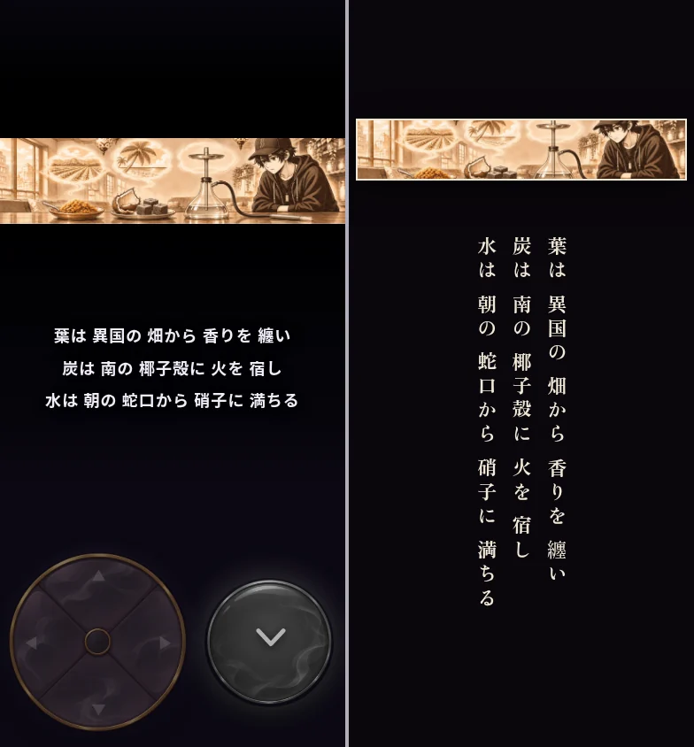

# 第1章の縦画面で、円形パッドを外せる場面

**最初に全面化したいのは、巻頭詩、朝・大会当日の日付、夜イベントの一行、大会の選手入場と ROUND の帯。** 390 × 844 CSS px では、これらの場面にも下端の **302 px** が割り当てられ、背景と演出の表示枠は **542 px** だった。本文送りや行き先選択が戻る瞬間に、従来の親指位置へ戻す。コンティニューは維持する。

ここでのパッドは左の輪形十字キーと右の丸ボタン（以下 A）の組。片方でも役割があれば「要る」。写真・文・ボタンを直接タップできるだけでは、パッドを外す理由にしない。以下の判定は **main `abf2a5731` の第1章・「縦画面／煙の舞台」** に限る。演出が重なるときは最前面で入力を受ける画面を優先する。

## 開幕から章末までの判定

| 場面 | 現行の縦画面と判定 | 入力の根拠 |
|---|---|---|
| 起動・タイトル・章ロード漫画 | 共通パッドなし | タイトルは `title.layout = full`、メニュー項目を直接押す。漫画の読み終わりはロード画面自身の入力。素材待ちの一行とは別。 |
| コールドオープン「1年前」、tonari のカット割り、初日の注文・接客、日常／大会前後の通常会話・地の文・CG・心の声 | 表示・**要る** | 左が休止中でも A が文字表示／ページ送り。絵や目元の帯が会話に重なったままの `#vn .vn-cutin-layer` も同じ。返答では上下で候補、A で分岐。AUTO・既読スキップ中だけ隠す案にも含めない。 |
| 序詩・巻頭ポエムの縦書き・次の連 | 表示・**要らない（確認版）** | 第1章では独立した詩が二つあるわけではなく、`playChapterPoem(1)` の全2ページ。実際の開幕から第1連の保持、第2連の行表示・保持・退場まで十字キーの有効方向はゼロ、A は無効。無操作で章タイトルへ移った。本編の手動送りを保つ方法は下記。 |
| 第1章タイトルコール・人物初対面のイラスト付き紹介（なる等） | **要らない・既に全面** | `.vt-ct` と `.vt-cv` が 844 px 全高を覆う。輪の座標をヒットテストすると章名／人物ポスターの幕に当たる。章題の本編は入力を吸収してタイマー終了。紹介は `holdIntro` が一定時間待ち、送りキーを吸収する。ロード前後の汎用覆いと区別。 |
| 作るチュートリアル・練習・大会制作 | 工程別 | 水入れ、詰め方、穴あけ、炭焼き、蒸らし時間は `craft.layout = full`。説明スポットライト、工程結果も工程独自の「次へ」、長押し、炭タップ等を使う。機材・配合、炭配置、雑念回避、吸い出し、調整など登録外の工程は回転案内。工程前の3・2・1は `cover` が出る場合もある。更新版はタップ／キーで省略、桜井版は毎回固定。版・工程・重なりで分かれるので**要る側に保留**。 |
| DAY1 のおつかい、DAY2 の配達・参加登録、以後の橙須の地図・施設・自宅・休養・目的地一覧 | 表示・**要る** | 左右で店を移動、上で全体図、下で一覧、A で決定／入店。一時的な休業・選択不能でも他の店に動ける。スロットが地図上で回る間も地図が操作先になり得る。 |
| tonari の行動、練習選び、買い物などの確認、前夜の選択 | 表示・**要る** | `menu` は上下と A で本編の選択ボタンを押す。一択でも A に用途あり。会話内の前夜の返答は上の会話と同じ。 |
| ショップ、全画面 MENU、設定、セーブ／ロード、用語・規則、会話 LOG、LIME 初回案内 | 表示・**要る** | `sheet` の上下で本文をスクロール。閉じる操作があれば A に割り当てる。短い文でも項目数、本文量、端末高が変わる。LIME **アプリ本体**は既に全面で、画面内の返信・戻る・閉じるを使う。連絡先の**交換演出**は次表。 |
| 心得の盤と説明・一覧 | 表示・**要る** | 説明は A で次へ、盤では方向移動／寄る／灯す等。結果表示中に一時休止しても同じ盤内で操作に戻る。 |
| くじ・店番・ミニゲーム・スロットの説明／夜の筐体 | 未対応画面は回転案内。切替時に短い `cover` あり | 各画面で直接操作する。くじの開封・筐体のランプ・ノート・初回説明は入力あり。ボーナスの `.reel-cutin.bonus` はタップでリールの待ちを短縮するため **要る側**。通知だけのレベルアップ・火種・トーストは元画面の上に載り、元の地図／会話のパッド判定を引き継ぐ。 |
| DAY1〜13 の日付・就寝／翌朝・体力回復・夜イベント導入、交流で挟まる演出 | 表示・**要らない場面は次表** | 日程や訪問先で繰り返す。同じ画面と入力処理を使う回は一行にまとめた。 |
| DAY14 大会朝・受付／控室、対戦相手の名乗り・会場の中継 | 日付・選手入場は**要らない**。受付・控室の通常会話は**要る** | 選手入場は「なる→アダム→みんと→はじめ」が自動。初対面の縦ポスターとは別。会場の LIVE 枠付き会話は調査版の縦 VN 判定外。通常会話と混同しない。 |
| ROUND 1〜4、幕間、投票・審査・結果 | ROUND 帯は**要らない**。手で早送りできる演出は**要る側** | `roundCut` は固定時間。対して幕間のアイキャッチと順位の大見出しは `holdOrTap`、千須の最後の一票は押すと短縮。中間順位は演出を飛ばす操作と「次へ」があり、単独確認では縦の外枠は閉じた。結果カウントと順位表は本編画面（回転案内）でタップ／次へ。結果一式を一括で隠さない。 |
| 敗北→コンティニュー→再挑戦またはタイトル | 敗北／復帰の幕は**要らない**。**コンティニュー本体は要る** | `.end-screen.gameover` は `sheet/end`。A は無効、左右も使わないが上下は有効。390 × 844 では本文 458 / 枠 458 px、390 × 664 では本文 358 / 枠 344 px。短い画面では十字キー下を1回押して本文のスクロール位置が 0 → 14 px になった。「台詞を送る」「最初から再挑戦」「諦める」は写したボタンで、再挑戦時の難易度選択も残す。[背の低い画面の現行表示](continue-short.webp) |
| 優勝後の会話・LIME受信・章クリア | 会話・クリアシートは**要る**。受信前の単独グリッチは**要らない** | 会話は A、LIME はアプリ内操作。クリアは成長グラフや記録を上下で読み、「第2章へ進む」等を選ぶ。コンティニューと同じ `end` 名で一律に消さない。 |
| 空のつなぎ・未知の覆い・未対応から戻る瞬間 | 一時表示・**要る側に保留** | `gap` でも A の中継が許可される場合がある。`hold` は短い間だけ操作を止める。次の本編要素が先に現れるため、空に見えたことだけで無入力と決めない。 |

進行の入口は [第1章台本](../../../remake/js/chapters/ch1.js)、場面の見分けは [detectState](../../../remake/js/looks/neo/portrait-shell/detect.js)、縦画面への振り分けは [vertical.js](../../../remake/js/looks/vertical.js)。ボタンの実際の行き先は [会話](../../../remake/js/looks/vertical/talk.js)、[地図](../../../remake/js/looks/vertical/map.js)、[行動選び](../../../remake/js/looks/vertical/menu.js)、[シート](../../../remake/js/looks/vertical/sheet.js)、[盤](../../../remake/js/looks/vertical/board.js)、[制作工程](../../../remake/js/looks/vertical/craft.js) で確認できる。

## パッドを外した見た目と、場面ごとの根拠

各リンクの**左が現行、右が提案**。同一サイズの Chromium タッチ画面で本編の場面を呼び、右だけブラウザ内で下段を除いて表示領域を広げた。煙とグリッチは同じ表示フレームを固定した。ほかは連続して撮ったため、文字・絵のフェードにはわずかな時間差がある。巻頭詩の右は本編のコマ絵と表示中の連を使った縦書きの配置案。ほかは現行の縦の写しを使っている。暗幕や画像主体の演出が汎用の写しで背景と待機点だけになる場合も、そのまま掲載した。パッドを消すだけで元の演出まで復元されるわけではない。

| 第1章での表示・比較画像 | 本編が次へ移る条件／入力が不要な根拠 | 実装時に識別する場所 |
|---|---|---|
| [巻頭詩（序詩を兼ねる）](poem.webp) | 行を出す→一定時間保持→次の連。通常開始から両ページとも有効方向ゼロ、A 無効を実測。本編カードは pointerdown／Enter／Space で行を出す・次へ進む処理を持つ。ここは残す。 | [chapter-poem.js](../../../remake/js/scenes/chapter-poem.js) の `.chapter-poem[data-poem="poem_ch1"]`、`.cp-page.now`、`.cp-panel`。現行は元が `vertical-rl`、写しが `horizontal-tb`。右案では元のルビ・右からの順とコマ比率を保つ。 |
| [章タイトル](title.webp)／[人物初紹介](intro.webp) | 章題はタップ吸収→タイマー。人物紹介は登場→保持→退場を自走。前面全高が現状のため、裏のパッドを除く見た目の差はほぼない。 | [playCh1Title](../../../remake/js/chapters/ch1-title-motion.js)、[holdIntro](../../../remake/js/vn/intro.js)。縦は `data-cover=title/cutin`。簡易版の `.cutin` も holdIntro で終了するが、汎用の文字抽出から除外される。人物紹介に先行する `.ci-transition` 単体は切替中として保留。 |
| [朝・発熱時・大会当日の日付](day.webp) | `.day-card` は表示、既定 1,900 ms 待機、退場だけ。A が明るくても日付の更新・短縮ハンドラはない。 | [ui.js の dayCard](../../../remake/js/core/ui.js)、[calendar.js](../../../remake/js/daily/calendar.js)。画像は DAY14。 |
| [就寝→翌朝のめくり](dawn.webp)／[睡眠による体力回復](sleep.webp) | 夜明けは `mid()` で日付を進め、数字と朝の光の終了を待つ。回復表示はゲージの幅更新後 1,250 ms 待って消える。天気・病欠差分も入力なし。 | [nightToMorning](../../../remake/js/core/transitions.js) の `.tr-dawn` と [presentSleepRecovery](../../../remake/js/daily/hud.js) の `.sleep-recovery`。 |
| [夜予定・約束前の一行](beat.webp)／[会話・地図・モジュールの素材待ち](notice.webp) | `.beat` は一行を 1,500 ms 見せる。`.vn-loading` は読込の完了／失敗で取り外す。どちらにも選択・手送りはない。 | [calendar.js の beat](../../../remake/js/daily/calendar.js)、[loadingNotice](../../../remake/js/core/ui.js)。漫画のタップ待ちやアクティブな小窓は除く。 |
| [背景の切替](curtain.webp)・[店のロゴ](store.webp)／[煙ワイプ](wipe.webp)・[暗転](black.webp) | 幕が閉じた時に背景を更新、素材とアニメ完了で開く。ロゴも最低表示時間で消え、店に入る決定は既に済んでいる。 | [createSceneCurtain](../../../remake/js/core/transitions.js)、[withStoreArrival](../../../remake/js/core/store-arrival.js)、[smokeWipe / fadeBlack](../../../remake/js/core/ui.js)。`#wipe` だけで別の最前面入力を上書きしない。 |
| [連絡先交換](lime.webp) | 「友だち追加」の記録から演出を最後まで再生して会話に戻る。「追加」は作画内の文言。実際の LIME の返信・選択は別。 | [lime.js の exchange](../../../remake/js/motions/lime.js)、`.mo-lime`。 |
| [みんとのチェキ現像](cheki.webp)／[つむぎのスケッチ](sketch.webp) | チェキは写真が仕上がる時点で CG を置く。スケッチは描画後のコールバックで完成画を渡す。各演出の途中に選択・撮影ボタンはない。前後の撮影同意・ポーズ選択・CG台詞は要る。 | [chekiShot / sketchIn](../../../remake/js/core/scene-motions.js)、[完成画の引き継ぎ](../../../remake/js/chapters/tsumugi-story.js)。`.mo-cheki / .mo-sketch` の間だけ。 |
| [占いの札](tarot.webp)／[交流の贈り物](gift.webp) | 選ばれた人物の札を返し終える、または決まった贈り物を開け終えると呼び出し元へ戻る。占う前の選択、報酬後の会話とは別。 | [tarot.js](../../../remake/js/motions/tarot.js) の `.mo-tarot`、[gift.js](../../../remake/js/motions/gift.js) の `.mo-gift`。 |
| [バイト終了の看板](shift.webp)／[サメちゃん初遭遇の水幕](shark.webp) | 看板は OPEN→CLOSED の再生完了待ち。水幕は背景切替を挟んで自走する。接客本体・遭遇後の会話は操作あり。 | [shiftClose / sharkSwim](../../../remake/js/core/scene-motions.js)、[第1章 DAY8 以降の遭遇条件](../../../remake/js/daily/samechan.js)。 |
| [スロットのロングフリーズ単体](freeze.webp) | フリーズの文字→7揃い→報酬の順にタイマーで進む。待ちをタップ短縮できる BIG／REG と別の関数。夜の筐体やノートと重なる場合は適用しない。 | [reel.js の presentFreeze](../../../remake/js/daily/reel.js)、`.reel-cutin.freeze`。 |
| [大会受付で鉢合わせた恋人の視線](gaze.webp) | 2人以上の目元を順に表示し、保持時間・退場アニメで終了。前後の受付・鉢合わせの台詞だけが送れる。 | [gaze.js](../../../remake/js/motions/gaze.js) の `.mo-gaze`、[maybeShuraba](../../../remake/js/daily/romance.js)。 |
| [大会入場の RIVAL／CHALLENGER](entrance.webp) | 選手のカードを順に入れ替え、通常は各 2,100 ms 保持。4人とも方向選択・名乗り送りなし。 | [playEntrance(1)](../../../remake/js/chapters/tournament-entrance.js) の `.entrance`。 |
| [大会 ROUND 帯](round.webp)／[大会の見出し帯単体](sting.webp) | ROUND は 1,300 ms 後に退出。短い帯 `.ts-sting` はタイマーで表示・撤去。中間票・次へボタンと重なっている場合は、その入力が優先。 | [roundCut](../../../remake/js/core/ui.js)、[showSting](../../../remake/js/craft/tournament-show.js)。`.ts-eyecatch` や `.ts-splash` と区別する。 |
| [敗北の幕](defeat.webp)／[再挑戦後の復帰の幕](retry.webp) | 敗北は照明が落ちてからコンティニューを出す。再挑戦は選択後に大会を再開し、色が戻って幕を外す。どちらも幕そのものは入力を読まない。 | [defeatFade / retryStroke](../../../remake/js/core/transitions.js) の `.tr-defeat / .tr-retry`。裏の「再挑戦」「諦める」にタップを通さない。 |
| [優勝後の LIME グリッチ](scan.webp) | `scanGlitch` が文字を切り替え、アニメ完了で必読メッセージへ渡す。メッセージ自体の「読む」は残す。 | [moments.js](../../../remake/js/motions/moments.js) の `.mo-scan`、[勝利後の受信処理](../../../remake/js/chapters/ch1.js)。 |

## 実装の入口

1. [cover.js の sync](../../../remake/js/looks/vertical/cover.js#L176) で、最前面の本編要素から上表の演出を明示的に識別する。現状は十字キーが常に空で、A の有効性は中央のヒット層から推測した `pressable` に依存する。たとえば日付の A は点灯しても本編に送り処理がない。逆にタップ短縮を受ける順位の大見出しも同じ `cover` を通る。`dirs.length === 0` や `cover` 全体を条件にしない。
2. [vertical.js の setScene](../../../remake/js/looks/vertical.js#L97) は場面名の変更時だけレイアウトを設定する。詩→章題、幕→投票など `cover → cover` の切替は `sync` ごとに見直す。未知・複数の入力先・未対応への短い待機は通常の判定に戻す。ボタンを隠した間はフォーカスにもタップ中継にも残さない。
3. [look-vertical.css](../../../remake/css/look-vertical.css#L144) の `.vt-body` の下段予約と `.vt-over` の下端を同時に外し、`.vt-pic` を外枠いっぱいに伸ばす。既存の `data-layout="full"` は背景の `.vt-pic` も隠すため、専用の絵を持たない日付・入場では背景を残す。背の低い画面のコンテナ規則、下端の安全領域にも合わせる。自動演出では汎用の「タッチで次へ」も消す。
4. 詩の手動送りだけは、全面の読書領域から**表示中の詩カード自身**へ1回の入力を届ける。本編は `pointerdown` で行表示／ページ送り、キーは Enter・Space、Control は全体スキップ。現行の縦画面では詩カードの `pointer-events` が `none` で、中央ヒットが `#screen` に抜けた。中央の要素への汎用中継に依存せず、既存の誤タップ猶予、ルビ、2ページ目の退場まで保つ。[本編の送り](../../../remake/js/scenes/chapter-poem.js)、[縦の入力中継](../../../remake/js/looks/vertical/frame.js#L201)
5. 確認は「会話 A → 詩の自動／手動送り → 章題 → 会話 A」「地図 → 夜・翌朝 → 地図」「ROUND → 中間票の次へ」「敗北の幕 → コンティニューの上下 → 再挑戦」を 390 × 844 と 390 × 664 で行う。連打の指を次の選択へ通さず、地図・会話へ戻った輪と A が元の座標に戻ることを確かめる。[既存の縦画面テスト](../../../remake/test/browser/look_vertical.mjs)

## 確認条件

- 2026年11月28日、対象リポジトリの [main の固定版](https://github.com/haseatsu114514-dot/shisha-game/tree/abf2a573107e220a9b97886c09220276b9946b1e) をローカル配信し、隔離した Chromium で確認した。縦は `/remake/?look=vertical`、タッチ有効、画像は CSS 1 px を1画素で記録。端末実機・Safari と、任意イベントの全組合せは未検証。
- 章の順路は既存の [通しシナリオ](../../../remake/test/playthrough.mjs) で、新規→レッスン→DAY1〜13→DAY14 の大会3位→コンティニュー→再挑戦1位（98.6点）→第1章クリアに到達。基準の横画面 1280 × 720、会話高速化・制作自動。到達後のスロット回数検査は 17 回（期待は20回以上）で失敗したため、テスト全体は不合格。
- 縦の順路確認では、本編ボタンへ入力しながら外枠の場面名・覆いを記録した。縦に固定した走行は DAY7 のなる戦「調整」で回転案内になり、そこで停止。回転案内で横向きにする走行では縦へ戻したときに `vertical.js:61` で `undefined.catch` の例外も記録した。これらは画面単体での実測と区別する。
- 大会の幕間・最後の一票・優勝の大見出しを縦で個別に出すと `cover`（方向ゼロ・A 有効）、中間順位と結果カウントは外枠なし、クリアは `sheet/end`（上下有効）だった。[大会の本編入力](../../../remake/js/craft/result.js)
- 写真は同じ生成処理・同じ入力先の場面ごとに1例。任意イベント・短い幕は第1章の本編関数を個別に起動し、日付・人物・背景を固定して撮った。夜の一行は検証ブラウザ内だけで本編の非公開関数を呼び出した。交流や会場で同じ `#fx` でも、直前が未対応画面で外枠が復帰できない場合は回転案内のまま。単独再生で写せることを、全ての到達経路でパッドが出ることとはみなしていない。
- 再確認例は `NEW GAME → コールドオープンの台詞を送る → poem_ch1`。大会は既存の [大会演出の確認入口](../../../remake/js/craft/tournament-show-dev.js)、コンティニューは `devGameOver("rank", 3)`。390 × 664 ではコンティニューの短い台詞中に十字キー下を押し、`.rs-body.scrollTop` を比較する。
- [look_vertical.mjs](../../../remake/test/browser/look_vertical.mjs) の会話2行送り、tonari の選択・LIME／MENU、未対応画面の回転案内の3ケースは成功。
- 並行作業の [演出の縦画面化 #4356](https://github.com/haseatsu114514-dot/shisha-game/pull/4356)、[コンティニュー #4366](https://github.com/haseatsu114514-dot/shisha-game/pull/4366)、[大会 #4369](https://github.com/haseatsu114514-dot/shisha-game/pull/4369)、[作業台 #4371](https://github.com/haseatsu114514-dot/shisha-game/pull/4371)、[章頭詩 #4372](https://github.com/haseatsu114514-dot/shisha-game/pull/4372) はこの版に含まれない。取り込み後は特に詩の手動送りとコンティニューのスクロールを再判定する。
