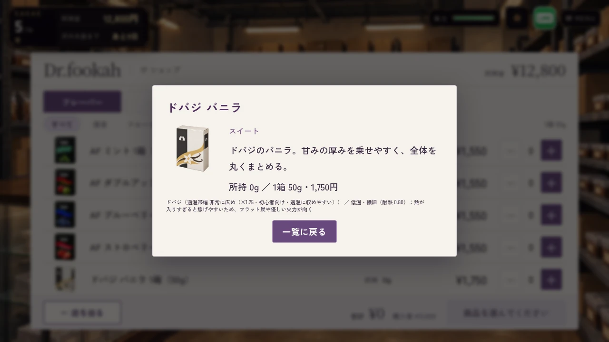
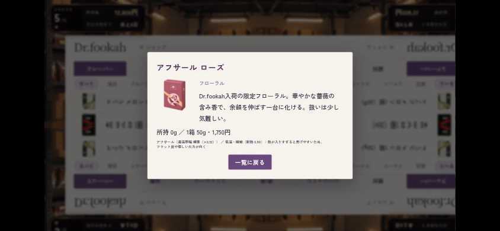
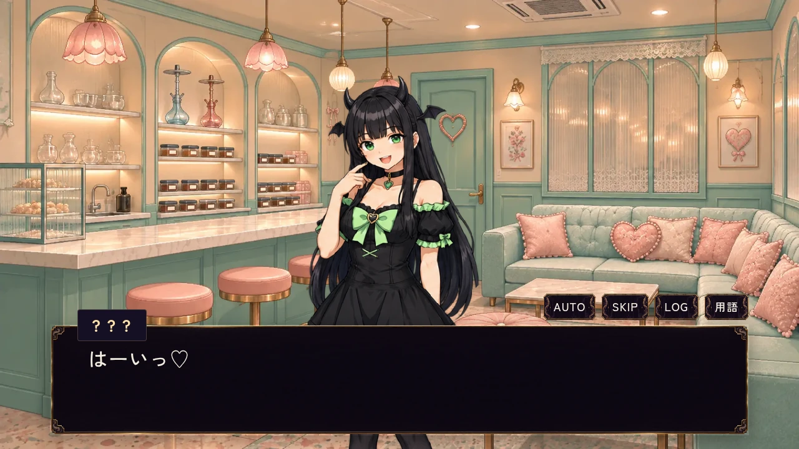
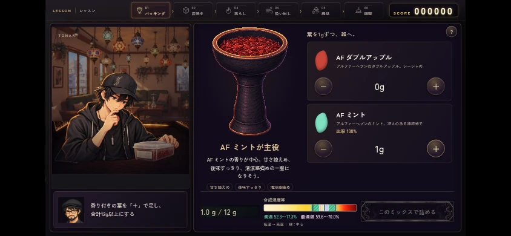

# 第1章の実プレイ修正・#647

## 確認した挙動

- 500円／1,000円の新品箱は50枚・S1枚。両方をPCクリック／横持ちタップで実際に50枚ずつ引き切り、50回分の支払い、実在庫の総g、台とラストワンの一度の付与、3日後の補充を比較。両方の店頭案内はシークレットで、中身の名称なし。
- 旧20／12枚箱の確定順と景品を実SAVE→LOADで保持し、最後の1枚を引いたあと補充で50枚へ切り替わる。
- ミックスは最新main（#637）で既に常時表示・同期更新。修正前の既存temperatureテストもPASS。同じ入力イベント内にミント追加→他葉追加→ミント除去→全除去を読み取り、帯・中心・文字が即時更新、未選択復帰、遷移時間0をPC／タッチで確認。
- 家シーシャは実際の選択画面でミント12gを決めて美味しい感想へ。葉50→38g・体力80→74・行動枠0、実SAVEも一致。unitでは全64品×4モードを評価し、単体の種類数減点と「他の香りを隠す」減点がなく、課題制約が維持されることを確認。
- みんとの配達は実daily loop・案内マップから、屋外到着の次に店内へ。PC／タッチ×通常／AUTO／SKIPの6ケースで全引き渡し台詞の背景と、2,000円・体力10・1枠、能力／好感度／固有会話不変、保存済み完了印を比較。通常2ケースは立ち絵遷移後の画面も撮り直した。
- 全18品が別々の箱画像でHTTP200/decode。PC／844×390 touch emulation／800×600で一覧・全詳細・112px枠・旧セーブ閲覧不変・実購入を確認。既存の機材売却・くじのショップケースもPASS。HMDの未採用候補は導入していない。

`results.json` は実行別の集約。feedback初回の家2件はテストのセレクタが `#vn.show` で失敗し、本番DOMの `#vn.active` に直して2件を再実行PASS。ほか8件のPASSを省略せず集約したもので、同一フル実行の全件greenとは表記しない。delivery6／shop4／修正前temperature1もPASS。

## 実行

```sh
node remake/test/kuji_balance.mjs
node remake/test/home_shisha.mjs
node remake/test/mix_recognition.mjs
node remake/test/golden_ratio.mjs
node --experimental-vm-modules remake/test/mix_temperature.mjs
node --experimental-vm-modules remake/test/daily_consistency.mjs
python3 tools/lint_dialogue.py remake_ch1
python3 tools/check_agent_docs.py
python3 tools/check_legacy_terms.py
python3 tools/check_mashiro_address.py
python3 tools/check_confession_flags.py
python3 tools/check_char_consistency.py
python3 -m unittest discover -s tools -p test_build_shop_art.py
python3 tools/build_shop_remaining_art.py --check
```

ブラウザは `CHROME_EXECUTABLE_PATH=/usr/bin/chromium` と `ARTIFACT_DIR=work/...` を指定して `ch1_feedback.mjs`／`minto_delivery.mjs` を実行。shop_uiは `TEST_CASES=pc-product-art-legacy-save,touch-product-art-legacy-save,compact-product-art-legacy-save,equipment-sell-kuji`。homeの修正後2件はCASE_FILTERで個別に再実行。

物理スマートフォン・全章通しプレイ・公開URL反映は未実施。既存legacy-term WARN（owner_requestsの既存シトラスミント文脈）1件は今回の差分外。

## 画面






